# Bell candidates among the 663 BB(6) holdouts

The 56 machines that the Bell scan (`bellscan.c`, 10⁷ steps per machine) marked as Bell-like (`bell_candidates.txt`), each with a space-time diagram from the blank tape.

- **Class** (from the scan): **A** = regular geometric growth like TM1/TM2 (sd < 0.12, one phase per level); **B** = Bell-like with another factor or several phases per level; **C** = irregular.
- **Level analysis**: a second detector (single-block Bell configurations, up to 3·10⁸ steps) looks at the tape at the start of each level: the long block, its growth ratio, and how many *different* short tails occur. Many different tails at a regular ratio is the signature of a vampire-like machine (a finite Bell table can then be derived); one or two tails means a "needle" (all information is in one number; halting needs an exact value).
- **Holdout status (24 Oct 2026)**: compared with the current list of 623 BB(6) holdouts (`holdouts_623.txt`). 40 machines of the old list of 663 have been decided since (`decided_663_to_623.txt`); **none of them is among the 56 candidates**. All 56 candidates, including TM1, TM2 and the halting machine `1RB0RB_1LC1RF_0RD0LB_0RA1LE_1LD---_0RB0RC`, are still in the holdout list.
- **BusyBeaverWiki (26 Oct 2026)**: **14 of the 56 candidates have their own article on the [BusyBeaverWiki](https://wiki.bbchallenge.org/wiki/Category:Individual_machines)** (marked **wiki** in the table and linked in the section): nos. 10, 13, 14, 15, 24, 28, 33, 34, 40, 41, 49, 50, 55, 56. Three of them are cryptids: no. 15, no. 33 ("Space Needle") and no. 40 ("Lucy's Moonlight"). No. 24 is listed as chaotic but not a cryptid. Checked against the 119 pages of the wiki category *Individual machines* and the [Cryptids](https://wiki.bbchallenge.org/wiki/Cryptids) page; machines with an article outside that category, or under an equivalent form of the code, would be missed.
- **Diagram**: time runs downward, one pixel column per tape cell (scaled up for narrow tapes), symbol 1 orange, 0 white; at most 700 sampled rows. Each diagram runs up to the start of the 8th Bell found by the detector (so the first 7 Bells are complete) or until the tape is 1000 cells wide, whichever comes first.

## The vampire method: when does it apply?

A machine is a candidate for the vampire method if its Bell map can be written as a **closed finite table**. This section collects what that means, what it proves and what it does not prove, as a basis for finding further vampire candidates in BB(6), BB(7) and other classes.

### 1. Deriving the table
Example: the BB(6) holdout `1RB0RB_1LC1RF_0RD0LB_0RA1LE_1LD---_0RB0RC`, which [halts](https://github.com/thomasreus-bb/halt-found-1rb0rb_1lc1rf_0rd0lb_0ra1le_1ld---_0rb0rc).

At the start of every Bell the tape is `0 11 0 1 0 1^n W (0 1 0 11)^m`: a long block 1^n, a short word W and a counter m. `derive_table.py` finds the table by breadth-first search over the words W:

- It starts with the empty word.
- For each word, each class of m (0, 1, 2, ≥ 3) and each residue n mod 3 (12 combinations per word), it builds the tape and runs the **real Turing machine** for one Bell.
- From that run it reads off either HALT or the next word W', the change Δm and the constant c in n' = (4n + c)/3.
- New words go into the queue.

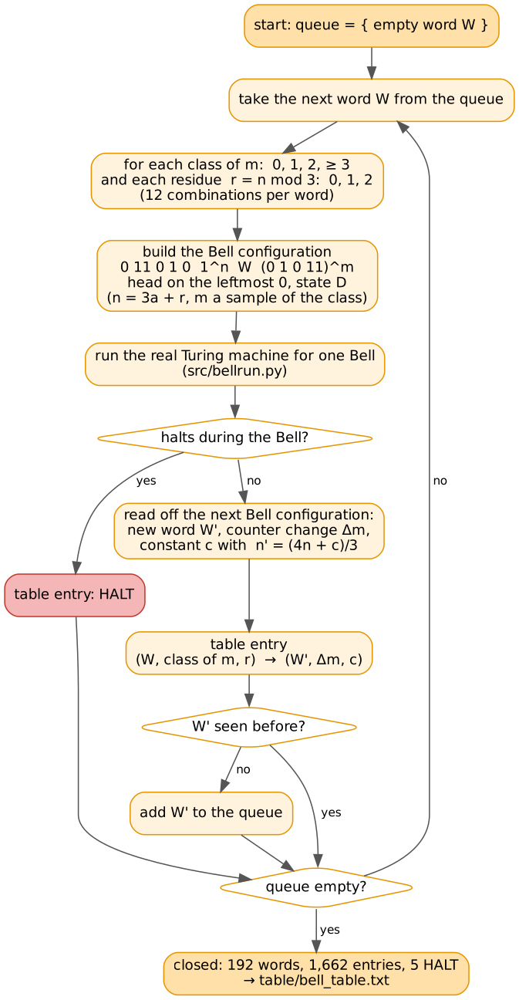

The search **closes**: 192 words, 1,662 table entries, 5 of them HALT. Every entry leads either to one of the 192 words or to HALT; no arrow leads out of the table. The 1,662 entries are exactly the reachable combinations of word and class of m, each with 3 residues.

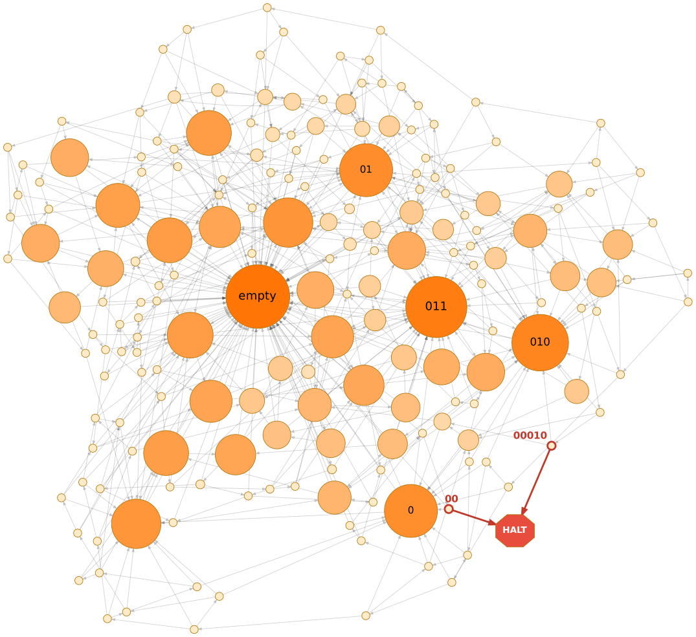

<em>Word graph of the halting machine: 192 words, an arrow W → W' for every table entry. Size and colour show how often a word occurs in the Markov chain (m ≥ 3, log scale). Only the rare words <code>00</code> and <code>00010</code> lead to HALT, when n ≡ 2 (mod 3). Together they occur with probability about 5·10⁻⁹, and only every third of those Bells halts, which gives the halting rate of about 1.6·10⁻⁹ per Bell.</em>

### 2. What a closed table proves, and what it does not
- **Proved:** the Bell map is a **finite automaton** with the states (W, min(m,3)), driven by one number n. In each Bell it reads the lowest base-3 digit of n and sets n' = (4n + c)/3. Whether the machine halts depends only on the sequence of residues n mod 3 along the orbit.
- **Markov estimate:** if the residues were random and independent (probability 1/3 each), HALT would be reached with probability 1. HALT is reachable from every state and absorbing, so **almost all** starting values halt, in the sense of 3-adic numbers.
- **Not proved:** the orbit starts from one specific n (n = 4 at Bell 1), and its sequence of residues is completely determined by n' = (4n + c)/3. "Almost all starting values halt" says nothing about this one; it could belong to the exceptional null set and avoid the halting patterns forever. Showing that the digits of (4/3)^b·n behave "randomly enough" is a Collatz-type problem that nobody can solve today.
- **So the simulation is the proof:** the exact iteration found the HALT at Bell 298,793,335, and Dennis confirmed it independently. The Markov estimate only said that searching was worthwhile.
- **The vampire family is the same:** its table is closed as well (2,880 words), and its orbits halt "with probability 1" in the Markov sense. Still, no orbit has halted up to 10¹¹–2·10¹¹ Bells, which fits a rate of about 9·10⁻¹³ per Bell. Whether a given orbit ever halts can only be decided by finding the HALT.
- **What closure is worth anyway:** the simulation needs only the table, not the Turing machine, which is what makes the fast programs (`belldc`, `belldcf`, `belldco`) possible. A formal proof, e.g. in Rocq, also becomes manageable: the finitely many table entries become lemmas, and the rest is the concrete iteration up to the HALT.

### 3. Closed or not: the criterion for candidates
A common first picture is that a few rare transitions lead *out of* the graph, and that the simulation shows HALT is reached before such an exit. That is not the case for the machines above: there are no exits. The state stays in the finite word set forever, and the only question is whether the concrete residue sequence hits a halting word with the right residue.

Exits do exist for another type of machine, where the short word keeps growing and new words keep appearing. There the table never closes, and the method in its present form does not apply.

| table | meaning | examples |
|---|---|---|
| **closed** | finite automaton driven by the digits of n; Markov estimate meaningful; simulation decides | BB(6) halting machine (192 words), vampire family (2,880 words), [BB(7) halting machine](https://github.com/thomasreus-bb/bb7-vampirs) (word plus counter m) |
| **not closed** | the tail carries information itself: a second number on the tape | BB(7) class G ([BB7-vampirs](https://github.com/thomasreus-bb/bb7-vampirs)), Hydra-like BB(2,5) machines, probably many of the BB(2,6) Bell machines in the scan ([BB2-6-vampirs](https://github.com/thomasreus-bb/bb2-6-vampirs)) |

### 4. Recipe for new candidates
1. **Bell structure.** Find a configuration with one long block that grows geometrically from Bell to Bell, plus short words. For finding these: the scans here (`bellscan.c`, the level analysis below), `b3.c` / `auto.py` in BB7-vampirs, and `b3g.c` / `scan.py` (any number of symbols) in BB2-6-vampirs.
2. **Several different short words at a regular growth factor** suggest a vampire. One or two words suggest a needle: all information is in n, and halting needs an exact value.
3. **Derive the table from the real TM** by breadth-first search over the words: `derive_table.py` (halting machine), or the generic `tools/bellstep.c` + `tools/derive2.py` in BB7-vampirs, which also handles counters in the tail. Check that it **closes**.
4. **Markov estimate** of the halting rate. If the expected number of Bells is within reach (up to about 10¹²), simulate.
5. **Exact iteration** with divide and conquer (`belldc3` in base 3, `belldc` / `belldcf` / `belldco` in base 2) until HALT, then check the last Bells on the real machine.
6. **Not closed?** Then the method needs an extension: a Bell state (n, b) with a second number b for the growing tail. That is the natural next step, and it would cover BB(7) class G and the Hydra-like machines.

### 5. Two-number candidates in BB(6): results of 24 Oct 2026
The candidates with several tails but a varying growth factor (nos. 10, 11, 16, 17, 31, 32, 35, 38) were examined with a new tool:

- **`scan/m19/accsim.c`, an accelerated simulator.** It uses blocks of K cells and a run-length encoded tape.
  - *Chain steps.* A sweep across a uniform block costs one operation.
  - *Jumps over repetitions.* If the run structure repeats with constant changes of the counts, many repetitions are applied at once. The step count is exact, because the steps per repetition grow linearly.
  - *Checks.* It gives the exact step counts of known halters: the BB(5) champion with 47,176,870 steps, and several BB(2,6) halters. With and without jumps it reaches the same state.
  - *Start options.* It can start from any Bell configuration and stop at a given tape length. This allows **halting-rate tests**: many real or slightly varied Bell starts, each run over many Bells, counting the halts.

| no. | type | depth reached without HALT | halting rate per Bell |
|---|---|---|---|
| 10 | two-register ping-pong, exact Bell map (25 Oct) | 10¹⁰ Bells, about 2·10³⁰ steps | HALT only on an exact hit (chance about 1/(9k) at Bell k); known on the BusyBeaverWiki as "probviously halting" (Shawn Ligocki, 2·10¹² steps); the 2 % estimate of 24 Oct is withdrawn |
| 11 | multi-register | 10²² steps | at most about 0.1 % |
| 16 | two-register (like 10) | 4.5·10¹³ steps | not measurable yet |
| 17 | two-register | 10¹⁴ steps | – |
| 31, 32 | vampire-like, base 3 (4/3), nested sub-process; Bell types A/B/C, prefix table mod 6, HALT entries blocked mod 3 (26 Oct) | 10³⁵·⁵ steps (202 Bells) | below 2·10⁻⁶ |
| 35 | register system | 5·10¹⁶ steps | – |
| 38 | growing list of blocks | 4·10³³ steps | – |

**New findings for the method:**
1. Besides the vampires there are **two-number machines**. For no. 10 the Bell map on two numbers has been found exactly (25 Oct, see [10](#10)): three Bell types A, B, C, and HALT only when a C Bell leaves exactly 0 or −1 cells. Iterated over 10¹⁰ Bells there is no HALT. (The halting rate of about 2 % estimated on 24 Oct from varied starts was wrong for the real orbit.)
2. Nos. 31/32 are vampires in base 3 whose table only closes with several blocks. This is the natural next step for the table method.
3. Perturbed real Bell starts together with an accelerated simulator give a quick estimate of the halting rate, even without a table.

## The 56 candidates

| # | class | machine | factor | verdict |
|---|---|---|---|---|
| [1](#1) | A | `1RB0RF_1LC---_1RD0LC_0RE0RD_1LF1LC_1LE1RA` | 1.55 | vampire family (orbits O1–O4 of this repository) |
| [2](#2) | A | `1RB---_1LC0RB_0LD0LC_1RE1RB_1RD1LF_1LA0LE` | 1.56 | vampire family (orbits O1–O4 of this repository) |
| [3](#3) | A | `1RB0LA_0RC0RB_1LD1LA_1LC1RE_1RF0RD_1LC---` | 1.57 | vampire family (orbits O1–O4 of this repository) |
| [4](#4) | A | `1RB0RE_1RC---_0RD0RC_1LE1LF_1LD1RA_1RC0LF` | 1.57 | vampire family (orbits O1–O4 of this repository) |
| [5](#5) | A | `1RB0LA_0RC0RB_1LD1LA_1LC1RE_1RF0RD_1LA---` | 1.56 | vampire family (orbits O1–O4 of this repository) |
| [6](#6) | A | `1RB---_0RC0RB_1LD1LE_1LC1RF_1RB0LE_1RA0RD` | 1.58 | vampire family (orbits O1–O4 of this repository) |
| [7](#7) | A | `1RB0RF_1LC---_1LF1LD_1RE0LD_0RC0RE_1LC1RA` | 1.58 | vampire family (orbits O1–O4 of this repository) |
| [8](#8) | B | `1RB0RB_1LC1RF_0RD0LB_0RA1LE_1LD---_0RB0RC` | 1.33 | **halts** (vampire method, [halt-found repository](https://github.com/thomasreus-bb/halt-found-1rb0rb_1lc1rf_0rd0lb_0ra1le_1ld---_0rb0rc)) |
| [9](#9) | B | `1RB0RB_1LB0LC_1RD1LC_1RE0RA_0RF1RA_---1LB` | 1.33 | needle-like: only 2 tails (all information in one number) |
| [10](#10) | B | `1RB---_0RC0RD_1LD1RB_0LE0LC_1RA0LF_1LD1LE` [**wiki**](https://wiki.bbchallenge.org/wiki/1RB---_0RC0RD_1LD1RB_0LE0LC_1RA0LF_1LD1LE) | 1.24 | two-register system, exact Bell map with types A/B/C; no HALT in 10¹⁰ Bells (about 2·10³⁰ steps); HALT needs an exact hit (see [10](#10)) |
| [11](#11) | B | `1RB1LB_1RC---_1LD1LF_1LE0LD_0LA1RF_1LC0RE` | 1.21 | multi-register system; no HALT up to 10²² steps; low halting rate |
| [12](#12) | B | `1RB1RA_1LC1LB_1RE0LD_1RA0LB_---0RF_1RC0RA` | 1.27 | no clear single-block Bell configuration found |
| [13](#13) | B | `1RB0RF_1RC1RF_1LD0LE_---1LC_1RA1LE_1LC1RB` [**wiki**](https://wiki.bbchallenge.org/wiki/1RB0RF_1RC1RF_1LD0LE_---1LC_1RA1LE_1LC1RB) | 1.33 | needle-like: only 2 tails (all information in one number) |
| [14](#14) | B | `1RB0LF_1LC1RA_0RE0RD_---1LE_1LF1RC_1LC1LA` [**wiki**](https://wiki.bbchallenge.org/wiki/1RB0LF_1LC1RA_0RE0RD_---1LE_1LF1RC_1LC1LA) | 1.21 | needle-like: only 1 tail (all information in one number) |
| [15](#15) | B | `1RB0RB_1LC1RE_1LF0LD_1RA1LD_1RC1RB_---1LC` [**wiki**](https://wiki.bbchallenge.org/wiki/1RB0RB_1LC1RE_1LF0LD_1RA1LD_1RC1RB_---1LC) | 1.36 | needle-like: only 2 tails (all information in one number) |
| [16](#16) | B | `1RB1LF_1RC1RF_0LD1RE_---1LC_0RB1RE_1LA0LE` | 1.26 | two-register system like 10; no HALT up to 4.5·10¹³ steps |
| [17](#17) | B | `1RB0RC_1RC---_1LD1RE_1LE0LD_1RA0LF_0RC0RB` | 1.29 | two-register system; no HALT up to 10¹⁴ steps |
| [18](#18) | B | `1RB---_1LC0LD_0RF0LD_0LE0RA_0LC1RA_1RC1RD` | 1.36 | no clear single-block Bell configuration found |
| [19](#19) | B | `1RB0LC_1LA1RE_1LD1RE_1RE0LA_0RA1RF_0RB---` | 1.32 | **two-number system** (examined in detail, see [19](#19)): no HALT found |
| [20](#20) | B | `1RB1LC_1LA0RD_0LB1LF_1RE1LC_1LC0RB_0LA---` | 1.40 | needle-like: only 2 tails (all information in one number) |
| [21](#21) | B | `1RB0LE_1RC1RE_0RD1RC_1LA0LB_1LF0RB_---1LD` | 1.40 | needle-like: only 1 tail (all information in one number) |
| [22](#22) | B | `1RB0RB_1LC0LF_1RD0LB_1RE1RC_0RA---_1LA1RE` | 1.40 | needle-like: only 2 tails (all information in one number) |
| [23](#23) | B | `1RB0LD_0RC1RD_1LA1RA_1LE0LE_1RF0LA_0RA---` | 1.39 | no clear single-block Bell configuration found |
| [24](#24) | B | `1RB0LD_1LC0RA_1RA1LB_1LA1LE_1RF0LC_---0RE` [**wiki**](https://wiki.bbchallenge.org/wiki/1RB0LD_1LC0RA_1RA1LB_1LA1LE_1RF0LC_---0RE) | 1.25 | needle-like: only 1 tail (all information in one number) |
| [25](#25) | B | `1RB0LE_1LC0RD_0RA1LD_0LC1RA_1LF1LA_---1LA` | 1.55 | needle-like: only 2 tails (all information in one number) |
| [26](#26) | B | `1RB1LC_1LA0RD_1LB1LF_1LE1RE_0LA0RB_0LB---` | 1.37 | needle-like: only 2 tails (all information in one number) |
| [27](#27) | B | `1RB1LC_1LC0RD_0LE1LA_0RF1RA_1LA0LA_---0RB` | 1.64 | needle-like: only 1 tail (all information in one number) |
| [28](#28) | B | `1RB1LE_1LC0RA_0RF0LD_1LE1LA_1RC0LB_---1RC` [**wiki**](https://wiki.bbchallenge.org/wiki/1RB1LE_1LC0RA_0RF0LD_1LE1LA_1RC0LB_---1RC) | 1.24 | no clear single-block Bell configuration found |
| [29](#29) | B | `1RB1LD_1LC0RC_0RF1RA_0LE1LA_1RC0LA_---0RB` | 1.49 | needle-like: only 2 tails (all information in one number) |
| [30](#30) | B | `1RB0LE_1LB1RC_0RF0RD_1RE0LA_1LA1RE_---0RB` | 1.54 | needle-like: only 1 tail (all information in one number) |
| [31](#31) | B | `1RB1RF_1RC0LD_1LB1RA_1RE1LE_0RC0LB_0RB---` | 1.34 | **vampire-like, base 3 (factor 4/3)** with a nested sub-process; Bell types A/B/C; prefix table mod 6 without reachable HALT, not closed (nested levels); no HALT in 202 Bells (10³⁵·⁵ steps) |
| [32](#32) | B | `1RB1LB_0RC0LD_1LD1RE_1RC0LA_1RD1RF_0RD---` | 1.33 | same dynamics as 31 |
| [33](#33) | B | `1RB1LA_1LC0RE_1LF1LD_0RB0LA_1RC1RE_---0LD` [**wiki**](https://wiki.bbchallenge.org/wiki/Space_Needle) | 1.69 | needle-like: only 1 tail (all information in one number) |
| [34](#34) | B | `1RB1RC_1LC1LC_1RE0LD_1LB1RF_---1RA_0RD1RD` [**wiki**](https://wiki.bbchallenge.org/wiki/1RB1RC_1LC1LC_1RE0LD_1LB1RF_---1RA_0RD1RD) | 1.34 | no clear single-block Bell configuration found |
| [35](#35) | B | `1RB---_0RC0LD_1LB1RC_0LE0LF_1RD1LE_1RF1RA` | 1.25 | register system; no HALT up to 5·10¹⁶ steps |
| [36](#36) | B | `1RB1LC_1LC0RD_0LE1LA_---1RA_1RF0LA_0RF0RB` | 1.56 | needle-like: only 1 tail (all information in one number) |
| [37](#37) | B | `1RB1RF_1RC0RB_0RD1LF_1LE1RE_1LA---_1RA0LC` | 1.26 | no clear single-block Bell configuration found |
| [38](#38) | C | `1RB0RE_1LC0RA_0LD0LB_1RE0LB_1RF---_0RB0RC` | 1.55 | growing list of blocks (nested); no HALT up to 4·10³³ steps |
| [39](#39) | C | `1RB1LC_1LC0RF_0LF1LD_0LE---_1RF1LC_1LE0RA` | 1.36 | needle-like: only 2 tails (all information in one number) |
| [40](#40) | C | `1RB0RD_0RC1RE_1RD0LA_1LE1LC_1RF0LD_---0RA` [**wiki**](https://wiki.bbchallenge.org/wiki/Lucy%27s_Moonlight) | 1.48 | no clear single-block Bell configuration found |
| [41](#41) | C | `1RB1LD_1RC0RA_1LA1RE_0LA0LB_0RB1RF_---1RD` [**wiki**](https://wiki.bbchallenge.org/wiki/1RB1LD_1RC0RA_1LA1RE_0LA0LB_0RB1RF_---1RD) | 1.40 | needle-like: only 1 tail (all information in one number) |
| [42](#42) | C | `1RB0RF_1LC0RA_1LD1LB_0LE---_1LA0LA_1RE1LD` | 1.42 | needle-like: only 1 tail (all information in one number) |
| [43](#43) | C | `1RB1RE_0RC---_1RD0RD_1LE0LF_1RA0LD_1LC1RB` | 1.41 | needle-like: only 2 tails (all information in one number) |
| [44](#44) | C | `1RB0RE_1LC0RA_0LD1LB_1LA1LE_0LB0LF_1LD---` | 1.90 | needle-like: only 1 tail (all information in one number) |
| [45](#45) | C | `1RB0LD_1LC0RD_1LA0LC_1RE0LB_1RB1RF_0LD---` | 1.53 | no clear single-block Bell configuration found |
| [46](#46) | C | `1RB---_1RC1LE_0RD0RF_0RE0LA_1LF0LB_1LA1LD` | 1.74 | needle-like: only 2 tails (all information in one number) |
| [47](#47) | C | `1RB0LF_1LC0LD_1RD1LB_---1RE_0RA1RE_1LA0LE` | 1.47 | needle-like: only 1 tail (all information in one number) |
| [48](#48) | C | `1RB1RD_1LC0LE_1LD0LB_0RB0RA_1RD1LF_0LC---` | 1.52 | no clear single-block Bell configuration found |
| [49](#49) | C | `1RB1LA_1RC0RF_1RD---_0LE1RB_---0LA_1LD1RF` [**wiki**](https://wiki.bbchallenge.org/wiki/1RB1LA_1RC0RF_1RD---_0LE1RB_---0LA_1LD1RF) | 1.44 | no clear single-block Bell configuration found |
| [50](#50) | C | `1RB1RB_1LC0RE_---1LD_0RA1LB_1RA1LF_0LE1LE` [**wiki**](https://wiki.bbchallenge.org/wiki/1RB1RB_1LC0RE_---1LD_0RA1LB_1RA1LF_0LE1LE) | 1.50 | no clear single-block Bell configuration found |
| [51](#51) | C | `1RB0RE_1LC0RA_1LA1LD_1LC1LF_0LC0LB_1LE---` | 1.60 | needle-like: only 1 tail (all information in one number) |
| [52](#52) | C | `1RB0LC_1RC1RF_1LD0RA_1LE0LD_1RC0LA_0LA---` | 1.61 | no clear single-block Bell configuration found |
| [53](#53) | C | `1RB1RE_1LC1RE_---1LD_1LE0LB_0RF0LD_1RD1RA` | 1.66 | no clear single-block Bell configuration found |
| [54](#54) | C | `1RB1RF_1LC---_1LE1RD_1RA0RC_0LF0LA_0LD0RB` | 1.53 | needle-like: only 1 tail (all information in one number) |
| [55](#55) | C | `1RB1LF_0RC1RD_1LA1LD_1LE0RA_---1LC_0LA1LA` [**wiki**](https://wiki.bbchallenge.org/wiki/1RB1LF_0RC1RD_1LA1LD_1LE0RA_---1LC_0LA1LA) | 1.48 | no clear single-block Bell configuration found |
| [56](#56) | C | `1RB1LE_1LB1LC_1RD0LE_---0RB_1RF1LA_0RA0RD` [**wiki**](https://wiki.bbchallenge.org/wiki/1RB1LE_1LB1LC_1RD0LE_---0RB_1RF1LA_0RA0RD) | 1.43 | needle-like: only 1 tail (all information in one number) |

## 1. `1RB0RF_1LC---_1RD0LC_0RE0RD_1LF1LC_1LE1RA` (class A)

- scan: 12 levels, 12 phases, mean factor 1.55 (sd 0.04); level starts: 18 31 51 81 126 193 294 445 672 1012 1521 2286
- verdict: vampire family (orbits O1–O4 of this repository)
- diagram: 46,900 steps, tape width 389 cells

## 2. `1RB---_1LC0RB_0LD0LC_1RE1RB_1RD1LF_1LA0LE` (class A)

- scan: 12 levels, 12 phases, mean factor 1.56 (sd 0.05); level starts: 15 27 45 72 112 171 261 396 600 906 1365 2052
- verdict: vampire family (orbits O1–O4 of this repository)
- diagram: 16,253 steps, tape width 227 cells

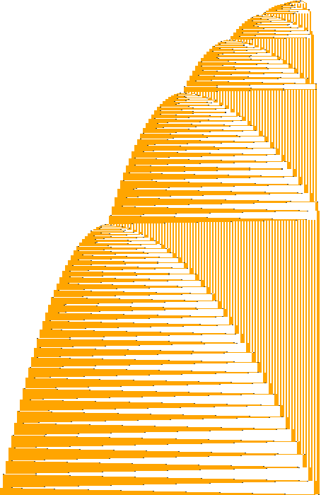

## 3. `1RB0LA_0RC0RB_1LD1LA_1LC1RE_1RF0RD_1LC---` (class A)

- scan: 12 levels, 12 phases, mean factor 1.57 (sd 0.06); level starts: 16 29 49 79 124 191 292 443 670 1010 1519 2284
- verdict: vampire family (orbits O1–O4 of this repository)
- diagram: 19,400 steps, tape width 250 cells

## 4. `1RB0RE_1RC---_0RD0RC_1LE1LF_1LD1RA_1RC0LF` (class A)

- scan: 12 levels, 12 phases, mean factor 1.57 (sd 0.06); level starts: 16 29 49 79 124 191 292 443 670 1010 1519 2284
- verdict: vampire family (orbits O1–O4 of this repository)
- diagram: 45,377 steps, tape width 385 cells

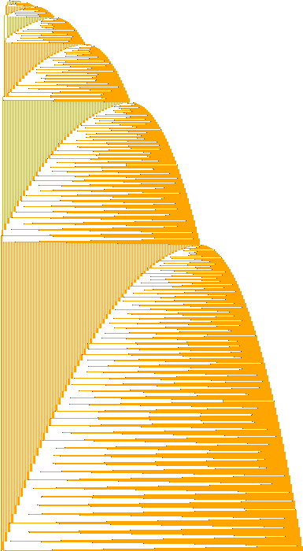

## 5. `1RB0LA_0RC0RB_1LD1LA_1LC1RE_1RF0RD_1LA---` (class A)

- scan: 13 levels, 13 phases, mean factor 1.56 (sd 0.06); level starts: 13 24 40 63 99 153 234 355 537 810 1221 1836 2758
- verdict: vampire family (orbits O1–O4 of this repository)
- diagram: 67,202 steps, tape width 468 cells

## 6. `1RB---_0RC0RB_1LD1LE_1LC1RF_1RB0LE_1RA0RD` (class A)

- scan: 12 levels, 12 phases, mean factor 1.58 (sd 0.07); level starts: 16 31 52 83 130 200 304 461 697 1052 1582 2378
- verdict: vampire family (orbits O1–O4 of this repository)
- diagram: 49,872 steps, tape width 403 cells

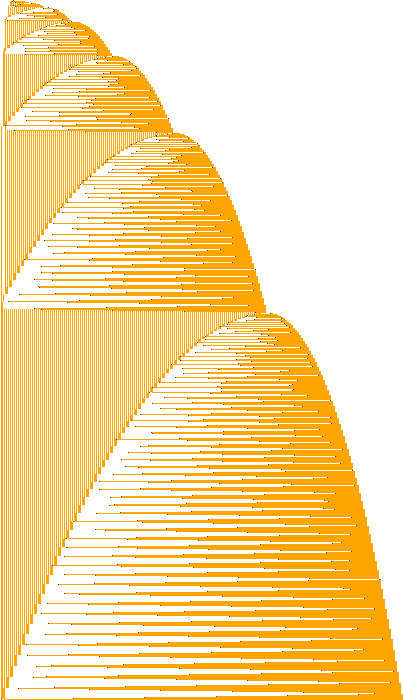

## 7. `1RB0RF_1LC---_1LF1LD_1RE0LD_0RC0RE_1LC1RA` (class A)

- scan: 12 levels, 12 phases, mean factor 1.58 (sd 0.07); level starts: 16 31 52 83 130 200 304 461 697 1052 1582 2378
- verdict: vampire family (orbits O1–O4 of this repository)
- diagram: 50,667 steps, tape width 405 cells

## 8. `1RB0RB_1LC1RF_0RD0LB_0RA1LE_1LD---_0RB0RC` (class B)

- scan: 20 levels, 71 phases, mean factor 1.33 (sd 0.07); level starts: 78 109 152 206 278 374 502 678 909 1218 1629 2178 2909 3882
- level analysis: Bell type `LD` with left part `01 12 01 11 01`, 26 levels; n: 284 380 508 684 915 1224 1635 2184 2915 3888 5187 6918 9227 12304 16411 21886; ratios: 1.338 1.336 1.336 1.335 1.334 1.334 1.334 1.334 1.333 1.334 1.334; 13 different tails
- verdict: **halts** (vampire method, [halt-found repository](https://github.com/thomasreus-bb/halt-found-1rb0rb_1lc1rf_0rd0lb_0ra1le_1ld---_0rb0rc))
- diagram: 4,677 steps, tape width 100 cells

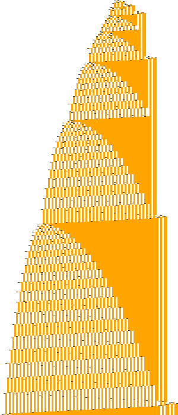

## 9. `1RB0RB_1LB0LC_1RD1LC_1RE0RA_0RF1RA_---1LB` (class B)

- scan: 15 levels, 98 phases, mean factor 1.33 (sd 0.09); level starts: 20 29 34 52 76 107 126 173 199 273 370 501 675 905
- level analysis: Bell type `RB`, 30 levels; n: 182 207 280 378 508 682 914 1246 1666 2226 2972 3307 4414 5890 7858 10482; ratios: 1.343 1.340 1.363 1.337 1.336 1.335 1.113 1.335 1.334 1.334 1.334; 2 different tails
- verdict: needle-like: only 2 tails (all information in one number)
- diagram: 2,981,111 steps, tape width 1001 cells

## 10. `1RB---_0RC0RD_1LD1RB_0LE0LC_1RA0LF_1LD1LE` (class B)
- **BusyBeaverWiki article:** [1RB---_0RC0RD_1LD1RB_0LE0LC_1RA0LF_1LD1LE](https://wiki.bbchallenge.org/wiki/1RB---_0RC0RD_1LD1RB_0LE0LC_1RA0LF_1LD1LE)

- scan: 21 levels, 240 phases, mean factor 1.24 (sd 0.09); level starts: 42 51 70 90 113 148 188 249 271 306 412 474 555 628
- level analysis: Bell type `RC`, 31 levels; n: 278 367 418 496 632 706 831 899 980 1076 1181 1299 1458 1758 1942 2205; ratios: 1.117 1.177 1.082 1.090 1.098 1.098 1.100 1.122 1.206 1.105 1.135; 22 different tails
- verdict: 22 different tails, but the growth ratio varies
- diagram: 10,067 steps, tape width 64 cells

- **Known result.** This machine has a page on the BusyBeaverWiki: [1RB---_0RC0RD_1LD1RB_0LE0LC_1RA0LF_1LD1LE](https://wiki.bbchallenge.org/wiki/1RB---_0RC0RD_1LD1RB_0LE0LC_1RA0LF_1LD1LE), with an analysis by Shawn Ligocki (as of April 2026).
  - **Rules.** There, the machine is reduced to rules on configurations A(a, b, c) with a norm that grows linearly. The ratio of the two registers follows a skew tent map, so it is uniformly distributed, and the chance of a halt per high-level step is about 1/(2S).
  - **Simulation.** These rules were simulated for 2·10¹² high-level steps without a halt.
  - **Verdict there.** "Probviously halting": under the model the probability of never halting is 0, and the median halting time is 512 times the number of steps already simulated.
  - **Relation to the analysis below.** The analysis below was done independently, before we knew the wiki page. It arrives at the same structure: the linear norm N, the skew tent map, uniform p and a halt chance of about 1/(2N) per Bell. Our exponent agrees with the wiki's: about 1/(2N) ≈ 1/(9k) per Bell means the survival probability falls like K^(−1/9). The chance of no halt up to Bell K therefore halves when K grows by the factor 2⁹ = 512, which is the wiki's median.
  - **What is new here.** The three Bell types A/B/C, the diagram with the phases, the exact step formula and `bmap2`. The wiki simulation goes further than ours: 2·10¹² steps against 10¹⁰ Bells.
- **Exact Bell map (25 Oct 2026): no HALT in the first 10¹⁰ Bells (about 10³⁰ steps); HALT needs an exact hit.** Tools: `scan/m10/`.
  - *What a Bell is here.* A Bell is the stretch between two steps at which the head reaches a new cell at the left end of the tape in state C. These are the horizontal bands of the space-time diagram. Bell 1 starts at step 48; before that there is only a short start-up. The tape grows by about 4.5 cells per Bell, i.e. **linearly**, not geometrically. The step count grows like about 2.3·k³ after k Bells.
  - *Tape at the start of a Bell.* Always
    `0 (01)^a [0 01] (11)^b [1]`, head on the new left cell, state C.
    Two registers a and b, a separator `0 01` (present or not) and an optional extra `1` at the right end.
  - *Three phases inside a Bell* (coloured bar in the figure below):
    1. The block `(01)^a` is turned into `11…` in a few steps. This is the left register L, about 2a cells.
    2. **Dome.** In each round L loses one cell, the right block `(11)^b` loses three cells and a chequered block `(01)…` in the middle grows by two cells. This phase draws the curved chequered area.
    3. **Parallelogram.** Starts when the right block is used up. The chequered block keeps its width and moves to the right. L loses one cell per round and a new `11…` block grows at the right end. This phase draws the slanted chequered stripe.
  - *Three types of Bell.* Which register runs out first decides the type:

    | type | condition (approx.) | what happens | next Bell (approx.) |
    |---|---|---|---|
    | **A** | b/3 < a ≤ b | the right block runs out first; a large right block, so a long dome | a' ≈ 4b/3, b' ≈ a − b/3 |
    | **B** | a > b | the right block runs out first; a small right block, so a short dome and a long parallelogram | as A |
    | **C** | a < b/3 | L runs out during the dome: no phase 3. The Bell is short and the next one starts without the separator `0 01` | a' ≈ 4a, b' ≈ b − 3a |

    Two rare details:
    - **b = 0.** A Bell may start with an empty right register; then it has only phase 3. In the first 10¹⁰ Bells this happens twice (Bells 93 and 39,365).
    - **Parity variant.** Depending on b mod 3 and the parity bits, A and B Bells may have one extra switching round between phases 2 and 3. It is not visible in the diagram.
  - *Order of the types.* A is always followed by B: after A, a' ≈ 4b/3 > b' ≈ a − b/3. B and C can be followed by A, B or C. Over 10¹⁰ Bells the shares are B 50 %, A 25 %, C 25 %. The first 16 Bells alternate strictly (ABAB…); the first C is Bell 17 (steps 20,438–20,907). First 100 Bells (Z = b = 0):

        1–10   ABABABABAB      51–60   BABCBCABCB
       11–20   ABABABCABA      61–70   ABCBCBCABC
       21–30   BABCBBABAB      71–80   BABCBBBBBA
       31–40   ABCBCBABCB      81–90   BABCBCCBCA
       41–50   ABCABCABCA      91–100  BAZCCABCCB

  - *Exact map.* `scan/m10/bandmap.py` gives the next Bell (a', separator, b', extra 1) from the current one exactly, with a table over (b mod 3, extra 1, separator). It is checked in two ways:
    - against the real TM for the first 2000 Bells of the orbit (`bands.c`);
    - against the real TM for all 19,844 start tapes with a ≤ 40 and b ≤ 120 (`edge.c`). It agrees on all of them except the cases b = 0 and the halting families below, which the iteration treats separately.

    In short, with L = 2a + 1 + 2·sep (cells of the left register) and m = ⌊2b/3⌋ + δ (rounds of the dome, δ ∈ {0, −1} from the table):
    - **A/B** (L > m): a' = 2m + (1…4), b' from 2b' + e' = 2a + 3·sep − m + (0 or −1); separator present.
    - **C** (L ≤ m): a' = 2L + 2 + sep, 2b' + e' = 2b + e − 3L − 2 − sep; no separator.
  - *HALT condition.*
    - **When it halts.** The machine halts exactly when a C Bell uses up the right register completely, leaving 0 or −1 cells. The four families of Bell starts are (a, sep, b, e) = (a, 0, 3a+2, 0), (a, 0, 3a+2, 1), (a, 1, 3a+5, 1) and (a, 1, 3a+6, 0). After such a C Bell the tape is `0 (01)^x` or `0 (01)^x 0`, and the machine halts in the next Bell. This is checked with the real TM for all a ≤ 40.
    - **No other halt.** No other start tape with a ≤ 40, b ≤ 120 halts within one Bell.
  - *The map as a mathematical question.* Write the Bell start in three numbers:
    - L = 2a + 1 + 2s: the cells of the left register (always odd);
    - Y = 2b + e: the cells of the right register;
    - s ∈ {0, 1}: whether the separator is there.

    Bell 1 starts at step 48 with (L, Y, s) = (5, 3, 1). For each Bell let

    &nbsp;&nbsp;&nbsp;&nbsp;m = ⌊(Y − 1 − s)/3⌋, &nbsp;&nbsp; r = Y − 1 − s − 3L.

    Then the next Bell is:
    - **r < 0** (type A or B, i.e. L > m): (L, Y, s) → (2Y − 2m + 3, L − m − 1, 1)
    - **r ≥ 2** (type C): (L, Y, s) → (4L + 5 + 2s, r − 1, 0)
    - **r ∈ {0, 1}:** the machine halts in the next Bell.

    This form agrees with the table map for 3·10⁶ Bells of the orbit and on all 43,984 test tapes. It needs no special case for b = 0.

    > **Question.** Does the sequence starting at (5, 3, 1) ever reach a Bell with r ∈ {0, 1}?
    > The TM halts if and only if it does.
  - *Why the answer is hard.*
    - **Growth.** N = L + Y grows by 3 + s per C Bell and by 3 + s + ((Y − 1 − s) mod 3) per A/B Bell, so N ≈ 4.5·k after k Bells.
    - **Leading order.** In the share p = L/N the map is, up to errors of order 1/N, the **skew tent map**
      - p' = 4p for p < 1/4 (C),
      - p' = 4(1 − p)/3 for p > 1/4 (A for p ≤ 1/2, B for p > 1/2).
    - **What this explains.** Both branches map onto all of [0, 1], so the invariant density is uniform. This explains the shares C 25 %, A 25 %, B 50 %. It also explains why A is always followed by B: p ∈ (1/4, 1/2] gives p' ≥ 2/3.
    - **Halting as a target.** The map is chaotic, so the sequence of types is as irregular as the binary digits of a typical number. HALT means that p lands in a target interval just below 1/4 whose width is about 1/(2N).
    - **Heuristic.** With uniform p this happens with probability about 1/(2N) ≈ 1/(9k) per Bell. The expected number of hits up to Bell K is therefore about (ln K)/9, or 0.26 per factor of 10 in K, which matches the count of near misses.
    - **Conclusion.** The question is a *shrinking-target problem* for a (slightly perturbed) expanding map. For such orbits no general method decides whether a target is ever hit, much as for Collatz-type questions. A HALT found by iteration settles it; a proof of non-halting would need a new idea.
  - *Exact step count.* Steps per Bell are polynomials in a and b. They were fitted on about 44,000 single-Bell runs of the real TM and are exact in every case:
    - **C Bell:** 16a² + 38a + 21 (no separator) or 16a² + 78a + 91 (with separator).
    - **A/B Bell** (also b = 0): (96ab − 16b² + k₁a + k₂b + k₀)/9, with k from a table over (b mod 3, extra 1, separator).
    - **Halting Bell:** start tape `0 (01)^x` or `0 (01)^x 0` takes 16 + 6x steps, then the halting transition.

    `bmap2.c` iterates the map with this step count in a 192-bit accumulator and prints the exact step count at HALT. Checks:
    - it reproduces the step counts of the orbit at Bells 1, 16, 17, 18, 999 and 1999 (e.g. 18,164,042,511 steps at the end of Bell 1999);
    - it reproduces the halting step counts of the four halting families started directly.

    Usage: `gcc -O2 -o bmap2 bmap2.c` and then `./bmap2 NBELLS [REPORT_EVERY]`. It runs about 5·10⁷ Bells per second; 10¹⁰ Bells take 3 minutes and end at exactly 2,250,041,677,475,296,360,402,353,788,984 steps. 64-bit registers are enough up to about 10¹⁸ Bells.
  - *Iteration.* `bmap.c` iterates the map, about 10⁸ Bells per second. In **10¹⁰ Bells there is no HALT**. The registers are then about 10¹⁰, the tape is about 4.5·10¹⁰ cells and the step count is roughly 2·10³⁰. The nearest misses: after Bells 31,031 and 14,043,703 a C Bell left 2 cells, after Bell 431,602 it left 4.
  - *Assessment.*
    - **What is open.** A HALT needs a C Bell whose right remainder lands exactly on 0 or −1. Over the C Bells this remainder is spread fairly evenly over [0, 2b] and shows no residue class mod 12 that would forbid it.
    - **Heuristic.** The chance of a hit per Bell falls like 1/k. The expected number of hits up to Bell K therefore grows only like log K, so HALT may come very late or never. This is a heuristic, not a proof in either direction.
    - **What would decide it.** The exact map reduces the machine to a two-number system that can be iterated cheaply. A decision needs either a hit, which can be searched for much further with `bmap.c`, or an argument why the remainder never reaches 0 or −1.
  - *Correction of 24 Oct.* The earlier estimate (about 2 % HALT per "Bell", HALT after about 10⁴⁰ steps) is **withdrawn**.
    - **Where it came from.** It used a different "Bell", namely records of the block `1^n` in configurations `1^n (01)^m 00` that are far apart, with many of the Bells above in between.
    - **Why it fails.** It counted halts of *varied* starts, which leave the orbit's set of reachable configurations. The real orbit does not halt in 10¹⁰ Bells.
    - **What stays valid.** The `accsim` run without HALT up to 4.4·10²³ steps agrees with the map: that is about Bell 6·10⁷.

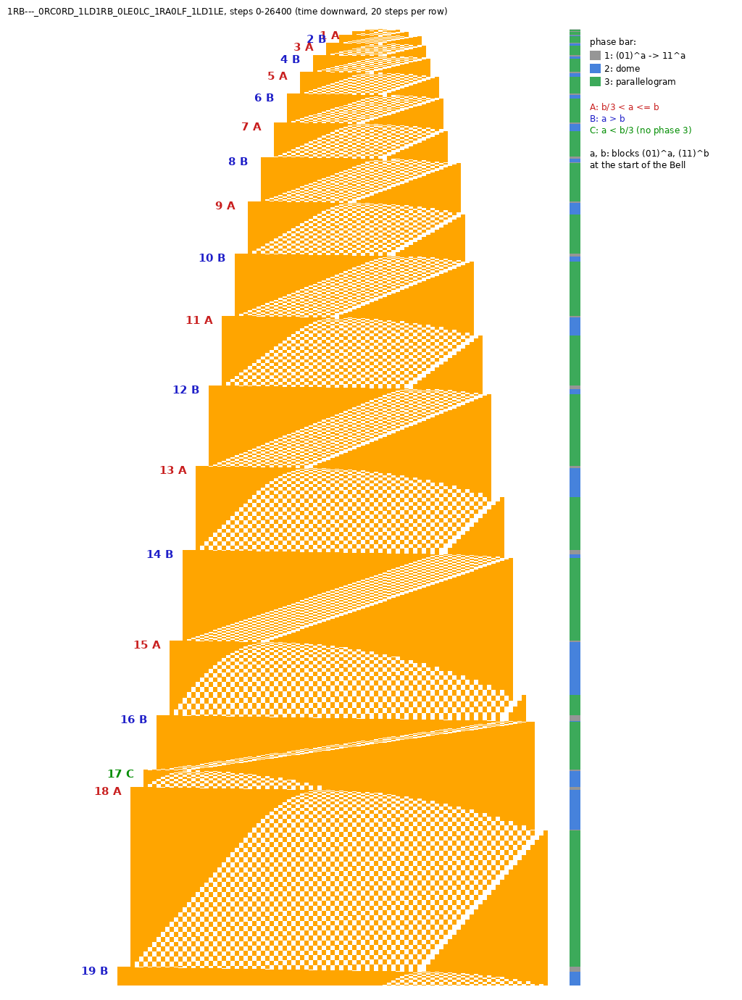

*Steps 0–26,400, time downward, 20 steps per row. Labels: Bell number and type. The bar on the right shows the phase: grey = 1 (`(01)^a` to `11`), blue = 2 (dome), green = 3 (parallelogram). Bell 17 is the first C Bell: no green phase.*

## 11. `1RB1LB_1RC---_1LD1LF_1LE0LD_0LA1RF_1LC0RE` (class B)

- scan: 20 levels, 95 phases, mean factor 1.21 (sd 0.10); level starts: 83 107 129 157 171 196 242 274 345 420 620 684 745 799
- level analysis: Bell type `LC` with left part `01`, 16 levels; n: 5 12 18 48 96 110 200 232 376 478 702 794 968 1512 1832 3912; ratios: 1.146 1.818 1.160 1.621 1.271 1.469 1.131 1.219 1.562 1.212 2.135; 13 different tails
- verdict: 13 different tails, but the growth ratio varies
- diagram: 202,912 steps, tape width 407 cells

- **examined (24 Oct 2026):** multi-register system. At Bell starts the tape is `(10)^m (01)^n 0`, head right, state F. In between there are 3–4 large blocks, e.g. `11^a 01^b 00 10^c`. `accsim` (2·10¹⁰ real operations) reaches **10²² steps** with blocks of about 3·10⁸: no HALT. Perturbed real starts gave 1 HALT in 120 runs over growth factor 10, right at the start, so the halting rate is at most about 0.1 % per Bell.

## 12. `1RB1RA_1LC1LB_1RE0LD_1RA0LB_---0RF_1RC0RA` (class B)

- scan: 19 levels, 42 phases, mean factor 1.27 (sd 0.10); level starts: 47 63 80 87 96 122 144 181 252 288 391 576 684 834
- level analysis: Bell type `LC` with left part `01`, 2 levels; n: 4 27; ratios: 6.750; 1 different tails
- verdict: no clear single-block Bell configuration found
- diagram: 38,184 steps, tape width 143 cells

## 13. `1RB0RF_1RC1RF_1LD0LE_---1LC_1RA1LE_1LC1RB` (class B)
- **BusyBeaverWiki article:** [1RB0RF_1RC1RF_1LD0LE_---1LC_1RA1LE_1LC1RB](https://wiki.bbchallenge.org/wiki/1RB0RF_1RC1RF_1LD0LE_---1LC_1RA1LE_1LC1RB)

- scan: 20 levels, 41 phases, mean factor 1.33 (sd 0.10); level starts: 34 43 64 77 91 119 175 231 350 441 665 1001 1505 2261
- level analysis: Bell type `RC`, 25 levels; n: 66 75 117 180 229 348 439 663 999 1503 2259 3393 5094 5735 8607 12915; ratios: 1.520 1.261 1.510 1.507 1.505 1.503 1.502 1.501 1.126 1.501 1.501; 2 different tails
- verdict: needle-like: only 2 tails (all information in one number)
- diagram: 1,313,195 steps, tape width 1001 cells

## 14. `1RB0LF_1LC1RA_0RE0RD_---1LE_1LF1RC_1LC1LA` (class B)
- **BusyBeaverWiki article:** [1RB0LF_1LC1RA_0RE0RD_---1LE_1LF1RC_1LC1LA](https://wiki.bbchallenge.org/wiki/1RB0LF_1LC1RA_0RE0RD_---1LE_1LF1RC_1LC1LA)

- scan: 30 levels, 87 phases, mean factor 1.21 (sd 0.10); level starts: 428 466 541 604 783 850 984 1046 1180 1372 1615 1882 2136 2262
- level analysis: Bell type `LC` with left part `01`, 13 levels; n: 8 14 26 74 106 122 440 1088 2366 4862 6538 7376 17540; ratios: 1.857 2.846 1.432 1.151 3.607 2.473 2.175 2.055 1.345 1.128 2.378; 1 different tails
- verdict: needle-like: only 1 tail (all information in one number)
- diagram: 619,684 steps, tape width 1001 cells

## 15. `1RB0RB_1LC1RE_1LF0LD_1RA1LD_1RC1RB_---1LC` (class B)
- **BusyBeaverWiki article:** [1RB0RB_1LC1RE_1LF0LD_1RA1LD_1RC1RB_---1LC](https://wiki.bbchallenge.org/wiki/1RB0RB_1LC1RE_1LF0LD_1RA1LD_1RC1RB_---1LC); on the [Cryptids](https://wiki.bbchallenge.org/wiki/Cryptids) page: listed as a cryptid

- scan: 19 levels, 45 phases, mean factor 1.36 (sd 0.11); level starts: 36 55 65 87 101 125 165 249 315 475 715 1075 1615 2425
- level analysis: Bell type `RC`, 23 levels; n: 86 100 128 163 248 313 473 713 1073 1613 2423 3638 4096 5123 7688 9613; ratios: 1.262 1.511 1.507 1.505 1.503 1.502 1.501 1.126 1.251 1.501 1.250; 2 different tails
- verdict: needle-like: only 2 tails (all information in one number)
- diagram: 1,423,912 steps, tape width 1001 cells

## 16. `1RB1LF_1RC1RF_0LD1RE_---1LC_0RB1RE_1LA0LE` (class B)

- scan: 15 levels, 109 phases, mean factor 1.26 (sd 0.11); level starts: 16 18 20 26 34 38 54 60 92 138 178 200 271 370
- level analysis: Bell type `RB` with left part `01`, 26 levels; n: 380 436 488 528 592 648 706 778 848 989 1092 1208 1308 1500 1630 1853; ratios: 1.095 1.090 1.102 1.090 1.166 1.104 1.106 1.083 1.147 1.087 1.137; 10 different tails
- verdict: 10 different tails, but the growth ratio varies
- diagram: 10,525 steps, tape width 77 cells

- **examined (24 Oct 2026):** the same form as no. 10. At Bell starts the tape is `0 1^n (01)^m 0`, head right, state C, with a two-register ping-pong inside. `accsim` is much less effective here: 2·10¹⁰ real operations reach only **4.5·10¹³ steps** (blocks about 3·10⁴): no HALT. Perturbed real starts gave 0 HALT in 60 runs over growth factor 4 (a weak test).

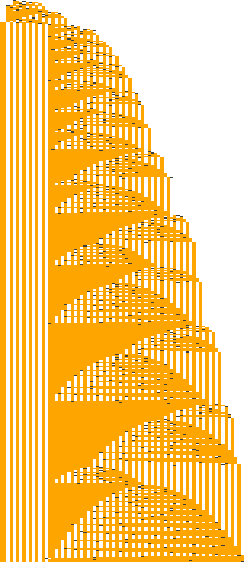

## 17. `1RB0RC_1RC---_1LD1RE_1LE0LD_1RA0LF_0RC0RB` (class B)

- scan: 17 levels, 149 phases, mean factor 1.29 (sd 0.12); level starts: 23 33 39 55 59 75 111 137 163 183 215 279 359 459
- level analysis: Bell type `LE` with left part `01`, 17 levels; n: 7 11 21 41 57 77 165 233 297 377 477 1137 1427 2141 4243 6365; ratios: 1.351 2.143 1.412 1.275 1.269 1.265 2.384 1.255 1.500 1.982 1.500; 3 different tails
- verdict: 3 different tails, but the growth ratio varies
- diagram: 15,198 steps, tape width 79 cells

- **examined briefly (24 Oct 2026):** two-register system. `accsim` with 10⁹ real operations reaches **10¹⁴ steps** (blocks `11^2·10⁵`, `10^2.2·10⁶`): no HALT.

## 18. `1RB---_1LC0LD_0RF0LD_0LE0RA_0LC1RA_1RC1RD` (class B)

- scan: 13 levels, 114 phases, mean factor 1.36 (sd 0.12); level starts: 8 10 14 19 25 32 52 61 70 83 131 203 311
- verdict: no clear single-block Bell configuration found
- diagram: 2,207,708 steps, tape width 1001 cells

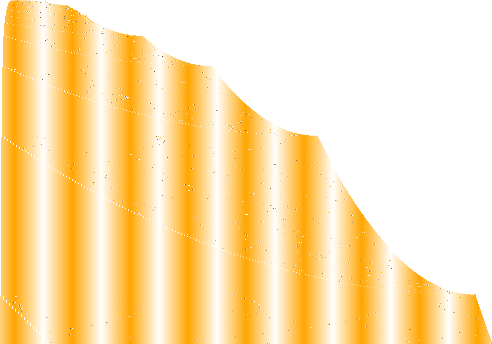

## 19. `1RB0LC_1LA1RE_1LD1RE_1RE0LA_0RA1RF_0RB---` (class B)

- scan: 23 levels, 61 phases, mean factor 1.32 (sd 0.12); level starts: 166 212 253 329 382 498 577 759 868 1148 1306 1733 2604 3920
- level analysis: Bell type `RB`, 13 levels; n: 20 22 35 92 143 335 767 1739 3926 5894 8846 13274 19916; ratios: 1.591 2.629 1.554 2.343 2.290 2.267 2.258 1.501 1.501 1.501 1.500; 3 different tails
- verdict (scan): vampire-like signature: regular growth, 3 different tails
- **verdict after a detailed examination (24 Oct 2026): not a simple vampire but a two-number system; no HALT found.** Tools: `scan/m19/`.
  - *Bell structure.* At the start of each Bell the tape is `L 1^n T`, head at the right end, state E. n grows by 3/2: in the real orbit 8846 → 13274 → 19916 → 29881 → 44822 → …, with n' = 3n/2 + c, where c depends on n mod 4, on T and on L.
  - *Right part.* T is only `0` or `010`.
  - *Left part.* L carries the information. After an even n it is empty again. After k odd n in a row it is `110 1^j 0`, with j = 8, 26, 359, 1232, 2780, 6263, 21158 for k = 2 … 8 (`chain.py`).
  - *Why the table does not close.* The sequence of j is itself Collatz-like, and it takes material from n: n' ≈ 1.5n − c(j), with c up to several thousand at j ≈ 2·10⁴. For other values of j the left part even becomes a list of several blocks, e.g. j = 13 gives `11 0 1^26 0 1^17 0`. The "3 tails" of the scan only looked at the right side.
  - *Search for HALT, all without a halt:*
    - all left parts `110 1^j 0` with j < 160, every residue n mod 4, both T (1,280 runs of the real TM from Bell configurations, `hscan.py`);
    - the chain of left parts of the real orbit up to k = 8;
    - the range where j is comparable to n (j = 26 and 359, n = 5 … 1025).
  - *Assessment.* Unusual left parts need long runs of odd n, whose probability halves with every further odd Bell. For j to catch up with n, about 0.4·b odd Bells in a row would be needed, which becomes exponentially unlikely as the Bell number b grows. So this machine is probably non-halting in the same sense as Antihydra, but not provably so with these means.
  - *Lessons for the method:*
    1. Count the different words on **both** sides of the long block.
    2. In a two-number system the second number can itself follow a Collatz-like process, not only take steps of ±1.
- diagram: 65,719 steps, tape width 338 cells

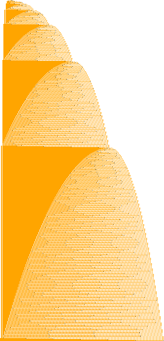

## 20. `1RB1LC_1LA0RD_0LB1LF_1RE1LC_1LC0RB_0LA---` (class B)

- scan: 16 levels, 43 phases, mean factor 1.40 (sd 0.12); level starts: 55 65 85 102 165 255 305 460 694 917 1044 1380 2084 3134
- level analysis: Bell type `LB` with left part `02 12 01 12 01 12 01 12 01 12 01 12 01 12 01 12 01 12 01 12 01 12 01 12 01 12 01 12 01 12 01 12 01 12 01 12 01`, 8 levels; n: 10 76 139 229 1354 4681 10588 15904; ratios: 7.600 1.829 1.647 5.913 3.457 2.262 1.502; 2 different tails
- verdict: needle-like: only 2 tails (all information in one number)
- diagram: 18,300 steps, tape width 175 cells

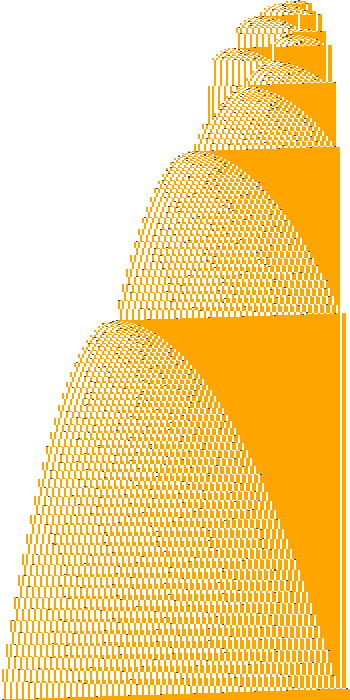

## 21. `1RB0LE_1RC1RE_0RD1RC_1LA0LB_1LF0RB_---1LD` (class B)

- scan: 15 levels, 66 phases, mean factor 1.40 (sd 0.13); level starts: 14 17 28 31 43 50 76 135 213 281 396 537 729 985
- level analysis: Bell type `RE`, 24 levels; n: 217 297 409 553 745 1001 1343 1554 2089 2793 3737 4991 6673 8905 11881 15849; ratios: 1.344 1.342 1.157 1.344 1.337 1.338 1.336 1.337 1.334 1.334 1.334; 1 different tails
- verdict: needle-like: only 1 tail (all information in one number)
- diagram: 696,601 steps, tape width 1001 cells

## 22. `1RB0RB_1LC0LF_1RD0LB_1RE1RC_0RA---_1LA1RE` (class B)

- scan: 12 levels, 30 phases, mean factor 1.40 (sd 0.13); level starts: 11 13 19 35 52 64 91 141 190 269 393 448
- level analysis: Bell type `RA`, 7 levels; n: 6 15 40 146 398 1192 3390; ratios: 2.500 2.667 3.650 2.726 2.995 2.844; 2 different tails
- verdict: needle-like: only 2 tails (all information in one number)
- diagram: 110,428 steps, tape width 397 cells

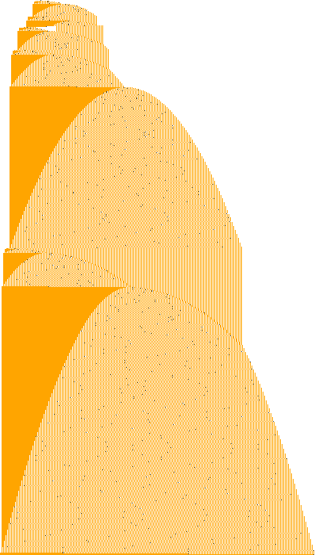

## 23. `1RB0LD_0RC1RD_1LA1RA_1LE0LE_1RF0LA_0RA---` (class B)

- scan: 16 levels, 27 phases, mean factor 1.39 (sd 0.13); level starts: 26 37 40 55 79 111 150 203 276 506 681 910 1633 2187
- level analysis: Bell type `RD` with left part `11 01 11 01`, 1 levels; n: 4; ratios: –; 1 different tails
- verdict: no clear single-block Bell configuration found
- diagram: 455,501 steps, tape width 1001 cells

## 24. `1RB0LD_1LC0RA_1RA1LB_1LA1LE_1RF0LC_---0RE` (class B)
- **BusyBeaverWiki article:** [1RB0LD_1LC0RA_1RA1LB_1LA1LE_1RF0LC_---0RE](https://wiki.bbchallenge.org/wiki/1RB0LD_1LC0RA_1RA1LB_1LA1LE_1RF0LC_---0RE); on the [Cryptids](https://wiki.bbchallenge.org/wiki/Cryptids) page: listed under "chaotic machines not classified as cryptids"

- scan: 23 levels, 76 phases, mean factor 1.25 (sd 0.14); level starts: 182 264 310 342 380 474 552 590 946 1104 1182 1884 2202 2360
- level analysis: Bell type `LB` with left part `01`, 13 levels; n: 10 20 50 106 200 328 398 608 1238 2494 4988 9916 19586; ratios: 2.500 2.120 1.887 1.640 1.213 1.528 2.036 2.015 2.000 1.988 1.975; 1 different tails
- verdict: needle-like: only 1 tail (all information in one number)
- diagram: 54,368 steps, tape width 329 cells

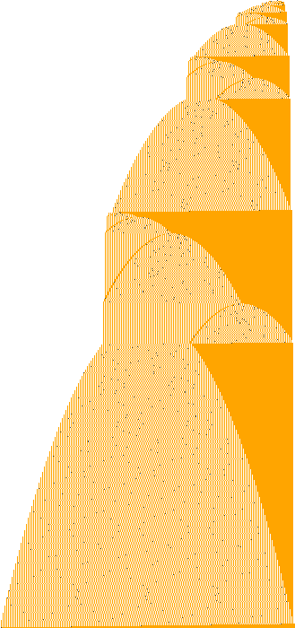

## 25. `1RB0LE_1LC0RD_0RA1LD_0LC1RA_1LF1LA_---1LA` (class B)

- scan: 8 levels, 32 phases, mean factor 1.55 (sd 0.14); level starts: 33 52 73 107 209 385 523 707
- level analysis: Bell type `LD` with left part `01 11 01`, 16 levels; n: 8 13 23 45 64 85 119 221 397 535 719 5398 7197 9600 12802 17069; ratios: 1.328 1.400 1.857 1.796 1.348 1.344 7.508 1.333 1.334 1.334 1.333; 2 different tails
- verdict: needle-like: only 2 tails (all information in one number)
- diagram: 464,164 steps, tape width 1001 cells

## 26. `1RB1LC_1LA0RD_1LB1LF_1LE1RE_0LA0RB_0LB---` (class B)

- scan: 20 levels, 32 phases, mean factor 1.37 (sd 0.15); level starts: 63 88 138 186 261 343 411 461 615 1026 1085 1383 1842 3255
- level analysis: Bell type `LA` with left part `01`, 11 levels; n: 4 9 15 30 62 146 270 1387 2475 10358 24548; ratios: 2.250 1.667 2.000 2.067 2.355 1.849 5.137 1.784 4.185 2.370; 2 different tails
- verdict: needle-like: only 2 tails (all information in one number)
- diagram: 14,056 steps, tape width 141 cells

## 27. `1RB1LC_1LC0RD_0LE1LA_0RF1RA_1LA0LA_---0RB` (class B)

- scan: 8 levels, 12 phases, mean factor 1.64 (sd 0.15); level starts: 17 32 61 98 121 188 359 545
- level analysis: Bell type `LA` with left part `01 12 02`, 6 levels; n: 33 99 189 546 1110 5589; ratios: 3.000 1.909 2.889 2.033 5.035; 1 different tails
- verdict: needle-like: only 1 tail (all information in one number)
- diagram: 3,959,736 steps, tape width 1001 cells

## 28. `1RB1LE_1LC0RA_0RF0LD_1LE1LA_1RC0LB_---1RC` (class B)
- **BusyBeaverWiki article:** [1RB1LE_1LC0RA_0RF0LD_1LE1LA_1RC0LB_---1RC](https://wiki.bbchallenge.org/wiki/1RB1LE_1LC0RA_0RF0LD_1LE1LA_1RC0LB_---1RC)

- scan: 20 levels, 176 phases, mean factor 1.24 (sd 0.15); level starts: 45 53 59 74 91 157 184 229 253 324 355 401 464 495
- verdict: no clear single-block Bell configuration found
- diagram: 1,865,705 steps, tape width 1001 cells

## 29. `1RB1LD_1LC0RC_0RF1RA_0LE1LA_1RC0LA_---0RB` (class B)

- scan: 12 levels, 25 phases, mean factor 1.49 (sd 0.16); level starts: 8 10 15 29 43 77 91 146 229 362 413 633
- level analysis: Bell type `LA` with left part `01 12 02`, 10 levels; n: 8 30 78 147 363 636 960 2226 3354 5694; ratios: 3.750 2.600 1.885 2.469 1.752 1.509 2.319 1.507 1.698; 2 different tails
- verdict: needle-like: only 2 tails (all information in one number)
- diagram: 6,792,964 steps, tape width 1001 cells

## 30. `1RB0LE_1LB1RC_0RF0RD_1RE0LA_1LA1RE_---0RB` (class B)

- scan: 10 levels, 34 phases, mean factor 1.54 (sd 0.16); level starts: 13 16 35 58 97 140 211 270 412 625
- level analysis: Bell type `RD`, 11 levels; n: 5 11 20 67 104 277 419 632 2070 5378 11434; ratios: 2.200 1.818 3.350 1.552 2.663 1.513 1.508 3.275 2.598 2.126; 1 different tails
- verdict: needle-like: only 1 tail (all information in one number)
- diagram: 280,089 steps, tape width 421 cells

## 31. `1RB1RF_1RC0LD_1LB1RA_1RE1LE_0RC0LB_0RB---` (class B)

- scan: 22 levels, 40 phases, mean factor 1.34 (sd 0.17); level starts: 114 128 173 235 279 313 381 421 516 705 936 1260 2910 3969
- level analysis: Bell type `RB`, 13 levels; n: 12 16 37 45 56 64 121 389 524 700 944 1260 3965; ratios: 2.312 1.216 1.244 1.143 1.891 3.215 1.347 1.336 1.349 1.335 3.147; 3 different tails
- verdict: 3 different tails, but the growth ratio varies
- diagram: 466,802 steps, tape width 1001 cells

- **examined in detail (24 Oct 2026): vampire-like in base 3, with a nested sub-process.**
  - *Bell structure.* At Bell starts the tape is `L 1^n T`, head at the right end, state A, with L ∈ {empty, `10`} and T ∈ {`0`, `010`}. The factor is exactly **4/3** in the limit: …, 108116, 144159, 192217.
  - *Table.* With L empty the table is clean and affine: n' = 4n/3 + c, with c depending on n mod 6 and T (`deriveLT.py`). From L = `10` the long block splits into several pieces, e.g. `1^39 0 1^54 0 1^30`, which only join up again after a variable number of Bells. So there is no finite table in this representation; a table with several blocks would be needed.
  - *Simulation.* With `accsim` (blocks of 3 cells), each Bell is essentially one jump: about 140 Bells and **10³⁵ steps** in about 77,000 real operations, no HALT. The limit is the 64-bit counts, not the time.
  - *Halting rate.* 20,000 random starts (n = 2,000 … 20,000, all four combinations of L and T), each run over a growth factor of 10¹², i.e. about 96 Bells, gave **no HALT** in about 1.9·10⁶ Bells in total. So the rate is below about 2·10⁻⁶ per Bell (`hz31.py`).
  - *Assessment.* A vampire-type machine with a very low halting rate, like the vampire family. Deciding it needs the vampire method extended to tables with several blocks.

- **Bell types, prefix table and HALT (26 Oct 2026).** Tools and data: `scan/m31/`.
  - *Bell.* A Bell starts when the head enters a new cell at the right end in state A. The tape is then only 1-blocks separated by single 0s:

        P  1^n 0  [1 0]

    It consists of a main block 1^n, a **prefix** P of a few small blocks on the left (e.g. `1 0 1^39 0`) and sometimes a **tail** `1 0` on the right. Below, a tape is written as the list of its block lengths, e.g. `1 39 | n` for P = (1, 39).
  - *Three types.*

    | type | start | what happens | growth of the tape |
    |---|---|---|---|
    | **A** | `1^n 0`, no prefix | one zigzag phase with period 8 turns; it rebuilds 1^n into 1^(4n/3 + c) | ×4/3 |
    | **B** | `P 1^n 0` | first the prefix is processed (its own zigzag phase with period 12, or for `1 39` always the same fixed sequence of turns), then the main phase as in A | ×4/3 |
    | **C** | `P 1^n 0 1 0` | a short Bell: the main block is **not** rebuilt; the tail and a few cells of the main block go into the prefix | about +3 cells |

    C is followed by B in 68 of 69 cases: the C Bells feed the prefix and the B Bells process it. This is the "nested sub-process" of 24 Oct.
  - *First 100 Bells* (from 202 Bells computed):

        1–10   CACBCBAABC      51–60   CBBCBABCBB
       11–20   BBBCBCBCBA      61–70   BCBCBBCBCB
       21–30   CBABBCBACB      71–80   CBCBBCBCBC
       31–40   CBBCBBCBCB      81–90   BCBBAABBCB
       41–50   BBCBCBAABB      91–100  ACBCBBCBCB

    In 202 Bells: B 117, C 69, A 16. Bell 100 is at about 10¹⁸·⁵ steps, Bell 202 at about 10³⁵·⁵, with no HALT.
  - *Simulation.*
    - `bells.c` (direct, 52 Bells, 5·10¹⁰ steps).
    - `accb.c`: `accsim` with blocks of 3 cells, jumps over repetitions and an exact Bell detection at cell level. It reproduces the 52 directly simulated Bell tapes exactly and reaches Bell 202 in 0.01 s; the 64-bit counts stop it there. Its output is in `bells_202.txt`.
    - `tok.c` and `phases.py` extract the zigzag phases.
  - *Prefixes.* The prefixes come from a small set that recurs over and over: –, `1`, `1 39`, `73`, `1 39 6`, `12`, `73 2`, `1 6`, `138`, `578`, `138 10`, `85`, … Rarely a deeper level appears with a larger number: `1 1379`, `1 39 1795`, `73 2355`, `1 39 5683`.
  - *Prefix table.* For a prefix state (P, tail), one Bell of the real TM was run from `P 1^n 0 [1 0]` with large n (`one.c`, `probe.py`). The result depends **only on n mod 6**:
    - the next prefix state;
    - n' = 4n/3 + β for A/B Bells and n' = n + β for C Bells, with β fixed.

    Checked by 160 random tests at n = 4,000 … 9,000 (`verify.py`); the table is in `table6.json`.
  - *Closure.* Following the table from (no prefix, no tail) over all n mod 6 gives the residue-consistent reachable part (`close6.py`). For each A/B Bell all three possible values of the next residue are allowed, so it is an over-approximation. It contains 55 prefix states and **no HALT entry**.

    It does not close, however. In the over-approximation the large number of a deep level keeps growing, by about (4/3)⁴ per step:
    - 1795 → 5683 → 17,971 in the family `1 39 x`;
    - 2355 → 7539 in the family `73 x`.

    So there is a whole hierarchy of nested counters. The real orbit reaches these deeper levels only rarely (5683 once in 202 Bells).
  - *HALT.*
    - **Where it halts.** HALT entries exist. A Bell started from `1 2 | n`, `48 64 | n` or `48 109 | n` (no tail) halts if n mod 3 ∈ {0, 1}. These were found by a scan of the prefixes `1 x`, `48 x` and `x` for x < 130 (`hscan.py`).
    - **How they are entered.** In the table they are entered only from the C Bells `1 19 | n 1` and `138 11 | n 1`, with n ≡ 1 (mod 3). These turn n into n + 28 and n − 2 respectively, i.e. **n' ≡ 2 (mod 3), exactly the residue for which the halting entry does not halt**. The way into HALT is therefore blocked by a residue condition mod 3.
    - **Not reached at all.** The two entry states are not even in the residue-consistent closure of the orbit.
  - *Assessment.*
    - **No path to HALT found.** All explored prefix states, including the halting entries, show HALT excluded by residues mod 3.
    - **What a proof would need.** The vampire method extended by one level: a parametric table for the families with a large prefix number (e.g. `1 39 x`, `73 x`, `1 39 x 6`, `73 x 10`) as linear maps in (n, x) with residues of both, and a closure over these families that contains no HALT entry.
    - **What is still open.** Whether the hierarchy has a finite number of family types (self-similar), and whether HALT entries also exist at deeper levels.

- **The family `1 39 x`: the nesting is self-similar (26 Oct 2026).** Tools: `fam.py`, `orbit.py`, `selfsim3.py` in `scan/m31/`.
  - *n ≡ 2 (mod 3).* Bells from `1 39 x | n` (no tail) with n ≡ 2 (mod 3) are simple: x is absorbed, the result is `1 39 | n'` with n' = 4n/3 + x + const.
  - *n ≡ 0, 1 (mod 3).* Here the result does **not** depend on x mod 6 in any simple way. For x = 300 … 317 the new prefix is in turn `1369`, `73 363`, `1 751`, `1 799`, –, `73 367`, `1 448`, `529`, `73 114`, `1 39 559`, … So there is no linear table in (n, x). It also does not depend on n beyond n mod 3: the prefix is the same for n mod 6 = 0, 1, 3, 4, and only the tail changes.
  - *Comparison with the machine's own Bells.* Compare with the machine's own Bell orbit started from the short tape `1 39 | y`, i.e. with the inner block as main block:
    - **When it matches.** In 43 of 72 cases (x = 300 … 371) the new prefix is *exactly* the tape of that inner orbit after k inner Bells, for some y = x − δ (δ = 0 … 7) and k = 1 … 8. In all 43 cases, k is the first inner Bell that ends with a tail `1 0`, i.e. the first inner C Bell.
    - **What this means.** Inside one Bell of the outer level, the inner block x runs through the same Bell dynamics as the whole machine. That inner run stops at the first C Bell.
    - **What is not explained.** The remaining 29 cases are not explained by this simple rule; they probably arise where the inner block grows into the main block.
  - *Consequence.*
    - **Why the table cannot close.** The nesting is (at least largely) a copy of the top level. This explains the growth by about (4/3)⁴ per step in the deep families (1795 → 5683 → 17,971), and why no finite table in (n, x) exists.
    - **Halting.** The HALT entries of the top level (`1 2`, `48 64`, `48 109`) are blocked by the residue condition mod 3. If the inner level were an exact copy, the same obstruction would hold there, and by induction over the levels HALT would never occur.
    - **What a proof would need.** A recursive description of the machine whose inner levels are copies of the top level, plus an exact account of the deviations in the remaining cases. With that, the mod-3 argument could be carried through all levels.

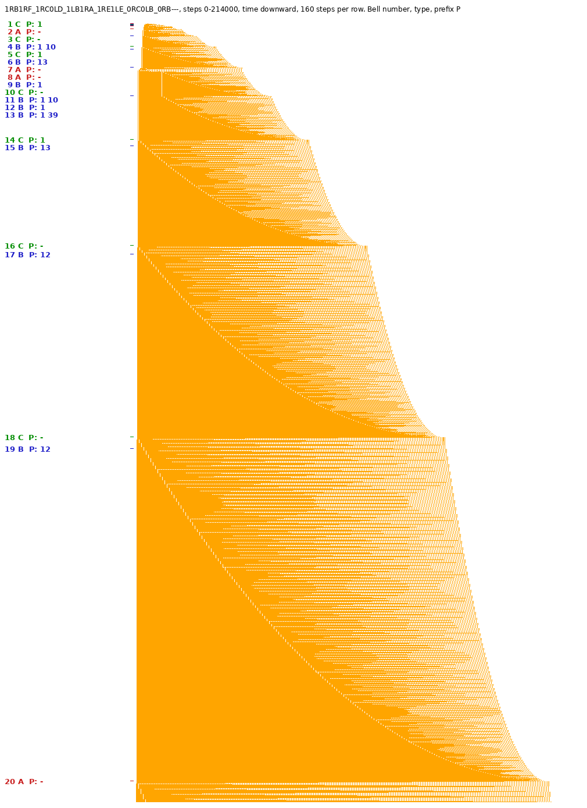

*Steps 0–214,000, time downward, 160 steps per row; Bell number, type and prefix P at the left (green C, blue B, red A).*

## 32. `1RB1LB_0RC0LD_1LD1RE_1RC0LA_1RD1RF_0RD---` (class B)

- scan: 23 levels, 40 phases, mean factor 1.33 (sd 0.17); level starts: 130 174 233 288 315 390 420 525 696 945 1257 1323 2919 3966
- level analysis: Bell type `RD` with left part `11 01`, 10 levels; n: 10 18 34 42 78 86 166 283 1690 5294; ratios: 1.800 1.889 1.235 1.857 1.103 1.930 1.705 5.972 3.133; 3 different tails
- verdict: 3 different tails, but the growth ratio varies
- diagram: 14,294 steps, tape width 141 cells

- **examined (24 Oct 2026):** the same dynamics as no. 31. The Bell values agree to within a few units (108114 / 108109, 144157 / 144152, …), so these are very probably equivalent machines. `accsim` with K = 3 gives the same picture: 10³⁵ steps in about 77,000 real operations, no HALT.

## 33. `1RB1LA_1LC0RE_1LF1LD_0RB0LA_1RC1RE_---0LD` (class B)
- **BusyBeaverWiki article:** [Space Needle](https://wiki.bbchallenge.org/wiki/Space_Needle); on the [Cryptids](https://wiki.bbchallenge.org/wiki/Cryptids) page: cryptid "Space Needle"

- scan: 9 levels, 407 phases, mean factor 1.69 (sd 0.17); level starts: 12 20 36 56 96 146 311 371 778
- level analysis: Bell type `LD` with left part `01`, 8 levels; n: 5 9 16 40 100 250 625 1094; ratios: 1.800 1.778 2.500 2.500 2.500 2.500 1.750; 1 different tails
- verdict: needle-like: only 1 tail (all information in one number)
- diagram: 18,026,802 steps, tape width 1001 cells

## 34. `1RB1RC_1LC1LC_1RE0LD_1LB1RF_---1RA_0RD1RD` (class B)
- **BusyBeaverWiki article:** [1RB1RC_1LC1LC_1RE0LD_1LB1RF_---1RA_0RD1RD](https://wiki.bbchallenge.org/wiki/1RB1RC_1LC1LC_1RE0LD_1LB1RF_---1RA_0RD1RD)

- scan: 13 levels, 29 phases, mean factor 1.34 (sd 0.18); level starts: 13 16 18 28 46 60 72 150 182 234 258 316 452
- level analysis: Bell type `RD`, 5 levels; n: 5 6 9 15 54; ratios: 1.200 1.500 1.667 3.600; 3 different tails
- verdict: no clear single-block Bell configuration found
- diagram: 948,717 steps, tape width 1001 cells

## 35. `1RB---_0RC0LD_1LB1RC_0LE0LF_1RD1LE_1RF1RA` (class B)

- scan: 16 levels, 128 phases, mean factor 1.25 (sd 0.18); level starts: 43 47 53 61 91 114 125 137 159 187 217 229 277 592
- level analysis: Bell type `RC`, 8 levels; n: 7 9 14 19 24 100 374 644; ratios: 1.286 1.556 1.357 1.263 4.167 3.740 1.722; 4 different tails
- verdict: 4 different tails, but the growth ratio varies
- diagram: 6,352 steps, tape width 55 cells

- **examined briefly (24 Oct 2026):** register system with blocks like `11^4·10⁵ 01 11^2.8·10⁵`. `accsim` with 10⁹ real operations reaches **5·10¹⁶ steps**: no HALT.

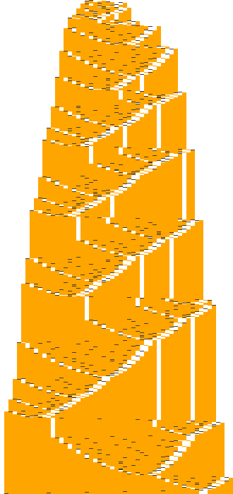

## 36. `1RB1LC_1LC0RD_0LE1LA_---1RA_1RF0LA_0RF0RB` (class B)

- scan: 7 levels, 12 phases, mean factor 1.56 (sd 0.19); level starts: 51 83 134 149 230 485 734
- level analysis: Bell type `RA` with left part `11 01`, 10 levels; n: 87 138 234 738 1122 1698 2568 4626 6951 10434; ratios: 1.586 1.696 3.154 1.520 1.513 1.512 1.801 1.503 1.501; 1 different tails
- verdict: needle-like: only 1 tail (all information in one number)
- diagram: 3,193,486 steps, tape width 1001 cells

## 37. `1RB1RF_1RC0RB_0RD1LF_1LE1RE_1LA---_1RA0LC` (class B)

- scan: 20 levels, 66 phases, mean factor 1.26 (sd 0.19); level starts: 98 127 160 216 251 276 323 344 375 565 620 675 799 853
- level analysis: Bell type `RF` with left part `11 01 11 03`, 3 levels; n: 21 51 403; ratios: 2.429 7.902; 1 different tails
- verdict: no clear single-block Bell configuration found
- diagram: 175,420 steps, tape width 403 cells

## 38. `1RB0RE_1LC0RA_0LD0LB_1RE0LB_1RF---_0RB0RC` (class C)

- scan: 10 levels, 18 phases, mean factor 1.55 (sd 0.20); level starts: 8 14 20 28 54 60 78 154 203 404
- level analysis: Bell type `RA`, 7 levels; n: 4 14 20 54 60 154 404; ratios: 3.500 1.429 2.700 1.111 2.567 2.623; 4 different tails
- verdict: 4 different tails, but the growth ratio varies
- diagram: 279,320 steps, tape width 1001 cells

- **examined briefly (24 Oct 2026):** the tape becomes a growing **list of blocks**, `11^192 10^15 01 11^2 01^3 00 11^233 10^17 …`, i.e. a nested counter structure of type G (not closed). `accsim` reaches **4·10³³ steps** with only 892 jumps: no HALT.

## 39. `1RB1LC_1LC0RF_0LF1LD_0LE---_1RF1LC_1LE0RA` (class C)

- scan: 21 levels, 54 phases, mean factor 1.36 (sd 0.21); level starts: 156 198 237 306 358 468 541 713 814 1074 1225 1623 2444 3677
- level analysis: Bell type `LC` with left part `01`, 11 levels; n: 4 10 88 136 208 316 478 1084 1633 5530 12457; ratios: 2.500 8.800 1.545 1.529 1.519 1.513 2.268 1.506 3.386 2.253; 2 different tails
- verdict: needle-like: only 2 tails (all information in one number)
- diagram: 10,129 steps, tape width 136 cells

## 40. `1RB0RD_0RC1RE_1RD0LA_1LE1LC_1RF0LD_---0RA` (class C)
- **BusyBeaverWiki article:** [Lucy's Moonlight](https://wiki.bbchallenge.org/wiki/Lucy%27s_Moonlight); on the [Cryptids](https://wiki.bbchallenge.org/wiki/Cryptids) page: cryptid "Lucy's Moonlight"

- scan: 13 levels, 26 phases, mean factor 1.48 (sd 0.22); level starts: 8 10 17 22 34 46 50 57 114 155 324 435 884
- level analysis: Bell type `RC`, 2 levels; n: 9 22; ratios: 2.444; 1 different tails
- verdict: no clear single-block Bell configuration found
- diagram: 180,752 steps, tape width 1001 cells

## 41. `1RB1LD_1RC0RA_1LA1RE_0LA0LB_0RB1RF_---1RD` (class C)
- **BusyBeaverWiki article:** [1RB1LD_1RC0RA_1LA1RE_0LA0LB_0RB1RF_---1RD](https://wiki.bbchallenge.org/wiki/1RB1LD_1RC0RA_1LA1RE_0LA0LB_0RB1RF_---1RD)

- scan: 17 levels, 63 phases, mean factor 1.40 (sd 0.23); level starts: 39 90 118 131 156 298 456 534 1006 1130 1209 1644 1962 2120
- level analysis: Bell type `LD` with left part `01 11 01 11 01 11 01 11 01 11 01 11 01`, 7 levels; n: 9 49 177 593 2257 5905 16113; ratios: 5.444 3.612 3.350 3.806 2.616 2.729; 1 different tails
- verdict: needle-like: only 1 tail (all information in one number)
- diagram: 157,672 steps, tape width 605 cells

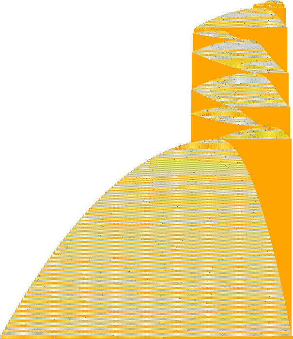

## 42. `1RB0RF_1LC0RA_1LD1LB_0LE---_1LA0LA_1RE1LD` (class C)

- scan: 14 levels, 45 phases, mean factor 1.42 (sd 0.23); level starts: 13 15 37 44 53 72 155 198 257 407 458 593 975 1200
- level analysis: Bell type `LD` with left part `01`, 6 levels; n: 4 44 162 414 1204 3402; ratios: 11.000 3.682 2.556 2.908 2.826; 1 different tails
- verdict: needle-like: only 1 tail (all information in one number)
- diagram: 1,076,279 steps, tape width 1001 cells

## 43. `1RB1RE_0RC---_1RD0RD_1LE0LF_1RA0LD_1LC1RB` (class C)

- scan: 15 levels, 32 phases, mean factor 1.41 (sd 0.25); level starts: 14 32 37 50 61 73 86 156 264 325 397 451 593 1412
- level analysis: Bell type `RC`, 7 levels; n: 8 13 42 157 330 1416 3614; ratios: 1.625 3.231 3.738 2.102 4.291 2.552; 2 different tails
- verdict: needle-like: only 2 tails (all information in one number)
- diagram: 1,270,033 steps, tape width 1001 cells

## 44. `1RB0RE_1LC0RA_0LD1LB_1LA1LE_0LB0LF_1LD---` (class C)

- scan: 7 levels, 13 phases, mean factor 1.90 (sd 0.25); level starts: 13 17 48 79 180 299 620
- level analysis: Bell type `LB` with left part `01`, 7 levels; n: 14 54 186 626 2094 6986 23294; ratios: 3.857 3.444 3.366 3.345 3.336 3.334; 1 different tails
- verdict: needle-like: only 1 tail (all information in one number)
- diagram: 108,486 steps, tape width 1001 cells

## 45. `1RB0LD_1LC0RD_1LA0LC_1RE0LB_1RB1RF_0LD---` (class C)

- scan: 10 levels, 21 phases, mean factor 1.53 (sd 0.25); level starts: 11 15 19 25 44 62 152 170 233 515
- verdict: no clear single-block Bell configuration found
- diagram: 444,830 steps, tape width 1001 cells

## 46. `1RB---_1RC1LE_0RD0RF_0RE0LA_1LF0LB_1LA1LD` (class C)

- scan: 7 levels, 14 phases, mean factor 1.74 (sd 0.26); level starts: 16 24 56 108 220 416 440
- level analysis: Bell type `RD`, 11 levels; n: 4 12 39 119 839 1079 1847 2567 3271 4639 8423; ratios: 3.000 3.250 3.051 7.050 1.286 1.712 1.390 1.274 1.418 1.816; 2 different tails
- verdict: needle-like: only 2 tails (all information in one number)
- diagram: 1,701,691 steps, tape width 1001 cells

## 47. `1RB0LF_1LC0LD_1RD1LB_---1RE_0RA1RE_1LA0LE` (class C)

- scan: 10 levels, 38 phases, mean factor 1.47 (sd 0.26); level starts: 16 18 21 51 108 119 176 249 330 499
- level analysis: Bell type `RE`, 10 levels; n: 4 12 29 62 120 256 516 1016 2108 17222; ratios: 3.000 2.417 2.138 1.935 2.133 2.016 1.969 2.075 8.170; 1 different tails
- verdict: needle-like: only 1 tail (all information in one number)
- diagram: 180,642 steps, tape width 515 cells

## 48. `1RB1RD_1LC0LE_1LD0LB_0RB0RA_1RD1LF_0LC---` (class C)

- scan: 7 levels, 1751 phases, mean factor 1.52 (sd 0.27); level starts: 12 15 20 54 85 116 146
- verdict: no clear single-block Bell configuration found
- diagram: 886,334 steps, tape width 1001 cells

## 49. `1RB1LA_1RC0RF_1RD---_0LE1RB_---0LA_1LD1RF` (class C)
- **BusyBeaverWiki article:** [1RB1LA_1RC0RF_1RD---_0LE1RB_---0LA_1LD1RF](https://wiki.bbchallenge.org/wiki/1RB1LA_1RC0RF_1RD---_0LE1RB_---0LA_1LD1RF)

- scan: 11 levels, 31 phases, mean factor 1.44 (sd 0.27); level starts: 18 25 73 86 138 238 281 312 456 593 711
- level analysis: Bell type `LA` with left part `01`, 4 levels; n: 6 12 27 746; ratios: 2.000 2.250 27.630; 3 different tails
- verdict: no clear single-block Bell configuration found
- diagram: 42,959 steps, tape width 139 cells

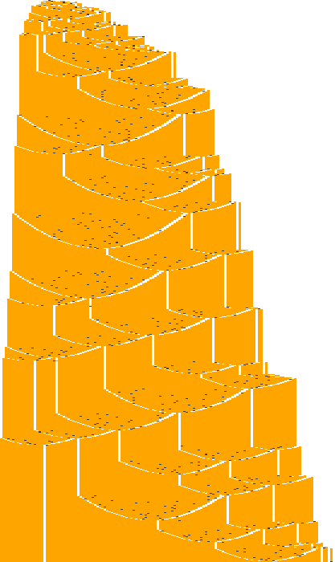

## 50. `1RB1RB_1LC0RE_---1LD_0RA1LB_1RA1LF_0LE1LE` (class C)
- **BusyBeaverWiki article:** [1RB1RB_1LC0RE_---1LD_0RA1LB_1RA1LF_0LE1LE](https://wiki.bbchallenge.org/wiki/1RB1RB_1LC0RE_---1LD_0RA1LB_1RA1LF_0LE1LE)

- scan: 10 levels, 28 phases, mean factor 1.50 (sd 0.28); level starts: 12 14 38 58 122 148 190 224 376 456
- level analysis: Bell type `RB`, 3 levels; n: 4 6 52; ratios: 1.500 8.667; 2 different tails
- verdict: no clear single-block Bell configuration found
- diagram: 932,951 steps, tape width 1001 cells

## 51. `1RB0RE_1LC0RA_1LA1LD_1LC1LF_0LC0LB_1LE---` (class C)

- scan: 10 levels, 19 phases, mean factor 1.60 (sd 0.29); level starts: 21 25 28 69 89 197 260 539 716 1451
- level analysis: Bell type `LA` with left part `01 11 01`, 8 levels; n: 10 28 76 204 546 1458 3890 27660; ratios: 2.800 2.714 2.684 2.676 2.670 2.668 7.111; 1 different tails
- verdict: needle-like: only 1 tail (all information in one number)
- diagram: 166,941 steps, tape width 1001 cells

## 52. `1RB0LC_1RC1RF_1LD0RA_1LE0LD_1RC0LA_0LA---` (class C)

- scan: 11 levels, 28 phases, mean factor 1.61 (sd 0.30); level starts: 8 26 32 42 83 160 244 322 539 860 941
- verdict: no clear single-block Bell configuration found
- diagram: 495,177 steps, tape width 1001 cells

## 53. `1RB1RE_1LC1RE_---1LD_1LE0LB_0RF0LD_1RD1RA` (class C)

- scan: 9 levels, 146 phases, mean factor 1.66 (sd 0.30); level starts: 8 12 15 17 46 57 136 247 471
- verdict: no clear single-block Bell configuration found
- diagram: 488,651 steps, tape width 1001 cells

## 54. `1RB1RF_1LC---_1LE1RD_1RA0RC_0LF0LA_0LD0RB` (class C)

- scan: 10 levels, 49 phases, mean factor 1.53 (sd 0.30); level starts: 12 20 46 52 58 124 135 262 288 564
- level analysis: Bell type `LA` with left part `02`, 9 levels; n: 31 47 111 127 255 1135 3551 6111 12303; ratios: 1.516 2.362 1.144 2.008 4.451 3.129 1.721 2.013; 1 different tails
- verdict: needle-like: only 1 tail (all information in one number)
- diagram: 754,212 steps, tape width 1001 cells

## 55. `1RB1LF_0RC1RD_1LA1LD_1LE0RA_---1LC_0LA1LA` (class C)
- **BusyBeaverWiki article:** [1RB1LF_0RC1RD_1LA1LD_1LE0RA_---1LC_0LA1LA](https://wiki.bbchallenge.org/wiki/1RB1LF_0RC1RD_1LA1LD_1LE0RA_---1LC_0LA1LA)

- scan: 10 levels, 26 phases, mean factor 1.48 (sd 0.32); level starts: 12 14 16 52 70 134 176 226 366 420
- level analysis: Bell type `LA` with left part `01 12 01`, 2 levels; n: 4 9; ratios: 2.250; 1 different tails
- verdict: no clear single-block Bell configuration found
- diagram: 905,251 steps, tape width 1001 cells

## 56. `1RB1LE_1LB1LC_1RD0LE_---0RB_1RF1LA_0RA0RD` (class C)
- **BusyBeaverWiki article:** [1RB1LE_1LB1LC_1RD0LE_---0RB_1RF1LA_0RA0RD](https://wiki.bbchallenge.org/wiki/1RB1LE_1LB1LC_1RD0LE_---0RB_1RF1LA_0RA0RD)

- scan: 14 levels, 28 phases, mean factor 1.43 (sd 0.32); level starts: 10 24 27 31 35 51 57 61 73 102 204 224 349 1056
- level analysis: Bell type `RB`, 11 levels; n: 5 8 14 39 110 232 357 1064 1614 4539 13610; ratios: 1.600 1.750 2.786 2.821 2.109 1.539 2.980 1.517 2.812 2.998; 1 different tails
- verdict: needle-like: only 1 tail (all information in one number)
- diagram: 391,938 steps, tape width 1001 cells

