# Bell candidates among the 663 BB(6) holdouts

The 56 machines that the Bell scan (`bellscan.c`, 10⁷ steps per machine) marked as Bell-like (`bell_candidates.txt`), each with a space-time diagram from the blank tape.

- **Class** (from the scan): **A** = regular geometric growth like TM1/TM2 (sd < 0.12, one phase per level); **B** = Bell-like with another factor or several phases per level; **C** = irregular.
- **Level analysis**: a second detector (single-block Bell configurations, up to 3·10⁸ steps) looks at the tape at the start of each level: the long block, its growth ratio, and how many *different* short tails occur. Many different tails at a regular ratio is the signature of a vampire-like machine (a finite Bell table can then be derived); one or two tails means a "needle" (all information is in one number; halting needs an exact value).
- **Holdout status (24 Oct 2026)**: compared with the current list of 623 BB(6) holdouts (`holdouts_623.txt`). 40 machines of the old list of 663 have been decided since (`decided_663_to_623.txt`); **none of them is among the 56 candidates**. All 56 candidates, including TM1, TM2 and the halting machine `1RB0RB_1LC1RF_0RD0LB_0RA1LE_1LD---_0RB0RC`, are still in the holdout list.
- **Holdout status (30 Oct 2026)**: compared with the new list of 608 holdouts (`holdouts_608.txt`). 15 machines have been decided or proved to be equivalent since the list of 623 (`decided_623_to_608.txt`). Two of them are candidates:
  - **no. 8** (`1RB0RB_1LC1RF_0RD0LB_0RA1LE_1LD---_0RB0RC`): halt found with the vampire method; the formal Coq/Rocq proof (busycoq PR #41) has been accepted;
  - **no. 11** (`1RB1LB_1RC---_1LD1LF_1LE0LD_0LA1RF_1LC0RE`). removed from the list because it is equivalent to **no. 37**

  All other candidates (nos. 1–56 and 57–108) are still holdouts. No. 8 is decided; no. 11 is equivalent to no. 37.
- **BusyBeaverWiki (26 Oct 2026)**: **14 of the 56 candidates have their own article on the [BusyBeaverWiki](https://wiki.bbchallenge.org/wiki/Category:Individual_machines)** (marked **wiki** in the table and linked in the section): nos. 10, 13, 14, 15, 24, 28, 33, 34, 40, 41, 49, 50, 55, 56. Three of them are cryptids: no. 15, no. 33 ("Space Needle") and no. 40 ("Lucy's Moonlight"). No. 24 is listed as chaotic but not a cryptid. Checked against the 119 pages of the wiki category *Individual machines* and the [Cryptids](https://wiki.bbchallenge.org/wiki/Cryptids) page; machines with an article outside that category, or under an equivalent form of the code, would be missed.
- **Related machines among the candidates (29 Oct 2026).** Tools: `scan/groups.py` (transition tables compared up to renaming of the states and mirroring), `scan/meet.c` and `scan/pairs.py` (do two runs reach the same configuration?).
  - *Same table, different start state.* 9 groups have exactly the same transition table up to renaming and mirroring; they differ only in the start state:

    | group | what is known |
    |---|---|
    | 1, 2, 5 | vampire family: TM1-F, TM1, TM2a (core with F0 = `1LA`); three different orbits (O2, O1, O3) |
    | 3, 7 | vampire family: TM2, TM2b' (F0 = `1LC`); orbits O2 and O4 |
    | 4, 6 | vampire family: TM2', TM2b (F0 = `1RB`); orbits O2 and O4 |
    | 26, 31, 32 | 31 and 32: nearly the same Bell sequence (the numbers differ by about 2, the prefixes are sometimes shifted by one Bell), but no common configuration; very probably equivalent: the long Bells coincide with a one-cell difference (see below). No. 26 runs differently (no common configuration) |
    | 19, 20, 39 · 22, 42, 43 · 45, 52 · 46, 54 | no common configuration found; 22/42 drift apart (see below) |

    "No common configuration" means: the configuration of one run after 2·10⁷ steps does not occur in the other run within 2·10⁸ steps, in both directions. A meeting later, or an equivalence with a small difference on the tape (as for 31/32), is not excluded. For 22/42 the tapes after 2·10⁷ steps have the same structure with slightly different numbers.
  - *Tables that differ in one or two transitions.*
    - Nos. 1–7 (the vampire family, one transition: F0). Equivalent orbits are known there: TM2, TM1-F and TM2' share orbit O2, and TM2b and TM2b' share O4 (see the main README).
    - Nos. **13 and 15** (no. 15 is a cryptid on the wiki; no. 13 has its own article) and nos. **34 and 50** differ in one transition.
    - Nos. 27/29, 34/55 and 50/55 differ in two.

    Whether their runs are related has not been checked.
  - *Closer look (29 Oct 2026).*
    - **31 / 32: very probably equivalent.** In the naming of no. 31, no. 32 is the same table started in D (`m31/bellsQ.c`). Compare the starts of the long Bells (new right cell in state A) of both runs.
      - All long Bells occur in both runs with the same tape width: 27 of them, from width 172 to 192,220, up to 1.6·10¹⁰ steps.
      - Each time the state is the same, and the tapes differ in **exactly one cell**, the third from the right end: one run has `1^n` there, the other `1^(n−2) 0 1`.
      - The other run is 7,978 … 8,012 steps behind, a bounded lag.

      So the two runs follow each other with a one-cell difference that never grows. A proof would need a local lemma showing that this difference survives every Bell and never leads to a different HALT decision. Not proven.
    - **22 / 42: not equivalent.** Same table, but the runs drift apart. Tape widths after 10⁹ steps are 39,335 and 39,747, after 2·10⁹ steps 59,649 and 40,160. The record configurations agree only at the ends of the tape, not inside (`recev.c`, `cmpev.py`).
    - **13 / 15: the same Bell skeleton, shifted by one.** In the naming of no. 15, no. 13 differs only in A0 (`1RE` instead of `1RB`), and A0 is used once per Bell.
      - Both machines have Bell configurations `1^n [0] 11` (head on the 0, state A).
      - For n = 4 … 39 (`bmapAB.py`) the Bell map of no. 13 is exactly that of no. 15 plus one: **F₁₃(n) = F₁₅(n) + 1**, with the same halting values (n = 11, 27) and the same exceptional values (n = 7, 19).
      - The orbits differ: no. 15 runs through n = 4, 9, 14, 24, 39, 47, …; no. 13 through 10, 19, 26, 35, 42, 67, ….
      - So the machines are not equivalent. But an analysis of the cryptid no. 15 (its map F₁₅) applies to no. 13 with the shifted map F₁₅ + 1.
  - *Nos. 57–108 (29 Oct 2026).* All 108 candidates were compared with `groups.py`.
    - **Same table, different start state:** 12 new groups.

      | group | note |
      |---|---|
      | 44, 81, 89, 96 | no. 44 is one of the first 56 |
      | 51, 61, 71, 93 | no. 51 (probviously halting cryptid) is one of the first 56; no. 61 is also a probviously halting cryptid |
      | 58, 68 | both Antihydra-like cryptids, probviously nonhalting |
      | 72, 73, 97 · 74, 77 · 75, 106 · 76, 99 · 78, 79, 92 · 80, 91, 108 · 94, 103 | |

      For all 26 pairs within these groups (`equiv_57_108.py candidates_112.txt 20000000 200000000`, with `meet.c`), the configuration of one run after 2·10⁷ steps does **not** occur in the other run within 2·10⁸ steps, in both directions. The record events (`recev.c`, `cmpev.py`, 3·10⁸ steps) also show no "same interior, different ends" pattern as for 31/32. Nos. 72/97 have the same interior only at the beginning (widths 144–155), then they separate. **No equivalence found.**
    - **Tables that differ in one transition:** nos. 63 and 98. **In two transitions:** 53/85, 70/86 and 84/101. The transitions in which they differ are all used, so they are not trivially the same.
      - **70/86** run almost identically: tape widths after 3·10⁸ steps are 27,942 and 27,922, the same record widths occur, and the step lag grows only slowly (0.2 %).
      - The other pairs separate more clearly (widths 14,910/16,491, 26,711/26,455, 14,060/14,673).
      - Not checked further.
- **Diagram**: time runs downward, one pixel column per tape cell (scaled up for narrow tapes), symbol 1 orange, 0 white; at most 700 sampled rows. Each diagram runs up to the start of the 8th Bell found by the detector (so the first 7 Bells are complete) or until the tape is 1000 cells wide, whichever comes first.

## Vampire-like TMs (13 Nov 2026)

Machines whose Bell map is driven by the digits of one large number n (n' ≈ q·n, with q = 3/2 or 4/3) and a short word or tail, so that a HALT needs a certain sequence of residues of n ("lottery"). The expected values come from a Markov estimate (random residues) and are heuristics, not proofs.

**Status:** *simulated to HALT* = the HALT was found by exact simulation of the Bell map; *+ proof* = in addition a formal Rocq proof; *open* = no HALT found yet.

| no. | machine | type | status | expected HALT (Markov) | computing time to HALT | steps of the original TM |
|---|---|---|---|---|---|---|
| 🟩 [8](#8) | `1RB0RB_1LC1RF_0RD0LB_0RA1LE_1LD---_0RB0RC` | vampire, 4/3, closed table (192 words) | **simulated to HALT + proof** (Bell 298,793,335, 21 Oct; Rocq proof busycoq PR #41, accepted) | 1.6·10⁻⁹ per Bell → ≈ 6·10⁸ Bells | ≈ 2 min on one core (`belldc3`) | ≈ 10^(7.5·10⁷) |
| 🟩 [1](#1) | `1RB0RF_1LC---_1RD0LC_0RE0RD_1LF1LC_1LE1RA` (TM1-F, orbit O2) | vampire family, 3/2, closed table (2,880 words) | **simulated to HALT** (Bell 731,899,010,932, Ahmer Raza, 30 Oct; confirmed by Thomas Reus) | 8.9·10⁻¹³ per Bell → ≈ 1.1·10¹² Bells (median 7.8·10¹¹) | 23 h 42 min on 8 cores (AMD EPYC 9655, `belldco`); ≈ 13–14 days on a notebook | ≈ 10^(2.58·10¹¹) |
| 🟩 [2](#2) | `1RB---_1LC0RB_0LD0LC_1RE1RB_1RD1LF_1LA0LE` (TM1, O1) | as no. 1 | **simulated to HALT** (Bell 747,242,483,684, Ahmer Raza, 30 Oct) | as no. 1 | 24 h 29 min on 8 cores | ≈ 10^(2.63·10¹¹) |
| 🟩 [3](#3) | `1RB0LA_0RC0RB_1LD1LA_1LC1RE_1RF0RD_1LC---` (TM2, O2) | as no. 1 | **simulated to HALT** (orbit O2, as no. 1) | as no. 1 | as no. 1 | ≈ 10^(2.58·10¹¹) |
| 🟩 [4](#4) | `1RB0RE_1RC---_0RD0RC_1LE1LF_1LD1RA_1RC0LF` (TM2', O2) | as no. 1 | **simulated to HALT** (orbit O2, as no. 1) | as no. 1 | as no. 1 | ≈ 10^(2.58·10¹¹) |
| 🟩 [5](#5) | `1RB0LA_0RC0RB_1LD1LA_1LC1RE_1RF0RD_1LA---` (TM2a, O3) | as no. 1 | **simulated to HALT** (Bell 1,961,935,897,288, Ahmer Raza, 30 Oct) | as no. 1 | 79 h on 8 cores (65 h of new progress) | ≈ 10^(6.91·10¹¹) |
| 🟩 [6](#6) | `1RB---_0RC0RB_1LD1LE_1LC1RF_1RB0LE_1RA0RD` (TM2b, O4) | as no. 1 | **simulated to HALT** (Bell 1,941,376,761,248, Ahmer Raza, 1 Nov) | as no. 1 | several days on 8 cores | ≈ 10^(6.84·10¹¹) |
| 🟩 [7](#7) | `1RB0RF_1LC---_1LF1LD_1RE0LD_0RC0RE_1LC1RA` (TM2b', O4) | as no. 1 | **simulated to HALT** (orbit O4, as no. 6) | as no. 1 | as no. 6 | ≈ 10^(6.84·10¹¹) |
|  [105](#105) | `1RB1LF_1LC0RD_---1LA_0LA0RE_1LA1RA_1LB0LD` | vampire-like, 4/3, small tail counter; 35-level residue path to HALT | **open** (100,000 levels without HALT) | 1.1·10⁻¹⁴ per level → ≈ 9·10¹³ levels (median 6·10¹³) | ≈ 5,000× the TM2 run: about 200 years on a notebook, a few years on a large cluster (simulator still to be written) | ≈ 10^(2.25·10¹³) |
|  [51](#51) | `1RB0RE_1LC0RA_1LA1LD_1LC1LF_0LC0LB_1LE---` | 8/3 map, memory word r as a stack (table **not** closed); 108-step path to HALT from r = empty | **open** (probviously halting cryptid; 400 macro steps, about 10^320 TM steps, no HALT; closest approach 102 macro steps) | about 3^−80 per reset of r (wiki, Racheline) | out of reach | ≈ 10^10^38 (wiki, heuristic) |
|  [61](#61) | `1RB---_0RC0RE_1RD1RF_1LE0LB_1RC0LD_1RC1RA` | same machine as no. 51, start state F (in the naming of no. 51); reaches C(12, [6]) after 111 steps | **open** (probviously halting cryptid; 400 macro steps without HALT, closest approach 103 macro steps) | as no. 51 | out of reach | ≈ 10^10^38.1 (wiki, heuristic) |
|  [71](#71) | `1RB1RD_1LC0LE_1RA0LB_1RA1RF_0RA0RC_1RE---` | same machine as no. 51, start state C; reaches C(16, empty) of no. 51 after 95 steps | **open** (400 macro steps, about 10^320 TM steps, no HALT; closest approach 101 macro steps) | as no. 51 | out of reach | ≈ 10^10^38 (as no. 51) |
|  [93](#93) | `1RB0LC_1RC1RE_1LA0LD_0RB0RA_1RB1RF_1RD---` | same machine as no. 51, start state B; reaches C(6, empty) of no. 51 after 18 steps | **open** (400 macro steps, about 10^320 TM steps, no HALT; closest approach 103 macro steps) | as no. 51 | out of reach | ≈ 10^10^38 (as no. 51) |
|  [31](#31) | `1RB1RF_1RC0LD_1LB1RA_1RE1LE_0RC0LB_0RB---` | vampire-like, 4/3, nested sub-process (prefix table mod 6); table with several blocks, not closed | **open** (202 Bells, 10³⁵·⁵ steps without HALT) | below 2·10⁻⁶ per Bell (measured upper bound) | unknown | – |
|  [32](#32) | `1RB1LB_0RC0LD_1LD1RE_1RC0LA_1RD1RF_0RD---` | as no. 31 (very probably equivalent) | **open** | as no. 31 | unknown | – |

Not included:
- No. 19: it has the scan signature "vampire-like", but a closer look shows a two-number system that is probably non-halting.
- The tetrational cryptids (nos. 60, 62–66) and the needle-like machines (e.g. nos. 42, 45/52): HALT there needs an exact value of a counter, not a residue pattern.

More machines can be added here as they are found.

## Same transition table (the 12 TM rules) among the 607 holdouts (13 Nov 2026)

All 607 machines of the Holdout Guide (status of 3 Nov 2026) were compared, transition table against transition table, up to renaming of the states and mirroring (L ↔ R) (`scan/groups607/groups607.py`, table made with `mk_table.py`). Two machines with the same table are the same machine, started in different states, like nos. 51, 61, 71 and 93. "Table" here means the plain transition table of the Turing machine (its 12 rules, as in the machine code), not a macro table such as the Bell table of the vampire family.

- **130 groups, 335 of the 607 machines.** Group sizes: 71 of size 2, 45 of size 3, 12 of size 4, 2 of size 5.
- "start X" means: this machine is the machine in column 2 (the first member of the group) started in state X, possibly mirrored. In bbchallenge normal form each start state gives another code.
- Same table does not mean equivalent. The runs from the different starts are different halting questions, unless they meet; this was checked only for the candidates (see *Related machines among the candidates*).
- A proof for one member (e.g. a closed family of configurations that never halts) often transfers to the others if it covers their starts too. In the guide such proofs always cover the whole group: groups 11, 72 and 119 (proof in an open PR) and 75 and 96 (proof ready) have the same status for all members. Cryptids occur in groups 27 (= nos. 51, 61, 71, 93), 44 (= nos. 46, 54), 74 (= nos. 58, 68) and 78 (no. 24 and two others).
- Column 3: Holdout Guide number, candidate number (if any), start state, guide status. Column 4: the guide's classes of the members.

- **Check (14 Nov 2026, our own):**
  - All groups were recomputed from the machine codes, and every member was checked by simulating it next to the first member started in the given state (`verify_groups.py`, 200,000 steps, all 205 agree). The 608-machine list gives the same 130 groups (its one extra machine has no partner), and no machine of the list is a hidden mirror copy of another.
  - Inside every group, the runs from the different starts were tested for meeting (`meetgroups.py`, configuration after 2·10⁷ steps searched within 2·10⁸ steps, both directions): none of the 298 pairs meets, so no two members are trivially equivalent.
  - **class differs**: the Holdout Guide gives the members of the group different classes (only group 85). Different guide statuses inside a group were checked with the space-time diagrams (`diagrams/groupN.png`); in all such groups the members show the same behaviour, so the status difference only reflects how far each member was looked at.
  - **behaviour test differs**: in our test the two runs differ. The test compares the repeated patterns on the tape (token bag of the record tapes, cosine ≥ 0.8) and the growth of the tape (exponent of width against steps, difference < 0.1) over 10⁸ steps (`regime.py`). It is a heuristic: it can miss a common behaviour that shows up only later, as for nos. 51/61/71/93, where the analysis by hand shows the same macro model for all four.

| group | machine (first member) | members | class | check (14 Nov 2026) |
|---|---|---|---|---|
| 1 | `1RB1LD_1LC0RF_0RD0LB`<br>`1LB0LE_1LA---_0RA0RF` | #5: start A, structure<br>#286: start D, mirrored, structure | Bouncer + Chaotic Edge | ok |
| 2 | `1RB1LE_0RC1RC_0RD0RB`<br>`1RE0RF_1LA0LE_---1RB` | #7: start A, structure<br>#535: start E, mirrored, structure | Chaotic Fractal Type 1 | ok |
| 3 | `1RB0LE_1RC0LB_1RD1RF`<br>`1RE0RB_1LA0RD_0RE---` | #11: start A, structure<br>#287: start C, structure<br>#423: start E, mirrored, structure | Chaotic Bell Class 3 | behaviour test differs: #11/#287, #11/#423 |
| 4 | `1RB1LF_1LC1RD_1RA1LA`<br>`0RA0RE_0RC---_1RF0LC` | #12 = [73](#73): start A, lottery<br>#84 = [72](#72): start B, mirrored, lottery<br>#440 = [97](#97): start C, lottery | Bell-like | ok; one machine, the same level map for all three (see no. 73) |
| 5 | `1RB0LB_1RC0LA_1RD---`<br>`0RE1LD_1LF0RF_1LA1RB` | #13: start A<br>#243: start E, mirrored | Skelet 1-like Class 1 | ok |
| 6 | `1RB0LE_1RC1RF_1RD0RA`<br>`1LE0RC_1LC0LD_0RD---` | #17: start A, structure<br>#168: start D, mirrored, structure<br>#332: start C, structure<br>#342: start E, mirrored, structure | Chaotic Bell Class 3 | ok |
| 7 | `1RB1LD_1LC---_1RE0LD`<br>`1LC1LD_1RF0RE_1RA0RC` | #20: start A, rules known<br>#588: start F, rules known | Structural counter + chaotic edge | ok |
| 8 | `1RB0LD_1RC0RF_1LA1RF`<br>`0LA0RE_1LD---_0RA0RD` | #21: start A, lottery<br>#106: start C, mirrored, lottery<br>#182: start E, mirrored, lottery<br>#214: start B, lottery | Skelet 1-like Class 1 | ok |
| 9 | `1RB1RA_1LC0RF_1LD1LC`<br>`1LE0LB_0LF---_1RA1RB` | #23: start A<br>#215: start B, mirrored<br>#288: start D, mirrored<br>#502: start F | – | ok |
| 10 | `1RB1RE_0RC---_1RD0RD`<br>`1LE0LF_1RA0LD_1LC1RB` | #25 = [43](#43): start A, lottery<br>#37 = [42](#42): start D, mirrored, lottery<br>#336 = [22](#22): start C, lottery | Quadratic Mess | ok |
| 11 | `1RB0RE_1RC0RA_0LD0LB`<br>`0LA1LE_1LC1LF_0LA---` | #28: start A, **open PR**<br>#430: start E, mirrored, **open PR** | Chaotic Bell Class 3 | ok |
| 12 | `1RB1RA_1LC1LE_1RA1LD`<br>`0LB0LC_1LF0RE_1LB---` | #30: start A, rules known<br>#73: start B, mirrored, rules known<br>#169: start E, mirrored, rules known<br>#354: start F, mirrored, rules known | Shift-overflow counter | behaviour test differs: #73/#354 |
| 13 | `1RB1LF_1LC1RB_1LF1LD`<br>`1LE0RD_1LB---_1LA0LA` | #31: start A, rules known<br>#222: start B, mirrored, rules known | Shift-overflow structural counter | ok |
| 14 | `1RB0LC_0RC0RF_1RD0RE`<br>`1LE0RA_0LA0LE_0RC---` | #32: start A, lottery<br>#170: start C, lottery<br>#333: start D, mirrored, lottery | Skelet 1-like Class 1 | ok |
| 15 | `1RB0LF_1LC0RB_0LD1LA`<br>`0RA1LE_0LA0RA_1LA---` | #33: start A, lottery<br>#39: start B, mirrored, lottery | Chaotic Fractal Type 1 | ok |
| 16 | `1RB1RD_1LC0LE_1LD0LB`<br>`0RB0RA_1RD1LF_0LC---` | #38 = [48](#48): start A, rules known<br>#59: start B, mirrored, structure<br>#124: start C, mirrored, structure | Unknown | ok |
| 17 | `1RB0LE_1RC1RA_1RD0RF`<br>`1RE0RA_1LA1LD_1RA---` | #40: start A, rules known<br>#250: start E, mirrored, rules known<br>#327: start C, rules known<br>#540: start D, rules known | Unknown | ok |
| 18 | `1RB0RD_1RC0LF_1LA0LB`<br>`---1RE_1LB1RA_0LC0RA` | #42 = [74](#74): start A, structure<br>#140 = [77](#77): start B, structure | Bell-like | ok |
| 19 | `1RB0LF_1RC0RB_0RD1LE`<br>`0LE0RA_1LC1LA_0LD---` | #44: start A, structure<br>#390: start B, structure | Unknown | ok |
| 20 | `1RB0LF_1RC1RB_1LD0RA`<br>`1LA0LE_0LC1LC_1LE---` | #46: start A, structure<br>#526: start B, structure<br>#576: start F, mirrored, structure | Unknown | ok |
| 21 | `1RB1LD_1RC1RE_1LA0RA`<br>`1RC0LB_0LA1RF_---1RB` | #47: start A<br>#91: start C, mirrored | Skelet 1-like Class 1 | ok |
| 22 | `1RB0LC_0RC0RB_1LD0RE`<br>`0LE0LF_1LA0LB_1RA---` | #49: start A, lottery<br>#100: start C, mirrored, lottery<br>#248: start E, mirrored, lottery | Skelet 1-like Class 1 | ok |
| 23 | `1RB0RC_1LC0RD_0LD0LC`<br>`1RE0LA_0RA0RF_1RC---` | #52: start A, lottery<br>#263: start D, lottery<br>#541: start B, mirrored, lottery | Skelet 1-like Class 1 | ok |
| 24 | `1RB0LC_1RC0RA_1LA0LD`<br>`1LE0RB_1RD1LF_0LA---` | #54: start A, structure<br>#200: start B, structure<br>#272: start D, mirrored, structure<br>#545: start C, mirrored, structure<br>#570: start E, structure | Chaotic Bell Class 3 | behaviour test differs: #54/#272, #200/#272, #200/#545, #272/#545, #272/#570 |
| 25 | `1RB0LC_1RC1RF_1LD0RA`<br>`1LE0LD_1RC0LA_0LA---` | #58 = [52](#52): start A, rules known<br>#104 = [45](#45): start E, structure | Quadratic Mess | ok |
| 26 | `1RB1RC_1LC1LE_1RD0RA`<br>`1LB0RA_0LD1LF_1LD---` | #60: start A, lottery<br>#146: start D, mirrored, lottery<br>#218: start C, lottery<br>#485: start B, mirrored, lottery | Skelet 1-like Class 1 | ok |
| 27 | `1RB---_0RC0RE_1RD1RF`<br>`1LE0LB_1RC0LD_1RC1RA` | #62 = [61](#61): start A, **cryptid**<br>#212 = [71](#71): start C<br>#369 = [51](#51): start D, mirrored, **cryptid**<br>#377 = [93](#93): start E | Bell-like | ok |
| 28 | `1RB0RE_0RC1RE_1RD1LE`<br>`0LE---_1RA1LF_1RF0LC` | #64: start A, lottery<br>#371: start C, lottery<br>#602: start E, lottery | Skelet 1-like Class 1 | ok |
| 29 | `1RB0LD_1RC0RF_0LD0LE`<br>`1RF1LC_0LB1LE_0RA---` | #65: start A, lottery<br>#381: start B, lottery<br>#590: start D, lottery | Skelet 1-like Class 1 | ok |
| 30 | `1RB0LD_1RC0RB_1RD1RF`<br>`1LE0LD_1RB1LA_---0RE` | #66: start A<br>#438: start B, structure<br>#532: start C, structure | Unknown | ok |
| 31 | `1RB1RD_1RC1LD_0LA1RA`<br>`1LE0RC_---1LF_0LA0LB` | #67 = [75](#75): start A, rules known<br>#597 = [106](#106): start B, rules known | Bell-like | ok |
| 32 | `1RB0RC_1LC0RD_0LD0LC`<br>`1RE0LA_0RA0RF_0RD---` | #68: start A, lottery<br>#97: start B, mirrored, lottery<br>#334: start D, lottery | Skelet 1-like Class 1 | ok |
| 33 | `1RB1LD_1RC1RE_1LA0RA`<br>`1RC0LB_0LA1RF_---1RD` | #69: start A<br>#166: start B | Skelet 1-like Class 1 | ok |
| 34 | `1RB---_0RC0LA_1LD0RB`<br>`1LE0RF_1LF1LC_1LB0LD` | #70: start A, rules known<br>#85: start C, mirrored, structure<br>#409: start D, mirrored, structure | Shift-overflow bouncer counter | ok |
| 35 | `1RB0RC_1LC0RD_0LD0LC`<br>`1RE0LA_0RA0RF_0LC---` | #71: start A, lottery<br>#105: start B, mirrored, lottery<br>#338: start D, lottery | Skelet 1-like Class 1 | ok |
| 36 | `1RB---_1LC0RB_0LD0LC`<br>`1RE1RB_1RD1LF_1LA0LE` | #75 = [2](#2): start A, HALT found (TM1, O1)<br>#419 = [1](#1): start F, mirrored, HALT found (TM1-F, O2)<br>#552 = [5](#5): start B, mirrored, HALT found (TM2a, O3) | Bell-like | ok: vampire family, all members HALT found by simulation (30 Oct / 1 Nov); guide status of 3 Nov outdated |
| 37 | `1RB---_0RC0RF_0RD0RA`<br>`1RE0LB_1LF0LE_1RC0LE` | #77: start A, structure<br>#498: start E, mirrored, structure | Unknown | ok |
| 38 | `1RB---_0LC0LB_1RF0LD`<br>`1RE0RB_1LB0RC_0RD1RA` | #78: start A, lottery<br>#403: start E, mirrored, lottery<br>#408: start C, lottery | Skelet 1-like Class 1 | ok |
| 39 | `1RB0LA_0RC1RF_0LD1RE`<br>`1LA0RB_0RD---_1RA1RD` | #79: start A, structure<br>#282: start D, mirrored, structure | Shift-overflow counter | ok |
| 40 | `1RB0RC_1RC1RA_1LD0RA`<br>`0LE1RA_---1LF_1RB0LF` | #80: start A, structure<br>#270: start B, structure | Bouncer + Chaotic Edge | ok |
| 41 | `1RB1RF_1RC0RA_1LD1RB`<br>`1LE0LD_0RA0LB_0RB---` | #83: start A, rules known<br>#402: start B, rules known<br>#462: start D, mirrored, rules known | Shift-overflow counter | ok |
| 42 | `1RB---_0RC0LA_1LD0RB`<br>`1LE1LD_1LF0LC_1LB1RE` | #90: start A, lottery<br>#203: start D, mirrored, lottery<br>#292: start F, mirrored, lottery | Chaotic 1dCA-like in bouncer | ok |
| 43 | `1RB1RA_1LC0RA_1LD0LC`<br>`0LE0LB_1LF1RF_1LA---` | #98: start A, structure<br>#455: start B, mirrored, structure | Structural counter + chaotic edge | ok |
| 44 | `1RB---_1RC1LE_0RD0RF`<br>`0RE0LA_1LF0LB_1LA1LD` | #103 = [46](#46): start A, **cryptid**<br>#464 = [54](#54): start F, mirrored, **cryptid** | Quadratic Mess | ok |
| 45 | `1RB1RF_1LC0RE_1LE1LD`<br>`1RE0LC_1RA1RA_1RD---` | #108: start A, structure<br>#163: start F, structure | Shift-overflow counter | ok |
| 46 | `1RB1RA_1LC0LF_1RA1LD`<br>`1LB1LE_1LC0LC_---0RA` | #109: start A, structure<br>#372: start B, mirrored, structure<br>#572: start D, mirrored, structure | Spaghetti | ok |
| 47 | `1RB0RA_0RC0LE_0LD1RA`<br>`1LB0RF_0LD1LC_1RD---` | #113: start A, structure<br>#453: start D, mirrored, structure | Unknown | behaviour test differs: #113/#453 |
| 48 | `1RB---_0RC0LF_1LD0RE`<br>`1RC0LB_1RD1RA_1LB0LC` | #114: start A, rules known<br>#367: start D, rules known<br>#378: start C, mirrored, rules known | Monotone list | ok |
| 49 | `1RB0RF_1RC0RA_1LD1RB`<br>`1LE0LD_1LB0LB_0RB---` | #115: start A, rules known<br>#144: start B, rules known<br>#456: start D, mirrored, rules known<br>#537: start E, mirrored, rules known | Shift-overflow counter | ok |
| 50 | `1RB0RA_1LC0RA_0LD0LC`<br>`1RD1RE_1LF0LE_---0LB` | #116: start A, lottery<br>#513: start B, mirrored, lottery | Unknown | ok |
| 51 | `1RB---_1LC0RF_1LD0LC`<br>`0RE0LF_0RD1LA_1RB0LE` | #117: start A, structure<br>#405: start C, mirrored, structure | Unknown | ok |
| 52 | `1RB0RA_1LC0RE_0LD0LB`<br>`1LA1LF_1RA0LF_1LC---` | #126: start A, rules known<br>#154: start D, mirrored, rules known<br>#370: start B, mirrored, rules known<br>#463: start E, rules known | Unknown | ok |
| 53 | `1RB0LB_1RC0LD_0LA1RD`<br>`1LC1LE_1LF0RE_1LD---` | #127: start A, structure<br>#291: start E, mirrored, structure | Unknown | ok |
| 54 | `1RB1LF_1LC0RD_---1LD`<br>`1RB1RE_1LA0LB_0LA0LE` | #129 = [76](#76): start A, rules known<br>#465 = [99](#99): start E, mirrored, rules known | Bell-like | ok |
| 55 | `1RB1RC_1LC0RC_0RA0LD`<br>`0LE---_0LF1LD_1LC1LE` | #132: start A<br>#143: start B, mirrored | Chaotic Ack-like Bell | ok |
| 56 | `1RB0LC_1LC0RE_1LD1LB`<br>`1LA1LD_1RF0RA_---1RE` | #133: start A<br>#581: start C, mirrored | Skelet 1-like Class 1 | ok |
| 57 | `1RB1RE_1RC0RF_0LD---`<br>`1LE1LD_1RA0LB_0RE1RF` | #138: start A, lottery<br>#227: start E, lottery<br>#308: start B, lottery<br>#358: start D, mirrored, lottery | Unknown | ok |
| 58 | `1RB0LE_0RC---_1RD0LA`<br>`1RE0RA_1LC0LF_0RC1LC` | #141: start A, rules known<br>#315: start E, mirrored, rules known | Monotone list | ok |
| 59 | `1RB0LC_1RC0RA_1LA0LD`<br>`1LE0RB_1RB1LF_0LA---` | #145: start A, structure<br>#310: start C, mirrored, structure<br>#313: start B, structure | Chaotic Bell Class 3 | behaviour test differs: #145/#313 |
| 60 | `1RB0LE_0LC0RB_1RD1LD`<br>`1RA1LF_0LB1LE_---1LB` | #147: start A, structure<br>#394: start C, structure | Shift-overflow counter | ok |
| 61 | `1RB0RE_1LC0LE_---1LD`<br>`1LE1LB_1RA0LF_0RD1LA` | #149: start A, rules known<br>#328: start D, mirrored, rules known | Quadratic Mess | ok |
| 62 | `1RB1LF_1RC1LD_1LB1LE`<br>`1LE0LD_0LA0RE_1RD---` | #150 = [78](#78): start A, lottery<br>#160 = [79](#79): start B, lottery<br>#349 = [92](#92): start D, mirrored, lottery | Bell-like | ok |
| 63 | `1RB0RF_1LC1LF_1RD1LC`<br>`---1RE_0RC1RF_1RA0LB` | #151: start A, rules known<br>#472: start F, rules known | Shift-overflow counter | ok |
| 64 | `1RB1RE_0LC0LF_0LA0LD`<br>`1LE1LC_1RA0LB_---0RE` | #152: start A, rules known<br>#324: start E, rules known | Quadratic Mess | behaviour test differs: #152/#324 |
| 65 | `1RB0RF_0LC1LB_1RD1LA`<br>`1RE0LC_0RA1RD_---0RC` | #161: start A, structure<br>#553: start D, structure<br>#562: start C, structure | Chaotic Bell Class 1 | ok |
| 66 | `1RB1RF_0RC0LE_1RD0RF`<br>`1LB---_1LB1LE_1RA0LC` | #162: start A, structure<br>#202: start E, mirrored, structure<br>#477: start C, structure | Unknown | ok |
| 67 | `1RB0LC_1LA0RD_1RA0LA`<br>`1RE1RD_1RA1RF_1LC---` | #165: start A<br>#373: start C | Skelet 1-like Class 1 | ok |
| 68 | `1RB0RE_1LC0RA_1LD0LC`<br>`0LE0LB_1RA1RF_0LC---` | #172: start A, structure<br>#311: start C, mirrored, structure | Shift-overflow bouncer counter | ok |
| 69 | `1RB1RA_1LC0RB_1LE0LD`<br>`0LB1LD_0RA0LF_---0RE` | #174 = [80](#80): start A, structure<br>#326 = [91](#91): start B, mirrored, structure<br>#604 = [108](#108): start C, mirrored, structure | Bell-like | ok |
| 70 | `1RB0LD_0RC1RA_1RD1RE`<br>`1LA0LE_0RA0RF_1RC---` | #175 = [81](#81): start A, rules known<br>#297 = [89](#89): start F, rules known<br>#410 = [96](#96): start C, rules known<br>#507 = [44](#44): start D, mirrored, rules known | Bell-like | ok |
| 71 | `1RB1RE_1LC0RA_1LA0LD`<br>`1LB0LF_0RB0LE_0LA---` | #176: start A, rules known<br>#600: start D, mirrored, rules known | Quadratic Mess | ok |
| 72 | `1RB0RA_0RC0LD_1LA1RF`<br>`1LE1LD_1LB1RE_---1RA` | #177: start A, **open PR**<br>#574: start D, mirrored, **open PR** | Counter Class 3 | behaviour test differs: #177/#574 |
| 73 | `1RB0LE_1RC0RE_1RD0RA`<br>`1RE1LC_0LA0RF_1LE---` | #178: start A, lottery<br>#205: start F, mirrored, lottery<br>#491: start B, lottery | Chaotic 1dCA-like in bouncer | ok |
| 74 | `1RB0LB_1LC0RE_1LA1LD`<br>`0LC---_0RB0RF_1RE1RB` | #180 = [68](#68): start A, **cryptid**<br>#497 = [58](#58): start B, mirrored, **cryptid** | Bell-like | ok |
| 75 | `1RB0LD_0RC---_0RD0RF`<br>`1LE0LA_1LF1LE_1RA0RD` | #181: start A, **proof ready**<br>#343: start F, **proof ready**<br>#374: start D, mirrored, **proof ready** | Unknown | behaviour test differs: #181/#374, #343/#374 |
| 76 | `1RB0RF_1LC0RC_0LD1LC`<br>`1RE1LB_1RF---_1LE1RA` | #184: start A, structure<br>#510: start F, mirrored, structure | Chaotic Ack-like Bell | behaviour test differs: #184/#510 |
| 77 | `1RB---_0RC1RD_1LA0LA`<br>`1LE0RB_1LF1LE_1LC0LD` | #185: start A<br>#422: start F, mirrored<br>#441: start C, mirrored<br>#490: start D, mirrored<br>#538: start E, mirrored | – | ok |
| 78 | `1RB0LD_1LC0RA_1RA1LB`<br>`1LA1LE_1RF0LC_---0RE` | #186 = [24](#24): start A, **cryptid**<br>#317: start D, mirrored, **cryptid**<br>#573: start C, **cryptid** | Quadratic Mess | ok |
| 79 | `1RB0RB_1LC1RA_1LF0LD`<br>`0LE1LD_1LA1LC_---1LA` | #187: start A, structure<br>#516: start E, mirrored, structure | Shift-overflow bouncer counter | ok |
| 80 | `1RB1RE_1RC0RF_0LD---`<br>`1LE1LD_1RA0LB_0RE0RF` | #188: start A, structure<br>#415: start B, structure<br>#426: start D, mirrored, structure<br>#429: start E, structure | Chaotic Bell Class 1 | ok |
| 81 | `1RB1LE_1RC1LD_1RD0LF`<br>`0LA0RD_---1LB_0LD1LF` | #190: start A, structure<br>#277: start B, structure | Shift-overflow counter | ok |
| 82 | `1RB0LD_0LB1RC_0RD---`<br>`1RE0RF_1LF0RA_0LA0LF` | #201: start A, lottery<br>#505: start D, lottery | Skelet 1-like Class 1 | ok |
| 83 | `1RB1RA_1LC0RD_1LD1LB`<br>`1LE0LF_0RA---_0LB1RE` | #210: start A, structure<br>#439: start B, mirrored, structure<br>#546: start C, mirrored, structure | Unknown | ok |
| 84 | `1RB0RC_1LC0RD_0LD0LC`<br>`1RE0LA_0RA0RF_0LA---` | #216: start A, lottery<br>#219: start B, mirrored, lottery | Skelet 1-like Class 1 | ok |
| 85 | `1RB0LE_0RC0RA_1LC1RD`<br>`0LB0LE_1LA0LF_1LE---` | #217: start A<br>#387: start F, mirrored<br>#417: start E, mirrored | Chaotic Ack-like Bell; Skelet 1-like Class 1 | **class differs** |
| 86 | `1RB0RA_1RC1RD_1LD1LB`<br>`0RF1LE_1LE0LC_---1RA` | #224: start A, rules known<br>#534: start C, mirrored, rules known | Quadratic Mess | ok |
| 87 | `1RB0LC_0RC0RB_1LD0RE`<br>`0LE0LF_1LA0LB_1LC---` | #232: start A, lottery<br>#347: start C, mirrored, lottery<br>#582: start E, mirrored, lottery | Skelet 1-like Class 1 | ok |
| 88 | `1RB1RF_1RC0LD_1LB1RA`<br>`1RE1LE_0RC0LB_0RB---` | #234 = [31](#31): start A<br>#290 = [26](#26): start C, mirrored<br>#418 = [32](#32): start D | Bell-like | ok |
| 89 | `1RB1LC_1LA0RD_0LB1LF`<br>`1RE1LC_1LC0RB_0LA---` | #237 = [20](#20): start A, structure<br>#442 = [39](#39): start D, structure<br>#556 = [19](#19): start B, mirrored | Bell-like | ok; same behaviour for all three by hand (diagrams: `diagrams/group89.png`) |
| 90 | `1RB0LF_0RC0LC_1LA1LD`<br>`1RE1LC_---1RA_0LC0RD` | #240: start A<br>#592: start C, mirrored | Skelet 1-like Class 1 | ok |
| 91 | `1RB0LE_1RC1RA_1LD0RE`<br>`1LA1LD_1LD0RF_0RA---` | #244: start A, structure<br>#339: start C, mirrored, structure<br>#489: start B, structure | Chaotic Bell Class 1 | ok |
| 92 | `1RB0LE_1RC1RB_1LD0RA`<br>`1LA1LC_0LC0LF_0RB---` | #247: start A, structure<br>#448: start D, mirrored, structure<br>#539: start C, mirrored, structure | Chaotic Bell Class 1 | ok |
| 93 | `1RB0LC_0RC0RB_1LD0RE`<br>`0LE1LF_1LA0LB_1LD---` | #249: start A, lottery<br>#298: start C, mirrored, lottery<br>#340: start E, mirrored, lottery | Skelet 1-like Class 1 | ok |
| 94 | `1RB---_0RC0RD_1LD0RF`<br>`0LE0LC_1RA0LC_1RC0RA` | #251: start A, structure<br>#353 = [38](#38): start F<br>#424: start E, structure | Chaotic Bell Class 2 | ok |
| 95 | `1RB0LC_1LA0RE_0LD0LB`<br>`1RA1LD_0RC1RF_0RA---` | #252: start A<br>#443: start B, mirrored<br>#557: start D | Chaotic Bell Class 3 | ok |
| 96 | `1RB1RF_0RC0LB_1LD1RE`<br>`1LB1RF_---0RF_1RD0RA` | #255: start A, **proof ready**<br>#278: start F, **proof ready** | Bell eats counter | ok |
| 97 | `1RB1LF_1LC0RD_0LD0LC`<br>`1RE0LA_0RA0RC_0RE---` | #257: start A, lottery<br>#267: start B, mirrored, lottery<br>#427: start D, lottery | Skelet 1-like Class 1 | ok |
| 98 | `1RB0RA_1RC0RD_1RD0LC`<br>`1LE1RA_---1LF_1RB0LC` | #259: start A, lottery<br>#578: start C, lottery | Bell eats counter | ok |
| 99 | `1RB0LE_1LC0RA_1RD0RC`<br>`1LA0LD_1LB0LF_1LC---` | #260: start A, structure<br>#397: start E, mirrored, structure | Unknown | ok |
| 100 | `1RB0RE_1LC0RA_0LD1LB`<br>`1LA1LF_0LB0RD_0LB---` | #274: start A, rules known<br>#518: start B, mirrored, rules known | Shift-overflow structural counter | ok |
| 101 | `1RB0LC_1RC1RA_1LD0RE`<br>`1LA1LD_0RA1RF_0LC---` | #279: start A, structure<br>#473: start C, mirrored, structure | Chaotic Bell Class 1 | ok |
| 102 | `1RB0RB_1LC1RA_1LF0LD`<br>`0LE1LD_1RA1LC_---1LA` | #280: start A, structure<br>#413: start E, structure | Shift-overflow bouncer counter | ok |
| 103 | `1RB0RF_1LC1RD_1LA1LC`<br>`1RA1RE_0RB0LD_---0LC` | #281: start A, structure<br>#454: start C, mirrored, structure | Spaghetti | ok |
| 104 | `1RB0RD_1LC0RA_1LF1LD`<br>`0RE0LC_---1LB_1RB1RC` | #283: start A, structure<br>#467: start C, mirrored, structure | Shift-overflow bouncer counter | ok |
| 105 | `1RB1RF_1RC0RA_1LD1RE`<br>`1LE0LE_0RA0LD_0RB---` | #285: start A, lottery<br>#362: start B, lottery<br>#561: start D, mirrored, lottery | Bell eats counter | ok |
| 106 | `1RB1LC_1RC---_1LD1LC`<br>`1RE0LC_1RF0RE_1RA0RD` | #295: start A, rules known<br>#393: start E, rules known | Structural counter + chaotic edge | ok |
| 107 | `1RB0LF_0RC1RD_0LD0RA`<br>`1RC0RE_1RF---_1LA0LB` | #299: start A, structure<br>#357: start E, structure | Chaotic Bell Class 2 | ok |
| 108 | `1RB1RA_0LC0RF_1LD1LC`<br>`1RE1LB_---0RA_1RF0RD` | #301: start A, structure<br>#329: start C, mirrored, structure | Bouncer + Chaotic Edge | ok |
| 109 | `1RB---_0RC0RB_1LD1LE`<br>`1LC1RF_1RB0LE_1RA0RD` | #303 = [6](#6): start A, HALT found (TM2b, O4)<br>#331 = [4](#4): start F, HALT found (TM2', O2) | Bell-like | ok: vampire family, all members HALT found by simulation (30 Oct / 1 Nov); guide status of 3 Nov outdated |
| 110 | `1RB0LC_1RC0RC_1LD0RB`<br>`1LA0LE_1LD1LF_1LD---` | #306: start A<br>#461: start D, mirrored | Skelet 1-like Class 2 | behaviour test differs: #306/#461 |
| 111 | `1RB---_0RC1RA_1RD1RF`<br>`1LE0LF_1RB0LD_0RE0LC` | #318: start A, rules known<br>#322: start C, rules known | Shift-overflow structural counter | ok |
| 112 | `1RB1RF_1RC1LC_1LD0LE`<br>`---1LE_1RF0LB_0RA1RE` | #319: start A, structure<br>#447: start B, structure<br>#469: start E, structure | Unknown | ok |
| 113 | `1RB0LC_0RC1RF_1RD0RE`<br>`1LE0RA_0LA0LE_0RB---` | #335: start A, lottery<br>#468: start D, mirrored, lottery<br>#474: start C, lottery | Skelet 1-like Class 1 | ok |
| 114 | `1RB0RC_1LC0RD_0LD0LC`<br>`1RE0LA_0RA1RF_0RC---` | #346: start A, lottery<br>#480: start D, lottery<br>#550: start B, mirrored, lottery | Skelet 1-like Class 1 | ok |
| 115 | `1RB1RF_1LC1RE_0LD0LC`<br>`1RD0RB_1RA0RB_1RE---` | #352: start A, rules known<br>#493: start F, rules known | Shift-overflow counter | ok |
| 116 | `1RB0RC_1LC0RD_0LD0LC`<br>`1RE0LA_0RA0RF_0LB---` | #359: start A, lottery<br>#580: start B, mirrored, lottery<br>#586: start D, lottery | Skelet 1-like Class 1 | ok |
| 117 | `1RB0LE_1RC---_0RD0RE`<br>`1LE0RB_0LA0LF_0RC0LD` | #363: start A, lottery<br>#560: start D, mirrored, lottery | Quadratic Mess | ok |
| 118 | `1RB0LE_1LC1RD_1LA0RB`<br>`1RC1RB_1LF0LC_---0RC` | #364: start A, structure<br>#380: start B, mirrored, structure<br>#521: start C, mirrored, structure | Bouncer + Chaotic Edge | ok |
| 119 | `1RB1LA_1LA1RC_1RD0RB`<br>`1LE1LD_---1LF_1RA0LF` | #375: start A, **open PR**<br>#433: start B, mirrored, **open PR** | Shift-overflow counter | behaviour test differs: #375/#433 |
| 120 | `1RB0LC_0RC0RF_1RD0LE`<br>`1LA1RA_1LC1RB_0RB---` | #376: start A, rules known<br>#519: start D, mirrored, rules known | Unknown | ok |
| 121 | `1RB1LC_1LA0RE_0LD---`<br>`1LB1LD_1RB1RF_0LA0RB` | #384: start A, structure<br>#431: start B, mirrored, structure | Unknown | ok |
| 122 | `1RB0LF_1RC0LB_1RD1RB`<br>`1RE1RF_1LA---_0RC1LA` | #386: start A, rules known<br>#487: start D, rules known | Counter Class 2 | ok |
| 123 | `1RB1RF_1LC1RD_1RA1LD`<br>`1RE0LA_---0RC_0LC1RB` | #391: start A<br>#543: start C | Skelet 1-like Class 1 | ok |
| 124 | `1RB0RA_1LC0LE_1RA1LD`<br>`0LB1LF_1LD0RC_1LB---` | #398 = [94](#94): start A, rules known<br>#530 = [103](#103): start B, mirrored, rules known | Bell-like | behaviour test differs: #398/#530 |
| 125 | `1RB0LC_0RC1RF_1RD0RE`<br>`1LE0RA_0LA0LE_0LA---` | #406: start A, lottery<br>#575: start C, lottery | Skelet 1-like Class 1 | ok |
| 126 | `1RB0LA_0RC0RB_1LD1LA`<br>`1LC1RE_1RF0RD_1LC---` | #421 = [3](#3): start A<br>#476 = [7](#7): start E | Bell-like | behaviour test differs: #421/#476 |
| 127 | `1RB0LD_0LC0RE_1LA0RD`<br>`0RB0LD_1RC1RF_1RA---` | #425: start A, rules known<br>#488: start F, rules known | Shift-overflow counter | ok |
| 128 | `1RB0LF_1LC0LA_---1RD`<br>`1RF1RE_1LF1RD_1LB0RE` | #437: start A, structure<br>#501: start D, structure | Bouncer + Chaotic Edge | ok |
| 129 | `1RB---_0LC0RB_1RA1LD`<br>`1LE1LF_1LB0LF_0RC0LA` | #450: start A, structure<br>#555: start D, mirrored, structure | Shift-overflow counter | ok |
| 130 | `1RB0RC_1LC0RE_0LD0LB`<br>`1RA1LE_1LB1RF_---0RD` | #506: start A, lottery<br>#547: start D, lottery | Shift-overflow counter | ok |

## Tables that differ in one transition, among the 607 holdouts (13 Nov 2026)

All 607 machines were compared again, this time allowing **one** different transition, up to renaming of the states and mirroring (`scan/groups607/onediff.py`). Machines with the same table (previous section) count as one table here.

- **133 pairs of tables in 37 families, 172 machines.** Family sizes (number of tables): 25 × 2, 7 × 3, 1 × 4, 1 × 5, 2 × 6, 1 × 16.
- Column "transition": the transition in which the two machines differ, in each machine's own naming (e.g. `F0 1LA → C1 0RB` means: F0 = `1LA` in the first machine corresponds to C1 = `0RB` in the second).
- **[PR #n]** after a machine: a Rocq proof for it is in an open busycoq pull request (BB(6) holdout list of 13 Nov 2026, filter "proof in PR"; 44 machines). That list also mentions "+k equivalent machines" for some entries without naming them, so other members may be covered too.
- Column "used": how often this transition is used in the first 10⁸ steps from the blank tape, in the first / second machine (`usage.c`).
- Column "kind":
  - **start**: the transition is used only in the first few steps (at most 20 times, last use before step 10⁵). After that both machines run with identical tables; they differ only in what the first steps wrote. Such pairs often reach the same configuration and are then equivalent; this is the easiest kind to check.
  - **rare**: used again and again, but at most 10,000 times in 10⁸ steps, e.g. once per Bell as F0 in the vampire family. Between the uses the machines run the same way. These are the best candidates for a shared analysis.
  - **mixed** / **frequent**: used often in one or both machines; the runs are probably quite different.
- Column "runs meet" (`meet2.c`, `meetpairs.py`): the second machine is renamed and mirrored into the naming of the first; then the configuration of each run after 2·10⁷ steps is searched in the other run within 2·10⁸ steps. **yes** = found in both directions.
- **9 pairs meet**: #52/#216, #81 (= no. 16)/#520, #88/#312/#449 (three machines), #123/#223, #196/#404, #253/#432 and #265/#407. In all of them the different transition is used again after the meeting, and the runs are still in step (e.g. #88/#312/#449: 220 uses up to step 8.6·10⁷). So the different transition is harmless there, as F0 in the vampire family (TM2, TM1-F, TM2' share one orbit). These pairs are very probably equivalent; a proof needs a local simulation lemma for the uses of the different transition. The Holdout Guide (3 Nov) describes the members of each of these pairs with the same text (#253/#432: the same open PR 54), but lists them as separate holdouts.
- Pairs that do not meet are not shown to be different; they may meet later or differ by a small shift, as nos. 31/32.

| family | machine 1 | machine 2 | transition | used in 10⁸ steps | kind | runs meet |
|---|---|---|---|---|---|---|
| 1 | #32 (group 14) | #49 (group 22) | `F0` 0RC → `F0` 1RA | 2× / 3× | **rare** | no |
|  | #32 (group 14) | #52 (group 23) | `F0` 0RC → `F0` 1RC | 2× / 3× | **rare** | no |
|  | #32 (group 14) | #68 (group 32) | `F0` 0RC → `F0` 0RD | 2× / 2× | **rare** | no |
|  | #32 (group 14) | #71 (group 35) | `F0` 0RC → `F0` 0LC | 2× / 2× | **rare** | no |
|  | #32 (group 14) | #216 (group 84) | `F0` 0RC → `F0` 0LA | 2× / 3× | **rare** | no |
|  | #32 (group 14) | #232 (group 87) | `F0` 0RC → `F0` 1LC | 2× / 2× | **rare** | no |
|  | #49 (group 22) | #52 (group 23) | `F0` 1RA → `F0` 1RC | 3× / 3× | **rare** | no |
|  | #49 (group 22) | #68 (group 32) | `F0` 1RA → `F0` 0RD | 3× / 2× | **rare** | no |
|  | #49 (group 22) | #71 (group 35) | `F0` 1RA → `F0` 0LC | 3× / 2× | **rare** | no |
|  | #49 (group 22) | #216 (group 84) | `F0` 1RA → `F0` 0LA | 3× / 3× | **rare** | no |
|  | #49 (group 22) | #232 (group 87) | `F0` 1RA → `F0` 1LC | 3× / 2× | **rare** | no |
|  | #52 (group 23) | #78 (group 38) | `E1` 0RF → `F1` 1RA | 3× / 2× | **rare** | no |
|  | #52 (group 23) | #68 (group 32) | `F0` 1RC → `F0` 0RD | 3× / 2× | **rare** | no |
|  | #52 (group 23) | #71 (group 35) | `F0` 1RC → `F0` 0LC | 3× / 2× | **rare** | no |
|  | #52 (group 23) | #216 (group 84) | `F0` 1RC → `F0` 0LA | 3× / 3× | **rare** | **yes** |
|  | #52 (group 23) | #232 (group 87) | `F0` 1RC → `F0` 1LC | 3× / 2× | **rare** | no |
|  | #68 (group 32) | #71 (group 35) | `F0` 0RD → `F0` 0LC | 2× / 2× | **rare** | no |
|  | #68 (group 32) | #216 (group 84) | `F0` 0RD → `F0` 0LA | 2× / 3× | **rare** | no |
|  | #68 (group 32) | #232 (group 87) | `F0` 0RD → `F0` 1LC | 2× / 2× | **rare** | no |
|  | #71 (group 35) | #216 (group 84) | `F0` 0LC → `F0` 0LA | 2× / 3× | **rare** | no |
|  | #71 (group 35) | #232 (group 87) | `F0` 0LC → `F0` 1LC | 2× / 2× | **rare** | no |
|  | #78 (group 38) | #249 (group 93) | `A0` 1RB → `F0` 1LD | 3× / 2× | **rare** | no |
|  | #213 | #32 (group 14) | `F0` 1LA → `F0` 0RC | 2× / 2× | **rare** | no |
|  | #213 | #49 (group 22) | `F0` 1LA → `F0` 1RA | 2× / 3× | **rare** | no |
|  | #213 | #52 (group 23) | `F0` 1LA → `F0` 1RC | 2× / 3× | **rare** | no |
|  | #213 | #68 (group 32) | `F0` 1LA → `F0` 0RD | 2× / 2× | **rare** | no |
|  | #213 | #71 (group 35) | `F0` 1LA → `F0` 0LC | 2× / 2× | **rare** | no |
|  | #213 | #216 (group 84) | `F0` 1LA → `F0` 0LA | 2× / 3× | **rare** | no |
|  | #213 | #232 (group 87) | `F0` 1LA → `F0` 1LC | 2× / 2× | **rare** | no |
|  | #213 | #359 (group 116) | `F0` 1LA → `F0` 0LB | 2× / 2× | **rare** | no |
|  | #216 (group 84) | #232 (group 87) | `F0` 0LA → `F0` 1LC | 3× / 2× | **rare** | no |
|  | #276 | #216 (group 84) | `D1` 1LF → `E1` 0RF | 2× / 3× | **rare** | no |
|  | #276 | #78 (group 38) | `F0` 0RE → `A0` 1RB | 2× / 3× | **rare** | no |
|  | #276 | #249 (group 93) | `F0` 0RE → `F0` 1LD | 2× / 2× | **rare** | no |
|  | #276 | #335 (group 113) | `F0` 0RE → `F0` 0RB | 2× / 2× | **rare** | no |
|  | #276 | #346 (group 114) | `F0` 0RE → `F0` 0RC | 2× / 1× (last at step 49,250) | **rare** | no |
|  | #276 | #406 (group 125) | `F0` 0RE → `F0` 0LA | 2× / 2× | **rare** | no |
|  | #276 | #563 | `F0` 0RE → `F0` 1LD | 2× / 7× | **rare** | no |
|  | #335 (group 113) | #78 (group 38) | `F0` 0RB → `A0` 1RB | 2× / 3× | **rare** | no |
|  | #335 (group 113) | #249 (group 93) | `F0` 0RB → `F0` 1LD | 2× / 2× | **rare** | no |
|  | #335 (group 113) | #346 (group 114) | `F0` 0RB → `F0` 0RC | 2× / 1× (last at step 49,250) | **rare** | no |
|  | #335 (group 113) | #406 (group 125) | `F0` 0RB → `F0` 0LA | 2× / 2× | **rare** | no |
|  | #346 (group 114) | #78 (group 38) | `F0` 0RC → `A0` 1RB | 1× (last at step 49,250) / 3× | **rare** | no |
|  | #346 (group 114) | #249 (group 93) | `F0` 0RC → `F0` 1LD | 1× (last at step 49,250) / 2× | **rare** | no |
|  | #346 (group 114) | #406 (group 125) | `F0` 0RC → `F0` 0LA | 1× (last at step 49,250) / 2× | **rare** | no |
|  | #359 (group 116) | #32 (group 14) | `F0` 0LB → `F0` 0RC | 2× / 2× | **rare** | no |
|  | #359 (group 116) | #49 (group 22) | `F0` 0LB → `F0` 1RA | 2× / 3× | **rare** | no |
|  | #359 (group 116) | #52 (group 23) | `F0` 0LB → `F0` 1RC | 2× / 3× | **rare** | no |
|  | #359 (group 116) | #68 (group 32) | `F0` 0LB → `F0` 0RD | 2× / 2× | **rare** | no |
|  | #359 (group 116) | #71 (group 35) | `F0` 0LB → `F0` 0LC | 2× / 2× | **rare** | no |
|  | #359 (group 116) | #216 (group 84) | `F0` 0LB → `F0` 0LA | 2× / 3× | **rare** | no |
|  | #359 (group 116) | #232 (group 87) | `F0` 0LB → `F0` 1LC | 2× / 2× | **rare** | no |
|  | #406 (group 125) | #78 (group 38) | `F0` 0LA → `A0` 1RB | 2× / 3× | **rare** | no |
|  | #406 (group 125) | #249 (group 93) | `F0` 0LA → `F0` 1LD | 2× / 2× | **rare** | no |
|  | #563 | #49 (group 22) | `B1` 1RF → `D1` 0LF | 7× / 3× | **rare** | no |
|  | #563 | #78 (group 38) | `F0` 1LD → `A0` 1RB | 7× / 3× | **rare** | no |
|  | #563 | #249 (group 93) | `F0` 1LD → `F0` 1LD | 7× / 2× | **rare** | no |
|  | #563 | #335 (group 113) | `F0` 1LD → `F0` 0RB | 7× / 2× | **rare** | no |
|  | #563 | #346 (group 114) | `F0` 1LD → `F0` 0RC | 7× / 1× (last at step 49,250) | **rare** | no |
|  | #563 | #406 (group 125) | `F0` 1LD → `F0` 0LA | 7× / 2× | **rare** | no |
| 2 | #231 | #352 (group 115) | `F0` 1RA → `F0` 1RE | 19× / 15× | **rare** | no |
|  | #231 | #529 | `F0` 1RA → `F0` 1RC | 19× / 5× (last at step 21,705) | **rare** | no |
|  | #246 | #265 | `F0` 0LC → `F0` 1RC | 4× / 4× | **rare** | no |
|  | #246 | #407 | `F0` 0LC → `F0` 0RB | 4× / 4× | **rare** | no |
|  | #265 | #529 | `A1` 0RF → `A1` 1RF | 4× / 5× (last at step 21,704) | **rare** | no |
|  | #265 | #407 | `F0` 1RC → `F0` 0RB | 4× / 4× | **rare** | **yes** |
|  | #529 | #352 (group 115) | `F0` 1RC → `F0` 1RE | 5× (last at step 21,705) / 15× | **rare** | no |
| 3 | #138 (group 57) | #188 (group 80) | `F1` 1RF → `F1` 0RF | 8,306× / 5,715× | **rare** | no |
|  | #138 (group 57) | #210 (group 83) | `F1` 1RF → `F1` 1RE | 8,306× / 35,844× | mixed | no |
|  | #188 (group 80) | #210 (group 83) | `F1` 0RF → `F1` 1RE | 5,715× / 35,844× | mixed | no |
|  | #598 | #247 (group 92) | `F0` 0RD → `F0` 0RB | 6,254× / 6,639× | **rare** | no |
|  | #608 | #247 (group 92) | `D0` 1LE → `A0` 1RB | 9,990,005× / 12,486,089× | frequent | no |
|  | #608 | #138 (group 57) | `F1` 0LE → `F1` 1RF | 5,817× / 8,306× | **rare** | no |
|  | #608 | #188 (group 80) | `F1` 0LE → `F1` 0RF | 5,817× / 5,715× | **rare** | no |
|  | #608 | #210 (group 83) | `F1` 0LE → `F1` 1RE | 5,817× / 35,844× | mixed | no |
| 4 | #8 | #425 (group 127) | `F0` 0LA → `F0` 1RA | 15× / 9× | **rare** | no |
|  | #34 | #8 | `F0` 0LC → `F0` 0LA | 14× / 15× | **rare** | no |
|  | #34 | #425 (group 127) | `F0` 0LC → `F0` 1RA | 14× / 9× | **rare** | no |
|  | #225 | #8 | `F0` 1LA → `F0` 0LA | 7× / 15× | **rare** | no |
|  | #225 | #34 | `F0` 1LA → `F0` 0LC | 7× / 14× | **rare** | no |
|  | #225 | #230 | `F0` 1LA → `F0` 1LE | 7× / 13× | **rare** | no |
|  | #225 | #425 (group 127) | `F0` 1LA → `F0` 1RA | 7× / 9× | **rare** | no |
|  | #230 | #8 | `F0` 1LE → `F0` 0LA | 13× / 15× | **rare** | no |
|  | #230 | #34 | `F0` 1LE → `F0` 0LC | 13× / 14× | **rare** | no |
|  | #230 | #425 (group 127) | `F0` 1LE → `F0` 1RA | 13× / 9× | **rare** | no |
| 5 | #337 | #559 | `A1` 0RF → `F1` --- | 1× (last at step 11) / never | start | no |
|  | #522 | #558 | `E1` 0LE → `E1` 1RC | 4× (last at step 11) / 1× (last at step 8) | start | no |
|  | #522 | #559 | `E1` 0LE → `E1` --- | 4× (last at step 11) / never | start | no |
|  | #558 | #559 | `E1` 1RC → `E1` --- | 1× (last at step 8) / never | start | no |
| 6 | #120 | #198 = [15](#15) | `B0` 0LC → `A0` 1RB | 27× / 24× | **rare** | no |
|  | #120 | #503 = [13](#13) | `B0` 0LC → `A0` 1RB | 27× / 22× | **rare** | no |
|  | #198 = [15](#15) | #503 = [13](#13) | `A0` 1RB → `A0` 1RB | 24× / 22× | **rare** | no |
| 7 | #128 | #458 | `A0` 1RB → `D0` 0RD | 5,882,233× / 5,263,019× | frequent | no |
|  | #128 | #450 (group 129) | `F0` 1RB → `F0` 0RC | 2,941,245× / 2,777,863× | frequent | no |
| 8 | #135 | #400 | `C0` 1LA → `C0` 0RA | 494× / 478× | **rare** | no |
|  | #135 | #483 | `C0` 1LA → `D0` 1LE | 494× / 493× | **rare** | no |
|  | #400 | #483 | `C0` 0RA → `D0` 1LE | 478× / 493× | **rare** | no |
| 9 | #191 | #504 | `D1` 0LD → `F1` 1RA | 26,166× / 22,458× | frequent | no |
|  | #504 | #98 (group 43) | `A0` 1RB → `F0` 1LA | 22,852× / 25,679× | frequent | no |
| 10 | #312 **[PR [#59](https://github.com/ccz181078/busycoq/pull/59)]** | #88 **[PR [#59](https://github.com/ccz181078/busycoq/pull/59)]** | `E1` 1RF → `E1` 1RB | 220× / 220× | **rare** | **yes** |
|  | #312 **[PR [#59](https://github.com/ccz181078/busycoq/pull/59)]** | #449 **[PR [#59](https://github.com/ccz181078/busycoq/pull/59)]** | `E1` 1RF → `E1` 0LC | 220× / 220× | **rare** | **yes** |
|  | #449 **[PR [#59](https://github.com/ccz181078/busycoq/pull/59)]** | #88 **[PR [#59](https://github.com/ccz181078/busycoq/pull/59)]** | `E1` 0LC → `E1` 1RB | 220× / 220× | **rare** | **yes** |
| 11 | #303 = [6](#6) (group 109) | #75 = [2](#2) (group 36) | `A0` 1RB → `A0` 1RB | 18× / 18× | **rare** | no |
|  | #303 = [6](#6) (group 109) | #421 = [3](#3) (group 126) | `A0` 1RB → `F0` 1LC | 18× / 17× | **rare** | no |
|  | #421 = [3](#3) (group 126) | #75 = [2](#2) (group 36) | `F0` 1LC → `A0` 1RB | 17× / 18× | **rare** | no |
| 12 | #54 (group 24) | #17 (group 6) | `E0` 1RD → `B0` 1RC | 20× / 16× | **rare** | no |
|  | #54 (group 24) | #145 (group 59) | `E0` 1RD → `E0` 1RB | 20× / 21× | **rare** | no |
|  | #145 (group 59) | #17 (group 6) | `E0` 1RB → `B0` 1RC | 21× / 16× | **rare** | no |
| 13 | #101 | #158 | `E0` 1RE → `B0` 1RC | 8,327,695× / 9,988,679× | frequent | no |
| 14 | #107 | #517 | `A1` 1RF → `A1` 1RD | 16× / 8× | **rare** | no |
| 15 | #123 | #223 | `E1` 0RE → `E1` 1RB | 4,334,579× / 4,756,717× | frequent | **yes** |
| 16 | #192 | #606 | `F1` 1RE → `F1` 0RC | 15,424× / 11,791× | frequent | no |
| 17 | #194 | #492 | `D0` 1LA → `D0` 1RE | 2× (last at step 1,198) / 2× (last at step 323) | start | no |
| 18 | #196 | #404 | `F0` 0RB → `F0` 1RC | 6× / 6× | **rare** | **yes** |
| 19 | #199 **[PR [#53](https://github.com/ccz181078/busycoq/pull/53)]** | #177 **[PR [#50](https://github.com/ccz181078/busycoq/pull/50)]** (group 72) | `C0` 1LD → `C0` 1LA | 4× (last at step 47,350) / 6× | **rare** | no |
| 20 | #226 | #242 | `F0` 0LE → `F0` 0LB | 17× / 17× | **rare** | no |
| 21 | #239 | #484 | `F0` 0RA → `F0` 0RD | 47,204× / 21,288× | frequent | no |
| 22 | #253 **[PR [#54](https://github.com/ccz181078/busycoq/pull/54)]** | #432 **[PR [#54](https://github.com/ccz181078/busycoq/pull/54)]** | `F0` 0LE → `F0` 1LC | 8,304,914× / 9,961,346× | frequent | **yes** |
| 23 | #351 | #356 | `E1` 0LB → `A1` 1LE | 6,562× / 6,494× | **rare** | no |
| 24 | #379 | #444 | `F0` 0RA → `F0` 0LD | 45,375× / 45,363× | frequent | no |
| 25 | #389 | #571 | `B0` 1LC → `D0` 1LB | 461× / 466× | **rare** | no |
| 26 | #434 | #386 (group 122) | `D0` 1LC → `E0` 1LA | 3,223,970× / 3,446,510× | frequent | no |
| 27 | #452 | #549 | `D0` 0LB → `F0` 0RC | 16,632,813× / 12,475,701× | frequent | no |
| 28 | #479 = [111](#111) | #506 (group 130) | `C1` 0LC → `D1` 1LE | 10,060× / 7,142,858× | frequent | no |
| 29 | #392 | #50 | `E0` 1LE → `E0` 1RE | 166,440× / 101,958× | frequent | no |
| 30 | #524 = [34](#34) | #548 = [50](#50) | `A0` 1RB → `D0` 0RA | 2× (last at step 11) / 2× (last at step 14) | start | no |
| 31 | #445 **[PR [#67](https://github.com/ccz181078/busycoq/pull/67)]** | #56 = [47](#47) **[PR [#67](https://github.com/ccz181078/busycoq/pull/67)]** | `F0` 1LE → `C0` 1RD | 22× / 38× | **rare** | no |
| 32 | #459 = [98](#98) | #72 = [63](#63) | `D0` 1RE → `A0` 1RB | 42× / 39× | **rare** | no |
| 33 | #520 | #81 = [16](#16) | `A0` 1RB → `A0` 1RB | 7× / 5× | **rare** | **yes** |
| 34 | #47 (group 21) | #69 (group 33) | `F1` 1RB → `F1` 1RD | 5,537,426× / 5,536,258× | frequent | no |
| 35 | #90 (group 42) | #178 (group 73) | `D1` 1LD → `B1` 0RE | 2,136,152× / 2,046,727× | frequent | no |
| 36 | #295 (group 106) | #20 (group 7) | `B0` 1RC → `B0` 1LC | 318× / 351× | **rare** | no |
| 37 | #280 (group 102) | #187 (group 79) | `E0` 1RA → `E0` 1LA | 6× (last at step 3,831) / 9× (last at step 28,971) | start | no |

## The vampire method: when does it apply?

A machine is a candidate for the vampire method if its Bell map can be written as a **closed finite table**. This section collects what that means, what it proves and what it does not prove, as a basis for finding further vampire candidates in BB(6), BB(7) and other classes.

### 1. Deriving the table
Example: the BB(6) holdout `1RB0RB_1LC1RF_0RD0LB_0RA1LE_1LD---_0RB0RC`, which [halts](https://github.com/thomasreus-bb/halt-found-1rb0rb_1lc1rf_0rd0lb_0ra1le_1ld---_0rb0rc).

At the start of every Bell the tape is `0 11 0 1 0 1^n W (0 1 0 11)^m`: a long block 1^n, a short word W and a counter m. `derive_table.py` finds the table by breadth-first search over the words W:

- It starts with the empty word.
- For each word, each class of m (0, 1, 2, ≥ 3) and each residue n mod 3 (12 combinations per word), it builds the tape and runs the **real Turing machine** for one Bell.
- From that run it reads off either HALT or the next word W', the change Δm and the constant c in n' = (4n + c)/3.
- New words go into the queue.

<p align="center">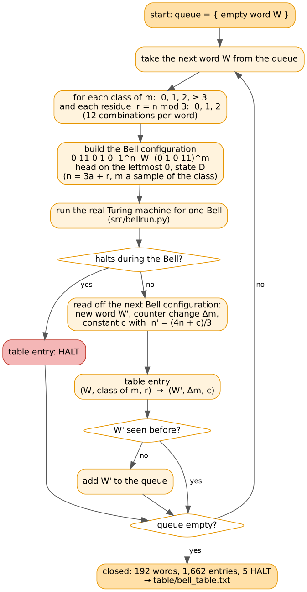</p>

The search **closes**: 192 words, 1,662 table entries, 5 of them HALT. Every entry leads either to one of the 192 words or to HALT; no arrow leads out of the table. The 1,662 entries are exactly the reachable combinations of word and class of m, each with 3 residues.

<p align="center">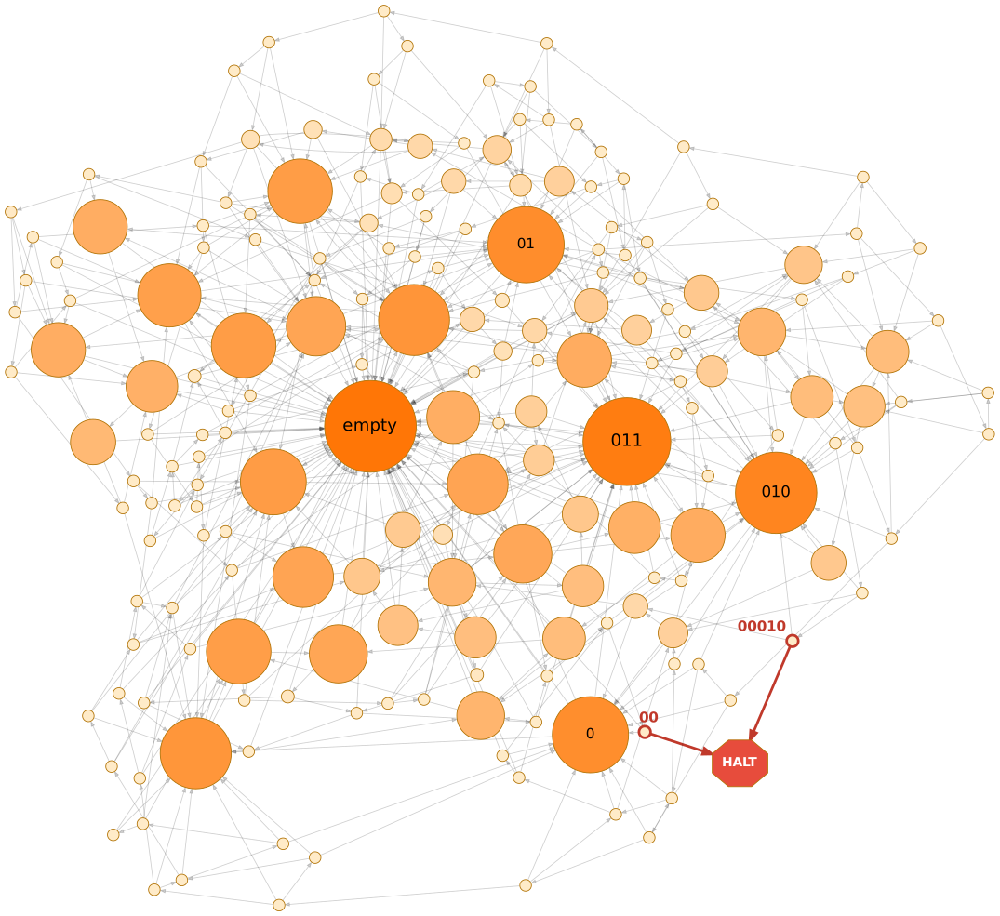</p>
<p align="center"><em>Word graph of the halting machine: 192 words, an arrow W → W' for every table entry. Size and colour show how often a word occurs in the Markov chain (m ≥ 3, log scale). Only the rare words <code>00</code> and <code>00010</code> lead to HALT, when n ≡ 2 (mod 3). Together they occur with probability about 5·10⁻⁹, and only every third of those Bells halts, which gives the halting rate of about 1.6·10⁻⁹ per Bell.</em></p>

### 2. What a closed table proves, and what it does not
- **Proved:** the Bell map is a **finite automaton** with the states (W, min(m,3)), driven by one number n. In each Bell it reads the lowest base-3 digit of n and sets n' = (4n + c)/3. Whether the machine halts depends only on the sequence of residues n mod 3 along the orbit.
- **Markov estimate:** if the residues were random and independent (probability 1/3 each), HALT would be reached with probability 1. HALT is reachable from every state and absorbing, so **almost all** starting values halt, in the sense of 3-adic numbers.
- **Not proved:** the orbit starts from one specific n (n = 4 at Bell 1), and its sequence of residues is completely determined by n' = (4n + c)/3. "Almost all starting values halt" says nothing about this one; it could belong to the exceptional null set and avoid the halting patterns forever. Showing that the digits of (4/3)^b·n behave "randomly enough" is a Collatz-type problem that nobody can solve today.
- **So the simulation is the proof:** the exact iteration found the HALT at Bell 298,793,335, and Dennis confirmed it independently. The Markov estimate only said that searching was worthwhile.
- **The vampire family is the same:** its table is closed as well (2,880 words), and its orbits halt "with probability 1" in the Markov sense. Still, no orbit has halted up to 10¹¹–2·10¹¹ Bells, which fits a rate of about 9·10⁻¹³ per Bell. Whether a given orbit ever halts can only be decided by finding the HALT.
- **What closure is worth anyway:** the simulation needs only the table, not the Turing machine, which is what makes the fast programs (`belldc`, `belldcf`, `belldco`) possible. A formal proof, e.g. in Rocq, also becomes manageable: the finitely many table entries become lemmas, and the rest is the concrete iteration up to the HALT.

### 3. Closed or not: the criterion for candidates
A common first picture is that a few rare transitions lead *out of* the graph, and that the simulation shows HALT is reached before such an exit. That is not the case for the machines above: there are no exits. The state stays in the finite word set forever, and the only question is whether the concrete residue sequence hits a halting word with the right residue.

Exits do exist for another type of machine, where the short word keeps growing and new words keep appearing. There the table never closes, and the method in its present form does not apply.

| table | meaning | examples |
|---|---|---|
| **closed** | finite automaton driven by the digits of n; Markov estimate meaningful; simulation decides | BB(6) halting machine (192 words), vampire family (2,880 words), [BB(7) halting machine](https://github.com/thomasreus-bb/bb7-vampirs) (word plus counter m) |
| **not closed** | the tail carries information itself: a second number on the tape | BB(7) class G ([BB7-vampirs](https://github.com/thomasreus-bb/bb7-vampirs)), Hydra-like BB(2,5) machines, probably many of the BB(2,6) Bell machines in the scan ([BB2-6-vampirs](https://github.com/thomasreus-bb/bb2-6-vampirs)) |

### 4. Recipe for new candidates
1. **Bell structure.** Find a configuration with one long block that grows geometrically from Bell to Bell, plus short words. For finding these: the scans here (`bellscan.c`, the level analysis below), `b3.c` / `auto.py` in BB7-vampirs, and `b3g.c` / `scan.py` (any number of symbols) in BB2-6-vampirs.
2. **Several different short words at a regular growth factor** suggest a vampire. One or two words suggest a needle: all information is in n, and halting needs an exact value.
3. **Derive the table from the real TM** by breadth-first search over the words: `derive_table.py` (halting machine), or the generic `tools/bellstep.c` + `tools/derive2.py` in BB7-vampirs, which also handles counters in the tail. Check that it **closes**.
4. **Markov estimate** of the halting rate. If the expected number of Bells is within reach (up to about 10¹²), simulate.
5. **Exact iteration** with divide and conquer (`belldc3` in base 3, `belldc` / `belldcf` / `belldco` in base 2) until HALT, then check the last Bells on the real machine.
6. **Not closed?** Then the method needs an extension: a Bell state (n, b) with a second number b for the growing tail. That is the natural next step, and it would cover BB(7) class G and the Hydra-like machines.

### 5. Two-number candidates in BB(6): results of 24 Oct 2026
The candidates with several tails but a varying growth factor (nos. 10, 11, 16, 17, 31, 32, 35, 38) were examined with a new tool:

- **`scan/m19/accsim.c`, an accelerated simulator.** It uses blocks of K cells and a run-length encoded tape.
  - *Chain steps.* A sweep across a uniform block costs one operation.
  - *Jumps over repetitions.* If the run structure repeats with constant changes of the counts, many repetitions are applied at once. The step count is exact, because the steps per repetition grow linearly.
  - *Checks.* It gives the exact step counts of known halters: the BB(5) champion with 47,176,870 steps, and several BB(2,6) halters. With and without jumps it reaches the same state.
  - *Start options.* It can start from any Bell configuration and stop at a given tape length. This allows **halting-rate tests**: many real or slightly varied Bell starts, each run over many Bells, counting the halts.

| no. | type | depth reached without HALT | halting rate per Bell |
|---|---|---|---|
| 🟩 10 | two-register ping-pong, exact Bell map (25 Oct) | 10¹⁰ Bells, about 2·10³⁰ steps | HALT only on an exact hit (chance about 1/(9k) at Bell k); known on the BusyBeaverWiki as "probviously halting" (Shawn Ligocki, 2·10¹² steps); the 2 % estimate of 24 Oct is withdrawn |
|  16 | two-register (like 10) | 10³³ steps (exact macro rules) | about 0.7·N^(−1/3), i.e. 7·10⁻¹² after 10³³ steps |
| 🟩 17 | two-register | 10¹⁴ steps | – |
|  31, 32 | vampire-like, base 3 (4/3), nested sub-process; Bell types A/B/C, prefix table mod 6, HALT entries blocked mod 3 (26 Oct) | 10³⁵·⁵ steps (202 Bells) | below 2·10⁻⁶ |
|  35 | register system | 5·10¹⁶ steps | – |
|  37 | multi-register | 10²² steps | at most about 0.1 % |
| 38 | growing list of blocks | 4·10³³ steps | – |
|  105 | vampire-like, base 3 (4/3), small tail counter; exact level map, 35-level residue path to HALT (9 Nov) | 100,000 levels, n ≈ 10¹²⁴⁹⁵ | 1.1·10⁻¹⁴ per level, constant (Markov); expected HALT after ≈ 9·10¹³ levels |

**Assessment of the yellow machines (7 Nov 2026).** The key question is how fast the chance of a HALT falls as the machine grows. If it falls like 1/T per cycle, the sum diverges and the machine halts with probability 1; this is how no. 10 halted, after about 8.3·10⁴¹ steps. If it falls faster, or is blocked by structure, the machine probably never halts.

*HALT likely, ranked by the prospects of a fast simulator:*

| rank | no. | why HALT is likely | prospects with a fast simulator |
|---|---|---|---|
| 1 |  [37](#37) (≡ no. 11) | multi-register system, guide: "lottery, chaotic digits"; at most 0.1 % per Bell measured | **medium**: the decay is unknown. Reached 10²² steps so far; exact macro rules and a measurement as for no. 35 are missing |
| 2 |  [31](#31) /  [32](#32) (very probably equivalent) | vampire-like, factor 4/3; HALT entries exist; rate < 2·10⁻⁶ per Bell | **uncertain**: if the rate stays constant, a Bell-map simulator in the style of the vampire method (`belldco` did 7·10¹¹ Bells) could succeed. But the HALT entries found are blocked mod 3, so the rate might also be 0 |
| 3 |  [51](#51) /  [61](#61) (same table) | almost certainly halting: a 108-step halting path is known, with a Lean proof for a whole family | **hopeless**: expected halting time about 10^10^38 steps |

*HALT unlikely:*

| no. | reason |
|---|---|
|  [16](#16) | measured (7 Nov 2026): HALT only if an A0 event gives B = 2^(k+1) − k − 1; such events become rarer as the machine grows. No HALT up to 10³³ steps; chance after N steps about 0.7·N^(−1/3) |
|  [19](#19) | two-number system; unusual left parts become exponentially rarer with every Bell |
|  [39](#39) | needle type; HALT only beyond level 400 of the fixed chain, chance about 2⁻⁴⁰⁰ per Bell |
|  [41](#41) | needle type; HALT needs an exact hit, which becomes less likely as n grows; no HALT in 70 Bells up to 8·10⁵⁹ steps |
|  [44](#44) | no halting case in 50,000 reachable memory words and 44,135 tested group words |

The ranks for "likely" are estimates, not measurements; for no. 37 the halting chance has not yet been studied as closely as for nos. 10, 16 and 35. No. 16 was rank 1 until the measurement of 7 Nov 2026 moved it to "unlikely". Since 8 Nov 2026 no. 16 is marked red.


**New findings for the method:**
1. Besides the vampires there are **two-number machines**. For no. 10 the Bell map on two numbers has been found exactly (25 Oct, see [10](#10)): three Bell types A, B, C, and HALT only when a C Bell leaves exactly 0 or −1 cells. Iterated over 10¹⁰ Bells there is no HALT. (The halting rate of about 2 % estimated on 24 Oct from varied starts was wrong for the real orbit.)
2. Nos. 31/32 are vampires in base 3 whose table only closes with several blocks. This is the natural next step for the table method.
3. Perturbed real Bell starts together with an accelerated simulator give a quick estimate of the halting rate, even without a table.

## The 56 candidates

The column "BB6 sheet" combines the sheet columns Row; Classification; Notes; Sources; Done by (in this order, separated by semicolons, empty fields left out), copied from the community BB6 sheet (tab "Holdouts (From the 1534 list)", read on 29 Oct 2026; Row = row number in the sheet; a sheet status such as CRYPTID is shown in bold before the classification). The Sources numbers link to the referenced post or wiki page; for nos. 58, 67 and 69 only reference 1 is linked so far. Nos. 57–108 are the remaining Bell-like holdouts of the sheet, added for later analysis (see [the section at the end](#candidates-57108-bell-like-holdouts-from-the-bb6-sheet-for-later-analysis)).

Column **Holdout Guide**: status and note from the [BB(6) Holdout Guide](https://claude.ai/artifact/8B8E5ms18otN4XHbEnxaP2) (status of 3 Nov 2026, 607 machines; text copy in `holdout_guide_2026-11-03.txt`), with the machine's number in the guide (#N).

| # | class | machine | factor | verdict<br> | BB6 sheet (row; classification; notes; sources; done by) | Holdout Guide<br> |
|---|---|---|---|---|---|---|
| 🟩 <a id="t1"></a>[1](#1) | 🟩<br>A | 🟩<br>`1RB0RF_1LC---`<br>`1RD0LC_0RE0RD`<br>`1LF1LC_1LE1RA` | 1.55 | vampire family, TM1-F, orbit O2: **HALT at Bell 731,899,010,932** (Ahmer Raza, 30 Oct 2026; confirmed on a second computer by Thomas Reus, 31 Oct) | 1120; Bell-like | **#419 Looks like a lottery**: A Collatz-like map N' = (3N+c)/2 with a prefix counter. Halting prefixes are reachable in the model. |
| 🟩 <a id="t2"></a>[2](#2) | 🟩<br>A | 🟩<br>`1RB---_1LC0RB`<br>`0LD0LC_1RE1RB`<br>`1RD1LF_1LA0LE` | 1.56 | vampire family, TM1, orbit O1: **HALT at Bell 747,242,483,684** (Ahmer Raza, 30 Oct 2026, not yet independently verified) | 1083; Bell-like | **#75 Looks like a lottery**: A Collatz-like map N' = (3N+c)/2 with a prefix counter. Halting prefixes are reachable in the model. |
| 🟩 <a id="t3"></a>[3](#3) | 🟩<br>A | 🟩<br>`1RB0LA_0RC0RB`<br>`1LD1LA_1LC1RE`<br>`1RF0RD_1LC---` | 1.57 | vampire family, TM2, orbit O2: **HALT at Bell 731,899,010,932** (Ahmer Raza, 30 Oct 2026; confirmed on a second computer by Thomas Reus, 31 Oct); **potential cryptid** ([Machines at the Edge](https://wiki.bbchallenge.org/wiki/User:RobinCodes/Machines_at_the_Edge)) – listed although it halts (orbit O2) | 1073; Bell-like; Probviously halting machine; [1](https://discord.com/channels/960643023006490684/1390082340008755333/1390082340008755333); Peacemaker, Legion, hipparcos, dyuan | **#421 Reported by others**: Others have worked on it or discussed it. |
| 🟩 <a id="t4"></a>[4](#4) | 🟩<br>A | 🟩<br>`1RB0RE_1RC---`<br>`0RD0RC_1LE1LF`<br>`1LD1RA_1RC0LF` | 1.57 | vampire family, TM2', orbit O2: **HALT at Bell 731,899,010,932** (Ahmer Raza, 30 Oct 2026; confirmed on a second computer by Thomas Reus, 31 Oct) | 1111; Bell-like | **#331 Looks like a lottery**: Member of the vampire family. A rough estimate gives a tiny chance of halting per Bell. |
| 🟩 <a id="t5"></a>[5](#5) | 🟩<br>A | 🟩<br>`1RB0LA_0RC0RB`<br>`1LD1LA_1LC1RE`<br>`1RF0RD_1LA---` | 1.56 | vampire family, TM2a, orbit O3: **HALT at Bell 1,961,935,897,288** (Ahmer Raza, 30 Oct 2026, not yet independently verified) | 1131; Bell-like | **#552 Looks like a lottery**: A Collatz-like map N' = (3N+c)/2 with a prefix counter. Halting prefixes are reachable in the model. |
| 🟩 <a id="t6"></a>[6](#6) | 🟩<br>A | 🟩<br>`1RB---_0RC0RB`<br>`1LD1LE_1LC1RF`<br>`1RB0LE_1RA0RD` | 1.58 | vampire family, TM2b, orbit O4: **HALT at Bell 1,941,376,761,248** (Ahmer Raza, 1 Nov 2026, not yet independently verified) | 1107; Bell-like | **#303 Reported by others**: Others have worked on it or discussed it. Member of the vampire family. A rough estimate gives a tiny chance of halting per Bell. |
| 🟩 <a id="t7"></a>[7](#7) | 🟩<br>A | 🟩<br>`1RB0RF_1LC---`<br>`1LF1LD_1RE0LD`<br>`0RC0RE_1LC1RA` | 1.58 | vampire family, TM2b', orbit O4: **HALT at Bell 1,941,376,761,248** (Ahmer Raza, 1 Nov 2026, not yet independently verified) | 1125; Bell-like | **#476 Reported by others**: Others have worked on it or discussed it. Member of the vampire family. A rough estimate gives a tiny chance of halting per Bell. |
| 🟩 <a id="t8"></a>[8](#8) | 🟩<br>B | 🟩<br>`1RB0RB_1LC1RF`<br>`0RD0LB_0RA1LE`<br>`1LD---_0RB0RC` | 1.33 | **halts**, formal proof accepted, no longer a holdout (vampire method, [halt-found repository](https://github.com/thomasreus-bb/halt-found-1rb0rb_1lc1rf_0rd0lb_0ra1le_1ld---_0rb0rc)) | 1078; Bell-like; [1](https://discord.com/channels/960643023006490684/960643023530762341/1309905887451938927); Racheline | – (not in the guide: no longer a holdout) |
| <a id="t9"></a>[9](#9) | B | `1RB0RB_1LB0LC`<br>`1RD1LC_1RE0RA`<br>`0RF1RA_---1LB` | 1.33 | needle-like: only 2 tails (all information in one number) | 756; Quadratic Mess; Part of Category 1 | **#314 Cryptid**: Its halting reduces to a Collatz-like question. |
| 🟩 <a id="t10"></a>[10](#10) | 🟩<br>B | 🟩<br>`1RB---_0RC0RD`<br>`1LD1RB_0LE0LC`<br>`1RA0LF_1LD1LE`<br>[**wiki**](https://wiki.bbchallenge.org/wiki/1RB---_0RC0RD_1LD1RB_0LE0LC_1RA0LF_1LD1LE) | 1.24 | **HALT after ≈ 8.3·10⁴¹ steps** (exact number in the [chapter](#10)) (Yeyito, 7 Nov 2026; Rocq proof); two-register system, exact Bell map with types A/B/C; no HALT in 10¹⁰ Bells (about 2·10³⁰ steps); HALT needs an exact hit (see [10](#10)) | 688; Cubic Mess; Part of Category 1 | **#395 Reported by others**: Others have worked on it or discussed it. |
|  <a id="t11"></a>[11](#11) | <br>B | <br>`1RB1LB_1RC---`<br>`1LD1LF_1LE0LD`<br>`0LA1RF_1LC0RE` | 1.21 | **equivalent to [37](#37)** ; all information under no. 37 | 703; Cubic Mess | – (not in the guide: removed, equivalent to no. 37) |
| <a id="t12"></a>[12](#12) | B | `1RB1RA_1LC1LB`<br>`1RE0LD_1RA0LB`<br>`---0RF_1RC0RA` | 1.27 | no clear single-block Bell configuration found | 731; Cubic Mess | **#486 Looks like a lottery**: Our experiments suggest the outcome turns on chaotic digits. |
|  <a id="t13"></a>[13](#13) | <br>B | <br>`1RB0RF_1RC1RF`<br>`1LD0LE_---1LC`<br>`1RA1LE_1LC1RB`<br>[**wiki**](https://wiki.bbchallenge.org/wiki/1RB0RF_1RC1RF_1LD0LE_---1LC_1RA1LE_1LC1RB) | 1.33 | needle: exact Bell map (Sheep, Apr 2026; checked 10 Nov 2026), HALT iff n + 2 = 2^k; 2·10⁶ Bells to n ≈ 10²⁴¹⁷⁹⁶ without HALT: convergent, almost certainly never halts (Collatz-like, no proof) | 754; Quadratic Mess; Part of Category 1; [1](https://discord.com/channels/960643023006490684/1448375857046360094/1491403477421785158); sheep | **#503 Cryptid**: Its halting reduces to a Collatz-like question. |
|  <a id="t14"></a>[14](#14) | <br>B | <br>`1RB0LF_1LC1RA`<br>`0RE0RD_---1LE`<br>`1LF1RC_1LC1LA`<br>[**wiki**](https://wiki.bbchallenge.org/wiki/1RB0LF_1LC1RA_0RE0RD_---1LE_1LF1RC_1LC1LA) | 1.21 | needle: exact Collatz-like map on (m, r), HALT only if a cycle ends with m = 2^k − k − 1; very probably non-halting (see [14](#14)) | 797; Quadratic Mess | **#565 Cryptid**: Its halting reduces to a Collatz-like question. |
|  <a id="t15"></a>[15](#15) | <br>B | <br>`1RB0RB_1LC1RE`<br>`1LF0LD_1RA1LD`<br>`1RC1RB_---1LC`<br>[**wiki**](https://wiki.bbchallenge.org/wiki/1RB0RB_1LC1RE_1LF0LD_1RA1LD_1RC1RB_---1LC) | 1.36 | needle-like: only 2 tails (all information in one number) | 747; **CRYPTID**, Quadratic Mess; Cryptid, Part of Category 1; [1](https://wiki.bbchallenge.org/wiki/1RB0RB_1LC1RE_1LF0LD_1RA1LD_1RC1RB_---1LC); Andrew Ducharme, DrDisentangle | **#198 Cryptid**: Its halting reduces to a Collatz-like question. |
|  <a id="t16"></a>[16](#16) | <br>B | <br>`1RB1LF_1RC1RF`<br>`0LD1RE_---1LC`<br>`0RB1RE_1LA0LE` | 1.26 | two-register system like 10; exact macro rules, no HALT up to 10³³ steps | 700; Cubic Mess | **#81 Cryptid**: Its halting reduces to a Collatz-like question. |
| 🟩 <a id="t17"></a>[17](#17) | 🟩<br>B | 🟩<br>`1RB0RC_1RC---`<br>`1LD1RE_1LE0LD`<br>`1RA0LF_0RC0RB` | 1.29 | two-register system; no HALT up to 10¹⁴ steps | 766; Quadratic Mess | **#61 Proof in PR #55** (status of 5 Nov 2026; before: "Proof ready, PR soon") |
| <a id="t18"></a>[18](#18) | B | `1RB---_1LC0LD`<br>`0RF0LD_0LE0RA`<br>`0LC1RA_1RC1RD` | 1.36 | no clear single-block Bell configuration found | 1101; Bell-like | **#268 Looks like a lottery**: Labelled Bell-like, but no clear Bell events up to 3e8 steps. No rule found at 1e9. |
|  <a id="t19"></a>[19](#19) | <br>B | <br>`1RB0LC_1LA1RE`<br>`1LD1RE_1RE0LA`<br>`0RA1RF_0RB---` | 1.32 | **two-number system** (examined in detail, see [19](#19)): no HALT found | 1077; Bell-like; [1](https://discord.com/channels/960643023006490684/1337004420138799106/1337004420138799106); nerdyjoe | **#556 Reported by others**: Others have worked on it or discussed it. |
|  <a id="t20"></a>[20](#20) | <br>B | <br>`1RB1LC_1LA0RD`<br>`0LB1LF_1RE1LC`<br>`1LC0RB_0LA---` | 1.40 | needle-like: only 2 tails (all information in one number) | 1098; Bell-like | **#237 Some structure seen**: A 3/2 Bell whose phases spawn nested counters. |
| 🟩 <a id="t21"></a>[21](#21) | 🟩<br>B | 🟩<br>`1RB0LE_1RC1RE`<br>`0RD1RC_1LA0LB`<br>`1LF0RB_---1LD` | 1.40 | **solved** (proved in busycoq); needle-like: only 1 tail (all information in one number) | 932; Fractal in Bouncer | – (not in the guide: proved in busycoq after 30 Oct 2026, the one machine the guide removes from the 608 list) |
| <a id="t22"></a>[22](#22) | B | `1RB0RB_1LC0LF`<br>`1RD0LB_1RE1RC`<br>`0RA---_1LA1RE` | 1.40 | needle-like: only 2 tails (all information in one number) | 782; Quadratic Mess | **#336 Looks like a lottery**: Close to a known machine with 3 entries changed. Built tapes halt at specific values tied to the machine's own orbit. |
| 🟩 <a id="t23"></a>[23](#23) | 🟩<br>B | 🟩<br>`1RB0LD_0RC1RD`<br>`1LA1RA_1LE0LE`<br>`1RF0LA_0RA---` | 1.39 | **decided (never halts), 3 Nov 2026** ([Discord](https://discord.com/channels/960643023006490684/1239205785913790465/1567184717650862173)); no clear single-block Bell configuration found | 1115; Bell-like | **#385 Proof in an open PR**: Open PR 44, by Claude (Heron), proves that it never halts. Not merged yet. |
| <a id="t24"></a>[24](#24) | B | `1RB0LD_1LC0RA`<br>`1RA1LB_1LA1LE`<br>`1RF0LC_---0RE`<br>[**wiki**](https://wiki.bbchallenge.org/wiki/1RB0LD_1LC0RA_1RA1LB_1LA1LE_1RF0LC_---0RE) | 1.25 | needle-like: only 1 tail (all information in one number) | 750; Quadratic Mess; Potential cryptid, Part of Category 1. BMO 5.; [1](https://wiki.bbchallenge.org/wiki/1RB0LD_1LC0RA_1RA1LB_1LA1LE_1RF0LC_---0RE); dyuan, mxdys | **#186 Cryptid**: Its halting reduces to a Collatz-like question. |
|  <a id="t25"></a>[25](#25) | <br>B | <br>`1RB0LE_1LC0RD`<br>`0RA1LD_0LC1RA`<br>`1LF1LA_---1LA` | 1.55 | 4/3 Bell, the tail is a second Bell counter; HALT iff the tail counter reaches about 4n (exact level map, 100,000 levels to n ≈ 10¹²⁴⁹⁵ without HALT, 9 Nov 2026): Collatz-like lottery, chance far below 10⁻¹⁰⁰⁰; needle-like: only 2 tails (all information in one number) | 1085; Bell-like | **#118 Looks like a lottery**: A 4/3 Bell where a second counter drains the main one. |
| <a id="t26"></a>[26](#26) | B | `1RB1LC_1LA0RD`<br>`1LB1LF_1LE1RE`<br>`0LA0RB_0LB---` | 1.37 | needle-like: only 2 tails (all information in one number) | 1103; Bell-like | **#290 Little known** (being worked on): One table, three starts. Being decoded now. |
| <a id="t27"></a>[27](#27) | B | `1RB1LC_1LC0RD`<br>`0LE1LA_0RF1RA`<br>`1LA0LA_---0RB` | 1.64 | needle-like: only 1 tail (all information in one number) | 789; Quadratic Mess | **#475 Rules known, no proof**: A 3/2 map (a,b) to (a-2,b+3) with a complete event model, not in Rocq. The open question is whether every state returns. |
| <a id="t28"></a>[28](#28) | B | `1RB1LE_1LC0RA`<br>`0RF0LD_1LE1LA`<br>`1RC0LB_---1RC`<br>[**wiki**](https://wiki.bbchallenge.org/wiki/1RB1LE_1LC0RA_0RF0LD_1LE1LA_1RC0LB_---1RC) | 1.24 | no clear single-block Bell configuration found | 752; Quadratic Mess; Very strange machine; [1](https://wiki.bbchallenge.org/wiki/1RB1LE_1LC0RA_0RF0LD_1LE1LA_1RC0LB_---1RC); -d | **#399 Cryptid**: Its halting reduces to a Collatz-like question. |
| <a id="t29"></a>[29](#29) | B | `1RB1LD_1LC0RC`<br>`0RF1RA_0LE1LA`<br>`1RC0LA_---0RB` | 1.49 | needle-like: only 2 tails (all information in one number) | 799; Quadratic Mess | **#579 Rules known, no proof**: A 3/2 map (a,b) to (a-2,b+3) with a complete event model, not in Rocq. The open question is whether every state returns. |
|  <a id="t30"></a>[30](#30) | <br>B | <br>`1RB0LE_1LB1RC`<br>`0RF0RD_1RE0LA`<br>`1LA1RE_---0RB` | 1.54 | nested recursion G (exact, 8 Nov 2026): HALT only if an argument equals 2^k − 4; arguments now over 6000 digits, so the chance is practically 0; needle-like: only 1 tail (all information in one number) | 791; Quadratic Mess | **#508 Rules known, no proof**: A nested recursion G(b) = b + G(1 + G(b/2 - 2)). It halts if and only if it evaluates G(4). |
|  <a id="t31"></a>[31](#31) | <br>B | <br>`1RB1RF_1RC0LD`<br>`1LB1RA_1RE1LE`<br>`0RC0LB_0RB---` | 1.34 | **vampire-like, base 3 (factor 4/3)** with a nested sub-process; Bell types A/B/C; prefix table mod 6 without reachable HALT, not closed (nested levels); no HALT in 202 Bells (10³⁵·⁵ steps) | 1097; Bell-like | **#234 Little known** (being worked on): One table, three starts. Being decoded now. |
|  <a id="t32"></a>[32](#32) | <br>B | <br>`1RB1LB_0RC0LD`<br>`1LD1RE_1RC0LA`<br>`1RD1RF_0RD---` | 1.33 | same dynamics as 31 | 1119; Bell-like | **#418 Little known** (being worked on): One table, three starts. Being decoded now. |
| <a id="t33"></a>[33](#33) | B | `1RB1LA_1LC0RE`<br>`1LF1LD_0RB0LA`<br>`1RC1RE_---0LD`<br>[**wiki**](https://wiki.bbchallenge.org/wiki/Space_Needle) | 1.69 | needle-like: only 1 tail (all information in one number) | 693; Cubic Mess; Space Needle. BMO 6. Possible cryptid; [1](https://wiki.bbchallenge.org/wiki/1RB1LA_1LC0RE_1LF1LD_0RB0LA_1RC1RE_---0LD); Katelyn Douchette | **#366 Cryptid**: Its halting reduces to a Collatz-like question. |
| <a id="t34"></a>[34](#34) | B | `1RB1RC_1LC1LC`<br>`1RE0LD_1LB1RF`<br>`---1RA_0RD1RD`<br>[**wiki**](https://wiki.bbchallenge.org/wiki/1RB1RC_1LC1LC_1RE0LD_1LB1RF_---1RA_0RD1RD) | 1.34 | no clear single-block Bell configuration found | 792; Quadratic Mess | **#524 Cryptid**: Its halting reduces to a Collatz-like question. |
|  <a id="t35"></a>[35](#35) | <br>B | <br>`1RB---_0RC0LD`<br>`1LB1RC_0LE0LF`<br>`1RD1LE_1RF1RA` | 1.25 | register system; no HALT up to 5·10¹⁶ steps | 697; Cubic Mess | **#57 Looks like a lottery**: Halts if and only if it reaches one of three critical pairs. |
| <a id="t36"></a>[36](#36) | B | `1RB1LC_1LC0RD`<br>`0LE1LA_---1RA`<br>`1RF0LA_0RF0RB` | 1.56 | needle-like: only 1 tail (all information in one number) | 783; Quadratic Mess | **#344 Rules known, no proof**: A 3/2 map (a,b) to (a-2,b+3) with a complete event model, not in Rocq. The open question is whether every state returns. |
|  <a id="t37"></a>[37](#37) | <br>B | <br>`1RB1RF_1RC0RB`<br>`0RD1LF_1LE1RE`<br>`1LA---_1RA0LC` | 1.26 | multi-register system; no HALT up to 10²² steps; low halting rate; **equivalent to [11](#11)** | 729; Cubic Mess | **#460 Looks like a lottery**: Our experiments suggest the outcome turns on chaotic digits. |
| <a id="t38"></a>[38](#38) | C | `1RB0RE_1LC0RA`<br>`0LD0LB_1RE0LB`<br>`1RF---_0RB0RC` | 1.55 | growing list of blocks (nested); no HALT up to 4·10³³ steps | 973; Chaotic Bell Class 2 | **#353 Reported by others**: Someone reported a proof. We have not verified it. |
|  <a id="t39"></a>[39](#39) | <br>C | <br>`1RB1LC_1LC0RF`<br>`0LF1LD_0LE---`<br>`1RF1LC_1LE0RA` | 1.36 | needle-like: only 2 tails (all information in one number); **analysed** (2 Nov 2026): main block plus a tail counter that follows one fixed chain; no HALT on the chain up to level 400, so very probably non-halting; see below | 1122; Bell-like | **#442 Some structure seen**: A 3/2 Bell whose phases spawn nested counters. |
|  <a id="t40"></a>[40](#40) | <br>C | <br>`1RB0RD_0RC1RE`<br>`1RD0LA_1LE1LC`<br>`1RF0LD_---0RA`<br>[**wiki**](https://wiki.bbchallenge.org/wiki/Lucy%27s_Moonlight) | 1.48 | no clear single-block Bell configuration found; **potential cryptid** ([Machines at the Edge](https://wiki.bbchallenge.org/wiki/User:RobinCodes/Machines_at_the_Edge)) | 1060; **CRYPTID**, Bell-like; Lucy's Moonlight. Part of Category 1; [1](https://wiki.bbchallenge.org/wiki/Lucy%27s_Moonlight); Racheline, Shawn Ligocki | **#569 Cryptid**: Its halting reduces to a Collatz-like question. |
|  <a id="t41"></a>[41](#41) | <br>C | <br>`1RB1LD_1RC0RA`<br>`1LA1RE_0LA0LB`<br>`0RB1RF_---1RD`<br>[**wiki**](https://wiki.bbchallenge.org/wiki/1RB1LD_1RC0RA_1LA1RE_0LA0LB_0RB1RF_---1RD) | 1.40 | needle-like: only 1 tail (all information in one number) | 755; Quadratic Mess; Part of Category 1 | **#112 Cryptid**: Its halting reduces to a Collatz-like question. |
| <a id="t42"></a>[42](#42) | C | `1RB0RF_1LC0RA`<br>`1LD1LB_0LE---`<br>`1LA0LA_1RE1LD` | 1.42 | needle-like: only 1 tail (all information in one number); **exact event rules; halts iff a merge with even c has e in H = {2, 28, 74, 114, 288, …} (13 Nov 2026), probviously non-halting** | 761; Quadratic Mess | **#37 Looks like a lottery**: Close to a known machine with 3 entries changed. Built tapes halt at specific values tied to the machine's own orbit. |
| <a id="t43"></a>[43](#43) | C | `1RB1RE_0RC---`<br>`1RD0RD_1LE0LF`<br>`1RA0LD_1LC1RB` | 1.41 | needle-like: only 2 tails (all information in one number) | 760; Quadratic Mess | **#25 Reported by others**: Others have worked on it or discussed it. Close to a known machine with 3 entries changed. Built tapes halt at specific values tied to the machine's own orbit. |
|  <a id="t44"></a>[44](#44) | <br>C | <br>`1RB0RE_1LC0RA`<br>`0LD1LB_1LA1LE`<br>`0LB0LF_1LD---` | 1.90 | needle-like: only 1 tail (all information in one number) | 1127; Bell-like | **#507 Rules known, no proof**: One table, four starts. Exact macro law proved in Rocq. Real runs stay small, but the residues behave like Collatz digits, so a proof has to allow every sequence. |
| <a id="t45"></a>[45](#45) | C | `1RB0LD_1LC0RD`<br>`1LA0LC_1RE0LB`<br>`1RB1RF_0LD---` | 1.53 | no clear single-block Bell configuration found | 768; Quadratic Mess | **#104 Some structure seen**: Same table as another holdout, from another start. |
| <a id="t46"></a>[46](#46) | C | `1RB---_1RC1LE`<br>`0RD0RF_0RE0LA`<br>`1LF0LB_1LA1LD` | 1.74 | needle-like: only 2 tails (all information in one number) | 751; Quadratic Mess; Simulated to 1e2848; [1](https://discord.com/channels/960643023006490684/1239205785913790465/1456268738428145684); Alistaire | **#103 Cryptid**: Its halting reduces to a Collatz-like question. |
| 🟩 <a id="t47"></a>[47](#47) | 🟩<br>C | 🟩<br>`1RB0LF_1LC0LD`<br>`1RD1LB_---1RE`<br>`0RA1RE_1LA0LE` | 1.47 | needle-like: only 1 tail (all information in one number) | 764; Quadratic Mess | **#56 Proof in an open PR**: Open [PR 67](https://github.com/ccz181078/busycoq/pull/67), by Dahoas (12 Nov 2026), proves that it never halts. Not merged yet. (Before: "Cryptid: Its halting reduces to a Collatz-like question.") |
| 🟩 <a id="t48"></a>[48](#48) | 🟩<br>C | 🟩<br>`1RB1RD_1LC0LE`<br>`1LD0LB_0RB0RA`<br>`1RD1LF_0LC---` | 1.52 | translated cycler with period 4.1·10²⁴ steps (exact Lin check on the accelerated simulation): never halts, if the simulator is exact (8 Nov 2026); | 29; Unknown; Simulated to 1.08e17 steps.; [1](https://discord.com/channels/960643023006490684/1239205785913790465/1456934113943621653); Alistaire | **#38 Rules known, no proof**: Exact sweep laws. A phase map picks (5b+d)/3, (7b+d)/5 or b+13 by residues. Built tapes can halt. |
| <a id="t49"></a>[49](#49) | C | `1RB1LA_1RC0RF`<br>`1RD---_0LE1RB`<br>`---0LA_1LD1RF`<br>[**wiki**](https://wiki.bbchallenge.org/wiki/1RB1LA_1RC0RF_1RD---_0LE1RB_---0LA_1LD1RF) | 1.44 | no clear single-block Bell configuration found | 686; Cubic Mess; Potential cryptid. One of 3 holdouts with 2 undefined transitions, may be cryptid. 10^14 doesn't halt. Analysed thoroughly using formal proofs from Claude Opus 4.6.; [1](https://discord.com/channels/960643023006490684/1410023564249403577/1410023564249403577), [2](https://wiki.bbchallenge.org/wiki/1RB1LA_1RC0RF_1RD---_0LE1RB_---0LA_1LD1RF); dyuan, mxdys, hipparcos, DrDisentangle | **#416 Reported by others**: Others have worked on it or discussed it. |
| <a id="t50"></a>[50](#50) | C | `1RB1RB_1LC0RE`<br>`---1LD_0RA1LB`<br>`1RA1LF_0LE1LE`<br>[**wiki**](https://wiki.bbchallenge.org/wiki/1RB1RB_1LC0RE_---1LD_0RA1LB_1RA1LF_0LE1LE) | 1.50 | no clear single-block Bell configuration found | 794; Quadratic Mess | **#548 Cryptid**: Its halting reduces to a Collatz-like question. |
|  <a id="t51"></a>[51](#51) | <br>C | <br>`1RB0RE_1LC0RA`<br>`1LA1LD_1LC1LF`<br>`0LC0LB_1LE---` | 1.60 | needle-like: only 1 tail (all information in one number); **potential cryptid** ([Machines at the Edge](https://wiki.bbchallenge.org/wiki/User:RobinCodes/Machines_at_the_Edge)) – "equivalent to no. 61 (?)" there | 1063; **CRYPTID**, Bell-like; Probviously halting cryptid; [1](https://wiki.bbchallenge.org/wiki/1RB---_0RC0RE_1RD1RF_1LE0LB_1RC0LD_1RC1RA); -d | **#369 Cryptid**: Its halting reduces to a Collatz-like question. |
|  <a id="t52"></a>[52](#52) | <br>C | <br>`1RB0LC_1RC1RF`<br>`1LD0RA_1LE0LD`<br>`1RC0LA_0LA---` | 1.61 | stack of counters; HALT only for one exact z per level with an empty stack (17, 44, 285, 712, …); chance converges, about 10⁻⁵ after 10¹¹ steps (8 Nov 2026); no clear single-block Bell configuration found | 765; Quadratic Mess | **#58 Rules known, no proof**: A stack of counters drained by a level chain. A halt needs an exact hit of a small target set. |
|  <a id="t53"></a>[53](#53) | <br>C | <br>`1RB1RE_1LC1RE`<br>`---1LD_1LE0LB`<br>`0RF0LD_1RD1RA` | 1.66 | several long segments (sibling of no. 85); HALT only while a segment is small (35 % for start size < 100, 0 % above 1,000), no HALT to 10³⁰⁰ (10 Nov 2026): convergent lottery, remaining chance ≈ 10⁻⁷⁰ | 1080; Bell-like | **#18 Looks like a lottery**: Our experiments suggest the outcome turns on chaotic digits. |
| <a id="t54"></a>[54](#54) | C | `1RB1RF_1LC---`<br>`1LE1RD_1RA0RC`<br>`0LF0LA_0LD0RB` | 1.53 | needle-like: only 1 tail (all information in one number) | 787; Quadratic Mess | **#464 Cryptid**: Its halting reduces to a Collatz-like question. |
| <a id="t55"></a>[55](#55) | C | `1RB1LF_0RC1RD`<br>`1LA1LD_1LE0RA`<br>`---1LC_0LA1LA`<br>[**wiki**](https://wiki.bbchallenge.org/wiki/1RB1LF_0RC1RD_1LA1LD_1LE0RA_---1LC_0LA1LA) | 1.48 | no clear single-block Bell configuration found | 770; Quadratic Mess | **#136 Cryptid**: Its halting reduces to a Collatz-like question. |
| <a id="t56"></a>[56](#56) | C | `1RB1LE_1LB1LC`<br>`1RD0LE_---0RB`<br>`1RF1LA_0RA0RD`<br>[**wiki**](https://wiki.bbchallenge.org/wiki/1RB1LE_1LB1LC_1RD0LE_---0RB_1RF1LA_0RA0RD) | 1.43 | needle-like: only 1 tail (all information in one number) | 753; Quadratic Mess; Simulated to 10^190,000; [1](https://wiki.bbchallenge.org/wiki/User:Polygon/Page_for_analyses#1RB1LE_1LB1LC_1RD0LE_---0RB_1RF1LA_0RA0RD_(bbch)); [2](https://discord.com/channels/960643023006490684/1239205785913790465/1453010575901593643); [3](https://discord.com/channels/960643023006490684/1466628778905305292/1466628778905305292); Polygon, hipparcos | **#93 Cryptid**: Its halting reduces to a Collatz-like question. |
| <a id="t57"></a>[57](#57) | – | `1RB1RC_1LC1LE`<br>`1RA1RD_0RF0RE`<br>`1LA0LB_---1RA` | – | for later analysis | 1057; **CRYPTID**, Bell-like; A variant of Hydra and Antihydra; [1](https://wiki.bbchallenge.org/wiki/1RB1RC_1LC1LE_1RA1RD_0RF0RE_1LA0LB_---1RA); mxdys, dyuan | **#591 Cryptid**: Its halting reduces to a Collatz-like question. |
| <a id="t58"></a>[58](#58) | – | `1RB0LD_1RC1RF`<br>`1LA0RA_0LA0LE`<br>`1LD1LA_0RB---` | – | for later analysis | 1058; **CRYPTID**, Bell-like; Antihydra-like cryptid, probviously nonhalting; [1](https://discord.com/channels/960643023006490684/1239205785913790465/1280916092683812916); 2; 3; dyuan, mxdys | **#497 Cryptid**: Its halting reduces to a Collatz-like question. |
| <a id="t59"></a>[59](#59) | – | `1RB1RA_0LC1LE`<br>`1LD1LC_1LA0LB`<br>`1LF1RE_---0RA` | – | for later analysis | 1059; **CRYPTID**, Bell-like; Antihydra. Part of Category 1; [1](https://wiki.bbchallenge.org/wiki/Antihydra) | **#36 Cryptid**: Antihydra, the best-known cryptid. Its halting is a Collatz-like question. |
| <a id="t60"></a>[60](#60) | – | `1RB1RA_0RC1RC`<br>`1LD0LF_0LE1LE`<br>`1RA0LB_---0LC` | – | for later analysis; **potential cryptid** ([Machines at the Edge](https://wiki.bbchallenge.org/wiki/User:RobinCodes/Machines_at_the_Edge)) | 1061; **CRYPTID**, Bell-like; One of (canonical) collection of 16 probviously halting tetrational cryptids; [1](https://wiki.bbchallenge.org/wiki/1RB1RA_0RC1RC_1LD0LF_0LE1LE_1RA0LB_---0LC); mxdys | **#89 Cryptid**: Its halting reduces to a Collatz-like question. |
|  <a id="t61"></a>[61](#61) | <br>– | <br>`1RB---_0RC0RE`<br>`1RD1RF_1LE0LB`<br>`1RC0LD_1RC1RA` | – | for later analysis; **potential cryptid** ([Machines at the Edge](https://wiki.bbchallenge.org/wiki/User:RobinCodes/Machines_at_the_Edge)) | 1062; **CRYPTID**, Bell-like; Probviously halting cryptid; [1](https://wiki.bbchallenge.org/wiki/1RB---_0RC0RE_1RD1RF_1LE0LB_1RC0LD_1RC1RA); Racheline | **#62 Cryptid**: Its halting reduces to a Collatz-like question. |
|  <a id="t62"></a>[62](#62) | <br>– | <br>`1RB0LD_1RC1RA`<br>`1LD0RB_1LE1LA`<br>`1RF0RC_---1RE`<br>[**wiki**](https://wiki.bbchallenge.org/wiki/1RB0LD_1RC1RA_1LD0RB_1LE1LA_1RF0RC_---1RE) | – | tetrational phases; HALT only at a phase end, chance ½ each; no HALT up to about 10^80,000 steps, next chance after about 10^(10^40,000) steps (8 Nov 2026); **potential cryptid** ([Machines at the Edge](https://wiki.bbchallenge.org/wiki/User:RobinCodes/Machines_at_the_Edge)) | 1064; **CRYPTID**, Bell-like; Probviously halting cryptid; [1](https://wiki.bbchallenge.org/wiki/1RB0LD_1RC1RA_1LD0RB_1LE1LA_1RF0RC_---1RE); mxdys | **#536 Cryptid**: Its halting reduces to a Collatz-like question. |
| <a id="t63"></a>[63](#63) | – | `1RB0LC_1LC0RD`<br>`1LF1LA_1LB1RE`<br>`1RB1LE_---0LE` | – | for later analysis; **potential cryptid** ([Machines at the Edge](https://wiki.bbchallenge.org/wiki/User:RobinCodes/Machines_at_the_Edge)) | 1065; **CRYPTID**, Bell-like; Probviously halting tetrational cryptid; [1](https://wiki.bbchallenge.org/wiki/1RB0LC_1LC0RD_1LF1LA_1LB1RE_1RB1LE_---0LE); Racheline | **#72 Cryptid**: Its halting reduces to a Collatz-like question. |
| <a id="t64"></a>[64](#64) | – | `1RB0RE_1LC1LD`<br>`0RA0LD_1LB0LA`<br>`1RF1RA_---1LB` | – | for later analysis; **potential cryptid** ([Machines at the Edge](https://wiki.bbchallenge.org/wiki/User:RobinCodes/Machines_at_the_Edge)) | 1066; **CRYPTID**, Bell-like; Probviously halting tetrational cryptid; [1](https://wiki.bbchallenge.org/wiki/1RB0RE_1LC1LD_0RA0LD_1LB0LA_1RF1RA_---1LB); Racheline, N1vi | **#179 Cryptid**: Its halting reduces to a Collatz-like question. |
|  <a id="t65"></a>[65](#65) | <br>– | <br>`1RB1RE_1LC1LD`<br>`---1LA_1LB1LE`<br>`0RF0RA_1LD1RF`<br>[**wiki**](https://wiki.bbchallenge.org/wiki/1RB1RE_1LC1LD_---1LA_1LB1LE_0RF0RA_1LD1RF) | – | tetrational cryptid: exact rules (10 Nov 2026, agree with the wiki), B = 6, 23, 300, 459,271,258,863,234; the cycle after the current one halts with chance 3/4, decided by s_t mod 4 for t ≈ 1.15·10¹⁴; **potential cryptid** ([Machines at the Edge](https://wiki.bbchallenge.org/wiki/User:RobinCodes/Machines_at_the_Edge)) | 1067; **CRYPTID**, Bell-like; Probviously halting tetrational cryptid; [1](https://wiki.bbchallenge.org/wiki/1RB1RE_1LC1LD_---1LA_1LB1LE_0RF0RA_1LD1RF); Racheline | **#412 Cryptid**: Its halting reduces to a Collatz-like question. |
| <a id="t66"></a>[66](#66) | – | `1RB0LC_0LC0RF`<br>`1RD1LC_0RA1LE`<br>`---0LD_1LF1LA` | – | for later analysis; **potential cryptid** ([Machines at the Edge](https://wiki.bbchallenge.org/wiki/User:RobinCodes/Machines_at_the_Edge)) | 1068; **CRYPTID**, Bell-like; Probviously halting tetrational cryptid, Part of Category 1; [1](https://wiki.bbchallenge.org/wiki/1RB0LC_0LC0RF_1RD1LC_0RA1LE_---0LD_1LF1LA); Racheline | **#284 Cryptid**: Its halting reduces to a Collatz-like question. |
| <a id="t67"></a>[67](#67) | – | `1RB1LD_1RC1RE`<br>`0LA1LB_0LD1LC`<br>`1RF0RA_---0RC` | – | for later analysis | 1069; **CRYPTID**, Bell-like; Probviously nonhalting cryptid, similar to Antihydra; [1](https://discord.com/channels/960643023006490684/1239205785913790465/1275205992405274656), 2; mxdys | **#325 Cryptid**: Its halting reduces to a Collatz-like question. |
| <a id="t68"></a>[68](#68) | – | `1RB0LB_1LC0RE`<br>`1LA1LD_0LC---`<br>`0RB0RF_1RE1RB` | – | for later analysis | 1070; **CRYPTID**, Bell-like; Probviously nonhalting cryptid, similar to Antihydra; [1](https://wiki.bbchallenge.org/wiki/1RB0LB_1LC0RE_1LA1LD_0LC---_0RB0RF_1RE1RB); Racheline | **#180 Cryptid**: Its halting reduces to a Collatz-like question. |
| <a id="t69"></a>[69](#69) | – | `1RB1LE_0LC0LB`<br>`1RD1LC_1RD1RA`<br>`1RF0LA_---1RE` | – | for later analysis; **potential cryptid** ([Machines at the Edge](https://wiki.bbchallenge.org/wiki/User:RobinCodes/Machines_at_the_Edge)) | 1071; **CRYPTID**, Bell-like; Tetrational cryptid (3/5 of becoming TC, 2/5 of halting), see source 2 for more exact chances and refinements, Part of Category 1; [1](https://wiki.bbchallenge.org/wiki/1RB1LE_0LC0LB_1RD1LC_1RD1RA_1RF0LA_---1RE), 2; Racheline | **#320 Cryptid**: Its halting reduces to a Collatz-like question. |
| <a id="t70"></a>[70](#70) | – | `1RB1RF_1LC1RD`<br>`1LA1LC_1RA0RE`<br>`1RD1LA_---0LE` | – | for later analysis | 1074; Bell-like; Simulated to 10^4600 steps, code with log reduction; [1](https://discord.com/channels/960643023006490684/1451285809553477763/1451285809553477763); nerdyjoe | **#148 Reported by others**: Others have worked on it or discussed it. |
|  <a id="t71"></a>[71](#71) | <br>– | <br>`1RB1RD_1LC0LE`<br>`1RA0LB_1RA1RF`<br>`0RA0RC_1RE---` | – | for later analysis | 1075; Bell-like; Could be solvable | **#212 Reported by others**: Others have worked on it or discussed it. |
|  <a id="t72"></a>[72](#72) | <br>– | <br>`1RB1LE_1LC1RC`<br>`1LA1RD_1LD0RB`<br>`0LC0LF_0LB---` | – | **same machine as no. 73** (mirrored, states renamed), started in state B; handled together with [73](#73), the runs never meet; earlier note: same level map as no. 73; 50,000 levels to n ≈ 10⁸⁸⁰⁶, no HALT for any residue sequence up to depth 400 (10 Nov 2026): HALT very unlikely, proof candidate together with no. 73 | 1076; Bell-like; [1](https://discord.com/channels/960643023006490684/1400456788955893840/1404371323265876010); -d | **#84 Reported by others**: Others have worked on it or discussed it. |
|  <a id="t73"></a>[73](#73) | <br>– | <br>`1RB1LF_1LC1RD`<br>`1RA1LA_0RA0RE`<br>`0RC---_1RF0LC` | – | 3/2 Bell, exact level map, 50,000 levels to n ≈ 10⁸⁸⁰⁶; HALT only from tails the real run never produces (9 Nov 2026): HALT very unlikely, candidate for a proof | 1079; Bell-like | **#12 Looks like a lottery**: A 3/2 Bell. Every known halt needs a case that real transitions avoid. |
| <a id="t74"></a>[74](#74) | – | `1RB0RD_1RC0LF`<br>`1LA0LB_---1RE`<br>`1LB1RA_0LC0RA` | – | for later analysis | 1081; Bell-like | **#42 Some structure seen**: Labelled Bell-like, but no clear Bell events up to 3e8 steps. No rule found at 1e9. |
| <a id="t75"></a>[75](#75) | – | `1RB1RD_1RC1LD`<br>`0LA1RA_1LE0RC`<br>`---1LF_0LA0LB` | – | for later analysis | 1082; Bell-like | **#67 Rules known, no proof**: One table, two starts. Law proved in Rocq: a 4/3 map whose branches depend on n mod 6. Collatz-like, with a large margin so far. |
| <a id="t76"></a>[76](#76) | – | `1RB1LF_1LC0RD`<br>`---1LD_1RB1RE`<br>`1LA0LB_0LA0LE` | – | for later analysis | 1086; Bell-like | **#129 Rules known, no proof** (being worked on): Exact macro machine proved in Rocq for all sizes. A halt needs one rare event that real runs avoid. No invariant yet. |
| <a id="t77"></a>[77](#77) | – | `1RB0LF_1LC0LA`<br>`1RA0RD_---1RE`<br>`1LA1RC_0LB0RC` | – | for later analysis | 1087; Bell-like | **#140 Some structure seen**: Labelled Bell-like, but no clear Bell events up to 3e8 steps. No rule found at 1e9. |
| <a id="t78"></a>[78](#78) | – | `1RB1LF_1RC1LD`<br>`1LB1LE_1LE0LD`<br>`0LA0RE_1RD---` | – | for later analysis | 1088; Bell-like | **#150 Looks like a lottery**: Our experiments suggest the outcome turns on chaotic digits. |
| <a id="t79"></a>[79](#79) | – | `1RB1LC_1LA1LD`<br>`1LD0LC_0LE0RD`<br>`1RA1LF_1RC---` | – | for later analysis | 1089; Bell-like | **#160 Looks like a lottery**: Our experiments suggest the outcome turns on chaotic digits. |
| <a id="t80"></a>[80](#80) | – | `1RB1RA_1LC0RB`<br>`1LE0LD_0LB1LD`<br>`0RA0LF_---0RE` | – | for later analysis | 1090; Bell-like | **#174 Some structure seen**: A Bell with an escalating refill: a counter that counts down and refills at growing levels. |
| <a id="t81"></a>[81](#81) | – | `1RB0LD_0RC1RA`<br>`1RD1RE_1LA0LE`<br>`0RA0RF_1RC---` | – | for later analysis | 1091; Bell-like | **#175 Rules known, no proof**: One table, four starts. Exact macro law proved in Rocq. Real runs stay small, but the residues behave like Collatz digits, so a proof has to allow every sequence. |
| <a id="t82"></a>[82](#82) | – | `1RB0RE_0LC1LE`<br>`0RD1LD_1RA1LF`<br>`1LC0RA_0LB---` | – | for later analysis | 1092; Bell-like | **#197 Looks like a lottery**: Labelled Bell-like, but no clear Bell events up to 3e8 steps. No rule found at 1e9. |
| <a id="t83"></a>[83](#83) | – | `1RB1RA_1LC0RB`<br>`1LD0LB_1RA0LE`<br>`---1LF_1LB0LA` | – | for later analysis | 1093; Bell-like | **#204 Looks like a lottery**: Our experiments suggest the outcome turns on chaotic digits. |
| 🟩 <a id="t84"></a>[84](#84) | 🟩<br>– | 🟩<br>`1RB0LC_1LC0RE`<br>`1RF1LD_1LA0LB`<br>`1RD1RA_1LB---` | – | for later analysis | 1094; Bell-like | **#207 Proof in an open PR**: Open PR 47, by Dahoas, proves that it halts. Not merged yet. |
|  <a id="t85"></a>[85](#85) | <br>– | <br>`1RB0RF_0LC1RE`<br>`---1LD_1LE0LB`<br>`0RF0LD_1RD1RA` | – | 3/2 Bell with several long segments; 92 outer events to 10³⁰⁰ and about 900 perturbed outer events without HALT (9 Nov 2026): HALT unlikely | 1095; Bell-like | **#208 Looks like a lottery**: A 3/2 Bell with several long segments. |
| <a id="t86"></a>[86](#86) | – | `1RB0RE_1RC0RF`<br>`1LD1RA_1LB1LD`<br>`1RA1LB_---0LD` | – | for later analysis | 1099; Bell-like | **#241 Looks like a lottery**: Labelled Bell-like, but no clear Bell events up to 3e8 steps. No rule found at 1e9. |
| <a id="t87"></a>[87](#87) | – | `1RB1LC_1RC0RF`<br>`1RD0LB_1RE0LD`<br>`1LF---_0RA1LA` | – | for later analysis | 1100; Bell-like | **#245 Cryptid**: Its halting reduces to a Collatz-like question. |
|  <a id="t88"></a>[88](#88) | <br>– | <br>`1RB0LE_1RC0RF`<br>`0RD0RB_1RE0RC`<br>`1LA0LA_1RA---` | – | several counters (gaps ×3/2, main gap ×2 per phase); 11,860 perturbed phases without HALT (9 Nov 2026): HALT unlikely | 1102; Bell-like | **#269 Some structure seen**: A Bell with several counters, growing by about 3/2 or by irregular doubling. |
| <a id="t89"></a>[89](#89) | – | `1RB---_1RC1RE`<br>`1LD0LE_1RF0LC`<br>`0RD0RA_0RB1RD` | – | for later analysis | 1104; Bell-like | **#297 Rules known, no proof**: One table, four starts. Exact macro law proved in Rocq. Real runs stay small, but the residues behave like Collatz digits, so a proof has to allow every sequence. |
| <a id="t90"></a>[90](#90) | – | `1RB1LB_1LC1LA`<br>`1RD0LB_1RA1RE`<br>`1RF0RD_---1RD` | – | for later analysis | 1108; Bell-like | **#321 Looks like a lottery**: Labelled Bell-like, but no clear Bell events up to 3e8 steps. No rule found at 1e9. |
| <a id="t91"></a>[91](#91) | – | `1RB0LA_1RC0RE`<br>`0LD0RF_1LA1LD`<br>`0RA1RE_---0LC` | – | for later analysis | 1110; Bell-like | **#326 Some structure seen**: A Bell with an escalating refill: a counter that counts down and refills at growing levels. |
| <a id="t92"></a>[92](#92) | – | `1RB0RA_0RC0LB`<br>`1LD1RF_1LE1RA`<br>`1RD1RB_1LA---` | – | for later analysis | 1113; Bell-like | **#349 Looks like a lottery**: Our experiments suggest the outcome turns on chaotic digits. |
|  <a id="t93"></a>[93](#93) | <br>– | <br>`1RB0LC_1RC1RE`<br>`1LA0LD_0RB0RA`<br>`1RB1RF_1RD---` | – | for later analysis | 1114; Bell-like | **#377 Reported by others**: Others have worked on it or discussed it. |
| <a id="t94"></a>[94](#94) | – | `1RB0RA_1LC0LE`<br>`1RA1LD_0LB1LF`<br>`1LD0RC_1LB---` | – | for later analysis | 1116; Bell-like | **#398 Rules known, no proof** (being worked on): One table, two starts. Token rules proved in Rocq. Marks on a periodic background act as a base-3 odometer. Invariant open. |
| 🟩 <a id="t95"></a>[95](#95) | 🟩<br>– | 🟩<br>`1RB0LE_1RC---`<br>`1RD1RE_1LA0RF`<br>`0RC0LA_0LC0RB` | – | **decided (never halts), 3 Nov 2026** ([Discord](https://discord.com/channels/960643023006490684/1239205785913790465/1567184717650862173)); Bell types A/B/C (list of counters), 102 Bells (≈10⁷⁹ steps) without HALT, see below | 1117; Bell-like | **#401 Proof in an open PR**: Open PR 44, by Claude (Heron), proves that it never halts. Not merged yet. |
| <a id="t96"></a>[96](#96) | – | `1RB1RE_1LC0LE`<br>`1RD0LB_0RA1RC`<br>`0RC0RF_1RA---` | – | for later analysis | 1118; Bell-like | **#410 Rules known, no proof**: One table, four starts. Exact macro law proved in Rocq. Real runs stay small, but the residues behave like Collatz digits, so a proof has to allow every sequence. |
|  <a id="t97"></a>[97](#97) | <br>– | <br>`1RB1LB_1RC1LD`<br>`1LA1RE_1RD0LA`<br>`0RB0RF_0RA---` | – | **same machine as no. 73** (states renamed), started in state C; handled together with [73](#73), the runs never meet; earlier note: same level map as nos. 72 and 73; 50,000 levels to n ≈ 10⁸⁸⁰⁶, no HALT for any residue sequence up to depth 400 (10 Nov 2026): HALT very unlikely, proof candidate together with 72 and 73 | 1121; Bell-like | **#440 Looks like a lottery**: A 3/2 Bell. Every known halt needs a case that real transitions avoid. |
| <a id="t98"></a>[98](#98) | – | `1RB1LA_1LC0RE`<br>`1LF1LD_1RE0LC`<br>`1LB1RA_---0LA` | – | for later analysis | 1123; Bell-like | **#459 Cryptid**: Its halting reduces to a Collatz-like question. |
| <a id="t99"></a>[99](#99) | – | `1RB0RC_1LC1RF`<br>`1RE0LD_1LC1LA`<br>`---1RD_0RB0RA` | – | for later analysis | 1124; Bell-like | **#465 Rules known, no proof** (being worked on): Exact macro machine proved in Rocq for all sizes. A halt needs one rare event that real runs avoid. No invariant yet. |
| <a id="t100"></a>[100](#100) | – | `1RB1RD_1LC0RD`<br>`1RF1RB_1LE0RA`<br>`0LB0LE_---0RC` | – | for later analysis | 1126; Bell-like | **#478 Cryptid**: Its halting reduces to a Collatz-like question. |
| 🟩 <a id="t101"></a>[101](#101) | 🟩<br>– | 🟩<br>`1RB1RC_1LC0LF`<br>`1RF0LD_0RE1LB`<br>`1RC---_1LD0RA` | – | for later analysis | 1128; Bell-like | **#512 Proof in an open PR**: Open PR 47, by Dahoas, proves that it halts. Not merged yet. |
| 🟩 <a id="t102"></a>[102](#102) | 🟩<br>– | 🟩<br>`1RB1RA_0LC0RA`<br>`1RC1LD_0LB1LE`<br>`1LF0RC_---0LD` | – | **decided (never halts), 3 Nov 2026** ([Discord](https://discord.com/channels/960643023006490684/1239205785913790465/1567184717650862173)); for later analysis | 1129; Bell-like | **#528 Proof in an open PR**: Open PR 44, by Claude (Heron), proves that it never halts. Not merged yet. |
| <a id="t103"></a>[103](#103) | – | `1RB0RE_1LC1RD`<br>`1LA0LC_0RA1RF`<br>`1RD0LB_1RA---` | – | for later analysis | 1130; Bell-like | **#530 Rules known, no proof** (being worked on): One table, two starts. Token rules proved in Rocq. Marks on a periodic background act as a base-3 odometer. Invariant open. |
| <a id="t104"></a>[104](#104) | – | `1RB1RE_1LC1LB`<br>`1LE0LD_1LE1LC`<br>`0RF1RA_---1RA` | – | for later analysis | 1133; Bell-like | **#595 Looks like a lottery**: Labelled Bell-like, but no clear Bell events up to 3e8 steps. No rule found at 1e9. |
|  <a id="t105"></a>[105](#105) | <br>– | <br>`1RB1LF_1LC0RD`<br>`---1LA_0LA0RE`<br>`1LA1RA_1LB0LD` | – | 4/3 Bell with a small tail counter; exact level map, 100,000 levels to n ≈ 10¹²⁴⁹⁵ without HALT; a 35-level residue path to HALT exists (checked), chance 1.1·10⁻¹⁴ per level, constant, about 5,000× the effort of the TM2 run (9 Nov 2026): **potential cryptid**, probviously halting | 1134; Bell-like | **#596 Some structure seen**: A 4/3 Bell where a second counter drains the main one. |
| <a id="t106"></a>[106](#106) | – | `1RB1LD_0LC1RC`<br>`1RA1RD_1LE0RB`<br>`---1LF_0LC0LA` | – | for later analysis | 1135; Bell-like | **#597 Rules known, no proof**: One table, two starts. Law proved in Rocq: a 4/3 map whose branches depend on n mod 6. Collatz-like, with a large margin so far. |
| <a id="t107"></a>[107](#107) | – | `1RB1LD_0RC1RC`<br>`1RD0RE_0LA0LF`<br>`0RF---_1RA1LA` | – | for later analysis | 1136; Bell-like | **#599 Looks like a lottery**: A 3/2 Bell. |
| <a id="t108"></a>[108](#108) | – | `1RB0RE_0LC0RF`<br>`1LD1LC_1RA0LD`<br>`0RD1RE_---0LB` | – | for later analysis | 1137; Bell-like | **#604 Some structure seen**: A Bell with an escalating refill: a counter that counts down and refills at growing levels. |
| <a id="t109"></a>[109](#109) | – | `1RB1LE_0LC1RE`<br>`---1LD_0RD1LA`<br>`0RF1RF_1RA0LB` | – | **potential cryptid** ([Machines at the Edge](https://wiki.bbchallenge.org/wiki/User:RobinCodes/Machines_at_the_Edge)); for later analysis | 605; Shift-overflow structural counter; Possibly tetrational machine; [1](https://discord.com/channels/960643023006490684/1026577255754903572/1384906806303789178); Racheline | **#87 Some structure seen**: Nested shift-overflow counters on 2-cell units with base-4 levels. The first overflow freezes the old tape. |
| <a id="t110"></a>[110](#110) | – | `1RB1RD_1LC1RA`<br>`---1LD_1LE0RA`<br>`1LF0LE_0RB0LB` | – | **potential cryptid** ([Machines at the Edge](https://wiki.bbchallenge.org/wiki/User:RobinCodes/Machines_at_the_Edge)); for later analysis | 563; Shift-overflow bouncer counter; Possibly tetrational machine; [1](https://discord.com/channels/960643023006490684/1026577255754903572/1384906806303789178); Racheline | **#167 Some structure seen**: A wide shift-overflow bouncer counter. |
| <a id="t111"></a>[111](#111) | – | `1RB0LE_0RC0RA`<br>`1LD0LC_1LA0LB`<br>`1RA1LF_---0LC` | – | **potential cryptid** ([Machines at the Edge](https://wiki.bbchallenge.org/wiki/User:RobinCodes/Machines_at_the_Edge)); for later analysis | 564; Shift-overflow bouncer counter; Possibly tetrational machine; [1](https://discord.com/channels/960643023006490684/1026577255754903572/1384906806303789178); Racheline | **#479 Some structure seen**: A wide shift-overflow bouncer counter. |
| <a id="t112"></a>[112](#112) | – | `1RB1LD_1RC0LE`<br>`1LA1RE_0LF1LA`<br>`1RB0RB_---0LB` | – | **potential cryptid** ([Machines at the Edge](https://wiki.bbchallenge.org/wiki/User:RobinCodes/Machines_at_the_Edge)); for later analysis | 560; **CRYPTID**, Shift-overflow bouncer counter; Probviously halting cryptid; [1](https://discord.com/channels/960643023006490684/1239205785913790465/1337994337790853181), 2; Racheline | **#22 Cryptid**: Its halting reduces to a Collatz-like question. |

<a id="1"></a>
## 🟩 [1](#t1). `1RB0RF_1LC---_1RD0LC_0RE0RD_1LF1LC_1LE1RA` (class A)

- **Same table as nos. [2](#2), [5](#5), other start state (13 Nov 2026).** No. 1 is no. 2 (mirrored) started in state F; no. 5 started in state E. Vampire family, three different orbits (see the main README). Overview: *Related machines among the candidates* at the top.

- scan: 12 levels, 12 phases, mean factor 1.55 (sd 0.04); level starts: 18 31 51 81 126 193 294 445 672 1012 1521 2286
- verdict: vampire family (orbits O1–O4 of this repository)
- diagram: 46,900 steps, tape width 389 cells


<a id="2"></a>
## 🟩 [2](#t2). `1RB---_1LC0RB_0LD0LC_1RE1RB_1RD1LF_1LA0LE` (class A)

- **Same table as nos. [1](#1), [5](#5), other start state (13 Nov 2026).** No. 2 is no. 1 (mirrored) started in state B; no. 5 (mirrored) started in state F. Vampire family, three different orbits (see the main README). Overview: *Related machines among the candidates* at the top.

- scan: 12 levels, 12 phases, mean factor 1.56 (sd 0.05); level starts: 15 27 45 72 112 171 261 396 600 906 1365 2052
- verdict: vampire family (orbits O1–O4 of this repository)
- diagram: 16,253 steps, tape width 227 cells

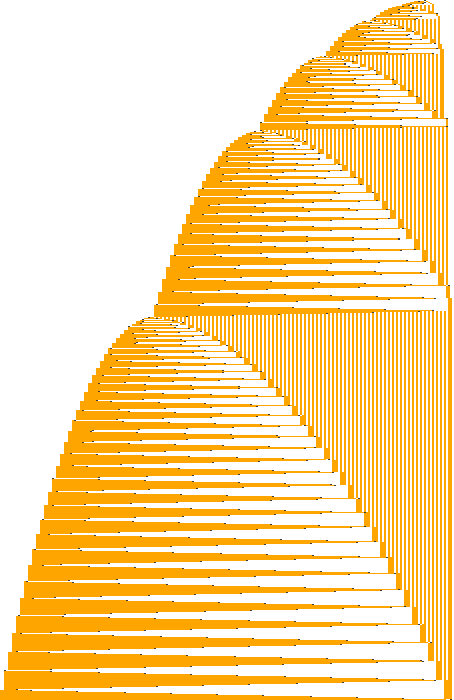

<a id="3"></a>
## 🟩 [3](#t3). `1RB0LA_0RC0RB_1LD1LA_1LC1RE_1RF0RD_1LC---` (class A)

- **Same table as no. [7](#7), other start state (13 Nov 2026).** No. 3 is no. 7 started in state D. Vampire family, orbits O2 and O4. Overview: *Related machines among the candidates* at the top.

- scan: 12 levels, 12 phases, mean factor 1.57 (sd 0.06); level starts: 16 29 49 79 124 191 292 443 670 1010 1519 2284
- verdict: vampire family (orbits O1–O4 of this repository)
- diagram: 19,400 steps, tape width 250 cells


<a id="4"></a>
## 🟩 [4](#t4). `1RB0RE_1RC---_0RD0RC_1LE1LF_1LD1RA_1RC0LF` (class A)

- **Same table as no. [6](#6), other start state (13 Nov 2026).** No. 4 is no. 6 started in state F. Vampire family, orbits O2 and O4. Overview: *Related machines among the candidates* at the top.

- scan: 12 levels, 12 phases, mean factor 1.57 (sd 0.06); level starts: 16 29 49 79 124 191 292 443 670 1010 1519 2284
- verdict: vampire family (orbits O1–O4 of this repository)
- diagram: 45,377 steps, tape width 385 cells

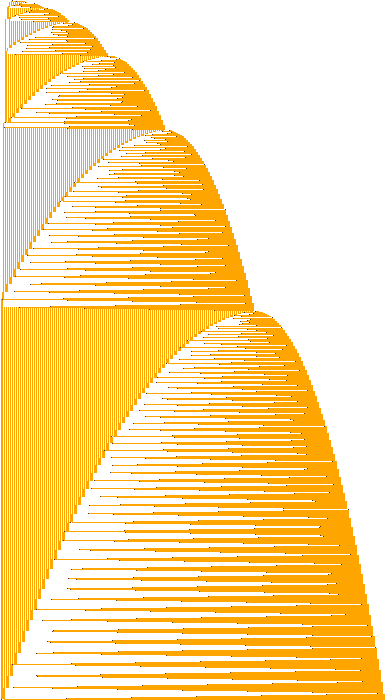

<a id="5"></a>
## 🟩 [5](#t5). `1RB0LA_0RC0RB_1LD1LA_1LC1RE_1RF0RD_1LA---` (class A)

- **Same table as nos. [1](#1), [2](#2), other start state (13 Nov 2026).** No. 5 is no. 1 started in state C; no. 2 (mirrored) started in state B. Vampire family, three different orbits (see the main README). Overview: *Related machines among the candidates* at the top.

- scan: 13 levels, 13 phases, mean factor 1.56 (sd 0.06); level starts: 13 24 40 63 99 153 234 355 537 810 1221 1836 2758
- verdict: vampire family (orbits O1–O4 of this repository)
- diagram: 67,202 steps, tape width 468 cells


<a id="6"></a>
## 🟩 [6](#t6). `1RB---_0RC0RB_1LD1LE_1LC1RF_1RB0LE_1RA0RD` (class A)

- **Same table as no. [4](#4), other start state (13 Nov 2026).** No. 6 is no. 4 started in state B. Vampire family, orbits O2 and O4. Overview: *Related machines among the candidates* at the top.

- scan: 12 levels, 12 phases, mean factor 1.58 (sd 0.07); level starts: 16 31 52 83 130 200 304 461 697 1052 1582 2378
- verdict: vampire family (orbits O1–O4 of this repository)
- diagram: 49,872 steps, tape width 403 cells

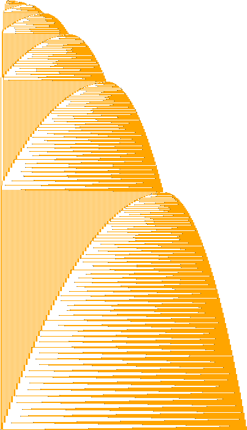

<a id="7"></a>
## 🟩 [7](#t7). `1RB0RF_1LC---_1LF1LD_1RE0LD_0RC0RE_1LC1RA` (class A)

- **Same table as no. [3](#3), other start state (13 Nov 2026).** No. 7 is no. 3 started in state E. Vampire family, orbits O2 and O4. Overview: *Related machines among the candidates* at the top.

- scan: 12 levels, 12 phases, mean factor 1.58 (sd 0.07); level starts: 16 31 52 83 130 200 304 461 697 1052 1582 2378
- verdict: vampire family (orbits O1–O4 of this repository)
- diagram: 50,667 steps, tape width 405 cells


<a id="8"></a>
## 🟩 [8](#t8). `1RB0RB_1LC1RF_0RD0LB_0RA1LE_1LD---_0RB0RC` (class B)

- scan: 20 levels, 71 phases, mean factor 1.33 (sd 0.07); level starts: 78 109 152 206 278 374 502 678 909 1218 1629 2178 2909 3882
- level analysis: Bell type `LD` with left part `01 12 01 11 01`, 26 levels; n: 284 380 508 684 915 1224 1635 2184 2915 3888 5187 6918 9227 12304 16411 21886; ratios: 1.338 1.336 1.336 1.335 1.334 1.334 1.334 1.334 1.333 1.334 1.334; 13 different tails
- verdict: **halts** (vampire method, [halt-found repository](https://github.com/thomasreus-bb/halt-found-1rb0rb_1lc1rf_0rd0lb_0ra1le_1ld---_0rb0rc))
- diagram: 4,677 steps, tape width 100 cells

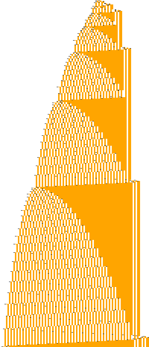

<a id="9"></a>
## [9](#t9). `1RB0RB_1LB0LC_1RD1LC_1RE0RA_0RF1RA_---1LB` (class B)

- scan: 15 levels, 98 phases, mean factor 1.33 (sd 0.09); level starts: 20 29 34 52 76 107 126 173 199 273 370 501 675 905
- level analysis: Bell type `RB`, 30 levels; n: 182 207 280 378 508 682 914 1246 1666 2226 2972 3307 4414 5890 7858 10482; ratios: 1.343 1.340 1.363 1.337 1.336 1.335 1.113 1.335 1.334 1.334 1.334; 2 different tails
- verdict: needle-like: only 2 tails (all information in one number)
- diagram: 2,981,111 steps, tape width 1001 cells

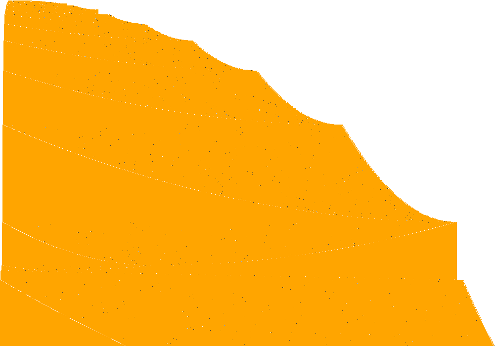

<a id="10"></a>
## 🟩 [10](#t10). `1RB---_0RC0RD_1LD1RB_0LE0LC_1RA0LF_1LD1LE` (class B)

- **Status: HALT (Yeyito, Discord, 7 Nov 2026).** `1RB---_0RC0RD_1LD1RB_0LE0LC_1RA0LF_1LD1LE` halts after **831265665802914901834939426973647910800304 steps** (≈ 8.3·10⁴¹, counting the halting step).
  - Proof (halts): [github.com/Yeyito777/bbchallenge-discoveries/tree/main/bb6-holdout-2](https://github.com/Yeyito777/bbchallenge-discoveries/tree/main/bb6-holdout-2), 280 core-hours.
  - With Shawn's A(a, b, c) rules the machine halts from A(0, 1, 0) after 71,755,048,174,256 rule steps, at A(80724428909535, 1, 242173286728609) (c = 3a + 4).
  - The orbit was found by a plain C run of the rules (about 33 h on one core), replayed by a separate Rust implementation, and then proved in Rocq: the rules are derived from the raw machine, and a kernel check of the whole orbit runs in 523 jobs.
  - The exact step count comes from two independent counters (C and Rust) that agree; it is not yet a Rocq theorem.
- **BusyBeaverWiki article:** [1RB---_0RC0RD_1LD1RB_0LE0LC_1RA0LF_1LD1LE](https://wiki.bbchallenge.org/wiki/1RB---_0RC0RD_1LD1RB_0LE0LC_1RA0LF_1LD1LE)

- scan: 21 levels, 240 phases, mean factor 1.24 (sd 0.09); level starts: 42 51 70 90 113 148 188 249 271 306 412 474 555 628
- level analysis: Bell type `RC`, 31 levels; n: 278 367 418 496 632 706 831 899 980 1076 1181 1299 1458 1758 1942 2205; ratios: 1.117 1.177 1.082 1.090 1.098 1.098 1.100 1.122 1.206 1.105 1.135; 22 different tails
- verdict: 22 different tails, but the growth ratio varies
- diagram: 10,067 steps, tape width 64 cells

- **Known result.** This machine has a page on the BusyBeaverWiki: [1RB---_0RC0RD_1LD1RB_0LE0LC_1RA0LF_1LD1LE](https://wiki.bbchallenge.org/wiki/1RB---_0RC0RD_1LD1RB_0LE0LC_1RA0LF_1LD1LE), with an analysis by Shawn Ligocki (as of April 2026).
  - **Rules.** There, the machine is reduced to rules on configurations A(a, b, c) with a norm that grows linearly. The ratio of the two registers follows a skew tent map, so it is uniformly distributed, and the chance of a halt per high-level step is about 1/(2S).
  - **Simulation.** These rules were simulated for 2·10¹² high-level steps without a halt.
  - **Verdict there.** "Probviously halting": under the model the probability of never halting is 0, and the median halting time is 512 times the number of steps already simulated.
  - **Relation to the analysis below.** The analysis below was done independently, before we knew the wiki page. It arrives at the same structure: the linear norm N, the skew tent map, uniform p and a halt chance of about 1/(2N) per Bell. Our exponent agrees with the wiki's: about 1/(2N) ≈ 1/(9k) per Bell means the survival probability falls like K^(−1/9). The chance of no halt up to Bell K therefore halves when K grows by the factor 2⁹ = 512, which is the wiki's median.
  - **What is new here.** The three Bell types A/B/C, the diagram with the phases, the exact step formula and `bmap2`. The wiki simulation goes further than ours: 2·10¹² steps against 10¹⁰ Bells.
- **Exact Bell map (25 Oct 2026): no HALT in the first 10¹⁰ Bells (about 10³⁰ steps); HALT needs an exact hit.** Tools: `scan/m10/`.
  - *What a Bell is here.* A Bell is the stretch between two steps at which the head reaches a new cell at the left end of the tape in state C. These are the horizontal bands of the space-time diagram. Bell 1 starts at step 48; before that there is only a short start-up. The tape grows by about 4.5 cells per Bell, i.e. **linearly**, not geometrically. The step count grows like about 2.3·k³ after k Bells.
  - *Tape at the start of a Bell.* Always
    `0 (01)^a [0 01] (11)^b [1]`, head on the new left cell, state C.
    Two registers a and b, a separator `0 01` (present or not) and an optional extra `1` at the right end.
  - *Three phases inside a Bell* (coloured bar in the figure below):
    1. The block `(01)^a` is turned into `11…` in a few steps. This is the left register L, about 2a cells.
    2. **Dome.** In each round L loses one cell, the right block `(11)^b` loses three cells and a chequered block `(01)…` in the middle grows by two cells. This phase draws the curved chequered area.
    3. **Parallelogram.** Starts when the right block is used up. The chequered block keeps its width and moves to the right. L loses one cell per round and a new `11…` block grows at the right end. This phase draws the slanted chequered stripe.
  - *Three types of Bell.* Which register runs out first decides the type:

    | type | condition (approx.) | what happens | next Bell (approx.) |
    |---|---|---|---|
    | **A** | b/3 < a ≤ b | the right block runs out first; a large right block, so a long dome | a' ≈ 4b/3, b' ≈ a − b/3 |
    | **B** | a > b | the right block runs out first; a small right block, so a short dome and a long parallelogram | as A |
    | **C** | a < b/3 | L runs out during the dome: no phase 3. The Bell is short and the next one starts without the separator `0 01` | a' ≈ 4a, b' ≈ b − 3a |

    Two rare details:
    - **b = 0.** A Bell may start with an empty right register; then it has only phase 3. In the first 10¹⁰ Bells this happens twice (Bells 93 and 39,365).
    - **Parity variant.** Depending on b mod 3 and the parity bits, A and B Bells may have one extra switching round between phases 2 and 3. It is not visible in the diagram.
  - *Order of the types.* A is always followed by B: after A, a' ≈ 4b/3 > b' ≈ a − b/3. B and C can be followed by A, B or C. Over 10¹⁰ Bells the shares are B 50 %, A 25 %, C 25 %. The first 16 Bells alternate strictly (ABAB…); the first C is Bell 17 (steps 20,438–20,907). First 100 Bells (Z = b = 0):

        1–10   ABABABABAB      51–60   BABCBCABCB
       11–20   ABABABCABA      61–70   ABCBCBCABC
       21–30   BABCBBABAB      71–80   BABCBBBBBA
       31–40   ABCBCBABCB      81–90   BABCBCCBCA
       41–50   ABCABCABCA      91–100  BAZCCABCCB

  - *Exact map.* `scan/m10/bandmap.py` gives the next Bell (a', separator, b', extra 1) from the current one exactly, with a table over (b mod 3, extra 1, separator). It is checked in two ways:
    - against the real TM for the first 2000 Bells of the orbit (`bands.c`);
    - against the real TM for all 19,844 start tapes with a ≤ 40 and b ≤ 120 (`edge.c`). It agrees on all of them except the cases b = 0 and the halting families below, which the iteration treats separately.

    In short, with L = 2a + 1 + 2·sep (cells of the left register) and m = ⌊2b/3⌋ + δ (rounds of the dome, δ ∈ {0, −1} from the table):
    - **A/B** (L > m): a' = 2m + (1…4), b' from 2b' + e' = 2a + 3·sep − m + (0 or −1); separator present.
    - **C** (L ≤ m): a' = 2L + 2 + sep, 2b' + e' = 2b + e − 3L − 2 − sep; no separator.
  - *HALT condition.*
    - **When it halts.** The machine halts exactly when a C Bell uses up the right register completely, leaving 0 or −1 cells. The four families of Bell starts are (a, sep, b, e) = (a, 0, 3a+2, 0), (a, 0, 3a+2, 1), (a, 1, 3a+5, 1) and (a, 1, 3a+6, 0). After such a C Bell the tape is `0 (01)^x` or `0 (01)^x 0`, and the machine halts in the next Bell. This is checked with the real TM for all a ≤ 40.
    - **No other halt.** No other start tape with a ≤ 40, b ≤ 120 halts within one Bell.
  - *The map as a mathematical question.* Write the Bell start in three numbers:
    - L = 2a + 1 + 2s: the cells of the left register (always odd);
    - Y = 2b + e: the cells of the right register;
    - s ∈ {0, 1}: whether the separator is there.

    Bell 1 starts at step 48 with (L, Y, s) = (5, 3, 1). For each Bell let

    &nbsp;&nbsp;&nbsp;&nbsp;m = ⌊(Y − 1 − s)/3⌋, &nbsp;&nbsp; r = Y − 1 − s − 3L.

    Then the next Bell is:
    - **r < 0** (type A or B, i.e. L > m): (L, Y, s) → (2Y − 2m + 3, L − m − 1, 1)
    - **r ≥ 2** (type C): (L, Y, s) → (4L + 5 + 2s, r − 1, 0)
    - **r ∈ {0, 1}:** the machine halts in the next Bell.

    This form agrees with the table map for 3·10⁶ Bells of the orbit and on all 43,984 test tapes. It needs no special case for b = 0.

    > **Question.** Does the sequence starting at (5, 3, 1) ever reach a Bell with r ∈ {0, 1}?
    > The TM halts if and only if it does.
  - *Why the answer is hard.*
    - **Growth.** N = L + Y grows by 3 + s per C Bell and by 3 + s + ((Y − 1 − s) mod 3) per A/B Bell, so N ≈ 4.5·k after k Bells.
    - **Leading order.** In the share p = L/N the map is, up to errors of order 1/N, the **skew tent map**
      - p' = 4p for p < 1/4 (C),
      - p' = 4(1 − p)/3 for p > 1/4 (A for p ≤ 1/2, B for p > 1/2).
    - **What this explains.** Both branches map onto all of [0, 1], so the invariant density is uniform. This explains the shares C 25 %, A 25 %, B 50 %. It also explains why A is always followed by B: p ∈ (1/4, 1/2] gives p' ≥ 2/3.
    - **Halting as a target.** The map is chaotic, so the sequence of types is as irregular as the binary digits of a typical number. HALT means that p lands in a target interval just below 1/4 whose width is about 1/(2N).
    - **Heuristic.** With uniform p this happens with probability about 1/(2N) ≈ 1/(9k) per Bell. The expected number of hits up to Bell K is therefore about (ln K)/9, or 0.26 per factor of 10 in K, which matches the count of near misses.
    - **Conclusion.** The question is a *shrinking-target problem* for a (slightly perturbed) expanding map. For such orbits no general method decides whether a target is ever hit, much as for Collatz-type questions. A HALT found by iteration settles it; a proof of non-halting would need a new idea.
  - *Exact step count.* Steps per Bell are polynomials in a and b. They were fitted on about 44,000 single-Bell runs of the real TM and are exact in every case:
    - **C Bell:** 16a² + 38a + 21 (no separator) or 16a² + 78a + 91 (with separator).
    - **A/B Bell** (also b = 0): (96ab − 16b² + k₁a + k₂b + k₀)/9, with k from a table over (b mod 3, extra 1, separator).
    - **Halting Bell:** start tape `0 (01)^x` or `0 (01)^x 0` takes 16 + 6x steps, then the halting transition.

    `bmap2.c` iterates the map with this step count in a 192-bit accumulator and prints the exact step count at HALT. Checks:
    - it reproduces the step counts of the orbit at Bells 1, 16, 17, 18, 999 and 1999 (e.g. 18,164,042,511 steps at the end of Bell 1999);
    - it reproduces the halting step counts of the four halting families started directly.

    Usage: `gcc -O2 -o bmap2 bmap2.c` and then `./bmap2 NBELLS [REPORT_EVERY]`. It runs about 5·10⁷ Bells per second; 10¹⁰ Bells take 3 minutes and end at exactly 2,250,041,677,475,296,360,402,353,788,984 steps. 64-bit registers are enough up to about 10¹⁸ Bells.
  - *Iteration.* `bmap.c` iterates the map, about 10⁸ Bells per second. In **10¹⁰ Bells there is no HALT**. The registers are then about 10¹⁰, the tape is about 4.5·10¹⁰ cells and the step count is roughly 2·10³⁰. The nearest misses: after Bells 31,031 and 14,043,703 a C Bell left 2 cells, after Bell 431,602 it left 4.
  - *Assessment.*
    - **What is open.** A HALT needs a C Bell whose right remainder lands exactly on 0 or −1. Over the C Bells this remainder is spread fairly evenly over [0, 2b] and shows no residue class mod 12 that would forbid it.
    - **Heuristic.** The chance of a hit per Bell falls like 1/k. The expected number of hits up to Bell K therefore grows only like log K, so HALT may come very late or never. This is a heuristic, not a proof in either direction.
    - **What would decide it.** The exact map reduces the machine to a two-number system that can be iterated cheaply. A decision needs either a hit, which can be searched for much further with `bmap.c`, or an argument why the remainder never reaches 0 or −1.
  - *Correction of 24 Oct.* The earlier estimate (about 2 % HALT per "Bell", HALT after about 10⁴⁰ steps) is **withdrawn**.
    - **Where it came from.** It used a different "Bell", namely records of the block `1^n` in configurations `1^n (01)^m 00` that are far apart, with many of the Bells above in between.
    - **Why it fails.** It counted halts of *varied* starts, which leave the orbit's set of reachable configurations. The real orbit does not halt in 10¹⁰ Bells.
    - **What stays valid.** The `accsim` run without HALT up to 4.4·10²³ steps agrees with the map: that is about Bell 6·10⁷.

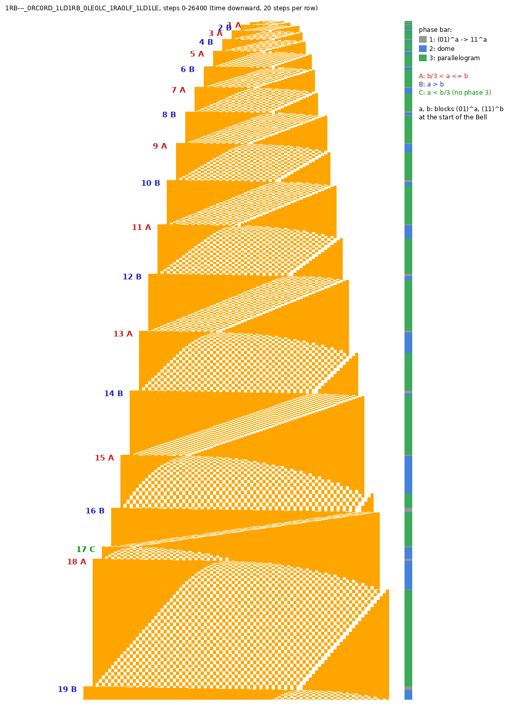

*Steps 0–26,400, time downward, 20 steps per row. Labels: Bell number and type. The bar on the right shows the phase: grey = 1 (`(01)^a` to `11`), blue = 2 (dome), green = 3 (parallelogram). Bell 17 is the first C Bell: no green phase.*

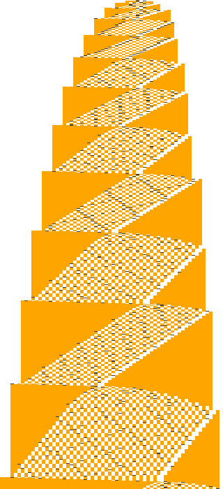

<a id="11"></a>
##  [11](#t11). `1RB1LB_1RC---_1LD1LF_1LE0LD_0LA1RF_1LC0RE` (class B)

- **Same table as no. [37](#37), other start state (13 Nov 2026).** No. 11 is no. 37 (mirrored) started in state D. The two are equivalent. Overview: *Related machines among the candidates* at the top.
- **Equivalent to [no. 37](#37)**  Removed from the BB(6) holdout list on 30 Oct 2026 because of this equivalence. All information is collected under no. 37.

<a id="12"></a>
## [12](#t12). `1RB1RA_1LC1LB_1RE0LD_1RA0LB_---0RF_1RC0RA` (class B)

- scan: 19 levels, 42 phases, mean factor 1.27 (sd 0.10); level starts: 47 63 80 87 96 122 144 181 252 288 391 576 684 834
- level analysis: Bell type `LC` with left part `01`, 2 levels; n: 4 27; ratios: 6.750; 1 different tails
- verdict: no clear single-block Bell configuration found
- diagram: 38,184 steps, tape width 143 cells

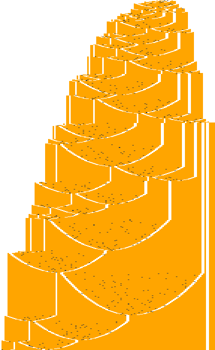

<a id="13"></a>
##  [13](#t13). `1RB0RF_1RC1RF_1LD0LE_---1LC_1RA1LE_1LC1RB` (class B)
- **BusyBeaverWiki article:** [1RB0RF_1RC1RF_1LD0LE_---1LC_1RA1LE_1LC1RB](https://wiki.bbchallenge.org/wiki/1RB0RF_1RC1RF_1LD0LE_---1LC_1RA1LE_1LC1RB)

- scan: 20 levels, 41 phases, mean factor 1.33 (sd 0.10); level starts: 34 43 64 77 91 119 175 231 350 441 665 1001 1505 2261
- level analysis: Bell type `RC`, 25 levels; n: 66 75 117 180 229 348 439 663 999 1503 2259 3393 5094 5735 8607 12915; ratios: 1.520 1.261 1.510 1.507 1.505 1.503 1.502 1.501 1.126 1.501 1.501; 2 different tails
- verdict: needle-like: only 2 tails (all information in one number)
- diagram: 1,313,195 steps, tape width 1001 cells
- **Exact Bell map (10 Nov 2026).** Tools: `scan/m13/` (`f13.py`, `map13.py`, `run13.py`). In the mirrored machine, at every B-event (state B, head at the end of the tape) the tape is exactly `1^n`. All the information is in one number.
  - *The map* (derived from direct simulation for every n < 1,100, checked for 47 larger values and against the real run):
    - n odd: n′ = (3n + 5)/2.
    - n even, n + 2 = 2^k·m with m odd:
      - m = 1: **HALT**;
      - otherwise n′ = F = ((2^(k+1) + 1)·m + 2k − 1)/2;
      - exception m = 3 with k even: n′ = (3F + 3)/2.
  - *Real orbit:* from n = 1 it reproduces all 26 Bells of the real run up to 2·10⁹ steps (1, 4, 8, 13, 22, 28, …, 29,074, 32,712).
  - *Long run:* 2,000,000 Bells with the exact map: no HALT, n ≈ 10²⁴¹⁷⁹⁶. One Bell takes about 1.1–1.5·n² steps, so this is about 10⁴⁸³⁵⁹² steps.
- **HALT condition.** The machine halts exactly when n = 2^k − 2. Direct simulation of all n < 1,100: exactly 2, 6, 14, 30, 62, 126, 254, 510 and 1,022 halt.
- **Discord (Sheep, 8 Apr 2026).** Sheep had already derived the same rules ("needle rules"). With x = n + 2:
  - HALT iff x is a power of 2;
  - x = (2a+1)·2^b → x + a + b + 2;
  - a = 1 with b even: 3(x + b)/2 + 5.

  This agrees exactly with the map above.

  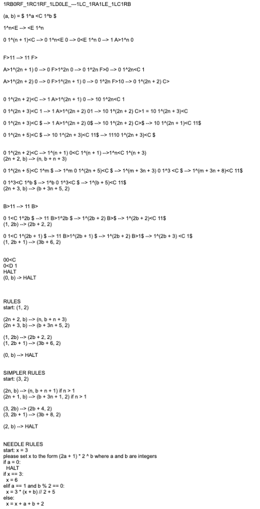

- **Assessment.** A Collatz-like needle. It halts only if the orbit ever hits n + 2 = 2^k exactly. For a pseudo-random n of size N the chance per Bell is about 1/N, and n grows by about ×1.32 per Bell, so the sum converges.
  - Up to n ≈ 10²⁴¹⁷⁹⁶ (exact, 2·10⁶ Bells) no HALT; the remaining chance is far below 10⁻²⁴⁰⁰⁰⁰.
  - A non-halting proof would have to show that the orbit never meets a power of 2. That is a Collatz-type statement, so it is a cryptid in the sense of the Holdout Guide ("halting reduces to a Collatz-like question"), but one whose answer is almost certainly "never halts".


<a id="14"></a>
##  [14](#t14). `1RB0LF_1LC1RA_0RE0RD_---1LE_1LF1RC_1LC1LA` (class B)
- **BusyBeaverWiki article:** [1RB0LF_1LC1RA_0RE0RD_---1LE_1LF1RC_1LC1LA](https://wiki.bbchallenge.org/wiki/1RB0LF_1LC1RA_0RE0RD_---1LE_1LF1RC_1LC1LA)

- scan: 30 levels, 87 phases, mean factor 1.21 (sd 0.10); level starts: 428 466 541 604 783 850 984 1046 1180 1372 1615 1882 2136 2262
- level analysis: Bell type `LC` with left part `01`, 13 levels; n: 8 14 26 74 106 122 440 1088 2366 4862 6538 7376 17540; ratios: 1.857 2.846 1.432 1.151 3.607 2.473 2.175 2.055 1.345 1.128 2.378; 1 different tails
- verdict: needle-like: only 1 tail (all information in one number)
- diagram: 619,684 steps, tape width 1001 cells

- **Examined in detail (28 Oct 2026): an exact Collatz-like map; HALT needs an exact hit.** Tools: `scan/m14/`.
  - *Configuration.* Each time the head reaches a new cell at the left end in state C, the tape is

        (01)^m 1^r

    with the head on the first 0. All information is in the two numbers (m, r).
  - *Exact map* (`map14.py`): it reproduces all 114 events of the direct simulation (3·10⁹ steps), and `scan14.py` checks it against the TM for all small start tapes.
    - **Phase 1 (doubling):** while r ≥ 2m: (m, r) → (2m+1, r−2m). Starting from m = 1, m runs through 1, 3, 7, 15, …, 2^k − 1.
    - **Phase 2 (factor 3/2):** if r < 2m, let X = 3m + (r+1)/2. If X is even, the next event is (X/2, 0); if X is odd, it is ((X−1)/2, 2), and phase 2 continues with X = 3m + 3.
    - **New cycle:** (m, 0) → (1, 2m+1).
  - *Bells = cycles.* A cycle (from m = 1 to the next m = 1) consists of k doublings and j ≥ 1 steps of phase 2. The Bell types are given by j:
    - **A** (j = 1): 50 %;
    - **B** (j = 2): 26 %;
    - **C** (j = 3): 12 %;
    - … geometric, as for the parity of a random number.

    First 100 cycles:

        1–10   AABAACCBBA      51–60   DBACCBBBAA
       11–20   ACEBGBDBCD      61–70   BAAABBACBA
       21–30   AABACABBAA      71–80   BBAAADBBBB
       31–40   AAAAAAAAEA      81–90   BBDCABCCCA
       41–50   AAAAACABAA      91–100  AACBEABAAB

    The numbers grow by about 0.76 bits per cycle (factor 1.7). The level ratios 1.1 … 3.6 of the scan are the cycles with different j.
  - *HALT condition.* The TM halts exactly at the tape (m, r) = (2^k − 1, 1), i.e. when phase 1 leaves exactly one 1. This happens if and only if a cycle starts with r = 2^(k+1) − 2k − 1, i.e. if the previous cycle ends with **m = 2^k − k − 1** (4, 11, 26, 57, 120, 247, …). Checked with the TM for all m = 2^k − 1 (k ≤ 8) and r ≤ 2m + 3: the only halting tapes are (2^k − 1, 1). Phase 2 never halts.
  - *Iteration.* 3000 cycles with the exact map (numbers of about 2300 bits): no hit.
  - *Comparison with the BusyBeaverWiki.*
    - **The wiki's rules.** The wiki article lists the machine as a potential cryptid, found by Marco Dos Santos ("At the Limits of Computability", arXiv 2610.22603), with status undecided and "probvious behaviour not yet analysed". He uses C(a, b) = `0^∞ E> (10)^a 1^b 0^∞` with the rules:
      - C(a, b) → C(2a+2, b−2a−2) if b > 2a+2;
      - C(a, 1) → C(2, 2a+2);
      - C(a, 2k) → C((6a+2k+2)/4, (6a+2k+2) mod 4 + 1);
      - C(a, 2k+1) → C((6a+2k+6)/4, (6a+2k+6) mod 4 + 1);
      - C(a, 2) halts; start C(0, 3).
    - **Same rules.** With **a = m − 1, b = r + 1** these are exactly the rules above:
      - doubling: m' = 2m + 1, r' = r − 2m;
      - phase 2: m' = (6m + r + 1)/4, and b' = 1 or 3 corresponds to r' = 0 or 2;
      - new cycle: C(a, 1) → C(2, 2a+2) is our (m, 0) → (1, 2m+1) together with the first doubling step;
      - HALT: b = 2 corresponds to r = 1;
      - start: C(0, 3) corresponds to (1, 2).

      The two descriptions were found independently.
    - **New here:**
      - the closed form of the HALT condition (a cycle has to end with m = 2^k − k − 1);
      - the Bell types and their geometric distribution;
      - 3000 cycles without a hit;
      - the probabilistic assessment.
  - *Assessment.* A "needle". At the end of each cycle, m must hit one particular number per power of 2, so the chance per cycle is about 1/m. Since m grows exponentially, these chances add up to a tiny total after the first cycles: **the machine very probably never halts**. A proof would have to show that the Collatz-like orbit never hits the numbers 2^k − k − 1, which is a typical Collatz-type question.


<a id="15"></a>
##  [15](#t15). `1RB0RB_1LC1RE_1LF0LD_1RA1LD_1RC1RB_---1LC` (class B)
- **BusyBeaverWiki article:** [1RB0RB_1LC1RE_1LF0LD_1RA1LD_1RC1RB_---1LC](https://wiki.bbchallenge.org/wiki/1RB0RB_1LC1RE_1LF0LD_1RA1LD_1RC1RB_---1LC); on the [Cryptids](https://wiki.bbchallenge.org/wiki/Cryptids) page: listed as a cryptid

- scan: 19 levels, 45 phases, mean factor 1.36 (sd 0.11); level starts: 36 55 65 87 101 125 165 249 315 475 715 1075 1615 2425
- level analysis: Bell type `RC`, 23 levels; n: 86 100 128 163 248 313 473 713 1073 1613 2423 3638 4096 5123 7688 9613; ratios: 1.262 1.511 1.507 1.505 1.503 1.502 1.501 1.126 1.251 1.501 1.250; 2 different tails
- verdict: needle-like: only 2 tails (all information in one number)
- diagram: 1,423,912 steps, tape width 1001 cells


<a id="16"></a>
##  [16](#t16). `1RB1LF_1RC1RF_0LD1RE_---1LC_0RB1RE_1LA0LE` (class B)

- scan: 15 levels, 109 phases, mean factor 1.26 (sd 0.11); level starts: 16 18 20 26 34 38 54 60 92 138 178 200 271 370
- level analysis: Bell type `RB` with left part `01`, 26 levels; n: 380 436 488 528 592 648 706 778 848 989 1092 1208 1308 1500 1630 1853; ratios: 1.095 1.090 1.102 1.090 1.166 1.104 1.106 1.083 1.147 1.087 1.137; 10 different tails
- verdict: 10 different tails, but the growth ratio varies
- diagram: 10,525 steps, tape width 77 cells

- **examined (24 Oct 2026):** the same form as no. 10. At Bell starts the tape is `0 1^n (01)^m 0`, head right, state C, with a two-register ping-pong inside. `accsim` is much less effective here: 2·10¹⁰ real operations reach only **4.5·10¹³ steps** (blocks about 3·10⁴): no HALT. Perturbed real starts gave 0 HALT in 60 runs over growth factor 4 (a weak test).

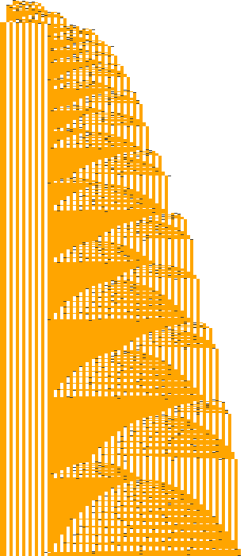

- **Red and green sections (4 Nov 2026).** Seen in the 500,000-step Blaze diagram: *red* = a vertically striped block at the left edge, *green* = a small notch at the right edge.

  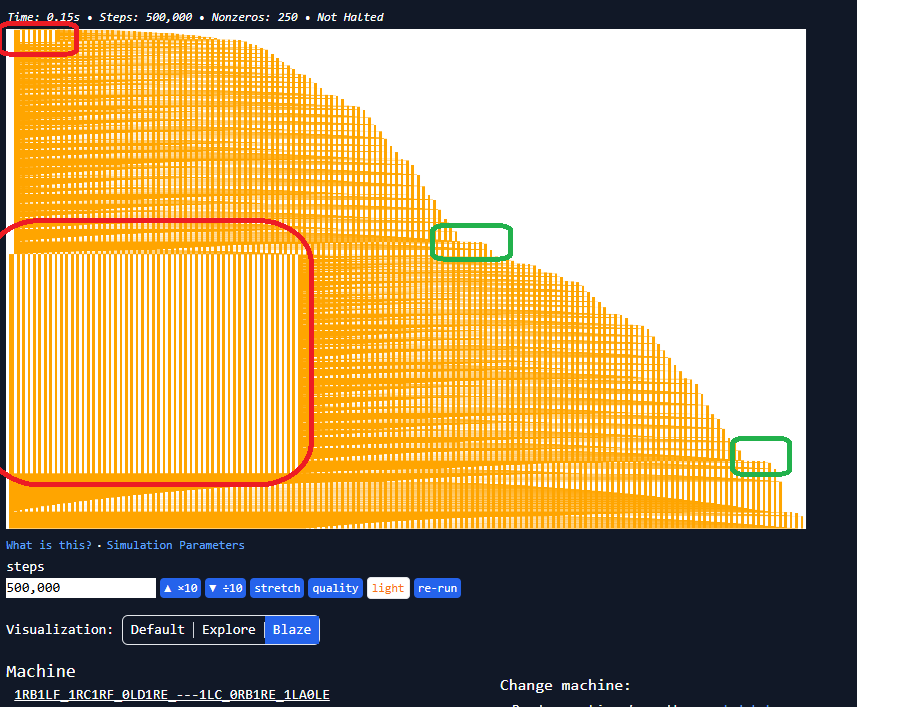

  - **Green = restart of the right counter (a Bell start).** The right part runs down to a pure block of ones, `… (1)^a [0]`; then the `01` counter restarts and doubles, b = 2, 6, 14, 30, 62, 126, … (b = 2^k − 2), eating the ones: (a, b) → (a − 2b − 2, 2b + 2). These are exactly the level starts of the level analysis above (n = 380, 436, 989, 1308, 1500, 1853, …). Green events up to 10⁷ steps: 27, 213, 10,526, 212,887, 432,060 (both with a = 165; these are the two green boxes in the diagram), 1,966,727 (a = 380), 3,213,509 (a = 436).
  - **Red = the left part is a frozen block `1 (10)^m`.** A red section starts at a left record in state A, `[0] (1)^(2m) (01)^c 0`, where the left block of 2m ones is folded into `1 (10)^m`. The block then stays untouched and acts as a wall for the right process. The section ends at the next left record, in state E, `[0] 0 (1)^x (01)^c 0`, where the block is turned back into ones.

    | red section | steps | m |
    |---|---|---|
    | 1 (small red box) | 412 – 12,807 | 7 (from `(1)^14`) |
    | 2 (large red box) | 225,310 – 444,589 | 53 (from `(1)^106`) |
    | 3 | 43,553,622 – 43,556,893 | 497 (from `(1)^994`) |
    | 4 | 262,103,544 – 262,207,789 | 851 (from `(1)^1702`) |

    So up to 10⁷ steps there are only the two red sections visible in the diagram; up to 3·10⁹ steps there are four. These eight left records are the only left records at all (after the start-up at steps 21–133).
  - **Relation.** Every start and every end of a red section comes shortly after a green event that ends at a right record in state E (`(1)^a [0]`, stE): 213 → 412, 10,526 → 12,807, 212,887 → 225,310, 432,060 → 444,589, 43,052,523 → 43,553,622, 43,555,700 → 43,556,893, 260,493,637 → 262,103,544. Green events without that record (1,966,727, 3,213,509, 92,466,003, 113,297,533, 139,969,291) do not reach the left end, and the left part stays as it is. In sections 2 and 3 the red start and the red end follow the same right-hand sequence: `(1)^165 [0]`, then (163, 2), (157, 6), (143, 14), (113, 30), (51, 62), and the overflow at (51, 62) sends the head to the left end.
  - The open question of the overflow rule is solved in the next section.

- **Exact macro rules and halting chance (7 Nov 2026).** Tools in [`m16/`](m16/): `sim16.c` (fast simulator), `run16.sh` (download, compile, run), `macro16.py` (the rules in Python), `step16.c` (one macro step by direct simulation), `rec16.c` (all right records of the real run), `test16.py`, `fitsteps16.py`.
  - **Configuration.** At every new right record in state C the tape is `P (1)^a (01)^b [0]`, where the left part `P` is either empty (*E mode*) or the frozen block `1 (10)^m` (*L mode*, the red sections). Size S = a + 2b.
  - **One rule for almost everything.** Let E(u, X) take the smallest M = 1, 2, 4, 8, … with a′ = (2M−1)·u − X − 2 ≥ 0, and set b′ = X + 1 − (M−1)·u. If a′ = 0 (an *A0 event*), the machine goes on to (a′, b′) = (2b′ − 1, 1).
    - a even, or a ≥ 2b + 1: (a, b) → E(a + 2, 2b), mode unchanged. M = 1 is the doubling (a − 2b, 2b + 1) from before; M ≥ 2 are the overflow cases. Here S grows by exactly 2.
    - a odd and a < 2b, with d = 2b + 1 − a:
      - E mode: a = 1 → **HALT**; d = 2 → (4b + 3, 1); d = 4 → (2, 2b − 1); otherwise switch to L mode with m = a + 2 and (a′, b′) = E(1, d − 3). The size drops to d − 2; the rest goes into the frozen block.
      - L mode: d = 2 → E mode (2m + 4b + 1, 1); otherwise switch to E mode with (a′, b′) = E(2m + 2a + 6, 2b − 3 − a). The block is used up again.
    - Detail: `1 (10)^m 1 (01)^b` is the same tape as `11 (01)^(m+b)`, so L mode with a = 1 counts as E mode (2, b + m).
  - **Step counts.** E(u, X) takes (M−1)(2M−1)u² − 3(M−1)uX + 3X²/2 − 8(M−1)u + 6X + 6 + 2·log₂M steps, an A0 event adds 3 − 2b′, and the mode switches add 3a²/2 + 9a + 12 (E→L) or 3a²/2 + 4m + 7a + 19/2 (L→E). The special cases take 6b² + 20b + 14 (E, d = 2), 6b² + 5 (E, d = 4) and 6b² + 4m + 8b + 7 (L, d = 2). All formulas are exact on the test data (thousands of random starts, `step16`), and `sim16` reproduces all 1,447 right records of the real run up to 10⁹ steps with the exact step numbers.
  - **When does it halt?** E(u, X) keeps the parity of a in the normal case, and both mode switches give an even a. An odd a only appears after an A0 event, as (2B − 1, 1) with B = b′. From there the doublings give b = 1, 3, 7, 15, … and a_k = 2B + 3 + 2k − 2^(k+2). The machine halts exactly when a_k = 1 for some k, so:

    **No. 16 halts if and only if an A0 event in E mode gives B = 2^(k+1) − k − 1 = 1, 2, 5, 12, 27, 58, 121, …** (In L mode an A0 event cannot halt; the only other route needs an L-mode A0 event with B = 2^(k+2) − k − 3 and then a second exact hit, and it did not occur.) This is the Collatz-like question from the Holdout Guide (#81 Cryptid), now in explicit form.
  - **Run.** `sim16` reaches 10²¹ steps in 0.4 s 10³⁰ steps in 6.7 minutes (1.6·10¹⁰ macro steps, size S = 3.2·10¹⁰) and 10³³ steps in about 70 minutes (1.4·10¹¹ macro steps, size S = 2.9·10¹¹). **No HALT up to 10³³ steps.** There were 16 A0 events in E mode (B = 83, 495, 927, 6,655, 13,167, 22,335, 24,955, 9,927,931, 84,719,059, 141,933,395, 743,840,751, 996,218,719, 1,801,573,711, 5,459,060,607, 23,347,006,751, 25,527,721,551) and 17 in L mode. The nearest miss was B = 495, 8 below the halting value 503 (k = 8).
  - **Halting chance.** A0 events need an exact hit a′ = 0. That happens about once per growth of S by a factor e^1.4: 14 E-mode events while S grew by a factor of 1.9·10⁸ (0.73 per e-fold). For each event B ≈ S/2, and the chance that B is one of the halting values is about 1.44/B. The expected number of future hits after size S₀ is therefore about ∫ 0.73 · 2.9/S² dS ≈ 2/S₀. With S ≈ 3.2·N^(1/3) (N = steps) this gives

    **P(HALT after N steps) ≈ 0.7 · N^(−1/3)**, so about 10⁻¹⁰ after 10³⁰ steps and 7·10⁻¹² after 10³³ steps.

    Unlike no. 10, the chance per cycle does not stay at about 1/T: the cycles that can halt (A0 events) become rarer in the same way as the hit becomes harder, and the sum converges. Even summed from the start, all 16 events together had only about a 2 % chance of a HALT.

<a id="17"></a>
## 🟩 [17](#t17). `1RB0RC_1RC---_1LD1RE_1LE0LD_1RA0LF_0RC0RB` (class B)

- scan: 17 levels, 149 phases, mean factor 1.29 (sd 0.12); level starts: 23 33 39 55 59 75 111 137 163 183 215 279 359 459
- level analysis: Bell type `LE` with left part `01`, 17 levels; n: 7 11 21 41 57 77 165 233 297 377 477 1137 1427 2141 4243 6365; ratios: 1.351 2.143 1.412 1.275 1.269 1.265 2.384 1.255 1.500 1.982 1.500; 3 different tails
- verdict: 3 different tails, but the growth ratio varies
- diagram: 15,198 steps, tape width 79 cells

- **examined briefly (24 Oct 2026):** two-register system. `accsim` with 10⁹ real operations reaches **10¹⁴ steps** (blocks `11^2·10⁵`, `10^2.2·10⁶`): no HALT.

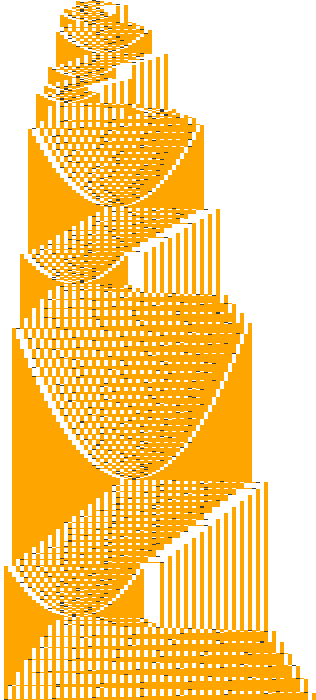

<a id="18"></a>
## [18](#t18). `1RB---_1LC0LD_0RF0LD_0LE0RA_0LC1RA_1RC1RD` (class B)

- scan: 13 levels, 114 phases, mean factor 1.36 (sd 0.12); level starts: 8 10 14 19 25 32 52 61 70 83 131 203 311
- verdict: no clear single-block Bell configuration found
- diagram: 2,207,708 steps, tape width 1001 cells

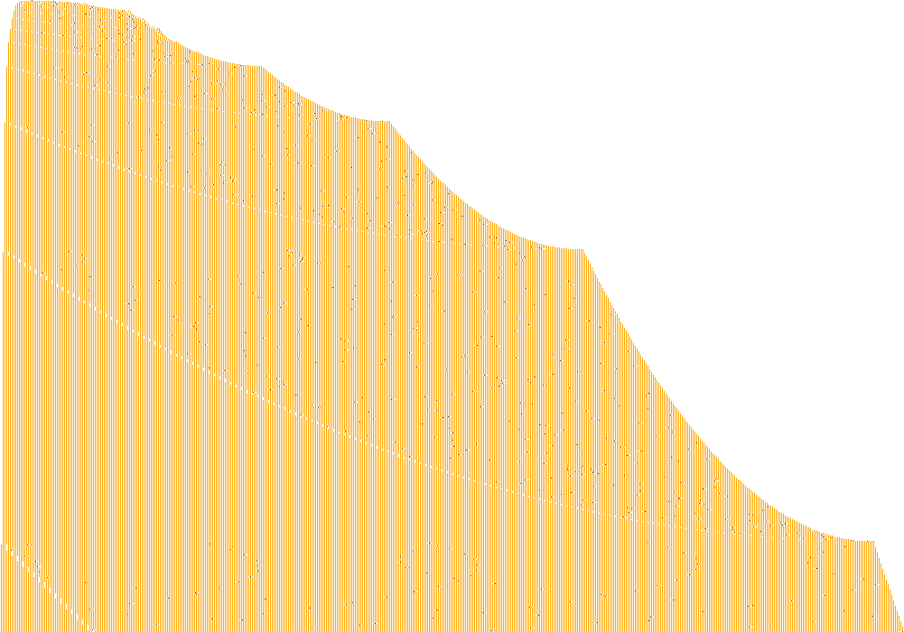

<a id="19"></a>
##  [19](#t19). `1RB0LC_1LA1RE_1LD1RE_1RE0LA_0RA1RF_0RB---` (class B)

- **Same table as nos. [20](#20), [39](#39), other start state (13 Nov 2026).** No. 19 is no. 20 (mirrored) started in state B; no. 39 (mirrored) started in state F. No common configuration found (2·10⁸ steps, in both directions). Overview: *Related machines among the candidates* at the top.

- scan: 23 levels, 61 phases, mean factor 1.32 (sd 0.12); level starts: 166 212 253 329 382 498 577 759 868 1148 1306 1733 2604 3920
- level analysis: Bell type `RB`, 13 levels; n: 20 22 35 92 143 335 767 1739 3926 5894 8846 13274 19916; ratios: 1.591 2.629 1.554 2.343 2.290 2.267 2.258 1.501 1.501 1.501 1.500; 3 different tails
- verdict (scan): vampire-like signature: regular growth, 3 different tails
- **verdict after a detailed examination (24 Oct 2026): not a simple vampire but a two-number system; no HALT found.** Tools: `scan/m19/`.
  - *Bell structure.* At the start of each Bell the tape is `L 1^n T`, head at the right end, state E. n grows by 3/2: in the real orbit 8846 → 13274 → 19916 → 29881 → 44822 → …, with n' = 3n/2 + c, where c depends on n mod 4, on T and on L.
  - *Right part.* T is only `0` or `010`.
  - *Left part.* L carries the information. After an even n it is empty again. After k odd n in a row it is `110 1^j 0`, with j = 8, 26, 359, 1232, 2780, 6263, 21158 for k = 2 … 8 (`chain.py`).
  - *Why the table does not close.* The sequence of j is itself Collatz-like, and it takes material from n: n' ≈ 1.5n − c(j), with c up to several thousand at j ≈ 2·10⁴. For other values of j the left part even becomes a list of several blocks, e.g. j = 13 gives `11 0 1^26 0 1^17 0`. The "3 tails" of the scan only looked at the right side.
  - *Search for HALT, all without a halt:*
    - all left parts `110 1^j 0` with j < 160, every residue n mod 4, both T (1,280 runs of the real TM from Bell configurations, `hscan.py`);
    - the chain of left parts of the real orbit up to k = 8;
    - the range where j is comparable to n (j = 26 and 359, n = 5 … 1025).
  - *Assessment.* Unusual left parts need long runs of odd n, whose probability halves with every further odd Bell. For j to catch up with n, about 0.4·b odd Bells in a row would be needed, which becomes exponentially unlikely as the Bell number b grows. So this machine is probably non-halting in the same sense as Antihydra, but not provably so with these means.
  - *Lessons for the method:*
    1. Count the different words on **both** sides of the long block.
    2. In a two-number system the second number can itself follow a Collatz-like process, not only take steps of ±1.
- diagram: 65,719 steps, tape width 338 cells

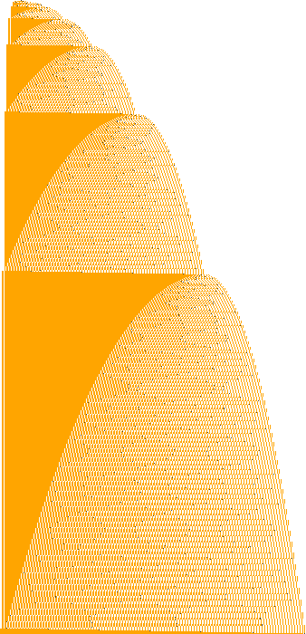

<a id="20"></a>
##  [20](#t20). `1RB1LC_1LA0RD_0LB1LF_1RE1LC_1LC0RB_0LA---` (class B)

- **Same table as nos. [19](#19), [39](#39), other start state (13 Nov 2026).** No. 20 is no. 19 (mirrored) started in state B; no. 39 started in state E. No common configuration found (2·10⁸ steps, in both directions). Overview: *Related machines among the candidates* at the top.

This machine is the [BMO's 5th problem](https://wiki.bbchallenge.org/wiki/Beaver_Math_Olympiad#Unsolved_problems).

- scan: 16 levels, 43 phases, mean factor 1.40 (sd 0.12); level starts: 55 65 85 102 165 255 305 460 694 917 1044 1380 2084 3134
- level analysis: Bell type `LB` with left part `02 12 01 12 01 12 01 12 01 12 01 12 01 12 01 12 01 12 01 12 01 12 01 12 01 12 01 12 01 12 01 12 01 12 01 12 01`, 8 levels; n: 10 76 139 229 1354 4681 10588 15904; ratios: 7.600 1.829 1.647 5.913 3.457 2.262 1.502; 2 different tails
- verdict: needle-like: only 2 tails (all information in one number)
- diagram: 18,300 steps, tape width 175 cells

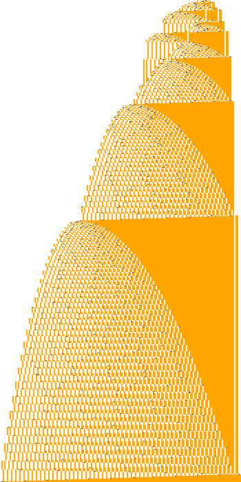

<a id="21"></a>
## 🟩 [21](#t21). `1RB0LE_1RC1RE_0RD1RC_1LA0LB_1LF0RB_---1LD` (class B)

Discord, 22 Dec 2025:

> **Peacemaker II** (12:01): what do you think of this one? `1RB0LE_1RC1RE_0RD1RC_1LA0LB_1LF0RB_---1LD`
>
> **mxdys** (12:12): it's terrible to analyze, and likely to be cryptid
>
> **Peacemaker II** (12:14): it's interesting because it keeps coming back to the config `0^inf <A 1^2n+1 0^inf`
>
> **Peacemaker II**: in fact I have tried `0^inf <A 1^2n+1 0^inf` as input for 1<n<1000 and none of them halt before reaching another config of the same form
>
> **Peacemaker II**: but the behavior is not exactly predictable either
>
> **Peacemaker II**: well, it actually is predictable for certain residue classes and chaotic for others

- scan: 15 levels, 66 phases, mean factor 1.40 (sd 0.13); level starts: 14 17 28 31 43 50 76 135 213 281 396 537 729 985
- level analysis: Bell type `RE`, 24 levels; n: 217 297 409 553 745 1001 1343 1554 2089 2793 3737 4991 6673 8905 11881 15849; ratios: 1.344 1.342 1.157 1.344 1.337 1.338 1.336 1.337 1.334 1.334 1.334; 1 different tails
- verdict: needle-like: only 1 tail (all information in one number)
- diagram: 696,601 steps, tape width 1001 cells

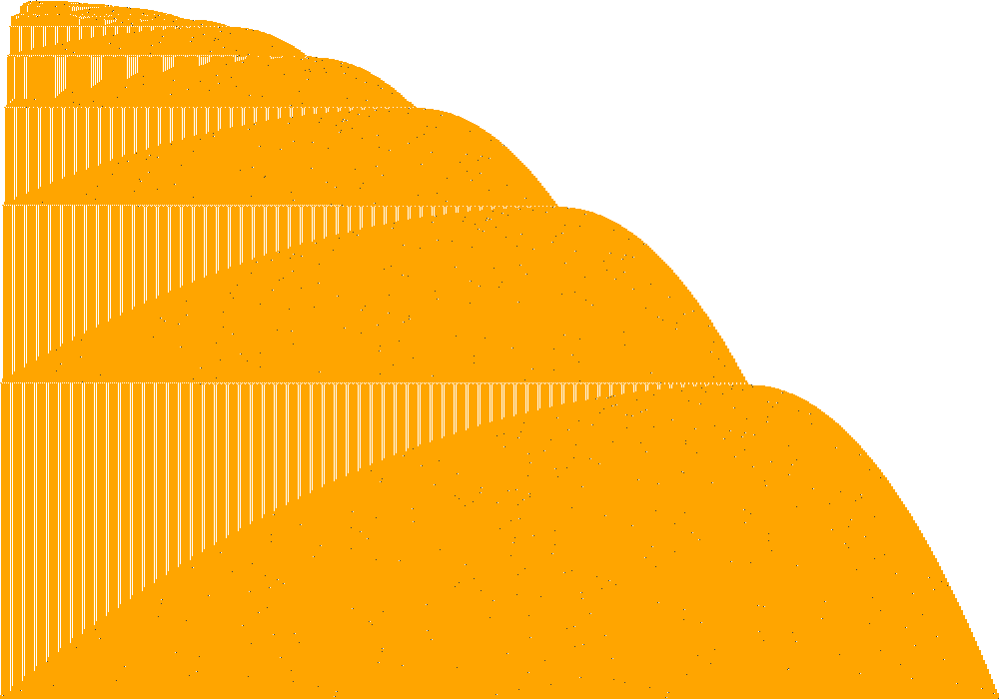

<a id="22"></a>
## [22](#t22). `1RB0RB_1LC0LF_1RD0LB_1RE1RC_0RA---_1LA1RE` (class B)

- **Same table as nos. [42](#42), [43](#43), other start state (13 Nov 2026).** No. 22 is no. 42 (mirrored) started in state E; no. 43 started in state C. No common configuration found; the runs of 22 and 42 drift apart. Overview: *Related machines among the candidates* at the top.

- scan: 12 levels, 30 phases, mean factor 1.40 (sd 0.13); level starts: 11 13 19 35 52 64 91 141 190 269 393 448
- level analysis: Bell type `RA`, 7 levels; n: 6 15 40 146 398 1192 3390; ratios: 2.500 2.667 3.650 2.726 2.995 2.844; 2 different tails
- verdict: needle-like: only 2 tails (all information in one number)
- diagram: 110,428 steps, tape width 397 cells

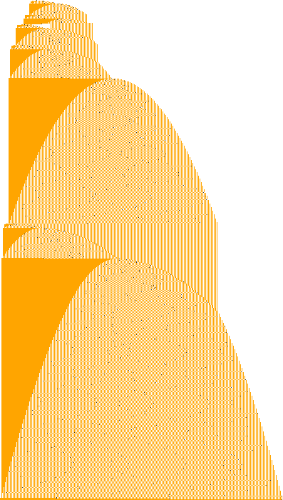

<a id="23"></a>
## 🟩 [23](#t23). `1RB0LD_0RC1RD_1LA1RA_1LE0LE_1RF0LA_0RA---` (class B)
- **Status:** **decided (never halts), 3 Nov 2026** ([Discord](https://discord.com/channels/960643023006490684/1239205785913790465/1567184717650862173))
- **From the Rocq proof:** `1RB0LD_0RC1RD_1LA1RA_1LE0LE_1RF0LA_0RA---`. 46 of the lines are the table; it needs only `Individual62`. At left-boundary visits the tape is `(001)^k 0000 (01)^j Y`, with the head in state A on its first cell. One round takes (k, j) to (k-1, j+2) and never reads Y. At k = 0 the run (01)^J is converted rigidly to about 2J/3 blocks of (101) on the left, so 2k + j grows by a factor of about 4/3 per cycle. The left half of the tape is kept exactly, as a stack. The right half is read from the far end by a fixed DFA with 11,253 states. A finite set of 933,744 triples (control, stack symbol, control), control = (state, head symbol, DFA state), is closed under the machine's rules (pre* saturation of a pushdown system, Bouajjani, Esparza and Maler), and a configuration it does not accept cannot reach a halt. `saturate` computes the triples inside the VM and needs no proof; `check_all` tests closure, that the halting controls are accepted, and that the real configuration after 1000 steps is not accepted; `sound` proves `check_all d P rs = true -> ~halts tm c0` for any table and any triples. Before Rocq, with no shared code: a separate C checker on the same table and triples, 1,978,289 closure checks, 0 failures, and a separate Python saturation that gets the same 933,744 triples, with the same order-independent hash as the VM. The file with the start taken after 100 steps, and the file with one machine entry changed, both fail at `Qed`. `coqchk` stopped at a 20 minute cap without a verdict; as far as I can tell it reduces the `vm_cast` without the VM, so it is not expected to finish, and this file relies on the kernel's VM check at `Qed`, like other `vm_cast_no_check` proofs.

- scan: 16 levels, 27 phases, mean factor 1.39 (sd 0.13); level starts: 26 37 40 55 79 111 150 203 276 506 681 910 1633 2187
- level analysis: Bell type `RD` with left part `11 01 11 01`, 1 levels; n: 4; ratios: –; 1 different tails
- verdict: no clear single-block Bell configuration found
- diagram: 455,501 steps, tape width 1001 cells


### No. 23: how the proof works (explanation, 3 Nov 2026)

This is our reading of the summary above; the Rocq file itself is not in this repository.

**Tape structure (checked by simulation).** At the left records in state A, which are 6267 of 6288 records up to 2·10⁷ steps, the tape is `(001)^k 0000 (01)^j Y`, up to alignment:

```
[0](010)^39  0000 (10)^40  1            (step 21176)
[0](010)^129 0000 (10)^26  0010110101   (step 95646)
[0](010)^89  0000 (10)^106 0010110101   (step 122606)
```

One round is (k, j) → (k−1, j+2). Y is an irregular remainder at the right end, which grows from cycle to cycle. Because of Y, a register machine with a few counters (as for nos. 95 and 102) is not possible here.

**1. Core logic: a set closed under predecessors.** Take a set S of configurations such that:
- (a) every halting configuration is in S;
- (b) S is closed backwards: if c → c' in one step and c' ∈ S, then c ∈ S.

Then every configuration from which HALT is reachable is in S (by induction backwards along the run). So if the real configuration is not in S, the machine never halts. The work is to describe such an S finitely.

**2. Two halves of the tape.**
- *Left of the head* the tape is kept exactly, as a stack. A move to the left pops a symbol, a move to the right pushes one. This gives a pushdown system: finite control plus an unbounded stack.
- *Right of the head* only the state of a fixed DFA with 11,253 states is kept. The DFA reads the right half from the far end up to the head.
- The control is (TM state, symbol under the head, DFA state), a finite set.

A move to the left adds a cell to the right half, and the DFA runs on deterministically. A move to the right removes the nearest right cell; this cell is not known from the DFA state alone, so every cell and predecessor state consistent with the DFA is allowed. This is an over-approximation, which is enough for non-halting: if even the abstract system cannot halt, the real machine cannot halt either.

**3. pre* saturation (Bouajjani, Esparza and Maler).** For a pushdown system, the set of configurations from which a target is reachable (pre*) is regular. It is given by a finite automaton on stack contents, and it is computed by saturation: start from the halting controls and add transitions (control, stack symbol, control) until nothing changes. Here this gives 933,744 triples. They are the finite description of S: a configuration is in S if the automaton accepts its stack from its control.

**4. Division of labour in Rocq.**
- `saturate` computes the triples in Rocq's VM. It needs no proof, because the result is checked afterwards.
- `check_all` checks three things: (1) closure, i.e. for every machine rule the needed predecessor transition is present (property b); (2) the halting controls are accepted (property a); (3) the real configuration after 1000 steps is not accepted.
- `sound` is a general theorem, proved once: `check_all = true → ~halts`, for any machine, DFA and triple set.
- At `Qed`, Rocq evaluates `check_all = true` with the VM (`vm_cast_no_check`). `coqchk` would redo this by slow reduction, which is why it did not finish within its 20-minute cap. The trusted base therefore includes Rocq's VM, as is usual for such computational proofs.

**5. Cross-checks, so that the check is not vacuous.**
- With a different start (after 100 steps instead of 1000), or with one machine entry changed, the proof fails at `Qed`.
- An independent C checker passes 1,978,289 closure checks with 0 failures.
- An independent Python saturation gets the same 933,744 triples, with the same hash as the VM.

**Role of the (k, j) dynamics.** The description (k, j) → (k−1, j+2), with growth of about 4/3 per cycle, is only for understanding; the proof does not use it. It explains why a finite DFA can be enough: apart from Y, the tape has a regular shape of `001` and `01` blocks, and Y is never read in a round. Finding the DFA is the creative part (done by the generator scripts); the proof only has to check it.

**Comparison with nos. 95 and 102.** There the whole tape is described by counters, and a linear invariant suffices. Here the tape has an irregular part Y, so instead of a formula the proof uses a large finite certificate (a DFA plus triples) that the computer checks. This is a closed-tape-language / regular-invariant approach, extended by an exact stack for the left half.

<a id="24"></a>
## [24](#t24). `1RB0LD_1LC0RA_1RA1LB_1LA1LE_1RF0LC_---0RE` (class B)
- **BusyBeaverWiki article:** [1RB0LD_1LC0RA_1RA1LB_1LA1LE_1RF0LC_---0RE](https://wiki.bbchallenge.org/wiki/1RB0LD_1LC0RA_1RA1LB_1LA1LE_1RF0LC_---0RE); on the [Cryptids](https://wiki.bbchallenge.org/wiki/Cryptids) page: listed under "chaotic machines not classified as cryptids"

- scan: 23 levels, 76 phases, mean factor 1.25 (sd 0.14); level starts: 182 264 310 342 380 474 552 590 946 1104 1182 1884 2202 2360
- level analysis: Bell type `LB` with left part `01`, 13 levels; n: 10 20 50 106 200 328 398 608 1238 2494 4988 9916 19586; ratios: 2.500 2.120 1.887 1.640 1.213 1.528 2.036 2.015 2.000 1.988 1.975; 1 different tails
- verdict: needle-like: only 1 tail (all information in one number)
- diagram: 54,368 steps, tape width 329 cells

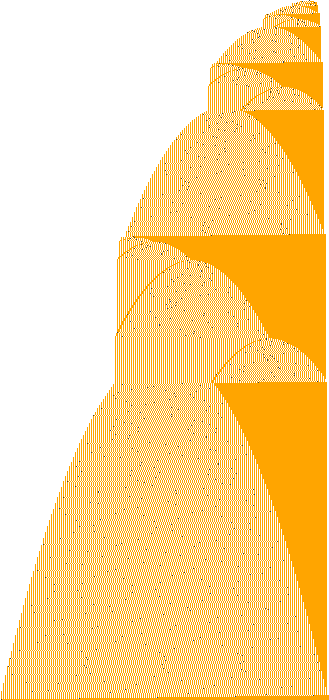

<a id="25"></a>
##  [25](#t25). `1RB0LE_1LC0RD_0RA1LD_0LC1RA_1LF1LA_---1LA` (class B)

- scan: 8 levels, 32 phases, mean factor 1.55 (sd 0.14); level starts: 33 52 73 107 209 385 523 707
- level analysis: Bell type `LD` with left part `01 11 01`, 16 levels; n: 8 13 23 45 64 85 119 221 397 535 719 5398 7197 9600 12802 17069; ratios: 1.328 1.400 1.857 1.796 1.348 1.344 7.508 1.333 1.334 1.334 1.333; 2 different tails
- verdict: needle-like: only 2 tails (all information in one number)
- diagram: 464,164 steps, tape width 1001 cells
- **Structure (9 Nov 2026).** Tools: `scan/m25/`, generic tools `scan/mgen/`. The tape grows to the left. At the outer phase starts (head at the left end in state D) the tape is `1 0 1^N T`, where T is a short list `(0 1^k)*`; in the real run T is empty, `011`, `0 1^7 011`, `0 1^17 011` or `0 1^54`. Inside a phase the levels have the form `(110)^a 100 1^b T` in state A: a sweep turns each `110` into four 1s, so the counter grows by a factor of 4/3 per level, and the residue of the counter decides when the phase ends and the tail T (the second counter) changes. From one outer phase to the next N grows by (4/3)^k with k between 1 and about 100 (20 on average).
- **HALT condition.** HALT needs E on a 0 and then F on a 0 (E: 0 → 1LF, F: 0 → HALT), so a leftward E has to meet `00`. On these tapes this is only possible at the left blank or at the `00` of `100`.
- **Run.** Accelerated simulator (12-cell blocks): 84 outer phases up to 10³⁰⁰ steps (N ≈ 10¹⁴³), 305 outer phases up to 10¹⁰⁰⁰ steps (N ≈ 10⁵⁰⁰), no HALT (`ph25D.txt`, `ph25_1e1000.txt`).
- **Halting tests.**
  - Direct simulation (`fam25.py`, `fam25c.py`, `fam25d.py`, `fam25e.py`): 1,100 random tapes of both forms, with N up to 5,000, a up to 1,500 and up to 5 tail entries of up to 300 ones. Every run reaches the next outer phase, and in the 500 runs checked the result is again of the form `1 0 1^N′ (0 1^k)*`. HALT occurs only for tiny N (N ≤ 4).
  - Accelerated simulation (`hit25.py`): 900 outer phases from random N up to 10⁹ with 15 different tails (about 17,800 levels). No HALT, and N always grew (by at least 4/3).
- **Exact level map (9 Nov 2026, correction).** Tools: `scan/m25/pmap.c`, `pm*.py`, `lev.py`, `stats.py`. A cleaner level start is P(n, W) = `0^∞ 1 0 A> 0 1^n W`, where W is the tail `(0 1^k)*`.
  - One level, for n = 3q + r: the `1^n` becomes `(101)^q`, the residue r and the first tail entries are worked off, and a sweep phase turns each `110` into four 1s. The next level is P(4q + e, W′), where e and W′ depend only on (r, W) as long as q is large compared with W. `lev.py` computes this table by direct simulation, at two values of q that must agree.
  - For r = 0 the first tail entry k is absorbed (e = k + 2). For r = 1 or 2 it is either reset to a short tail or grows by about 4/3 (k → about 4k/3, e about −k/3). The tail is a second, smaller Bell counter that is reset on some residues of k.
  - Checked against direct simulation for the first 33 levels: identical. 100,000 levels up to n ≈ 10¹²⁴⁹⁵ (about 10²⁵⁰⁰⁰ steps): no HALT. Only 44 table entries are needed, the largest tail entry is k = 237, and the residues of n are equally distributed.
- **HALT condition (exact, measured for n < 40).** P(n, 0 1^k …) halts in the next level if and only if the first tail entry is about 4n: k ∈ {4n−8, 4n−7, 4n−6} for n ≡ 1 (mod 3), k ∈ {4n+6, 4n+7, 4n+8} for n ≡ 2 (mod 3), and never for n ≡ 0. A longer tail shifts the window by a few cells. The earlier random tests missed this because they never had k close to 4n, so the earlier statement "HALT only for N ≤ 4, probably a non-halter" was wrong.
- **Assessment.** No. 25 is a true lottery of Collatz type. It halts only if the tail counter, which only grows over levels without a reset, ever catches up with 4n. Over 100,000 levels the chance of a tail entry ≥ K falls like about K^−3.5 (K = 17: 9 %, K = 54: 0.46 %, K = 237: 0.001 %). With n ≈ 10⁵⁰⁰ already at 10¹⁰⁰⁰ steps, the remaining chance of a HALT is far below 10⁻¹⁰⁰⁰. Details are in the next bullet.
- **Why no non-halting proof.**
  - *Two counters run against each other.* The main counter n grows by about ×4/3 per level. The tail counter k is either reset (always for r = 0, and for r = 1 or 2 on some residues of k itself) or grows along by about ×4/3. A HALT needs k ≈ 4n.
  - *What a HALT would need.* At 10¹⁰⁰⁰ steps n ≈ 10⁵⁰⁰ and k is at most a few hundred. To catch up, k has to grow without a reset for about log(10⁵⁰⁰)/log(4/3) ≈ 4,000 levels in a row.
  - *What that depends on.* Whether a level resets k depends on r = n mod 3, the last base-3 digit of n. As for Collatz maps, the next j residues are encoded in roughly the last j base-3 digits of n. Whether a run of 4,000 levels without a reset ever comes is therefore written in the digits of n: hundreds of digits now, later millions and billions.
  - *Why this blocks a proof.* As for Collatz maps, every finite sequence of residues is produced by some value of n. So there are values of n that halt after an arbitrarily long run without a reset, and "no configuration of this form ever halts" is false. One would have to show that the one sequence of n produced from the blank tape never meets such a run in the whole future. That is a statement about the base-3 digits of an ever-growing number built by repeated ×4/3, and such statements cannot be proved with the known methods (Antihydra, the known BB(6) cryptid, is open for the same reason). Computing only covers finitely many levels, and there is no regularity to use.
  - *Difference from no. 48.* There everything repeated exactly after a while (finite cycle), so one period could be checked, in Rocq. Here n grows forever and nothing repeats.
  - *What remains.* If the residues keep behaving like random ones, the chance of 4,000 levels in a row is practically 0 and shrinks with every level. That is a strong argument, not a proof.
  - *Possible: "no HALT before step X" in Rocq.* The table entries would be proved by symbolic execution, and the levels then computed, as in `Bellv2.v`, but this time without a HALT at the end. This only shows "not before X", not "never".


<a id="26"></a>
## [26](#t26). `1RB1LC_1LA0RD_1LB1LF_1LE1RE_0LA0RB_0LB---` (class B)

- **Same table as nos. [31](#31), [32](#32), other start state (13 Nov 2026).** No. 26 is no. 31 (mirrored) started in state C; no. 32 (mirrored) started in state C. 31 and 32 very probably equivalent (one-cell difference); 26 runs differently. Overview: *Related machines among the candidates* at the top.

- scan: 20 levels, 32 phases, mean factor 1.37 (sd 0.15); level starts: 63 88 138 186 261 343 411 461 615 1026 1085 1383 1842 3255
- level analysis: Bell type `LA` with left part `01`, 11 levels; n: 4 9 15 30 62 146 270 1387 2475 10358 24548; ratios: 2.250 1.667 2.000 2.067 2.355 1.849 5.137 1.784 4.185 2.370; 2 different tails
- verdict: needle-like: only 2 tails (all information in one number)
- diagram: 14,056 steps, tape width 141 cells

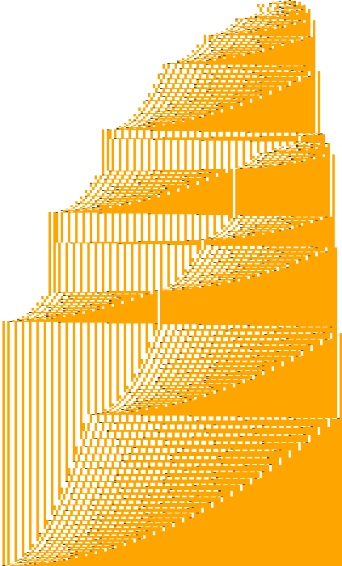

<a id="27"></a>
## [27](#t27). `1RB1LC_1LC0RD_0LE1LA_0RF1RA_1LA0LA_---0RB` (class B)

- scan: 8 levels, 12 phases, mean factor 1.64 (sd 0.15); level starts: 17 32 61 98 121 188 359 545
- level analysis: Bell type `LA` with left part `01 12 02`, 6 levels; n: 33 99 189 546 1110 5589; ratios: 3.000 1.909 2.889 2.033 5.035; 1 different tails
- verdict: needle-like: only 1 tail (all information in one number)
- diagram: 3,959,736 steps, tape width 1001 cells


<a id="28"></a>
## [28](#t28). `1RB1LE_1LC0RA_0RF0LD_1LE1LA_1RC0LB_---1RC` (class B)
- **BusyBeaverWiki article:** [1RB1LE_1LC0RA_0RF0LD_1LE1LA_1RC0LB_---1RC](https://wiki.bbchallenge.org/wiki/1RB1LE_1LC0RA_0RF0LD_1LE1LA_1RC0LB_---1RC)

- scan: 20 levels, 176 phases, mean factor 1.24 (sd 0.15); level starts: 45 53 59 74 91 157 184 229 253 324 355 401 464 495
- verdict: no clear single-block Bell configuration found
- diagram: 1,865,705 steps, tape width 1001 cells

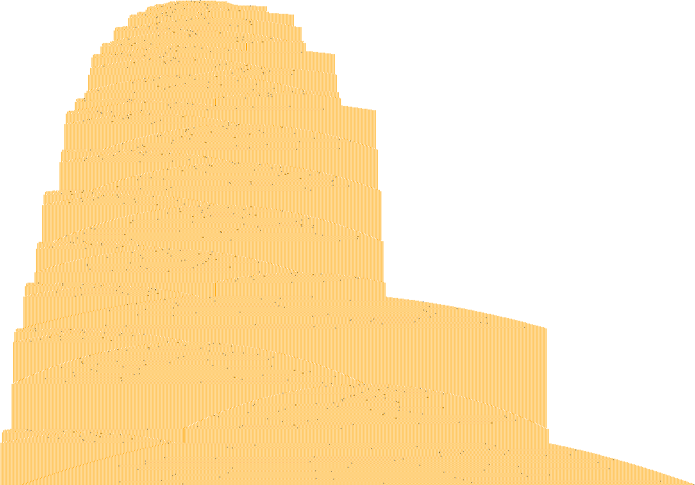

<a id="29"></a>
## [29](#t29). `1RB1LD_1LC0RC_0RF1RA_0LE1LA_1RC0LA_---0RB` (class B)

- scan: 12 levels, 25 phases, mean factor 1.49 (sd 0.16); level starts: 8 10 15 29 43 77 91 146 229 362 413 633
- level analysis: Bell type `LA` with left part `01 12 02`, 10 levels; n: 8 30 78 147 363 636 960 2226 3354 5694; ratios: 3.750 2.600 1.885 2.469 1.752 1.509 2.319 1.507 1.698; 2 different tails
- verdict: needle-like: only 2 tails (all information in one number)
- diagram: 6,792,964 steps, tape width 1001 cells

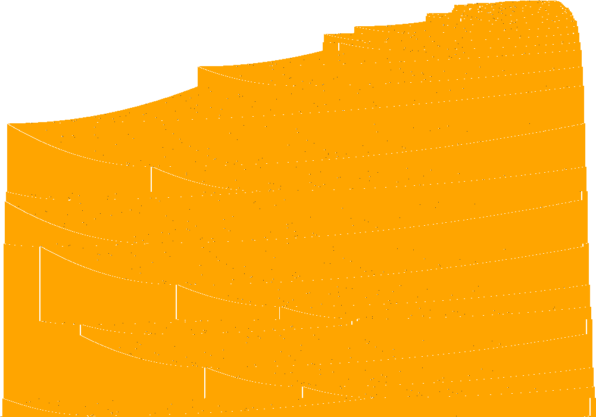

<a id="30"></a>
##  [30](#t30). `1RB0LE_1LB1RC_0RF0RD_1RE0LA_1LA1RE_---0RB` (class B)

- scan: 10 levels, 34 phases, mean factor 1.54 (sd 0.16); level starts: 13 16 35 58 97 140 211 270 412 625
- level analysis: Bell type `RD`, 11 levels; n: 5 11 20 67 104 277 419 632 2070 5378 11434; ratios: 2.200 1.818 3.350 1.552 2.663 1.513 1.508 3.275 2.598 2.126; 1 different tails
- verdict: needle-like: only 1 tail (all information in one number)
- diagram: 280,089 steps, tape width 421 cells
- **Exact rule (8 Nov 2026).** Tools: `scan/m30/`. At right records in state D the tape is a single block `1^n 0 0`, and the machine computes n → G(n), starting at n = 1, with the nested recursion
  - G(n) = (3n+7)/2 for odd n,
  - G(n) = n + G(1 + G(n/2 − 2)) for even n,

  where evaluating G(0) is the HALT (G(0) is only called from G(4)), and an even n that calls itself again never returns (the machine then runs forever). This is the recursion of the Holdout Guide (#508). Checked: `f30.c` builds `1^n 0 0` for n = 2 … 400 and simulates directly; `test30.py` finds all 399 values, halts and endless loops in agreement with G. The orbit starts 1, 5, 11, 20, 67, 104, 277, 419, 632, 2070, … as in the run.
- **Halting criterion.** An even argument N descends by N → N/2 − 2, i.e. N + 4 is halved, until the value is odd. It reaches 4, and so the HALT, exactly if **N + 4 is a power of two (≥ 8)**: N = 4, 12, 28, 60, 124, … For an argument of b bits the chance is about 2^(−b).
- **Run.** `g30.py` evaluates G with an explicit stack and exact integers. The orbit reaches n ≈ 10^6,683 after 697 steps without a HALT; at step 697 one evaluation of G grows its arguments past 10^22,000 (`probe30.py`) and had not returned after 40 s. In the 697 completed orbit steps no argument was of the form 2^k − 4.
- **Assessment.** All arguments are now thousands of digits long, so the chance of an argument 2^k − 4 is below 10^(−6000), and it only falls further. **HALT is practically excluded**; a simulator cannot help. The remaining question is a proof (does every G(n) return, or is there an endless recursion).

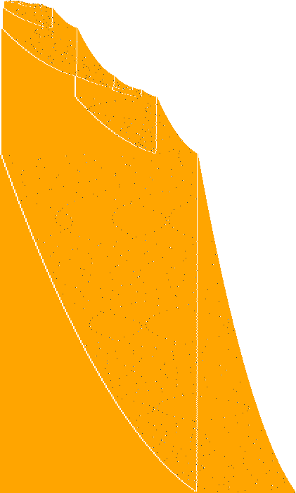

<a id="31"></a>
##  [31](#t31). `1RB1RF_1RC0LD_1LB1RA_1RE1LE_0RC0LB_0RB---` (class B)

- **Same table as nos. [26](#26), [32](#32), other start state (13 Nov 2026).** No. 31 is no. 26 (mirrored) started in state C; no. 32 started in state E. 31 and 32 very probably equivalent (one-cell difference); 26 runs differently. Overview: *Related machines among the candidates* at the top.

- scan: 22 levels, 40 phases, mean factor 1.34 (sd 0.17); level starts: 114 128 173 235 279 313 381 421 516 705 936 1260 2910 3969
- level analysis: Bell type `RB`, 13 levels; n: 12 16 37 45 56 64 121 389 524 700 944 1260 3965; ratios: 2.312 1.216 1.244 1.143 1.891 3.215 1.347 1.336 1.349 1.335 3.147; 3 different tails
- verdict: 3 different tails, but the growth ratio varies
- diagram: 466,802 steps, tape width 1001 cells

- **examined in detail (24 Oct 2026): vampire-like in base 3, with a nested sub-process.**
  - *Bell structure.* At Bell starts the tape is `L 1^n T`, head at the right end, state A, with L ∈ {empty, `10`} and T ∈ {`0`, `010`}. The factor is exactly **4/3** in the limit: …, 108116, 144159, 192217.
  - *Table.* With L empty the table is clean and affine: n' = 4n/3 + c, with c depending on n mod 6 and T (`deriveLT.py`). From L = `10` the long block splits into several pieces, e.g. `1^39 0 1^54 0 1^30`, which only join up again after a variable number of Bells. So there is no finite table in this representation; a table with several blocks would be needed.
  - *Simulation.* With `accsim` (blocks of 3 cells), each Bell is essentially one jump: about 140 Bells and **10³⁵ steps** in about 77,000 real operations, no HALT. The limit is the 64-bit counts, not the time.
  - *Halting rate.* 20,000 random starts (n = 2,000 … 20,000, all four combinations of L and T), each run over a growth factor of 10¹², i.e. about 96 Bells, gave **no HALT** in about 1.9·10⁶ Bells in total. So the rate is below about 2·10⁻⁶ per Bell (`hz31.py`).
  - *Assessment.* A vampire-type machine with a very low halting rate, like the vampire family. Deciding it needs the vampire method extended to tables with several blocks.

- **Bell types, prefix table and HALT (26 Oct 2026).** Tools and data: `scan/m31/`.
  - *Bell.* A Bell starts when the head enters a new cell at the right end in state A. The tape is then only 1-blocks separated by single 0s:

        P  1^n 0  [1 0]

    It consists of a main block 1^n, a **prefix** P of a few small blocks on the left (e.g. `1 0 1^39 0`) and sometimes a **tail** `1 0` on the right. Below, a tape is written as the list of its block lengths, e.g. `1 39 | n` for P = (1, 39).
  - *Three types.*

    | type | start | what happens | growth of the tape |
    |---|---|---|---|
    | **A** | `1^n 0`, no prefix | one zigzag phase with period 8 turns; it rebuilds 1^n into 1^(4n/3 + c) | ×4/3 |
    | **B** | `P 1^n 0` | first the prefix is processed (its own zigzag phase with period 12, or for `1 39` always the same fixed sequence of turns), then the main phase as in A | ×4/3 |
    | **C** | `P 1^n 0 1 0` | a short Bell: the main block is **not** rebuilt; the tail and a few cells of the main block go into the prefix | about +3 cells |

    C is followed by B in 68 of 69 cases: the C Bells feed the prefix and the B Bells process it. This is the "nested sub-process" of 24 Oct.
  - *First 100 Bells* (from 202 Bells computed):

        1–10   CACBCBAABC      51–60   CBBCBABCBB
       11–20   BBBCBCBCBA      61–70   BCBCBBCBCB
       21–30   CBABBCBACB      71–80   CBCBBCBCBC
       31–40   CBBCBBCBCB      81–90   BCBBAABBCB
       41–50   BBCBCBAABB      91–100  ACBCBBCBCB

    In 202 Bells: B 117, C 69, A 16. Bell 100 is at about 10¹⁸·⁵ steps, Bell 202 at about 10³⁵·⁵, with no HALT.
  - *Simulation.*
    - `bells.c` (direct, 52 Bells, 5·10¹⁰ steps).
    - `accb.c`: `accsim` with blocks of 3 cells, jumps over repetitions and an exact Bell detection at cell level. It reproduces the 52 directly simulated Bell tapes exactly and reaches Bell 202 in 0.01 s; the 64-bit counts stop it there. Its output is in `bells_202.txt`.
    - `tok.c` and `phases.py` extract the zigzag phases.
  - *Prefixes.* The prefixes come from a small set that recurs over and over: –, `1`, `1 39`, `73`, `1 39 6`, `12`, `73 2`, `1 6`, `138`, `578`, `138 10`, `85`, … Rarely a deeper level appears with a larger number: `1 1379`, `1 39 1795`, `73 2355`, `1 39 5683`.
  - *Prefix table.* For a prefix state (P, tail), one Bell of the real TM was run from `P 1^n 0 [1 0]` with large n (`one.c`, `probe.py`). The result depends **only on n mod 6**:
    - the next prefix state;
    - n' = 4n/3 + β for A/B Bells and n' = n + β for C Bells, with β fixed.

    Checked by 160 random tests at n = 4,000 … 9,000 (`verify.py`); the table is in `table6.json`.
  - *Closure.* Following the table from (no prefix, no tail) over all n mod 6 gives the residue-consistent reachable part (`close6.py`). For each A/B Bell all three possible values of the next residue are allowed, so it is an over-approximation. It contains 55 prefix states and **no HALT entry**.

    It does not close, however. In the over-approximation the large number of a deep level keeps growing, by about (4/3)⁴ per step:
    - 1795 → 5683 → 17,971 in the family `1 39 x`;
    - 2355 → 7539 in the family `73 x`.

    So there is a whole hierarchy of nested counters. The real orbit reaches these deeper levels only rarely (5683 once in 202 Bells).
  - *HALT.*
    - **Where it halts.** HALT entries exist. A Bell started from `1 2 | n`, `48 64 | n` or `48 109 | n` (no tail) halts if n mod 3 ∈ {0, 1}. These were found by a scan of the prefixes `1 x`, `48 x` and `x` for x < 130 (`hscan.py`).
    - **How they are entered.** In the table they are entered only from the C Bells `1 19 | n 1` and `138 11 | n 1`, with n ≡ 1 (mod 3). These turn n into n + 28 and n − 2 respectively, i.e. **n' ≡ 2 (mod 3), exactly the residue for which the halting entry does not halt**. The way into HALT is therefore blocked by a residue condition mod 3.
    - **Not reached at all.** The two entry states are not even in the residue-consistent closure of the orbit.
  - *Assessment.*
    - **No path to HALT found.** All explored prefix states, including the halting entries, show HALT excluded by residues mod 3.
    - **What a proof would need.** The vampire method extended by one level: a parametric table for the families with a large prefix number (e.g. `1 39 x`, `73 x`, `1 39 x 6`, `73 x 10`) as linear maps in (n, x) with residues of both, and a closure over these families that contains no HALT entry.
    - **What is still open.** Whether the hierarchy has a finite number of family types (self-similar), and whether HALT entries also exist at deeper levels.

- **The family `1 39 x`: the nesting is self-similar (26 Oct 2026).** Tools: `fam.py`, `orbit.py`, `selfsim3.py` in `scan/m31/`.
  - *n ≡ 2 (mod 3).* Bells from `1 39 x | n` (no tail) with n ≡ 2 (mod 3) are simple: x is absorbed, the result is `1 39 | n'` with n' = 4n/3 + x + const.
  - *n ≡ 0, 1 (mod 3).* Here the result does **not** depend on x mod 6 in any simple way. For x = 300 … 317 the new prefix is in turn `1369`, `73 363`, `1 751`, `1 799`, –, `73 367`, `1 448`, `529`, `73 114`, `1 39 559`, … So there is no linear table in (n, x). It also does not depend on n beyond n mod 3: the prefix is the same for n mod 6 = 0, 1, 3, 4, and only the tail changes.
  - *Comparison with the machine's own Bells.* Compare with the machine's own Bell orbit started from the short tape `1 39 | y`, i.e. with the inner block as main block:
    - **When it matches.** In 43 of 72 cases (x = 300 … 371) the new prefix is *exactly* the tape of that inner orbit after k inner Bells, for some y = x − δ (δ = 0 … 7) and k = 1 … 8. In all 43 cases, k is the first inner Bell that ends with a tail `1 0`, i.e. the first inner C Bell.
    - **What this means.** Inside one Bell of the outer level, the inner block x runs through the same Bell dynamics as the whole machine. That inner run stops at the first C Bell.
    - **What is not explained.** The remaining 29 cases are not explained by this simple rule; they probably arise where the inner block grows into the main block.
  - *Consequence.*
    - **Why the table cannot close.** The nesting is (at least largely) a copy of the top level. This explains the growth by about (4/3)⁴ per step in the deep families (1795 → 5683 → 17,971), and why no finite table in (n, x) exists.
    - **Halting.** The HALT entries of the top level (`1 2`, `48 64`, `48 109`) are blocked by the residue condition mod 3. If the inner level were an exact copy, the same obstruction would hold there, and by induction over the levels HALT would never occur.
    - **What a proof would need.** A recursive description of the machine whose inner levels are copies of the top level, plus an exact account of the deviations in the remaining cases. With that, the mod-3 argument could be carried through all levels.

- **The deviations: the inner run is coupled to the main block (26 Oct 2026).** Tool: `trace.py`, which prints every clean tape (only single 0s between blocks) at which the head is in state A.
  - *Examples.*

    | start | intermediate tapes during one outer Bell | result |
    |---|---|---|
    | `1 39 301 \| 1806` (matches) | `1 39 301 \| 1807 1`, then `73 363 2 \| 1712`, `73 363 6 \| 1709 1`, … | `73 363 \| …` |
    | `1 39 300 \| 1800` (deviates) | `1 39 300 \| 1801 1`, `1 440 \| 1702`, `1 768 \| 1381 1`, `1026 \| 1126`, `1369 2 \| 782 1`, `1369 6 \| 779`, … | `1369 \| 1047 1` |
    | `1 39 302 \| 1812` (deviates) | `1 39 302 \| 1813 1`, `562 \| 1597`, `1 751 2 \| 1406 1`, `1 751 6 \| 1403`, … | `1 751 \| 1879 1` |

    The last phase of each run is a small counter that grows by 4 per step while the main block loses 3 cells (`2, 6, 10, …`).
  - *What the examples show.*
    - **Inner Bells.** The inner block runs through several inner Bells: 300 → 440 → 768 → 1026 → 1369, each about ×4/3 with residue-dependent constants. It takes the cells for this from the main block (1800 → 1702 → 1381 → 1126 → 782).
    - **End of the run.** When the inner run stops (at a state with a tail), the counter phase rebuilds the rest of the main block.
  - *Why the free orbit does not fit.* The inner Bells are **not** those of the free orbit from `1 39 | x`. From 302 the free orbit gives `1 446`, `600`, `1 803`; the coupled run gives `562`, `1 751`. The shapes are similar, but the numbers are smaller, because the inner block grows into the main block instead of into blank tape. In the 43 matching cases the run stops after one inner Bell, before the coupling matters.
  - *Next step.* A table of the **coupled** inner Bells: from a clean tape `Q x | n [1]` to the next one, as a function of the prefix Q, x mod 6 and n mod 6, presumably again with linear maps. The nesting would then be "the same kind of table one level down". The mod-3 obstruction would have to be checked for this table; if it holds there too, that is the induction step for a proof.

- **Towards a non-halting proof (26 Oct 2026).** Tools: `fwin.c`, `snaps2.c`, `irr2.py` in `scan/m31/`.
  - *Local HALT condition.* F is entered only from A on a 1, and A only from C on a 1, both moving right. So the machine halts exactly when **state C reads a 1 that is followed by two more 1s** (C → A → F → `---`).
    - In 3·10⁹ steps F is entered 88,860 times, and every time it reads 0.
    - C reads a 1 about 5·10⁸ times, nearly always at the end of a 1-block (`…11111[1]00100…`).
    - A proof has to show that the pattern "C before `111`" never occurs.
  - *General deciders.* No proof found:
    - MITM-WFAR (Iijil1/MITMWFAR) with up to 13 non-dead transitions (also with memory 1);
    - MITM-DFA with 5 states per side.

    The Rust FAR decider of bbchallenge could not be built here (no access to the crate registry); it could be run with larger automata on another computer.
  - *The machine as a list-of-counters machine.* Record every clean tape at which the head is in state A on a 0. In 5·10¹⁰ steps there are 341,683 such tapes (`snaps2.c`). Between two consecutive ones the machine almost always applies **one rule**: at the gap where the head is, the left block grows by 4 and the right block shrinks by 3, i.e. (x, y) → (x + 4, y − 3); a single trailing `1` comes and goes in between.

    Only **113** transitions do something else (`irregular_transitions_5e10.txt`). They happen when the right block is used up (y < 3) and depend on y, on the tail and on the small neighbouring blocks, e.g.:
    - `N 2` → head one gap to the left, `N+7`;
    - `1 N` → `10 N−6 1`;
    - `10 N 1` → `1 39 2 N−29`;
    - `1 39 N 1` → `54 N−12`;
    - `54 N` → `73 2 N−20 1`.

    The prefix values 39, 54, 73, 138, … are created by these end rules.
  - *Plan for a proof.*
    1. Write down the end rules generally, with the small blocks as parameters. In 113 transitions there are 84 different patterns (not yet saturated), so the rules still have to be written in general form.
    2. Show that the conversion rule and the end rules describe the machine completely.
    3. Show that no end rule, in any reachable context, puts C in front of `111`. The mod-3 obstruction found above should be the core of this argument.

- **End rules (26 Oct 2026).** Tools: `mstep.c`, `endrules.py`; results in `endrules.txt` in `scan/m31/`.
  - *`mstep`.* It performs one macro step (from one clean tape to the next) of the real TM from any block list and head gap. It reproduces the first 3000 macro steps of the orbit exactly.
  - *End rules.* For each irregular transition of the orbit with one large block, the large block was replaced by N = 3000 + r and 3600 + r (r = 0 … 5), and the result written in terms of N. All these end rules are **linear in N and depend only on N mod 3**. In the notation `a | N` the head is at the gap between a small block a and the large block N:

    | N mod 3 | what happens | examples |
    |---|---|---|
    | 0 or 2 | an ordinary conversion step (the left block grows by 4, N shrinks by 3), or the end of the conversion | `a N` → `a+4 N−3`, `N 2` → `N+7` |
    | **1** | the **small left block is rebuilt**, in a jump much larger than 4 | `1 N` → `10 N−6`, `10 N 1` → `1 39 2 N−29`, `54 N` → `73 2 N−20`, `73 N` → `138 2 N−65`, `138 N 2 1` → `185 N−45`, `81 N 1 1` → `109 2 N−26`, `77 N 2 1` → `1 176 2 N−95` |

    The sequence of prefix values 10 → 1 39, 54 → 73 → 138 → 185 → 1 432 … is therefore driven by the residue N ≡ 1 (mod 3) of the main block. For `185 N 1 1` with N ≡ 1 the result is no longer linear: from there on the inner block runs through its own process (the coupled nesting described above).
  - *Coupled transitions.* 42 of the 113 orbit transitions involve two large blocks: the nesting. Their outcome depends on the relative size of the blocks, as in no. 10.
  - *Why a simple finite abstraction fails.* A first abstract search (`absbfs.py`: blocks above a bound S are abstracted to their residue mod 6) fails for the same reason: with independent large values the nested block can grow into the main block, and the result changes.
  - *Assessment.* The machine is a list-of-counters machine with:
    - the conversion rule;
    - end rules that depend only on N mod 3, as long as one block is large;
    - a recursive part, where a small block reaches the size at which it is itself processed like a main block.

    A non-halting proof needs a recursive invariant over these levels, for example "in every reachable configuration of every level, the block a and the residue N mod 3 never meet as in the halting entries `1 2`, `48 64`, `48 109`". This is a substantial piece of work, comparable to the analyses of the known cryptids.

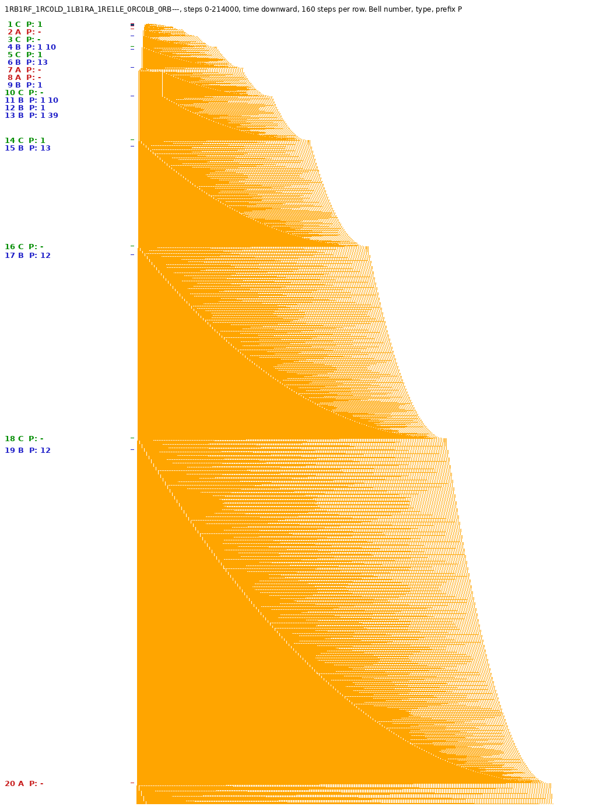

*Steps 0–214,000, time downward, 160 steps per row; Bell number, type and prefix P at the left (green C, blue B, red A).*


<a id="32"></a>
##  [32](#t32). `1RB1LB_0RC0LD_1LD1RE_1RC0LA_1RD1RF_0RD---` (class B)

- **Same table as nos. [26](#26), [31](#31), other start state (13 Nov 2026).** No. 32 is no. 26 (mirrored) started in state D; no. 31 started in state D. 31 and 32 very probably equivalent (one-cell difference); 26 runs differently. Overview: *Related machines among the candidates* at the top.

- scan: 23 levels, 40 phases, mean factor 1.33 (sd 0.17); level starts: 130 174 233 288 315 390 420 525 696 945 1257 1323 2919 3966
- level analysis: Bell type `RD` with left part `11 01`, 10 levels; n: 10 18 34 42 78 86 166 283 1690 5294; ratios: 1.800 1.889 1.235 1.857 1.103 1.930 1.705 5.972 3.133; 3 different tails
- verdict: 3 different tails, but the growth ratio varies
- diagram: 14,294 steps, tape width 141 cells

- **examined (24 Oct 2026):** the same dynamics as no. 31. The Bell values agree to within a few units (108114 / 108109, 144157 / 144152, …), so these are very probably equivalent machines. `accsim` with K = 3 gives the same picture: 10³⁵ steps in about 77,000 real operations, no HALT.

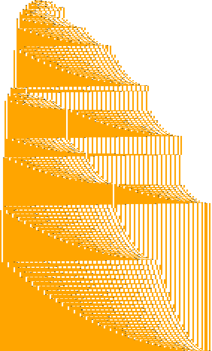

<a id="33"></a>
## [33](#t33). `1RB1LA_1LC0RE_1LF1LD_0RB0LA_1RC1RE_---0LD` (class B)
- **BusyBeaverWiki article:** [Space Needle](https://wiki.bbchallenge.org/wiki/Space_Needle); on the [Cryptids](https://wiki.bbchallenge.org/wiki/Cryptids) page: cryptid "Space Needle"

- scan: 9 levels, 407 phases, mean factor 1.69 (sd 0.17); level starts: 12 20 36 56 96 146 311 371 778
- level analysis: Bell type `LD` with left part `01`, 8 levels; n: 5 9 16 40 100 250 625 1094; ratios: 1.800 1.778 2.500 2.500 2.500 2.500 1.750; 1 different tails
- verdict: needle-like: only 1 tail (all information in one number)
- diagram: 18,026,802 steps, tape width 1001 cells


<a id="34"></a>
## [34](#t34). `1RB1RC_1LC1LC_1RE0LD_1LB1RF_---1RA_0RD1RD` (class B)
- **BusyBeaverWiki article:** [1RB1RC_1LC1LC_1RE0LD_1LB1RF_---1RA_0RD1RD](https://wiki.bbchallenge.org/wiki/1RB1RC_1LC1LC_1RE0LD_1LB1RF_---1RA_0RD1RD)

- scan: 13 levels, 29 phases, mean factor 1.34 (sd 0.18); level starts: 13 16 18 28 46 60 72 150 182 234 258 316 452
- level analysis: Bell type `RD`, 5 levels; n: 5 6 9 15 54; ratios: 1.200 1.500 1.667 3.600; 3 different tails
- verdict: no clear single-block Bell configuration found
- diagram: 948,717 steps, tape width 1001 cells

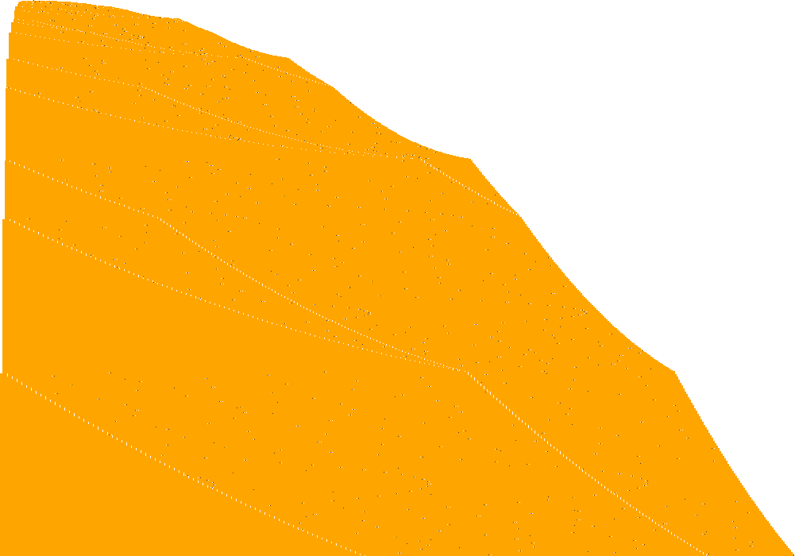

<a id="35"></a>
##  [35](#t35). `1RB---_0RC0LD_1LB1RC_0LE0LF_1RD1LE_1RF1RA` (class B)

- scan: 16 levels, 128 phases, mean factor 1.25 (sd 0.18); level starts: 43 47 53 61 91 114 125 137 159 187 217 229 277 592
- level analysis: Bell type `RC`, 8 levels; n: 7 9 14 19 24 100 374 644; ratios: 1.286 1.556 1.357 1.263 4.167 3.740 1.722; 4 different tails
- verdict: 4 different tails, but the growth ratio varies
- diagram: 6,352 steps, tape width 55 cells

- **examined briefly (24 Oct 2026):** register system with blocks like `11^4·10⁵ 01 11^2.8·10⁵`. `accsim` with 10⁹ real operations reaches **5·10¹⁶ steps**: no HALT.
- **Detailed analysis and fast simulator (7 Nov 2026).** Holdout Guide: "Halts if and only if it reaches one of three critical pairs", simulated 2.7·10¹⁹ there.
  - **Simulator** `scan/m35/sim35.c`. The tape is a linked list of runs. Two moves are done in one jump: the chain steps over 1-blocks (state C to the right, state E to the left), and the inner loop. The inner loop is: in state A on a single 0 between 1^X and 1^Y 00 1^Z, one round is (X, Y, Z) → (X+2, Y−3, Z+1) in 2Y + 16 steps (checked with `scan/m35/round35.py`; valid for Y ≥ 4). The step counts are exact (128-bit). The left records agree with the direct simulation up to 3·10⁷ steps. Speed: 10¹⁸ steps in 2 s, 10¹⁹ in 7 s, **10²² steps in a few minutes: no HALT** (26,270,859 left records in state E). Thomas Reus ran it to **10²⁴ steps (about 160 s): no HALT** (121,904,631 left records; at the end T = 3.6·10⁸ ones). After 10²² the small first counters show only the known even patterns (12 → 8 → 6 → 4 with b = 1), with no odd small a and no inner counter 1. Options: a start configuration (`"a|b c d"`), the tape at HALT, and `NEARMISS=1` (print every record with a small first or inner counter).
  - **Structure.** At its left records (state E) the tape is a list of counters `a | b c d …`: blocks of ones separated by single 0s, with `00` after the first.
    - *Left phase:* a ≡ 0 (mod 3): a → 2a/3, a new counter 1 is put in front, and the old first counter grows by a/3 − 1. a ≡ 2: a → (2a+2)/3, b → b + (a+1)/3. a ≡ 1: the right phase starts, which processes the whole list (with the inner loop above) and returns with a new first counter a₀.
    - *HALT* (state A reading 1) at the start of a right phase only for small values: a ∈ {1, 10} with b = 1, or a + 3b = 13 ((1,4), (4,3), (7,2), (10,1)); and also when a counter 1 stands inside the list. With b = 1 and an arbitrary list behind it, exactly a = 1 and a = 10 halt (tested with random large counters).
  - **Why these values are (almost) never reached.** Both left-phase maps give **even** results: 2a/3 = 2·(a/3) and (2a+2)/3 = 2·(a+1)/3. After the first step of a left phase, a is therefore always even. In the run, every first counter a ≤ 60 seen after 10⁹ steps is even, and with b = 1 always a ≡ 4 (mod 12). Hence:
    - a = 1 is impossible;
    - a = 10 with b = 1 would need the previous a = 15, which is odd;
    - (4,3) and (7,2) need b = 2 or 3, which needs an odd previous a;
    - an inner counter 1 needs a = 3.
    All halting routes therefore need a small *odd* value, and only the right phase can deliver one directly, as its output a₀.
  - **Halting probability.** Measured over the 876,000 right phases up to 10¹⁹ steps (T = total number of ones, T ≈ 9·K after K right phases): P(a₀/T < x) ≈ 0.86·x³ for 0.01 ≤ x ≤ 0.5 (power law with exponent 3). Extrapolated to a₀ ≲ 15, the chance per right phase is about 0.86·(15/T)³. Summed over all later right phases (T ≈ 9K) this gives **P(HALT after step S) ≈ 2/K(S)² ∝ S^(−2/3)**: about 3·10⁻¹² after 10¹⁹ steps, about 3·10⁻¹⁴ after 10²² steps and about 10⁻¹⁵ after 10²⁴ steps. This is a heuristic: the cubic tail has to be extrapolated over five orders of magnitude, and the rarer halting routes (small b, inner 1) are bounded by the same small-a₀ condition. Unlike nos. 10 and 51 (halting chance ∝ 1/T per cycle, so it halts with probability 1), the chance here falls like 1/T³ and the sum converges: **the machine is very likely never to halt**. The guide's "lottery" label refers to the same critical pairs.

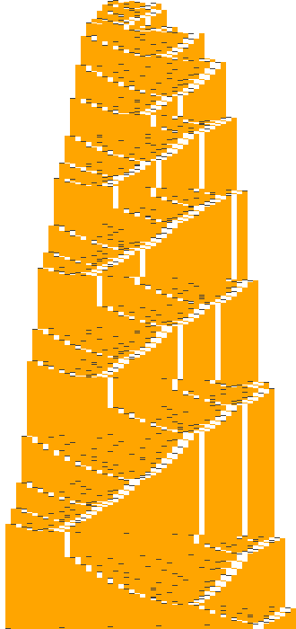

<a id="36"></a>
## [36](#t36). `1RB1LC_1LC0RD_0LE1LA_---1RA_1RF0LA_0RF0RB` (class B)

- scan: 7 levels, 12 phases, mean factor 1.56 (sd 0.19); level starts: 51 83 134 149 230 485 734
- level analysis: Bell type `RA` with left part `11 01`, 10 levels; n: 87 138 234 738 1122 1698 2568 4626 6951 10434; ratios: 1.586 1.696 3.154 1.520 1.513 1.512 1.801 1.503 1.501; 1 different tails
- verdict: needle-like: only 1 tail (all information in one number)
- diagram: 3,193,486 steps, tape width 1001 cells

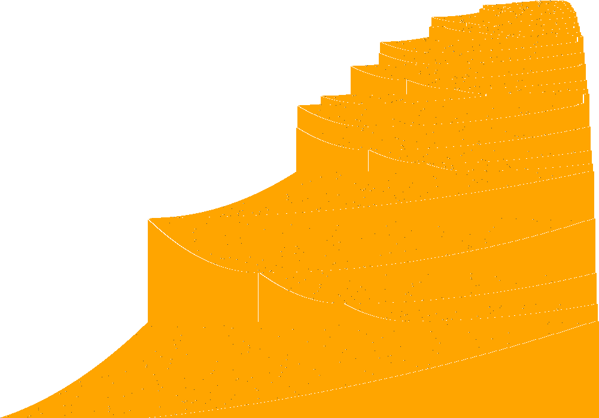

<a id="37"></a>
##  [37](#t37). `1RB1RF_1RC0RB_0RD1LF_1LE1RE_1LA---_1RA0LC` (class B)

- **Same table as no. [11](#11), other start state (13 Nov 2026).** No. 37 is no. 11 (mirrored) started in state C. The two are equivalent. Overview: *Related machines among the candidates* at the top.
- **Equivalent to no. 11** (checked 29 Oct 2026, observation by post-apocalyptic sphere on Discord; `scan/iso_11_37.py`).
  - **Same transition table.** This machine is no. 11 **mirrored**, with the states renamed (no. 11 → here: A→D, B→E, C→A, D→B, E→C, F→F). All 12 transitions agree under this map, with left and right swapped. Only the start state differs: this machine starts in A, which corresponds to C of no. 11.
  - **Same configuration.** After 8,277,490 steps of no. 11 and 7,454,917 steps of no. 37 the tapes are identical up to mirroring: 1674 cells, the head at the same position, state D in no. 11 and B here (B = image of D).
  - **Conclusion.** From these steps on, the two runs correspond step by step, and neither machine halted before. So **this machine halts if and only if no. 11 halts**.

- **Holdout status:** no. 37 is in the BB(6) holdout list (608 machines, 30 Oct 2026) as the representative of both; no. 11 was removed because of the equivalence.

- scan: 20 levels, 66 phases, mean factor 1.26 (sd 0.19); level starts: 98 127 160 216 251 276 323 344 375 565 620 675 799 853
- level analysis: Bell type `RF` with left part `11 01 11 03`, 3 levels; n: 21 51 403; ratios: 2.429 7.902; 1 different tails
- verdict: no clear single-block Bell configuration found
- diagram: 175,420 steps, tape width 403 cells

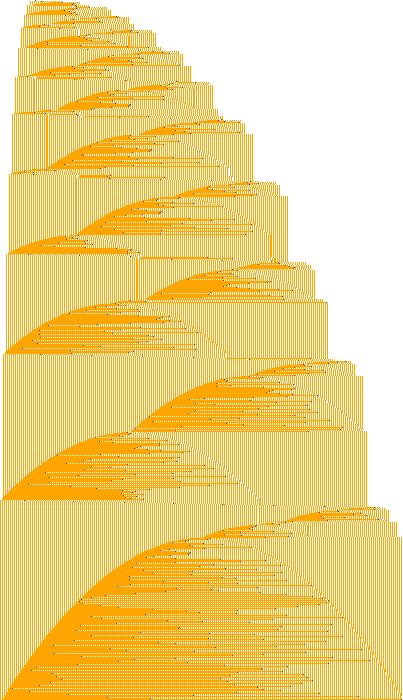

**Results obtained on the equivalent run of no. 11** (formerly listed under no. 11; the tape is mirrored there, so left and right are swapped compared with this machine):
- scan of no. 11: 20 levels, 95 phases, mean factor 1.21 (sd 0.10); level starts: 83 107 129 157 171 196 242 274 345 420 620 684 745 799
- level analysis of no. 11: Bell type `LC` with left part `01`, 16 levels; n: 5 12 18 48 96 110 200 232 376 478 702 794 968 1512 1832 3912; ratios: 1.146 1.818 1.160 1.621 1.271 1.469 1.131 1.219 1.562 1.212 2.135; 13 different tails. In that orientation a clear Bell type appears, which this run does not show.
- **examined (24 Oct 2026): multi-register system.**
  - **Bell starts:** in the orientation of no. 11 the tape is `(10)^m (01)^n 0`, head on the right, state F. In between there are 3–4 large blocks, e.g. `11^a 01^b 00 10^c`.
  - **Simulation:** `accsim` (2·10¹⁰ real operations) reaches **10²² steps**, with blocks of about 3·10⁸: no HALT.
  - **Halting rate:** perturbed real starts gave 1 HALT in 120 runs over a growth factor of 10, right at the start, so the rate is at most about 0.1 % per Bell.
  - Because the runs coincide, all of this holds for this machine as well.

<a id="38"></a>
## [38](#t38). `1RB0RE_1LC0RA_0LD0LB_1RE0LB_1RF---_0RB0RC` (class C)

- scan: 10 levels, 18 phases, mean factor 1.55 (sd 0.20); level starts: 8 14 20 28 54 60 78 154 203 404
- level analysis: Bell type `RA`, 7 levels; n: 4 14 20 54 60 154 404; ratios: 3.500 1.429 2.700 1.111 2.567 2.623; 4 different tails
- verdict: 4 different tails, but the growth ratio varies
- diagram: 279,320 steps, tape width 1001 cells

- **examined briefly (24 Oct 2026):** the tape becomes a growing **list of blocks**, `11^192 10^15 01 11^2 01^3 00 11^233 10^17 …`, i.e. a nested counter structure of type G (not closed). `accsim` reaches **4·10³³ steps** with only 892 jumps: no HALT.

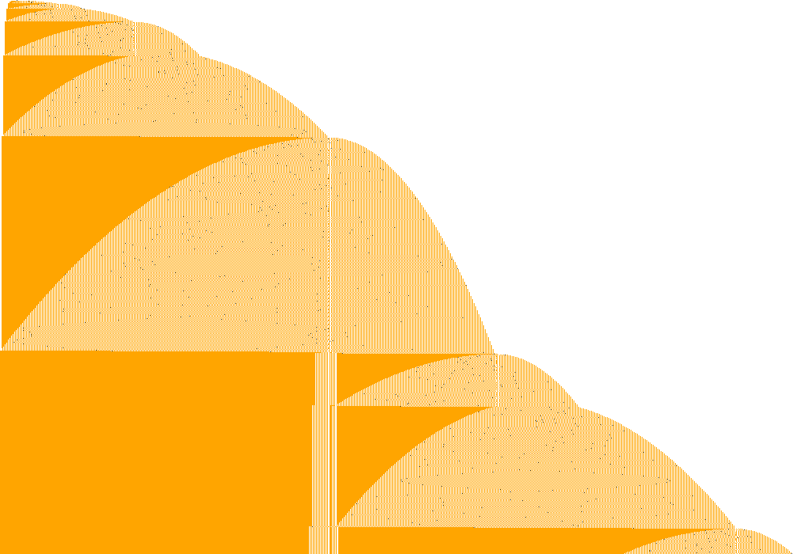

<a id="39"></a>
##  [39](#t39). `1RB1LC_1LC0RF_0LF1LD_0LE---_1RF1LC_1LE0RA` (class C)

- **Same table as nos. [19](#19), [20](#20), other start state (13 Nov 2026).** No. 39 is no. 19 (mirrored) started in state C; no. 20 started in state D. No common configuration found (2·10⁸ steps, in both directions). Overview: *Related machines among the candidates* at the top.

- scan: 21 levels, 54 phases, mean factor 1.36 (sd 0.21); level starts: 156 198 237 306 358 468 541 713 814 1074 1225 1623 2444 3677
- level analysis: Bell type `LC` with left part `01`, 11 levels; n: 4 10 88 136 208 316 478 1084 1633 5530 12457; ratios: 2.500 8.800 1.545 1.529 1.519 1.513 2.268 1.506 3.386 2.253; 2 different tails
- verdict: needle-like: only 2 tails (all information in one number)
- diagram: 10,129 steps, tape width 136 cells

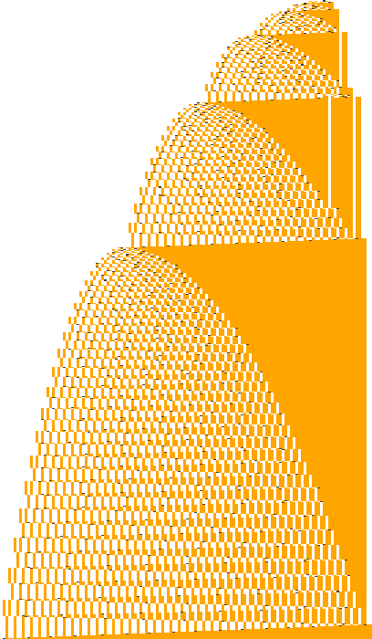

### No. 39: detailed analysis (2 Nov 2026)

**Bell start** (from Bell 3,923 on): head on the blank cell at the left end, state C:

    [0]  P  1^N  T            P = "" (type A) or "10" (type B),  T = tail

- **T = tail:** empty, or `011`, or a list of further blocks `0 1^m1 0 1^m2 … 011`.
- **What a Bell does:** each pair of passes turns the left end of the block 1^N into `(011)^k`. The block loses 4 ones per pair of passes, k grows by 2. At the right end the whole `(011)^k` is turned into ones again, and the next Bell begins with a block of about 1.5·N ones.
- **Tape width:** w' = (3w + c)/2 with a small c.

**Exact Bell map without tail counters** (checked with `m39/step.c`, `m39/table.py`; N' = (3N + d)/2):

| P, T | N ≡ 0 (mod 4) | N ≡ 1 | N ≡ 2 | N ≡ 3 |
|---|---|---|---|---|
| "", – | P' = "", T' = –, d = 8 | "10", `011`, 1 | "10", –, 4 | "", `011`, 5 |
| "10", – | "", –, 14 | "10", `011`, 7 | "10", –, 10 | "", `011`, 11 |
| "", `011` | "", –, 14 | "", `0 1^8 011`, −1 | "10", –, 10 | "10", `0 1^8 011`, −5 |
| "10", `011` | "", –, 20 | "", `0 1^8 011`, 5 | "10", –, 16 | "10", `0 1^8 011`, 1 |

Example: N = 88 → 136 → 208 → 316 → 478 (d = 8, N ≡ 0 or 2); 478 ≡ 2 → P' = "10", N' = (1434 + 4)/2 = 719; 719 ≡ 3 → (2157 + 11)/2 = 1084 with T' = `011`, and so on.

**Tail counters.** A tail `0 1^m 011` is a second counter.
- **N ≡ 0, 2 (mod 4):** it is absorbed into the main block.
- **N ≡ 1, 3:** it survives and is transformed, m → m'. The transformation is irregular: m = 8 → 26 → 359 → … (tested with N large: m = 2 → 35, 11 → 89, 14 → 62, 20 → 53, 26 → 359, 35 → 1088). Sometimes it splits into two blocks.
- **Structure:** the machine is a list of counters (similar to nos. 31 and 95). The main block grows by about 1.5 per Bell; a surviving tail counter grows by about 3.4.

**Order of the Bell types** (letter = prefix; digit = tail: 0 none, 1 only `011`, 2 or 3 = number of blocks including `011`), first 128 Bells from N = 88:

    A0 A0 A0 A0 A0 B0 A1 A0 B1 B0 A1 B0 A0 B1 B0 B1 B2 A2 B2 B2
    A0 B1 B0 A1 B0 B0 B0 B0 A0 A1 B2 A0 B1 A0 B0 A1 A0 B1 B0 A1
    A0 B1 A0 B0 B1 A2 A0 A0 B0 B1 B2 A2 A2 A2 A0 B0 B1 A2 A0 B0
    A1 B0 B0 B0 B0 A0 A1 A2 B2 B2 A2 A2 B0 A1 A0 A1 A2 B2 B2 B2
    A0 A1 B2 A0 A1 A2 B2 A2 B2 B2 A0 A1 A2 A2 B0 B1 A2 A0 A0 B0
    B1 A2 A0 B0 B1 A2 B0 A1 B0 B0 B0 B0 A0 B1 B0 A1 A0 A1 A2 B2
    B2 A2 B2 B2 A2 A2 A2 B3

- **Frequencies:** A0 28, A1 16, A2 22, B0 29, B1 14, B2 18, B3 1 (the last one: three blocks at Bell 128).
- **No fixed period**, because the types depend on N mod 4 and on the tail.
- **Counters live longer later on:** at Bells 121–127 a tail counter survives seven Bells in a row (m = 359, 1232, 2780, 6263, 21158, 71423, 241073). With N ≈ 1.5·10²⁴ it is still tiny compared with N.

<p align="center">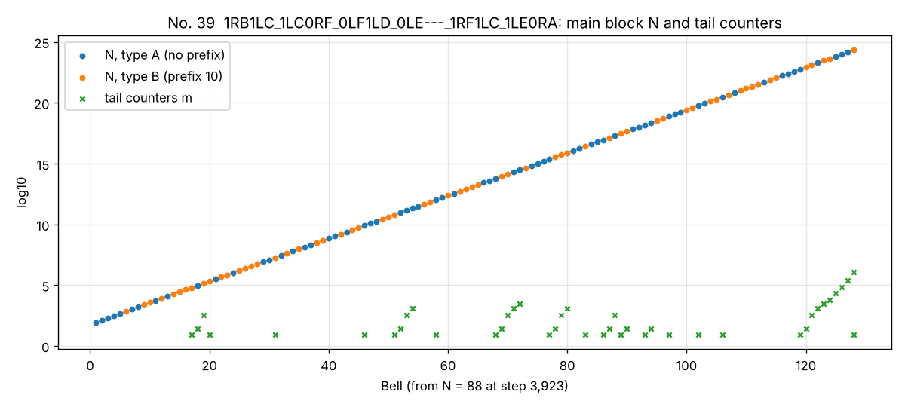</p>

**When does the tail go up, vanish or restart?** All 127 transitions of the first 128 Bells follow one rule. What matters is the parity of N and, when the tail is absorbed, the parity of m:
- **N odd (N ≡ 1, 3 mod 4): one level up.** Empty tail → `011` → `0 1^8 011` → m = 26 → 359 → 1232 → 2780 → 6263 → 21158 → 71423 → 241073 → (1220465 + a new 8) → 4119110 → 13902011 …
  - This chain is fixed: the next level does not depend on N or P (checked with very large N).
  - Each step multiplies m by 1.5^j (j = 2, 3 or 4): the tail runs j small Bells of its own during one large Bell.
- **N even (N ≡ 0, 2 mod 4): the tail is absorbed into the main block.**
  - If m is even (or the tail is only `011`), the tail becomes empty.
  - If m is odd, a new counter starts at m = 8; this was observed after m = 359, and with large N it holds for every odd m tested (1 … 39).
- **The tail never goes down part of the way.** It either climbs one level or starts again from the bottom.
- **Consequence:** for the tail to reach level k, about k odd values of N in a row are needed, roughly probability 2^−k. A HALT can come only from the chain itself.

**The chain computed to level 400** (2 Nov 2026; `m39/chainrun.py`, result in `m39/chain_400.txt`). Each level is one large Bell with a huge N (N ≈ 10^(digits of m + 25), odd) and only the tail.
- **Simulator:** a variant of the fast simulator also canonicalizes and extrapolates at every turn of the head, not only at the tape ends. With it, the small inner Bells of the tail are skipped as well, and all 400 levels take a few seconds. Up to level 9 the result is identical, step count included, to the earlier simulator.
- **Result:** **no HALT up to level 400.** The tail grows to m ≈ 1.6·10²⁷⁶.
  - Per level m is multiplied by exactly 1.5^j: j = 2 (90 times), 3 (118), 4 (95), 5 (34), 6 (21), 7 (9), 8 (15), 9 (8), 10 (2), 11 (3), 12 (1) and 22 (1).
  - 28 times an extra small counter 8 is split off; it is absorbed again at the next level.
- **Check** (`m39/check.py`, levels 0–149, each with P = "" and "10" and all four N mod 4):
  - N odd always gives the same next level;
  - N even gives an empty tail, 8 or 26, i.e. a restart near the bottom;
  - no HALT in any of these 1200 Bells.
- **Consequence:** a HALT of no. 39 needs a level beyond 400. That needs more than 400 odd N in a row, probability about 2^−400 per Bell. So the machine **very probably does not halt** (probviously non-halting). This is not a proof: deeper levels and the regime m ≈ N have not been covered.

**Towards a proof (2 Nov 2026, not successful).**
- **Local HALT condition:** C reads a 1 (writes 1, moves left, goes to D), and the cell to the left is also 1. In all observed configurations C reads a 1 only when there is a 0 to its left.
- **Inner process of the tail** (end phase of a large Bell, observed with N = 4001 and 8001): the converted main block, `(100)^K`, `(010)^K` or `(001)^K`, serves as a reservoir. The tail block 1^m is converted and rebuilt several times in small Bells of its own. Each small Bell uses about m/6 units of the reservoir.
  - Example m = 26: the small Bells go 26 → 45 → 69 → 105 → 159 → 240, then the tail is rebuilt to 359.
  - Inside the run m → (3m + 3)/2 holds (45 → 69 → 105 → 159 → 240). With y = m + 3 this is y → 3y/2, and the run continues while y is even. So the number j of small Bells is essentially the number of factors 2 in y: a Collatz-type map, as for Antihydra.
- **When m is large compared with N** (m + 3 = 2^k·3 with small N), the tail is absorbed into the main block instead; no HALT occurred in these tests either.
- **What a proof would need:** that along the chain the configuration "C reads 1 with a 1 to its left" never occurs, for every level, i.e. a statement about the iteration y → 3y/2 together with the entry and exit rules of the small runs. Statements of this kind (compare Antihydra) are at present out of reach, so the computations above (level 400, 2^−400) are evidence, not a proof.

The first 100 Bell starts `[0] P 1^N T` are listed in [`m39/bells_100.md`](m39/bells_100.md).

**Fast simulation:** `m39/run39.py`, with the chain, backsymbol and extrapolation simulator of no. 95. It reaches **Bell 128 at about 3·10⁴⁸ steps** (N ≈ 2.2·10²⁴) in 100 seconds, with no HALT. The Bell starts agree exactly with direct simulation up to 2.4·10⁹ steps (21 Bells). The data are in `m39/bells39.txt`.

**HALT:** only through D1 (`---`). No condition for it has been derived yet. Presumably it needs a tail counter that grows to the size of the main block, or a special configuration at the boundary between them.

<a id="40"></a>
##  [40](#t40). `1RB0RD_0RC1RE_1RD0LA_1LE1LC_1RF0LD_---0RA` (class C)
- **BusyBeaverWiki article:** [Lucy's Moonlight](https://wiki.bbchallenge.org/wiki/Lucy%27s_Moonlight); on the [Cryptids](https://wiki.bbchallenge.org/wiki/Cryptids) page: cryptid "Lucy's Moonlight"

- scan: 13 levels, 26 phases, mean factor 1.48 (sd 0.22); level starts: 8 10 17 22 34 46 50 57 114 155 324 435 884
- level analysis: Bell type `RC`, 2 levels; n: 9 22; ratios: 2.444; 1 different tails
- verdict: no clear single-block Bell configuration found
- diagram: 180,752 steps, tape width 1001 cells

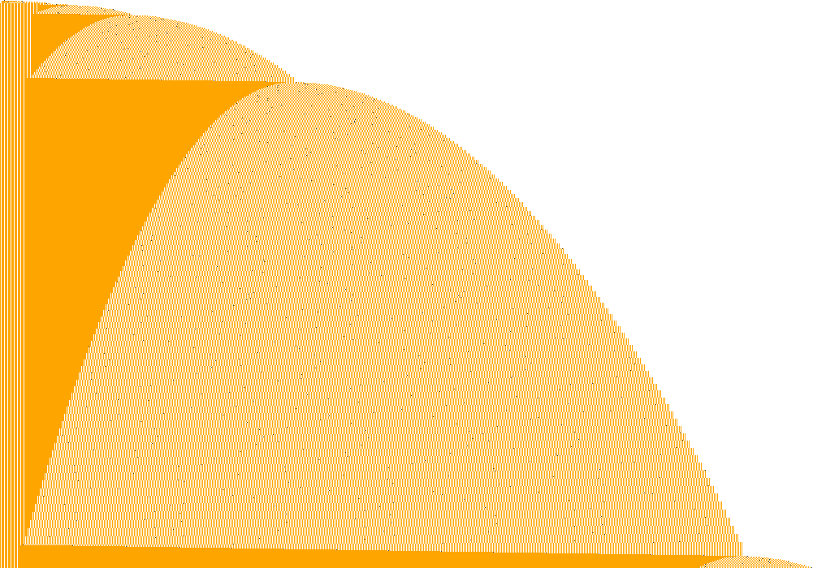

<a id="41"></a>
##  [41](#t41). `1RB1LD_1RC0RA_1LA1RE_0LA0LB_0RB1RF_---1RD` (class C)
- **BusyBeaverWiki article:** [1RB1LD_1RC0RA_1LA1RE_0LA0LB_0RB1RF_---1RD](https://wiki.bbchallenge.org/wiki/1RB1LD_1RC0RA_1LA1RE_0LA0LB_0RB1RF_---1RD)

- scan: 17 levels, 63 phases, mean factor 1.40 (sd 0.23); level starts: 39 90 118 131 156 298 456 534 1006 1130 1209 1644 1962 2120
- level analysis: Bell type `LD` with left part `01 11 01 11 01 11 01 11 01 11 01 11 01`, 7 levels; n: 9 49 177 593 2257 5905 16113; ratios: 5.444 3.612 3.350 3.806 2.616 2.729; 1 different tails
- verdict: needle-like: only 1 tail (all information in one number)
- diagram: 157,672 steps, tape width 605 cells

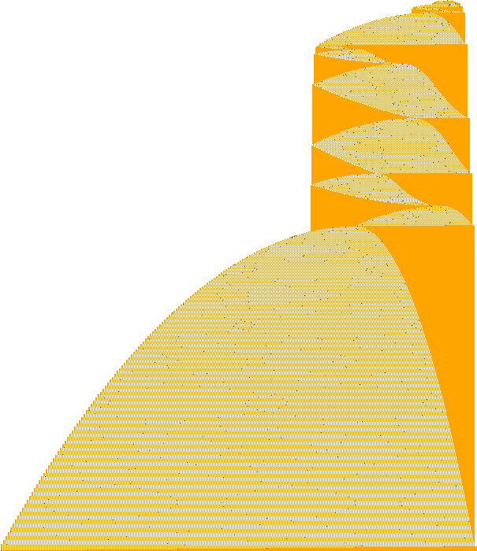

### No. 41: AB analysis (2 Nov 2026)

The space-time diagram shows two alternating phases: a large curved phase **A** and a short dark block phase **B**. Both have exact rules. One cycle runs from one Bell to the next; a Bell is the right-record event `1 (10)^n [0]` in state A.

**Phase B (turnover + doubling cascade + bounces).**
1. Turnover: the head sweeps once to the left and turns the whole tape into a solid block of ones: `1 (10)^n [0]` → `[0] 010 1^(2n+1)` (the dark block).
2. Doubling cascade: at the left end, in state A, the tape is `[0] (01)^x 1^y`. Each sweep doubles the `01` region and eats ones:
   (x, y) → (2x + 3, y − 2x − 4), starting from x₀ = 7, y₀ = 2n − 8.
   So x_k = 10·2^k − 3 (7, 17, 37, 77, 157, 317, 637, …) and y_k = 2n + 12 + 2k − 20·2^k. There are about log₂(n/10) doublings.
3. Bounces: when the ones run out (y_k < 2x_k + 4), the sweep reaches the right end (`(1)^a 0 (01)^b 0 [0]`) and the process runs back from the right. This repeats 0 to 14 times (a ping-pong between the two ends) until the configuration `[0] (01)^x 1^y` in state **B** is reached.

**Phase A (linear phase, the curved part).** Each sweep turns one `1` into `01 01`:
(x, y) → (x + 2, y − 1), in state B, for exactly y sweeps, until `[0] (01)^(x+2y)`. The next sweep to the right gives the next Bell with
**n' = x + 2y + 1**.
Phase A has y sweeps over a tape of width ≈ 2n, so it takes ≈ n² steps. This makes it the large curved part of the diagram.

**Bell sequence** (checked against direct simulation up to 6·10⁹ steps, 9 Bells; then run with the fast simulator `scan/m95/fast.py run2` up to 8·10⁵⁹ steps, 70 Bells, no HALT; script `scan/m41/run41.py`, parser `scan/m41/cycles41.py`, all 70 cycles in `scan/m41/cycles_70.txt`):

| Bell | n | doublings | bounces | phase A start (x, y) | next n = x+2y+1 | ratio |
|---:|---:|---:|---:|---|---:|---:|
| 1 | 8 | 0 | 0 | (15, 6) | 28 | 3.5000 |
| 2 | 28 | 1 | 0 | (15, 38) | 92 | 3.2857 |
| 3 | 92 | 3 | 2 | (39, 130) | 300 | 3.2609 |
| 4 | 300 | 4 | 0 | (35, 548) | 1132 | 3.7733 |
| 5 | 1132 | 6 | 0 | (539, 1208) | 2956 | 2.6113 |
| 6 | 2956 | 8 | 1 | (1275, 3392) | 8060 | 2.7267 |
| 7 | 8060 | 9 | 1 | (4911, 6338) | 17588 | 2.1821 |
| 8 | 17588 | 10 | 0 | (11499, 12208) | 35916 | 2.0421 |
| 9 | 35916 | 11 | 0 | (20103, 31658) | 83420 | 2.3226 |
| 10 | 83420 | 13 | 4 | (55467, 55952) | 167372 | 2.0064 |
| 11 | 167372 | 14 | 4 | (87955, 158888) | 405732 | 2.4241 |
| 12 | 405732 | 15 | 6 | (215623, 380286) | 976196 | 2.4060 |
| 13 | 976196 | 16 | 2 | (496723, 959008) | 2414740 | 2.4736 |
| 14 | 2414740 | 17 | 0 | (826703, 3176118) | 7178940 | 2.9730 |
| 15 | 7178940 | 19 | 4 | (3080987, 8195992) | 19472972 | 2.7125 |
| 16 | 19472972 | 20 | 0 | (5994083, 26957828) | 59909740 | 3.0766 |

Over the 70 cycles the ratio n'/n is irregular, between 1.15 and 3.95, with geometric mean 2.59. The number of bounces is 0 in 28 cycles and at most 14. The cascade and phase A are exact and regular; all the irregularity sits in the bounce phase, which acts like a pseudo-random map from (n, remainder) to the start (x, y) of phase A. The Bell sequence starts 8, 28, 92, 300, 1132, 2956, 8060, 17588, 35916, 83420, … (the old level list 9 49 177 593 2257 … is 2n − 7).

**HALT condition.** The only undefined transition is F0. F is reached only through E1 (`1RF`), and E only through C1 (`1RE`). So the machine halts exactly when state E reads a 1 whose right neighbour is 0. In the first 2.5·10⁶ steps, E reads a 1 with a 0 to its right only at steps 12 and 340 (start-up); after that E-on-1 always has another 1 to its right. A HALT would therefore need a bounce configuration that does not occur in these 70 cycles.

**End of phase A.** After j sweeps the tape is `[0] (01)^(x+2j) 1^(y−j)`. At the end (j = y) it is `[0] (01)^m`, with m = x + 2y, in state B; the tape width is 2m + 1. The next sweep gives the Bell `1 (10)^(m+1) [0]`, so n' = m + 1.

### No. 41: phase B in detail (2 Nov 2026)

Phase B is made of four zigzag regimes on a three-block tape: left ones `1^a`, a middle block, and right ones `1^c`. Each line below is the configuration at a turn of the head; one round is one zigzag over the middle block.

| regime | configuration | state | one round |
|---|---|---|---|
| P1 (middle collapses) | `(1)^a [0] (10)^b (1)^c` | B | (a+3, b−1, c−1) |
| P2 (middle expands) | `(1)^a 0 [0] (10)^b (1)^c` | A | (a−3, b+2, c−1) |
| P3 (right wall) | `(1)^a 0 (01)^b 1 [0] (1)^c` | C | (a, b−1, c+2) |
| Q (right wall, no separator) | `(1)^a (01)^b 1 [0] (1)^c` | C | (a, b−1, c+2) |
| A (phase A) | `[0] (01)^x (1)^y` | B | (x+2, y−1) |

Exits:

- **P1:** b = 0 → P2(a+3, 0, c−4) [`d`]; c = 1 first → P3(a+2, b−1, 2) [`X`].
- **P2:** the left wall is reached when a ≤ 2. Then:
  - a = 0 → P1(1, b+1, c−1) [`L0`];
  - a = 1 → P1(1, b+2, c−1) [`L1`];
  - a = 2 → A(b+3, c−2) (phase A starts).
  If instead c = 1 comes first → Q(a, b+1, 2) [`Y`].
- **P3:** b = 0 → P2(a−3, 1, c+2).
- **Q:** b = 0 → P2(a−2, 0, c+2).
- **A:** y = 0 → Bell n = x+1 → Q(2, n−1, 2) → P2(0, 0, 2n+2) → L0 → P1(1, 1, 2n+1).

This macro model (`scan/m41/macro41.py`) reproduces all 70 simulated Bells exactly from Bell 28 on. The step 8 → 28 is a start-up case with small counters.

**The residue rule.** P1 always starts with a = 1, so P2 starts with a ≡ 1 (mod 3) after `d` and with a ≡ 0 after `X`. Each bounce `Y` (Q) changes a by −2, i.e. raises the residue r = a mod 3 by 1. When P2 reaches the left wall, r alone decides what follows:

- r = 0 → `L0` (new cascade);
- r = 1 → `L1` (new cascade);
- r = 2 → **phase A**.

**Segments.** Phase B is a sequence of segments. A segment starts at P1(1, b, c) and ends at the next P1 start or at phase A. Only 13 segment types occur in 1500 cycles, all of the form `d Y^j` or `X Y^j`. Each type is an exact affine map on (b, c). The type is chosen by t = c/b:

| segment | t = c/b (observed) | result |
|---|---|---|
| `d L1` (= one doubling D) | t ≥ 2 | (b', c') = (2b+4, c−2b−6) |
| `d Y` | 1.2 ≤ t < 2 | **A**: x = 4b−2c+13, y = −6b+5c−21, so n' = 8(c−b)−28 |
| `d Y Y L0` | 1.048 ≤ t < 1.2 | (b', c') = (12b−10c+41, −22b+21c−75) |
| `d Y³ L1` | 1.012 ≤ t < 1.048 | (44b−42c+150, −86b+85c−289) |
| `d Y⁴` | 1.003 ≤ t < 1.012 | **A**: x = 172b−170c+579, y = −342b+341c−1144 |
| `d Y⁵ L0`, `d Y⁶ L1`, … | t → 1⁺ | (rare) |
| `X L0` | t < 2/3 | (b', c') = (2c, 2b−3c+4) |
| `X Y L1` | 2/3 < t < 0.909 | (−4b+6c−8, 10b−11c+24) |
| `X Y Y` | 0.909 < t < 0.976 | **A**: x = −20b+22c−47, y = 42b−43c+105 |
| `X Y³ L0` | 0.977 < t < 0.994 | (−84b+86c−211, 170b−171c+435) |
| `X Y⁴ L1` | 0.994 < t < 0.998 | (−340b+342c−870, 682b−683c+1757) |

The coefficients grow by a factor of about 4 per bounce. For `d Y^j` they are (2·4^j+4)/3 and (4^(j+1)+2)/3 (4, 12, 44, 172 and 6, 22, 86, 342). The thresholds approach t = 1 from both sides, at distances ≈ 1/(c·4^j). So the number of bounces is j ≈ log₄(1/|t−1|), and t = 1 is the only accumulation point.

**First segment after a Bell.** From P1(1, 1, 2n+1), the cascade gives b_k = 5·2^k − 4 and c_k = 2n + 11 + 2k − 10·2^k. It stops at the first k with c_k < 2b_k + 6. So t ∈ [0, 2), and t ≈ 0.4·n/2^k − 2 is set by the mantissa of n in base 2.

- In 36% of cycles, t ≥ 1.2 (path `L0 D^k d Y`). Then exactly n' = 8(c_k − b_k) − 28 = 16n + 92 + 16k − 120·2^k, and n'/n ∈ (1, 4).
- Otherwise the segment returns to P1 with new (b', c'). A new cascade follows, then the next segment, until a segment with final residue 2 starts phase A.

Scripts: `scan/m41/macro41.py` (macro model), `scan/m41/words41.py` (regime word per cycle), `scan/m41/segments41.py` (segment types, t ranges, affine maps; output in `scan/m41/segments_1500.txt`).

**Verdict:** a Bell machine with an exact two-phase cycle. Phase A is linear. Phase B is an iterated piecewise affine map on (b, c), whose pieces are cut out by t = c/b with thresholds accumulating at t = 1. So the Bell map n → n' is piecewise affine with infinitely many pieces, not a finite table; the vampire method does not apply directly. A non-halting proof would have to show that every transition of the macro model is valid for all counter values reached (no small-counter edge case that leads to "E on 1, then 0").

### No. 41: attempt at a non-halting proof (12 Nov 2026)

Tools in `scan/m41/exact/`. Result: **there are Bell values n that halt, also in the residue class of the real run, so a proof with a closed set of macro configurations is not possible.**

- **Exact macro step for all counter values.** One macro step is the first later configuration of the form P1, P2, P3, Q, A or Bell. It was tabulated by direct simulation for all counters ≤ 14 (10,822 of these entries have a counter above 7 and agree with the affine continuation of the smaller ones). With jumps over the loops, the model gives the 70 Bells of `cycles_70.txt` exactly, up to n = 606,883,091,006,796,836,107,927,983,740.
- **The only HALT of the macro model** is P1(a, 0, 2), for every a. It is reached from P1(a, b, b + 2): the round (a+3, b−1, c−1) keeps c − b.
- **Halting Bell values.** Up to n = 400,000 the cycle from `1 (10)^n [0]` ends in HALT for n = 1, 4, 9, 19, 24, 80, 7896, 32179, 62156 and 248567. Direct simulation confirms n = 24 (26,491 steps), n = 80 (111,382 steps) and n = 62156 (63,992,305,558 steps).
- **Residue of the Bells.** For all n from 5 to 19,999 whose cycle does not halt, the next Bell is ≡ 4 (mod 8); the real Bells are ≡ 4 (mod 8) from 28 on. But n = 62156 ≡ 4 (mod 8) halts, so this residue does not protect the run. Among the 7,499 values n ≡ 4 (mod 8) from 12 to 60,000 none halts.
- **Residue classes.** The closure of the classes (regime, a, b, c modulo 24), started from the Bell class n ≡ 4 (mod 8), has 956 classes and contains P1 with c − b ≡ 2, which halts when c − b = 2 exactly. In the first cascade after a Bell this cannot happen (c − b is odd there), but later in the cycle c − b is even and above 2 in about 5 % of the entries into P1 (2,763 of 57,874 entries from P2, for n ≡ 4 (mod 8) below 30,000).
- **Assessment.** The Bell map is exact but acts like a pseudo-random map, and the halting values are a sparse set (10 values up to 400,000, one of them ≡ 4 mod 8 and above 4). The real run halts only if a Bell hits this set. With Bells growing by a factor of about 2.6 this is very unlikely (the run is already at n ≈ 6·10²⁹), but excluding it would need control over the whole Bell sequence. **Probviously non-halting; no proof in sight.**

### No. 41: probviously non-halting, rough estimate (12 Nov 2026)

A heuristic estimate, not a proof. It treats the Bell map as a random map and uses the halting Bell values found above.

- **Chance per Bell.** The 10 halting values up to 400,000 (1, 4, 9, 19, 24, 80, 7896, 32179, 62156, 248567) are spread roughly evenly over the orders of magnitude, about 1.5 per factor of 10. This corresponds to a chance of about 0.65/n that a Bell of size n halts. The constant comes from 10 values only and is uncertain by a factor of 2 to 3; for the class n ≡ 4 (mod 8) of the real run it is rather smaller (only 4 and 62156 up to 400,000).
- **Sum over the Bells.** Each Bell is about 2.6 times the one before, so the chances form a geometric series with a finite sum. The total chance of a HALT is therefore below 1, and nearly all of it lies in the first Bells. This is the difference to a probviously halting machine, where the chance per cycle falls so slowly that the sum diverges.
- **Numbers.**
  - From the start: 0.65 · (1/8 + 1/28 + 1/92 + …) ≈ 0.1.
  - From Bell 71 on (n ≈ 6·10²⁹): about 0.65/n · 1.6 ≈ 10⁻³⁰.
  - From the 10¹¹ cycles already simulated without HALT: n has roughly 4·10¹⁰ decimal digits there, and the remaining chance is of the order 10^(−4·10¹⁰).
- **No expected halting time.** The machine halts with a chance far below 1, so an expected number of steps until HALT does not exist (it is infinite). Only the chance of ever halting can be given.
- **A sharper estimate** would count, per cycle, the entries into P1 with even c − b (about 5 % of the entries) and the chance that the cascade then hits c − b = 2 exactly. The expected form is a chance of constant · log n / n per Bell, which gives the same conclusion with a better constant. Not done yet.

<a id="42"></a>
## [42](#t42). `1RB0RF_1LC0RA_1LD1LB_0LE---_1LA0LA_1RE1LD` (class C)

- **Same table as nos. [22](#22), [43](#43), other start state (13 Nov 2026).** No. 42 is no. 22 (mirrored) started in state B; no. 43 (mirrored) started in state D. No common configuration found; the runs of 22 and 42 drift apart. Overview: *Related machines among the candidates* at the top.

- scan: 14 levels, 45 phases, mean factor 1.42 (sd 0.23); level starts: 13 15 37 44 53 72 155 198 257 407 458 593 975 1200
- level analysis: Bell type `LD` with left part `01`, 6 levels; n: 4 44 162 414 1204 3402; ratios: 11.000 3.682 2.556 2.908 2.826; 1 different tails
- verdict: needle-like: only 1 tail (all information in one number)
- diagram: 1,076,279 steps, tape width 1001 cells

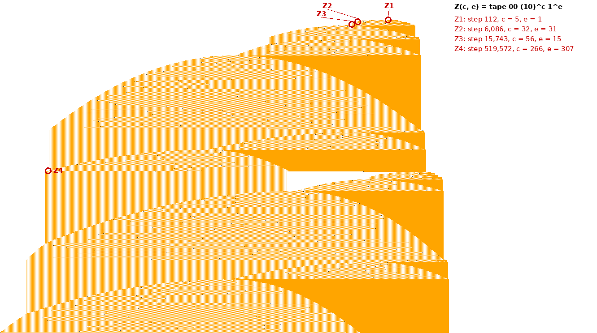

Z events in the diagram (red circles; tape `00 (10)^c 1^e`, head in state A on the new left cell; made with `m42/markZ.py`):

| | step | c | e | next: merge M(c, e) |
|---|---|---|---|---|
| Z1 | 112 | 5 | 1 | c odd (R4) → X(7, 13) |
| Z2 | 6,086 | 32 | 31 | c even → X(55, 6) |
| Z3 | 15,743 | 56 | 15 | c even → X(68, 11) |
| Z4 | 519,572 | 266 | 307 | c even → X(422, 44) |

The diagram ends at step 1,076,279. The later Z events of the run are listed under "The real run" below.

### No. 42: detailed analysis (13 Nov 2026)

Tools and data in `m42/` (`ev42.c`, `rules42.py`, `orbit42.py`, `hset.sh`, `NOTES.md`). The tape grows to the left; HALT is D reading 1.

**Events.** An event is the moment when the head reaches a new leftmost cell in state A. Almost all events of the run are one of two kinds:
- X(a, b): the tape is `(10)^a 1^b`;
- Z(c, e): the tape is `00 (10)^c 1^e`.

The first event, at step 6, is X(1, 4).

**Exact event rules.** Checked against direct simulation in 10,120 cases (`rules42.py`), up to a = 20,000:
- **R1.** X(a, b) → X(a+2, b−2) for b ≥ 3. The block 1^b is turned into (10) pairs.
- **R2.** X(a, 1) → X(1, 2a+6).
- **R3.** X(a, 2): this is a sweep with a hidden counter. The machine works through *blocks* of length D_k = 6·3^k − 1 (5, 17, 53, 161, 485, …), which start at a = A_k = 3^(k+1) − 3 − k (0, 5, 22, 75, 236, …). Write j = a − A_k for the position inside the block. Then:
  - j = 0 gives X(1, D_k);
  - j = 2i+1 gives Z(2+3i, D_k−2−2i);
  - j = 2i+2 gives X(4+3i, D_k−2−2i).
- **Z → merge.** From Z(c, e) a new segment appears on the left: X(1, 4) 0 X(c, e). One step of R1 gives X(3, 2) 0 X(c, e). Call this the merge M(c, e).
- **R4.** If c is odd: M(c, e) → X(c+6, e−1) for e ≥ 2, and M(c, 1) gives the R3 result of X(c+4, 2).
- **Merge with c even: no closed rule.** The block 1^e is erased, and a new process grows from the right end into the gap until it meets the left part. What comes out depends on where this inner process stands at that moment.

**Where HALT can happen.**
- R1–R4 never halt. They also never produce a Z(·, 2), because every D_k is odd.
- So a HALT is only possible in a merge with c even. That merge halts **exactly when e is in a set H**, and H does not depend on c (checked for c from 2 to 20,000).
- H below 5,000 (`m42/hset_M2_e1-4999.txt`): 2, 28, 74, 114, 288, 622, 715, 772, 1044, 1209, 3391.
- H is produced by the machine's own rules, one level deeper (the inner process). This is what the Holdout Guide means by "built tapes halt at specific values tied to the machine's own orbit".
- Example: M(12, 5) → Z(22, 2) → M(22, 2) → HALT.

**Result.** No. 42 halts **if and only if** some merge M(c, e) with c even has e in H.

**The real run** (`orbit42.py`: R1–R4 as formulas, merges with c even simulated directly). The merges with c even, as (c, e):

  (32, 31), (56, 15), (266, 307), (4214, 1563), (5888, 447), (6008, 367), (314, 39155), (337616, 129215), …

None of them halts. The run was followed through 91 macro events, up to tape width ≈ 10⁷ (X(4191793, 2) and further). The first macro events agree with the direct simulation, up to step 2.7·10⁸ (X(2548, 7391)).

**Estimate.**
- H has 11 values below 5,000, roughly 1.3·ln N values below N. So a merge with e near N halts with a chance of roughly 1.3/N.
- In R3, the e of a Z is spread over the whole block, so a merge in a block of length D halts with a chance of about 1.3·ln D / D. For D ≈ 10⁶ that is about 2·10⁻⁵.
- The blocks grow by a factor of 3, so the sum over all further merges stays of the same order.
- **Probviously non-halting**, with a remaining chance of HALT of about 10⁻⁴ (a rough estimate from only 11 values of H).

**Not a proof.** A proof would have to show that the run never meets a merge with c even and e in H. H is defined recursively by the same machine, so this is a lottery like the Collatz-type cryptids.

<a id="43"></a>
## [43](#t43). `1RB1RE_0RC---_1RD0RD_1LE0LF_1RA0LD_1LC1RB` (class C)

- **Same table as nos. [22](#22), [42](#42), other start state (13 Nov 2026).** No. 43 is no. 22 started in state D; no. 42 (mirrored) started in state C. No common configuration found; the runs of 22 and 42 drift apart. Overview: *Related machines among the candidates* at the top.

- scan: 15 levels, 32 phases, mean factor 1.41 (sd 0.25); level starts: 14 32 37 50 61 73 86 156 264 325 397 451 593 1412
- level analysis: Bell type `RC`, 7 levels; n: 8 13 42 157 330 1416 3614; ratios: 1.625 3.231 3.738 2.102 4.291 2.552; 2 different tails
- verdict: needle-like: only 2 tails (all information in one number)
- diagram: 1,270,033 steps, tape width 1001 cells


<a id="44"></a>
##  [44](#t44). `1RB0RE_1LC0RA_0LD1LB_1LA1LE_0LB0LF_1LD---` (class C)

- **Same table as nos. [81](#81), [89](#89), [96](#96), other start state (13 Nov 2026).** No. 44 is no. 81 (mirrored) started in state D; no. 89 (mirrored) started in state C; no. 96 (mirrored) started in state B. No common configuration found (2·10⁸ steps, in both directions). Overview: *Related machines among the candidates* at the top.

- scan: 7 levels, 13 phases, mean factor 1.90 (sd 0.25); level starts: 13 17 48 79 180 299 620
- level analysis: Bell type `LB` with left part `01`, 7 levels; n: 14 54 186 626 2094 6986 23294; ratios: 3.857 3.444 3.366 3.345 3.336 3.334; 1 different tails
- verdict: needle-like: only 1 tail (all information in one number)
- diagram: 108,486 steps, tape width 1001 cells

- **Model with the memory word r (4 Nov 2026), as for [no. 51](#51).** The macro state is C(m, r) = `[0] 10 1^m r` in state A (head on the blank left of the tape). r is a word at the right end of the tape, a sequence of blocks `0 1^k`, written as the list of k. The Bells are the C(m, empty) with m = 2n + 3. The blank tape reaches C(15, empty) at step 63 (after Bell 6).
  - **Inside one macro step** the head runs a zigzag loop over the ones: with A(x, y) = `[0] (10)^x 1^y`, each round is A(x, y) → A(x+5, y−3). The remainder y mod 3, i.e. m mod 3, decides how the loop ends. Checked with `scan/m44/nxt.c` / `checkrules.sh` for x < 200 and y < 13.
  - **Rules.** For every word r there are exactly three rules, one for each m mod 3: m' = (10m + b)/3 (factor 10/3 instead of 8/3 for no. 51), with b and r' fixed by (r, m mod 3). They were sampled with `cstep.c` / `rmodel51.py` (TMCODE = no. 44), four values per class, no exception. The reachable words have the shape (1^a k)(1^a' k')…: groups of a ones-blocks followed by one longer block. For one group, r = [1^a, k]:

    | m mod 3 | condition | r' | b |
    |---|---|---|---|
    | 0 | a ≥ 1 | [1^(a−1), k] (one 1-block removed) | +18 |
    | 0 | a = 0 | empty | 3k + 15 |
    | 1 | k ≡ 2 (mod 3) | [1^6, 4] | 10k + 6a − 51 |
    | 1 | k ≡ 0, 1 (mod 3) | empty | 10k + 6a + 11 (k ≡ 0) or 10k + 6a + 7 (k ≡ 1) |
    | 2 | k ≥ 3 | [1^(a+7), k−3] (a block k−3 = 1 joins the ones, k−3 = 0 disappears) | −35 |
    | 2 | k = 2 | depends on a: e.g. a = 0 → [1, 7], a = 1 → [1^10], a = 2 → empty, a = 5 → a second group | |
    | 2 | r = [1^a] (no k) | [1^6, 2a+4] | |
    | any | r = empty | m ≡ 0, 1: empty (b = +15, +11); m ≡ 2: [1^6, 4] (b = −47) | |

  - **The case k = 2 (m ≡ 2): a carry (5 Nov 2026).** When the first group ends with a block 2, the m ≡ 2 rule does not stop at this group; it passes on to the rest T of the word, like a carry. Write rule₂(T) for the result of the m ≡ 2 rule on T alone.
    - a ≥ 3 and T not empty: [1^a, 2] + T → [1^6, 2a − 6] + rule₂(T). Example: [1^4, 2, 1^2, 5] → [1^6, 2, 1^9, 2].
    - a ≥ 5 and T empty: [1^a, 2] → [1^6, 2a − 10, 1^6, 4] (rule₂(empty) = [1^6, 4]).
    - a = 2: [1, 1, 2, 1^b, k] → [1^6, 2b + 2k + 12] for k ≢ 2 (mod 3); for k ≡ 2 a second group follows.
    - a = 1: [1, 2, 1^b, k] → [2, 1^(b+3), k − 3], i.e. rule₂ of the next group with the first four 1-blocks merged into a block 2.
    - a = 0: [2] + T behaves roughly like the m ≡ 1 rule on T: T = [1^b, k] → empty if k ≢ 2, [1^6, 4] if k ≡ 2 (mod 3). Nested 2-blocks give extra groups.

    Because the carry can run through several groups in a row, the words become longer stacks of groups (r = G₁ G₂ G₃ …). This is the source of the shapes 1^a k 1^b l … found by the search.
  - **Brute force over group words** (`scan/m44/groups44.py`): every word with up to 3 groups [1^a, k], a ≤ 6, 2 ≤ k ≤ 6, which is 44,135 words with 3 residue classes each. None of them gives HALT, and none needs a finer modulus than 3.
  - **No way to HALT found.** A breadth-first search over r from r = empty (`graph51.py` with TMTAG = 44) visited 50,000 reachable words, up to 524 cells long: shapes 1^a k, 1^a k 1^b l and a few with single blocks in between. In **none** of them does any residue class lead to HALT, and every class was decided by m mod 3 (no finer modulus was needed). This is the opposite of no. 51, where every explored word has a path to HALT, the shortest of length 108.
  - **Real trajectory.** `orbit51.py` (TMTAG = 44, M0 = 15) follows the real run for 300 macro steps, up to m with 146 digits. r is cleared again and again, and words up to about 40 cells occur. There is no HALT.
  - **Complete case tree for short reads (5 Nov 2026).** `scan/m44/lazy44.c` runs one macro step C(m, r) → C(m', r') with r **unknown**. Every time the head reads a cell of r for the first time, the run is split into the two cases 0 and 1, so the leaves of this tree cover *all* words r at once, grouped by the prefix of r that the step actually reads. Results with up to 24 read cells:

    | m mod 3 | leaves (complete cases) | deeper than 24 cells | HALT |
    |---|---|---|---|
    | 0 | 1 (only the first cell, the leading 0, is used: the first block joins the 1-block) | 0 | 0 |
    | 1 | 6,973 | 5,955 | 0 |
    | 2 | 4,607 | 3,801 | 0 |

    The trees for m = 40, 43, 70 (and likewise 41/44/71 and 42/45/72) are identical: same read prefixes, same new words. So a step depends on m only through m mod 3. All small cases a = 0, 1, 2 inside a carry, and all nested exceptions such as [2, 1^5, 2] → [1, 3, 1^6, 4], are leaves of these trees. None of them halts.
  - **Where the reading stops.** In all 9,756 branches that read more than 24 cells, the prefix consists only of blocks of length 0, 1 or 2. The first block of length ≥ 3 always ends the reading. A step therefore reads deep into r only when r starts with a long string of "digits" 0, 1, 2 (block lengths, like a ternary number). This fits the Holdout Guide's remark "residues behave like Collatz digits". Spot checks with long digit prefixes (400 random words with 15–40 such blocks, 3 classes each) and with 3,000 random binary words r: no HALT.
  - **What remains for a proof:** steps that read more than 24 cells, i.e. r beginning with a long digit string over {0, 1, 2}. The tree grows exponentially with the depth (by about ×20 per 8 cells), so it cannot be closed by plain enumeration. The natural next tool is the method of the no. 23 proof: keep the word r exactly, as a pushdown stack read from the head side, and represent the left part (`10 1^m` with the zigzag, which only matters mod 3) by a finite automaton; then compute by pre* saturation the regular set of stacks from which HALT is reachable, and check that it does not contain the start configuration.
  - **pre* attempt (5 Nov 2026).** `scan/m44/prestar.py` implements the pushdown method of the no. 23 proof (pre* saturation after Bouajjani, Esparza and Maler). One half of the tape is an exact stack, and of the other half only the state of a DFA is kept. The program computes the set of configurations from which HALT is reachable and tests the start. If the start is not in this set, the machine never halts. So far no DFA has worked; every one still admits an abstract ("spurious") halting run:
    - Simple families (`dfas.py`: `make`, `make2`, `make3`; test scripts `tryd2.py`, `tryd4.py`), in both orientations: windows of the last K ≤ 8 cells; the trailing 1-run mod 3 or 6; the alternating run with a memory of the 1-run before it; run-length windows of up to 4 runs (3,893 states).
    - Shape DFAs for the left half 0^∞ (10)^x W (`make4`, `tryd5.py`): capped counter for x, exact W up to 14 cells, 106,753 states.
    - Exhaustive search over all DFAs with ≤ 6 states (`dfasearch.py`; 632,700 DFAs with 6 states), both orientations: none works.
    - Sub-problem "can an excursion into r halt, for any content of r?" (`excursion.py`, `excursion2.py`, the unread part of r arbitrary): also not provable with these DFAs. The real excursion trees do not halt (exhaustive up to depth 22), so these runs are spurious too.
  - **Why it is hard** (`shadow.py`, `excwit.py` print the spurious runs next to concrete tapes). The DFA loses the count x of the `(10)^x` block, and x becomes the next m. So the abstract system reaches every residue sequence of m, and with it every memory word r of the r-graph, including long digit strings. During an excursion the head writes such a digit string W (a sequence of alternating runs and short words of unbounded length) and later walks back over it, turning several times. A DFA that keeps only a bounded part of W then hands back contents that never occur, and some of these lead to HALT. A working invariant therefore has to describe the language of the written digit strings W, which is presumably the image of the "ternary arithmetic" that the macro step performs on r.
  - **Conclusion:** no. 44 is a three-register machine: m, plus the counts a and k in the memory word, which can stack into several groups. Unlike no. 51, no halting word is known. A non-halting proof could try to show that the language of reachable words (groups 1^a k) is closed under the rules and contains no halting case: a closed-language / invariant proof on r.


<a id="45"></a>
## [45](#t45). `1RB0LD_1LC0RD_1LA0LC_1RE0LB_1RB1RF_0LD---` (class C)

- **Same table as no. [52](#52), other start state (13 Nov 2026).** No. 45 is no. 52 started in state E. No common configuration found (2·10⁸ steps, in both directions). Overview: *Related machines among the candidates* at the top.

- scan: 10 levels, 21 phases, mean factor 1.53 (sd 0.25); level starts: 11 15 19 25 44 62 152 170 233 515
- verdict: no clear single-block Bell configuration found
- diagram: 444,830 steps, tape width 1001 cells

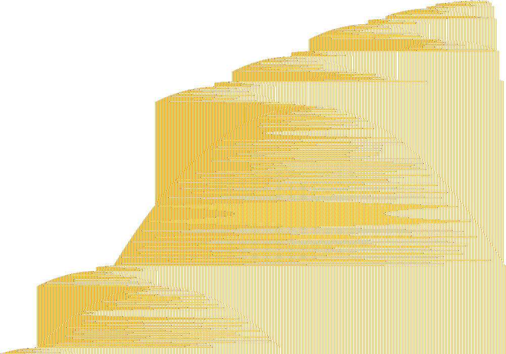

<a id="46"></a>
## [46](#t46). `1RB---_1RC1LE_0RD0RF_0RE0LA_1LF0LB_1LA1LD` (class C)

- **Same table as no. [54](#54), other start state (13 Nov 2026).** No. 46 is no. 54 (mirrored) started in state B. No common configuration found (2·10⁸ steps, in both directions). Overview: *Related machines among the candidates* at the top.

- scan: 7 levels, 14 phases, mean factor 1.74 (sd 0.26); level starts: 16 24 56 108 220 416 440
- level analysis: Bell type `RD`, 11 levels; n: 4 12 39 119 839 1079 1847 2567 3271 4639 8423; ratios: 3.000 3.250 3.051 7.050 1.286 1.712 1.390 1.274 1.418 1.816; 2 different tails
- verdict: needle-like: only 2 tails (all information in one number)
- diagram: 1,701,691 steps, tape width 1001 cells


<a id="47"></a>
## 🟩 [47](#t47). `1RB0LF_1LC0LD_1RD1LB_---1RE_0RA1RE_1LA0LE` (class C)

- **Proof in an open PR (13 Nov 2026):** [Nonhalt of 1RB0LF_1LC0LD_1RD1LB_---1RE_0RA1RE_1LA0LE and 1RB0RE_1LC0RA_1RF0RD_---1LE_0LB1LE_1LE1RC by Dahoas · Pull Request #67 · ccz181078/busycoq](https://github.com/ccz181078/busycoq/pull/67). Opened 12 Nov 2026, not merged yet. File `verify/M_1RB0LF_1LC0LD_1RD1LB_HHH1RE_0RA1RE_1LA0LE.v` with `Lemma nonhalt : ~ halts tm c0`: a symbolic macro machine with binary parameters, exponential accelerators and a power-tower invariant (`SubTowerInv`), translated from Lean 4 with AI help. Checked by the author with Coq 8.20.1 and `coqchk` (closed under the global context).

- scan: 10 levels, 38 phases, mean factor 1.47 (sd 0.26); level starts: 16 18 21 51 108 119 176 249 330 499
- level analysis: Bell type `RE`, 10 levels; n: 4 12 29 62 120 256 516 1016 2108 17222; ratios: 3.000 2.417 2.138 1.935 2.133 2.016 1.969 2.075 8.170; 1 different tails
- verdict: needle-like: only 1 tail (all information in one number)
- diagram: 180,642 steps, tape width 515 cells

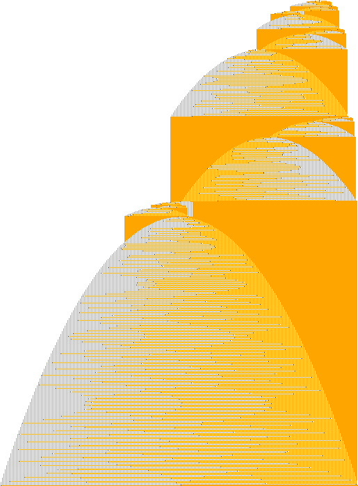

<a id="48"></a>
## 🟩 [48](#t48). `1RB1RD_1LC0LE_1LD0LB_0RB0RA_1RD1LF_0LC---` (class C)

- scan: 7 levels, 1751 phases, mean factor 1.52 (sd 0.27); level starts: 12 15 20 54 85 116 146
- verdict: no clear single-block Bell configuration found
- diagram: 886,334 steps, tape width 1001 cells
- **Own repository:** [BB6_TC_1RB1RD_1LC0LE_1LD0LB_0RB0RA_1RD1LF_0LC---](https://github.com/thomasreus-bb/BB6_TC_1RB1RD_1LC0LE_1LD0LB_0RB0RA_1RD1LF_0LC---) (full description, tools and data).
- **Translated cycler (exact check, 8 Nov 2026).** `phase48m.py` (with TCDUMP set) stores the exact tape at every restart record (left record in state C, B = 807) and the deepest excursion of the head to the right in between; `tccheck.py` compares cell by cell (`tc_check.txt`). Restart 0 is at step 26,735,911,821,080,026,413,068,533,212. In each cycle the head goes at most 3,336 cells to the right of the left edge it had at the restart, the tape grows by 2,428,193,875,694 cells to the left, and the cycle lasts 4,126,262,385,607,271,490,126,714 steps. At restarts 0, 1 and 2 the state is C and the first 3,436 cells from the left edge (excursion + 100 cells margin) are identical. This is the condition of a translated cycler (Lin recurrence) with a left record: the cycle repeats forever.
- **Rocq proof (9 Nov 2026).** `rocq/PR_LongTranslatedCycler.v` in the own repository proves `nonhalt : ~ halts tm c0` without axioms (Coq 8.20.1, busycoq branch BB6), with a variant of busycoq's verified accelerated simulator RWLAcc whose right end of the tape is arbitrary and never read. **No. 48 does not halt.**


<a id="49"></a>
## [49](#t49). `1RB1LA_1RC0RF_1RD---_0LE1RB_---0LA_1LD1RF` (class C)
- **BusyBeaverWiki article:** [1RB1LA_1RC0RF_1RD---_0LE1RB_---0LA_1LD1RF](https://wiki.bbchallenge.org/wiki/1RB1LA_1RC0RF_1RD---_0LE1RB_---0LA_1LD1RF)

- scan: 11 levels, 31 phases, mean factor 1.44 (sd 0.27); level starts: 18 25 73 86 138 238 281 312 456 593 711
- level analysis: Bell type `LA` with left part `01`, 4 levels; n: 6 12 27 746; ratios: 2.000 2.250 27.630; 3 different tails
- verdict: no clear single-block Bell configuration found
- diagram: 42,959 steps, tape width 139 cells

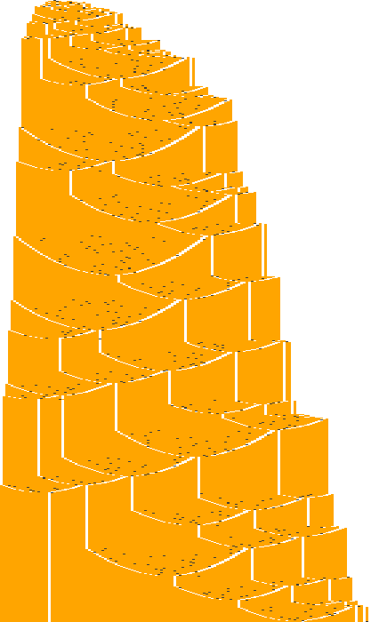

<a id="50"></a>
## [50](#t50). `1RB1RB_1LC0RE_---1LD_0RA1LB_1RA1LF_0LE1LE` (class C)
- **BusyBeaverWiki article:** [1RB1RB_1LC0RE_---1LD_0RA1LB_1RA1LF_0LE1LE](https://wiki.bbchallenge.org/wiki/1RB1RB_1LC0RE_---1LD_0RA1LB_1RA1LF_0LE1LE)

- scan: 10 levels, 28 phases, mean factor 1.50 (sd 0.28); level starts: 12 14 38 58 122 148 190 224 376 456
- level analysis: Bell type `RB`, 3 levels; n: 4 6 52; ratios: 1.500 8.667; 2 different tails
- verdict: no clear single-block Bell configuration found
- diagram: 932,951 steps, tape width 1001 cells

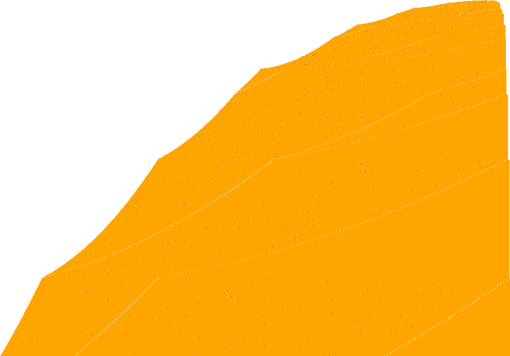

<a id="51"></a>
##  [51](#t51). `1RB0RE_1LC0RA_1LA1LD_1LC1LF_0LC0LB_1LE---` (class C)

- **Same table as nos. [61](#61), [71](#71), [93](#93), other start state (13 Nov 2026).** No. 51 is no. 61 (mirrored) started in state D; no. 71 (mirrored) started in state B; no. 93 (mirrored) started in state C. No common configuration found (2·10⁸ steps, in both directions). Overview: *Related machines among the candidates* at the top.

Wiki: [1RB---_0RC0RE_1RD1RF_1LE0LB_1RC0LD_1RC1RA - BusyBeaverWiki](https://wiki.bbchallenge.org/wiki/1RB---_0RC0RE_1RD1RF_1LE0LB_1RC0LD_1RC1RA)

- scan: 10 levels, 19 phases, mean factor 1.60 (sd 0.29); level starts: 21 25 28 69 89 197 260 539 716 1451
- level analysis: Bell type `LA` with left part `01 11 01`, 8 levels; n: 10 28 76 204 546 1458 3890 27660; ratios: 2.800 2.714 2.684 2.676 2.670 2.668 7.111; 1 different tails
- verdict: needle-like: only 1 tail (all information in one number)
- diagram: 166,941 steps, tape width 1001 cells

- **Same table as no. 61 (4 Nov 2026).** No. 51 is no. 61 (`1RB---_0RC0RE_1RD1RF_1LE0LB_1RC0LD_1RC1RA`) started in state D, written in normal form; the [wiki article of no. 61](https://wiki.bbchallenge.org/wiki/1RB---_0RC0RE_1RD1RF_1LE0LB_1RC0LD_1RC1RA) lists it as "start state D". So it is the same transition table but a different start, a different trajectory, and a separate holdout. Comparison with the wiki:
  - The wiki (Racheline; @-d for start D) models the machine as A(n, r): a main number n, multiplied by about 8/3 per step, with n mod 3 choosing one of three rules, and a left-side string r that stores information between steps. This matches our Bell map. Our regular rules are the steps in which the left side stays a single `1`; our "irregular" cases A(x, 2) are the steps in which r changes. So our macro model is the special case r = empty, and it stops where r becomes non-trivial.
  - @-d found a halting path of 108 rule applications by breadth-first search over r, and gave a Lean proof that the family n = 3^108·k + c with empty r halts for every k ≥ 0. Racheline estimates the halting probability per reset at about 3^−80, i.e. a halting time around 10^10^38. Status: "probviously halting" cryptid.
- **Model with the memory word r (4 Nov 2026).** The macro state is C(m, r) = `[0] 10 1^m r` in state A (head on the blank left of the tape). r is a short word at the right end of the tape: empty, or a sequence of blocks `0 1^k`, written below as the list of k (e.g. `01011011` = [1, 2, 2]). This r is the wiki's "left-side string" (the wiki uses the mirrored orientation). The Bell configurations above are exactly the C(m, empty) with m = 2n + 4. The blank tape reaches C(10, empty) at step 39, then C(28), C(76), … These m are the n values of the level analysis.
  - **Rules.** For every word r there are exactly three rules, one for each m mod 3. Each one has the form m' = (8m + b)/3, with b and the new word r' fixed by (r, m mod 3); it was sampled with `scan/m44/cstep.c` / `rmodel51.py`, four values per class and no exception. Examples:

    | r | m ≡ 0 | m ≡ 1 | m ≡ 2 |
    |---|---|---|---|
    | [] | [], b = +6 | [], b = +4 | [6], b = −22 |
    | [1] | [], +9 | [], +10 | [8], −22 |
    | [k], k ≥ 3 | [], 3k+6 | … | [1, 1, k−3], −10 |
    | [1, x, …] | [x, …] (the top block 1 is removed) | … | … |
    | **[2, 2, …], [1, 2, 2, …]** | … | … | **HALT** |

    Inside one macro step the head runs a zigzag loop over the ones: with A(x, y) = `[0] 1 (10)^x 1^y` in state A, each round is A(x, y) → A(x+4, y−3). The loop ends when fewer than 4 ones are left, and the remainder y mod 3 (that is, m mod 3) decides how it ends. This is where the division by 3 and the dependence on m mod 3 come from (loop checked with `scan/m44/nxt.c` / `checkrules.sh` for x < 200, y < 13).

    So r works like a stack of numbers. With m ≡ 2 a block k ≥ 3 is split into 1, 1, k−3; with m ≡ 0 a top block 1 is removed; with m ≡ 1 r is often cleared. Our earlier regular rules are the cases with r empty, and our "irregular" A(x, 2) cases are the steps where r becomes non-empty.
  - **HALT condition:** m ≡ 2 (mod 3) while r starts with the blocks 2, 2 (or 1, 2, 2), i.e. `011011…` or `01011011…`.
  - **The way to HALT.** A breadth-first search over r from r = empty (`scan/m44/graph51.py`, 300,000 words) finds that every explored word has a path to HALT. The shortest path from r = empty has **108 macro steps**, the same length that @-d found. It starts with residues 2, 2, 0, 0, 2, 0, … and words [] → [6] → [1, 1, 3] → [1, 3] → [3] → …. It ends with … → [1, 1, 5, 2] → [1, 5, 2] → [5, 2] → [1, 1, 2, 2] → [1, 2, 2], m ≡ 2 → HALT. The full list is in `scan/m44/halt51_path.txt`. Since every rule has slope 8/3, the residue sequence of the path fixes m modulo 3^108. The machine therefore halts from C(m, empty) exactly when m ≡ 1975700577069254261393123959451562008800234946348087 (mod 3^108) (computed by `halt51.py`; residues checked along the whole path). This matches @-d's Lean result "n = 3^108·k + constant halts", with our m in place of his n. The smallest such m has 52 digits, and m has 97 digits before the halting step.
  - **Real trajectory.** `orbit51.py` follows the real run for 400 macro steps (m up to 161 digits) with the exact rules. r is reset to empty again and again, so the run keeps returning to the start of the halting path. Its closest approach is at macro step 266, with r = [1], 102 macro steps from HALT. Each reset is a new "lottery ticket": the next 108 residues of m would have to match. With many possible halting paths, the wiki estimates the chance per reset at about 3^−80 and the halting time at about 10^10^38. So the machine is a probviously halting cryptid, but neither halting nor non-halting from the blank tape is proved.

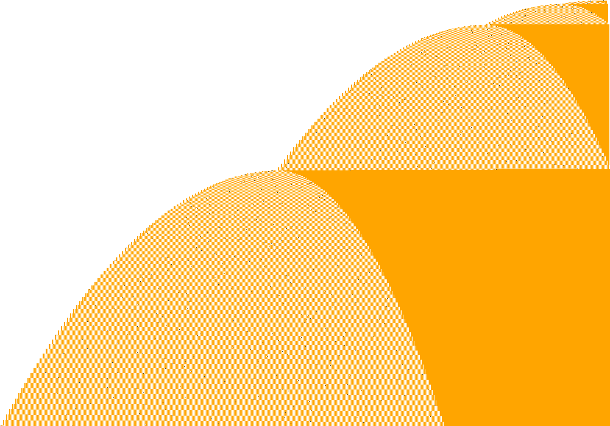

<a id="52"></a>
##  [52](#t52). `1RB0LC_1RC1RF_1LD0RA_1LE0LD_1RC0LA_0LA---` (class C)

- **Same table as no. [45](#45), other start state (13 Nov 2026).** No. 52 is no. 45 started in state D. No common configuration found (2·10⁸ steps, in both directions). Overview: *Related machines among the candidates* at the top.

- scan: 11 levels, 28 phases, mean factor 1.61 (sd 0.30); level starts: 8 26 32 42 83 160 244 322 539 860 941
- verdict: no clear single-block Bell configuration found
- diagram: 495,177 steps, tape width 1001 cells
- **Structure (8 Nov 2026).** Tools: `scan/m52/`. At left records in state E the tape is a stack of 3-cell blocks, e.g. `010^x 011 001^y 000 100^z …`. In a sweep x grows by 2 and y falls by 1. When a level chain starts from `010 100^z`, it uses up z in steps of 2, 6, 21, 81, 321, 1281, 5121, … (about 5·4^k) for counters 2, 10, 40, 160, 640, 2560, …; when z runs out, the rest is passed on and the stack is rebuilt. This is the "stack of counters drained by a level chain" of the Holdout Guide (#58).
- **Halting values.** `z52.c` builds `010 (100)^z 1` (nothing behind) for z = 1 … 1712 and simulates up to 400·z² steps: HALT exactly for **z = 17, 44, 285, 712**, one value in each level range [8, 29), [29, 110), [110, 431), [431, 1712) (602 cases were not decided within the step limit; `z52_1_1712.txt`). With other blocks behind (`zb52.py`) these z did not halt within 3·10⁷ steps, so a HALT needs an exact z with an (almost) empty stack.
- **Run.** `ev52.c` simulates directly to 1.1·10¹¹ steps (`ev52.txt`): 15 level-chain starts, z = 24, 70, 38, 4, 350, 966, 744, 520, 1190, 4658, 11,790, 15,522, 11,792, 35,958, 181,130; six of them with an empty stack. None is a halting value.
- **Assessment (estimate).** One halting value per level of width about 0.75·z gives a chance of about 1.3/z per empty-stack event, and these events come about once per growth of z by a factor 2.5 to 5. As for no. 16 the sum converges: summed from the start about 8 %, after 10¹¹ steps (z ≈ 2·10⁵) about 10⁻⁵, and after the 2.9·10⁷⁹ steps of the guide (z ≈ 10³⁹) about 10⁻³⁹. **HALT unlikely**; exact macro rules for the stack would be needed to make this a measurement.


<a id="53"></a>
##  [53](#t53). `1RB1RE_1LC1RE_---1LD_1LE0LB_0RF0LD_1RD1RA` (class C)

- scan: 9 levels, 146 phases, mean factor 1.66 (sd 0.30); level starts: 8 12 15 17 46 57 136 247 471
- verdict: no clear single-block Bell configuration found
- diagram: 488,651 steps, tape width 1001 cells
- **Structure (9 Nov 2026).** Tools: `scan/m53/`, `scan/mgen/`. No. 53 has the same C–F rows as no. 85. The tape grows to the right (the scripts use the mirrored machine). At the level starts (state A at the end of the tape) the tape is `(1011)^a` followed by a few short pieces and up to three further long segments `(0111)^b`, `(1110)^c`, `(1011)^d`. Their lengths are roughly proportional, a ratio of about 20 between neighbouring segments. Several counters, no single-number level map.
- **Run.** Accelerated simulator (40-cell blocks): up to 10³⁰⁰ steps, no HALT (`ph53A.txt`; direct level starts up to 1.9·10¹⁰ steps in `ev53A.txt`).
- **Halting tests.** No. 53 does halt from simple configurations of its own form: `(1011)^a 1` (state A) halts for a = 2, 6, 7, 8, 10, 13, 14, 16, 17, 19, 21, 23, 25, 26, 27, 30, 34, 40, 41, 47, 50, 55, 60, 62, 70, 74, 80, 89, 100 (29 of the a ≤ 100), always within about 3·10⁷ steps. For 100 ≤ a < 400 it was 4 of 40 (within about 10⁹ steps). For 1,000 ≤ a < 4,000 it was 0 of 40, with runs up to 10³⁰ steps or the time limit (`hit53b.py`, `h53_*.txt`). The real run passes `(1011)^11 1`, `(1011)^31 1`, `(1011)^157 1`, `(1011)^296 1`, `(1011)^4799 1`, all non-halting values. A direct test with changed repeat counts (`famgen.py`, 150 runs × 3·10⁸ steps) gave 14 HALTs, all from the small templates.
- **Assessment (estimate).** A true lottery, but the chance falls quickly with size: about 30 % per start for a ≤ 100, about 10 % for a in the hundreds, below a few percent for a in the thousands. A HALT, if it comes, comes early in a start. After 10³⁰⁰ steps the segments have about 10¹⁰⁰ cells, so the remaining chance is very small, probably convergent. **HALT unlikely, but not excluded; no proof route known.**
- **Events and the halting mechanism (10 Nov 2026, `scan/m53/ev53.py`, `nextev.c`).** Mirrored machine. At the E-events (state E, head at the end of the tape) the tape is a short list of long segments `(1011)^a`, `(1110)^b`, … with short separators (`(10)^3 1 1 0`, `(10)^4 1 (10)^3 1 (10)^3`, …).
  - The main segment grows by 3/2 per event, and new segments are born with a size proportional to it (about a/2 … a/30).
  - From the simple start `11011 0 (1011)^a 1`, every HALT seen came right after an event whose last segment was **small** (count about 3 to 5). Examples: a = 39 ends with `(1011)^5 1`, a = 29 with `(1110)^3 1^3`.
- **Halting chance by size (`hit53d.py`).** Starts `11011 0 (1011)^a 1` with random a, run until the size has grown by a factor of about 10⁶ (about 34 events):

  | start size a | HALT |
  |---|---|
  | 10 … 99 | 21 of 60 (35 %) |
  | 100 … 999 | 4 of 60 (7 %) |
  | 1,000 … 9,999 | 0 of 60 |
  | 10,000 … 99,999 | 0 of 40 |

  Almost all HALTs come within the first few events (a = 720 is the latest: after about 10¹⁶ steps). Together with the 120 perturbed late starts without HALT, the chance falls at least like a^−0.7.
- **Assessment (10 Nov 2026, estimate).** No. 53 halts only while a segment is still small. The real run passed through the small sizes without halting, and at 10³⁰⁰ steps its segments have about 10¹⁰⁰ units. With a^−0.7, the remaining chance is of the order 10⁻⁷⁰: practically 0, a convergent lottery like no. 16. A proof would have to show that the family "all segments ≥ N₀ with these separators" is closed and never halts: plausible, but not done.


<a id="54"></a>
## [54](#t54). `1RB1RF_1LC---_1LE1RD_1RA0RC_0LF0LA_0LD0RB` (class C)

- **Same table as no. [46](#46), other start state (13 Nov 2026).** No. 54 is no. 46 (mirrored) started in state F. No common configuration found (2·10⁸ steps, in both directions). Overview: *Related machines among the candidates* at the top.

- scan: 10 levels, 49 phases, mean factor 1.53 (sd 0.30); level starts: 12 20 46 52 58 124 135 262 288 564
- level analysis: Bell type `LA` with left part `02`, 9 levels; n: 31 47 111 127 255 1135 3551 6111 12303; ratios: 1.516 2.362 1.144 2.008 4.451 3.129 1.721 2.013; 1 different tails
- verdict: needle-like: only 1 tail (all information in one number)
- diagram: 754,212 steps, tape width 1001 cells


<a id="55"></a>
## [55](#t55). `1RB1LF_0RC1RD_1LA1LD_1LE0RA_---1LC_0LA1LA` (class C)
- **BusyBeaverWiki article:** [1RB1LF_0RC1RD_1LA1LD_1LE0RA_---1LC_0LA1LA](https://wiki.bbchallenge.org/wiki/1RB1LF_0RC1RD_1LA1LD_1LE0RA_---1LC_0LA1LA)

- scan: 10 levels, 26 phases, mean factor 1.48 (sd 0.32); level starts: 12 14 16 52 70 134 176 226 366 420
- level analysis: Bell type `LA` with left part `01 12 01`, 2 levels; n: 4 9; ratios: 2.250; 1 different tails
- verdict: no clear single-block Bell configuration found
- diagram: 905,251 steps, tape width 1001 cells

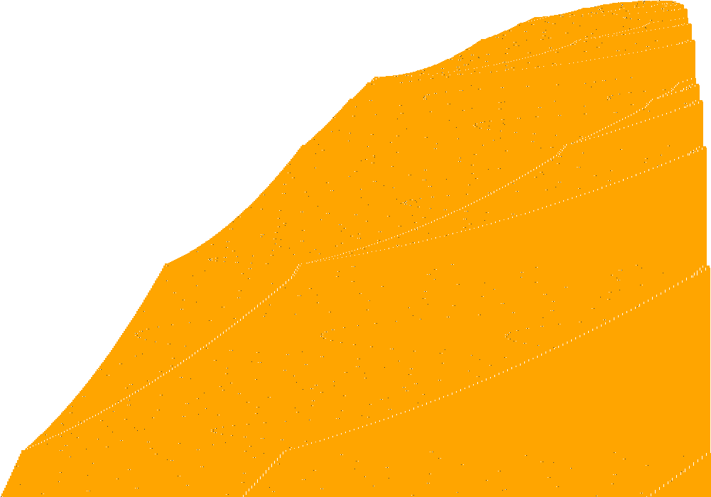

<a id="56"></a>
## [56](#t56). `1RB1LE_1LB1LC_1RD0LE_---0RB_1RF1LA_0RA0RD` (class C)
- **BusyBeaverWiki article:** [1RB1LE_1LB1LC_1RD0LE_---0RB_1RF1LA_0RA0RD](https://wiki.bbchallenge.org/wiki/1RB1LE_1LB1LC_1RD0LE_---0RB_1RF1LA_0RA0RD)

- scan: 14 levels, 28 phases, mean factor 1.43 (sd 0.32); level starts: 10 24 27 31 35 51 57 61 73 102 204 224 349 1056
- level analysis: Bell type `RB`, 11 levels; n: 5 8 14 39 110 232 357 1064 1614 4539 13610; ratios: 1.600 1.750 2.786 2.821 2.109 1.539 2.980 1.517 2.812 2.998; 1 different tails
- verdict: needle-like: only 1 tail (all information in one number)
- diagram: 391,938 steps, tape width 1001 cells


## Candidates 57–108: Bell-like holdouts from the BB6 sheet (for later analysis)

Nos. 57–108 are all machines classified "Bell-like" in the community BB6 sheet that are still in the holdout list (`holdouts_623.txt`) and were not among nos. 1–56. They are taken over from the sheet without own analysis; they are not in `bell_candidates.txt`. The space-time diagrams start from the blank tape (time downwards) and stop after 10 Bell levels, 2e7 steps or a tape width of 1000 cells.

<a id="57"></a>
## [57](#t57). `1RB1RC_1LC1LE_1RA1RD_0RF0RE_1LA0LB_---1RA` (for later analysis)

- BB6 sheet: row 1057, **CRYPTID**, Bell-like, notes: A variant of Hydra and Antihydra
- diagram: 248,932 steps, tape width 1001 cells

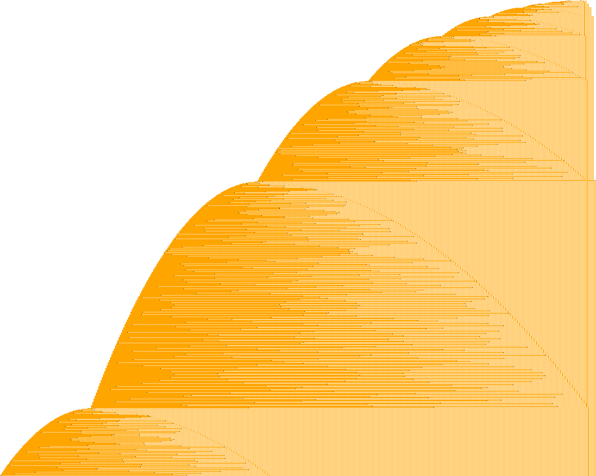

<a id="58"></a>
## [58](#t58). `1RB0LD_1RC1RF_1LA0RA_0LA0LE_1LD1LA_0RB---` (for later analysis)

- **Same table as no. [68](#68), other start state (13 Nov 2026).** No. 58 is no. 68 (mirrored) started in state B. No common configuration found (2·10⁸ steps, in both directions). Overview: *Related machines among the candidates* at the top.

- BB6 sheet: row 1058, **CRYPTID**, Bell-like, notes: Antihydra-like cryptid, probviously nonhalting
- diagram: 450,585 steps, tape width 1001 cells


<a id="59"></a>
## [59](#t59). `1RB1RA_0LC1LE_1LD1LC_1LA0LB_1LF1RE_---0RA` (for later analysis)

- BB6 sheet: row 1059, **CRYPTID**, Bell-like, notes: Antihydra. Part of Category 1
- diagram: 564,453 steps, tape width 1001 cells


<a id="60"></a>
## [60](#t60). `1RB1RA_0RC1RC_1LD0LF_0LE1LE_1RA0LB_---0LC` (for later analysis)

- BB6 sheet: row 1061, **CRYPTID**, Bell-like, notes: One of (canonical) collection of 16 probviously halting tetrational cryptids
- diagram: 703,225 steps, tape width 1001 cells


<a id="61"></a>
##  [61](#t61). `1RB---_0RC0RE_1RD1RF_1LE0LB_1RC0LD_1RC1RA` (for later analysis)

- **Same table as nos. [51](#51), [71](#71), [93](#93), other start state (13 Nov 2026).** No. 61 is no. 51 (mirrored) started in state F; no. 71 started in state F; no. 93 started in state F. No common configuration found (2·10⁸ steps, in both directions). Overview: *Related machines among the candidates* at the top.

Wiki: [1RB---_0RC0RE_1RD1RF_1LE0LB_1RC0LD_1RC1RA - BusyBeaverWiki](https://wiki.bbchallenge.org/wiki/1RB---_0RC0RE_1RD1RF_1LE0LB_1RC0LD_1RC1RA)

- **Same table as [no. 51](#51):** no. 51 is this machine started in state D (normal form `1RB0RE_1LC0RA_1LA1LD_1LC1LF_0LC0LB_1LE---`), a different trajectory and a separate holdout. Our macro rules and the comparison with the wiki analysis are in the section of no. 51.

- BB6 sheet: row 1062, **CRYPTID**, Bell-like, notes: Probviously halting cryptid
- diagram: 158,016 steps, tape width 1001 cells

- **Macro analysis (13 Nov 2026, `m44/first51.py`, `m44/orbit_start.py`).** This is the table of no. 51 started in state F. From the blank tape it reaches the macro configuration C(12, [6]) after 111 steps of no. 51 (the model C(m, r) with the memory word r, see [no. 51](#51)). From there the exact macro rules of no. 51 apply unchanged. The run was followed for 400 macro steps (m up to 161 digits, about 10^320 TM steps): no HALT. r is reset to empty again and again, and every reset is a new "lottery ticket" with the same 108-step halting path as for no. 51. Closest approach: 103 macro steps from HALT (macro step 192, r = [1, 1]). So the estimate of no. 51 applies: about 3^−80 per reset (wiki), halting time around 10^10^38; probviously halting, out of reach for simulation.


<a id="62"></a>
##  [62](#t62). `1RB0LD_1RC1RA_1LD0RB_1LE1LA_1RF0RC_---1RE` (analysed 8 Nov 2026)

- BB6 sheet: row 1064, **CRYPTID**, Bell-like, notes: Probviously halting cryptid
- BusyBeaverWiki: [1RB0LD_1RC1RA_1LD0RB_1LE1LA_1RF0RC_---1RE](https://wiki.bbchallenge.org/wiki/1RB0LD_1RC1RA_1LD0RB_1LE1LA_1RF0RC_---1RE) (analysis by mxdys, 30 Jul 2025; rules proved in Rocq and Lean)
- **Exact macro rules (8 Nov 2026).** Tools: `scan/m62/`. At every right record in state C the tape is `1^c 0 (01)^b [11] 0` (state (c, b, t), t = 1 if the tail `11` is present). One cycle lowers c by 1:
  - t = 0, b odd: (c, b, 0) → (c−1, (3b+1)/2, 0); t = 0, b even: → (c−1, 3b/2+1, 1);
  - t = 1, b odd: → (c−1, (3b+3)/2, 0); t = 1, b even: → (c−1, 3b/2+2, 1);
  - at c = 0: **HALT if b is odd**; if b is even a new phase starts with (3b+2+2t, 0, 0).

  Checked: `test62.py` compares the rules with direct simulation on 600 built tapes (c ≤ 4, b < 60, all t), and `cchk.c` follows the real run by direct simulation to 6·10¹⁰ steps (`cchk62_1e11.txt`), through the reset to c = 227,098. This is the same system as on the BusyBeaverWiki in other coordinates.
- **Phases.** The run passes (2, 3, 0) → reset c = 26 → reset c = 227,098 at about 2·10¹⁰ steps. `phase62.py` iterates phase 3 with exact big integers in 7 seconds: it ends after about 10^80,000 steps with an even b of 39,991 digits, so **no HALT**, and phase 4 starts with c ≈ 10^39,991. Each phase multiplies the step count by about 2.25 per cycle, so phase 4 ends after about 10^(10^39,991) steps.
- **Assessment.** HALT can only happen at a phase end, and there the parity of b behaves like a coin toss: chance ½ per phase, so the machine is "probviously halting". But the next chance comes only after about 10^(10^39,991) steps, far beyond any simulator. A decision needs a proof, not a simulation. Marked red (8 Nov 2026).
- diagram: 493,812 steps, tape width 1001 cells


<a id="63"></a>
## [63](#t63). `1RB0LC_1LC0RD_1LF1LA_1LB1RE_1RB1LE_---0LE` (for later analysis)

- BB6 sheet: row 1065, **CRYPTID**, Bell-like, notes: Probviously halting tetrational cryptid
- diagram: 1,197,908 steps, tape width 1001 cells


<a id="64"></a>
## [64](#t64). `1RB0RE_1LC1LD_0RA0LD_1LB0LA_1RF1RA_---1LB` (for later analysis)

- BB6 sheet: row 1066, **CRYPTID**, Bell-like, notes: Probviously halting tetrational cryptid
- diagram: 282,270 steps, tape width 1001 cells

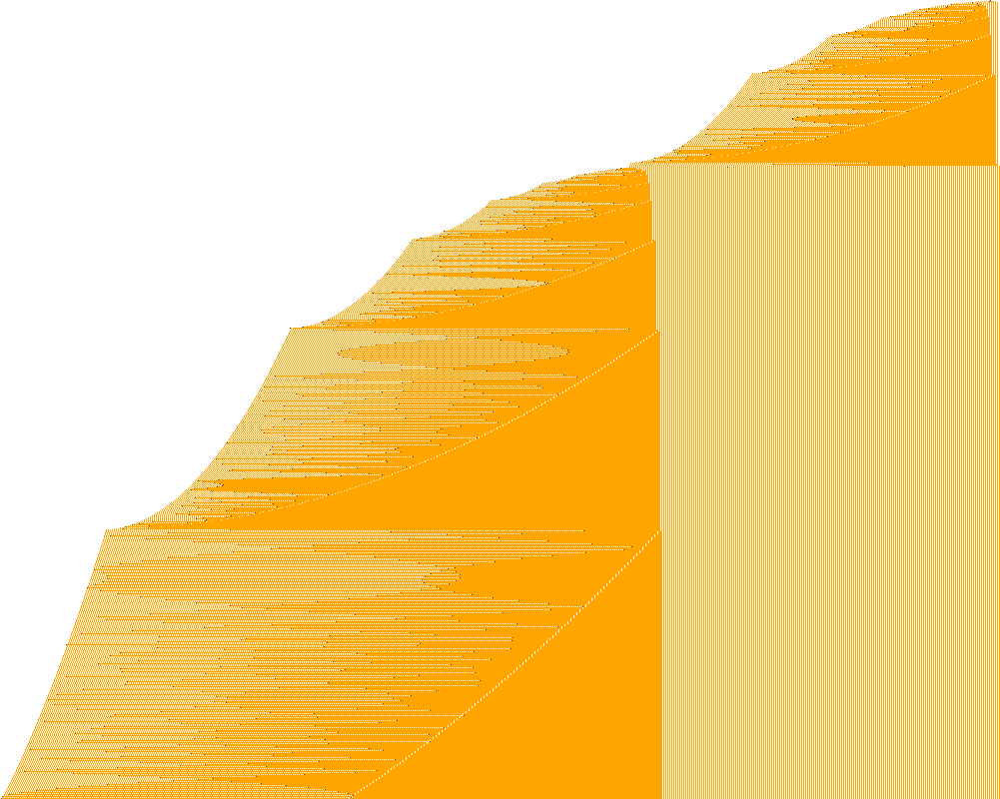

<a id="65"></a>
##  [65](#t65). `1RB1RE_1LC1LD_---1LA_1LB1LE_0RF0RA_1LD1RF` (for later analysis)

- BB6 sheet: row 1067, **CRYPTID**, Bell-like, notes: Probviously halting tetrational cryptid
- BusyBeaverWiki: [1RB1RE_1LC1LD_---1LA_1LB1LE_0RF0RA_1LD1RF](https://wiki.bbchallenge.org/wiki/1RB1RE_1LC1LD_---1LA_1LB1LE_0RF0RA_1LD1RF)
- diagram: 181,696 steps, tape width 1001 cells
- **Exact rules (10 Nov 2026).** Tools: `scan/m65/` (`f65.py`, `map65.py`). In the mirrored machine, at every A-event the tape is `(01)^a 1^b`. Rules, checked by direct simulation for all a < 140, b < 12 (1,656 cases):
  - b ≥ 4: (a, b) → (⌊(3a+8)/2⌋, b − 4)
  - b = 3: (a, 3) → (⌊(3a+6)/2⌋, 0)
  - b = 2: (a, 2) → (2, 3a + 3 − (a mod 2))
  - b = 1: **HALT**
  - b = 0: a even → (2, 3a); a odd → **HALT**
- **Cycles.** Every cycle starts with a = 2 and some B. It runs ⌊B/4⌋ steps of the fixed Hydra-like sequence s₀ = 2, s_{i+1} = ⌊(3s_i + 8)/2⌋ (2, 7, 14, 25, 41, 65, 101, …), and B mod 4 together with the parity of the end value decides HALT or the next B ≈ 3·s_⌊B/4⌋.
  - Since a run of ⌊B/4⌋ steps multiplies by about 1.5^(B/4), the growth is tetrational.
  - Real run: B = 6, 23, 300, then B = 459,271,258,863,234 (≡ 2 mod 4, from s₇₅ = 153,090,419,621,078, even).
  - This agrees with the analysis on the BusyBeaverWiki: B(1) → B(7) → B(24) → B(301) → B(459271258863235), same values with an offset of 1.
- **The next cycles.**
  - *Current cycle* (B ≡ 2 mod 4): it ends without HALT, after t = 114,817,814,715,808 steps of s. The next B is 3·s_t + 3 − (s_t mod 2), which is ≡ 1 or 3 (mod 4), never 0 or 2.
  - *Cycle after that:* with B ≡ 1 the machine halts at its end, with B ≡ 3 it halts if the end value is odd. If the residues of s behave like fair coins, the chance of a HALT at the end of that cycle is **3/4**. This is consistent with the B-rules on the wiki.
  - *To decide it:* one would need s_t mod 4 for t ≈ 1.15·10¹⁴, the same kind of computation as the TM2 run (parity of a ×3/2 sequence), but about 115× as many steps. With pruning, the largest number would be about 4·10¹³ bits (≈ 5 TB), and the time roughly 10⁴ × the TM2 run.
  - Even then, the HALT would come only after the following, tetrationally long cycle (about 10^(10^13) TM steps and more).
- **Cycle table and Markov chain (10 Nov 2026, `scan/m65/markov65.py`).** The end of a cycle depends only on r = B mod 4 and on a = s_t mod 8 (t = ⌊B/4⌋). Table (next B mod 4, or H = HALT), checked with 50 values of the higher bits each:

  | r = B mod 4 | a≡0 | a≡1 | a≡2 | a≡3 | a≡4 | a≡5 | a≡6 | a≡7 |
  |---|---|---|---|---|---|---|---|---|
  | 0 | 0 | H | 2 | H | 0 | H | 2 | H |
  | 1 | H | H | H | H | H | H | H | H |
  | 2 | 3 | 1 | 1 | 3 | 3 | 1 | 1 | 3 |
  | 3 | H | 0 | 2 | H | H | 2 | 0 | H |

  - *Uniform bits:* the low bits of s are equally distributed; s_t mod 8 for 1,000 < t ≤ 200,000 gives each value 12.4–12.6 %.
  - *Markov chain on r:* from r = 0 → 0 (¼), 2 (¼), H (½); r = 1 → H; r = 2 → 1 (½), 3 (½); r = 3 → 0 (¼), 2 (¼), H (½). HALT is the only absorbing state, so the machine halts with probability 1 under this model.
  - *Real run:* r = 2, 3, 0, then 2 for the current cycle B = 459,271,258,863,234.
  - *From the current cycle (r = 2)*, the cycle ends are numbered with the current one as end 1:

    | cycle end | HALT there | cumulative |
    |---|---|---|
    | 1 (current) | 0 | 0 |
    | 2 | 75 % | 75 % |
    | 3 | 6 % | 81 % |
    | 4 | 11 % | 92 % |
    | 5 | 3.5 % | 96 % |
    | 10 | | 99.9 % |

    Expected: 2.6 cycle ends including the current one. Every cycle is tetrationally longer than the one before, so even end 2 lies at about 10^(10^13) TM steps and more.
- **Assessment.** A tetrational cryptid, "probviously halting": each cycle with B ≢ 2 (mod 4) halts with chance ½ to 1. Not decidable by simulation and not provable either way with current methods.


<a id="66"></a>
## [66](#t66). `1RB0LC_0LC0RF_1RD1LC_0RA1LE_---0LD_1LF1LA` (for later analysis)

- BB6 sheet: row 1068, **CRYPTID**, Bell-like, notes: Probviously halting tetrational cryptid, Part of Category 1
- diagram: 945,825 steps, tape width 1001 cells


<a id="67"></a>
## [67](#t67). `1RB1LD_1RC1RE_0LA1LB_0LD1LC_1RF0RA_---0RC` (for later analysis)

- BB6 sheet: row 1069, **CRYPTID**, Bell-like, notes: Probviously nonhalting cryptid, similar to Antihydra
- diagram: 511,588 steps, tape width 1001 cells

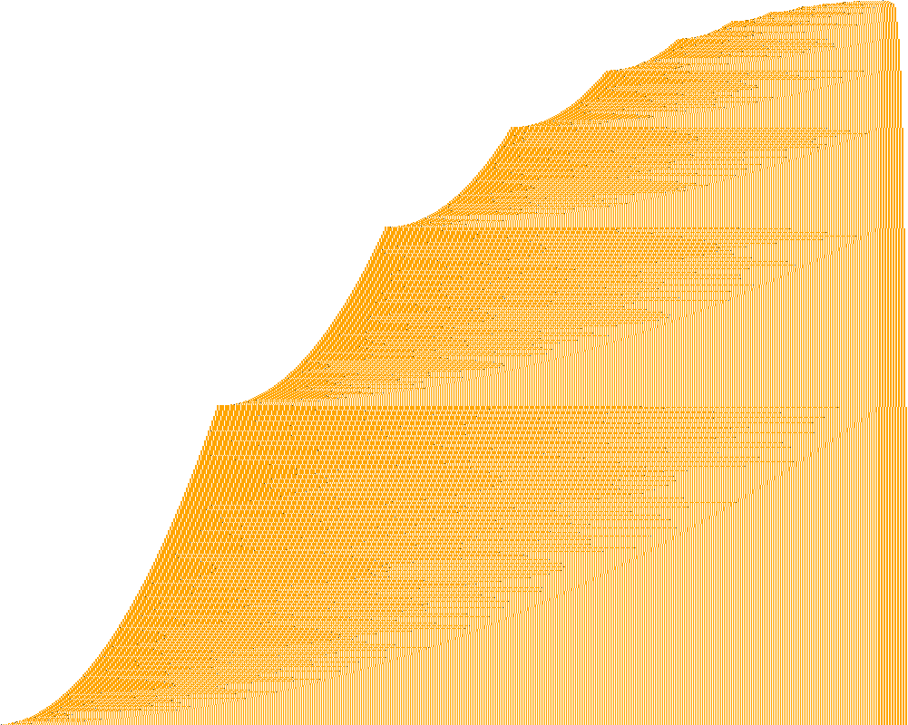

<a id="68"></a>
## [68](#t68). `1RB0LB_1LC0RE_1LA1LD_0LC---_0RB0RF_1RE1RB` (for later analysis)

- **Same table as no. [58](#58), other start state (13 Nov 2026).** No. 68 is no. 58 (mirrored) started in state C. No common configuration found (2·10⁸ steps, in both directions). Overview: *Related machines among the candidates* at the top.

- BB6 sheet: row 1070, **CRYPTID**, Bell-like, notes: Probviously nonhalting cryptid, similar to Antihydra
- diagram: 501,256 steps, tape width 1001 cells

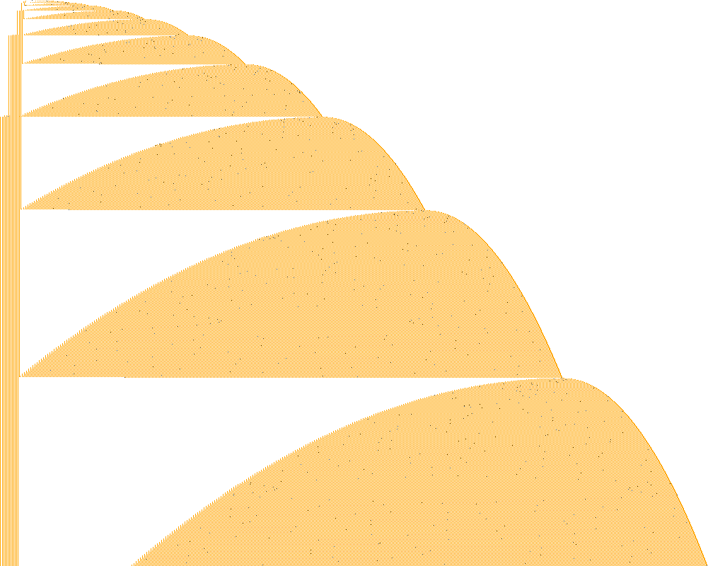

<a id="69"></a>
## [69](#t69). `1RB1LE_0LC0LB_1RD1LC_1RD1RA_1RF0LA_---1RE` (for later analysis)

- BB6 sheet: row 1071, **CRYPTID**, Bell-like, notes: Tetrational cryptid (3/5 of becoming TC, 2/5 of halting), see source 2 for more exact chances and refinements, Part of Category 1
- diagram: 268,228 steps, tape width 1001 cells


<a id="70"></a>
## [70](#t70). `1RB1RF_1LC1RD_1LA1LC_1RA0RE_1RD1LA_---0LE` (for later analysis)

- BB6 sheet: row 1074, Bell-like, notes: Simulated to 10^4600 steps, code with log reduction
- diagram: 361,348 steps, tape width 1001 cells

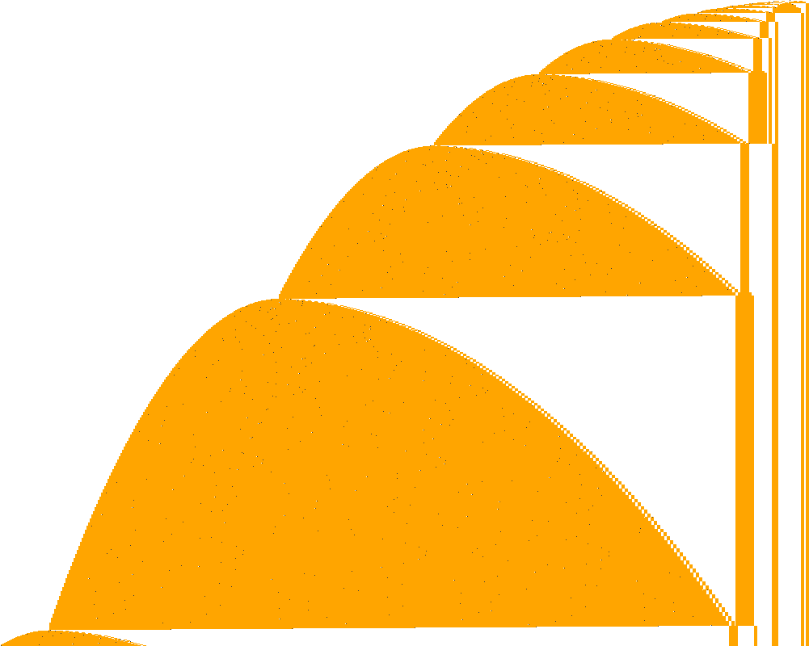

<a id="71"></a>
##  [71](#t71). `1RB1RD_1LC0LE_1RA0LB_1RA1RF_0RA0RC_1RE---` (for later analysis)

- **Same table as nos. [51](#51), [61](#61), [93](#93), other start state (13 Nov 2026).** No. 71 is no. 51 (mirrored) started in state C; no. 61 started in state C; no. 93 started in state B. No common configuration found (2·10⁸ steps, in both directions). Overview: *Related machines among the candidates* at the top.

- BB6 sheet: row 1075, Bell-like, notes: Could be solvable
- diagram: 157,428 steps, tape width 1001 cells

- **Macro analysis (13 Nov 2026, `m44/first51.py`, `m44/orbit_start.py`).** This is the table of no. 51 started in state C. From the blank tape it reaches the macro configuration C(16, empty) after 95 steps of no. 51 (the model C(m, r) with the memory word r, see [no. 51](#51)). From there the exact macro rules of no. 51 apply unchanged. The run was followed for 400 macro steps (m up to 161 digits, about 10^320 TM steps): no HALT. r is reset to empty again and again, and every reset is a new "lottery ticket" with the same 108-step halting path as for no. 51. Closest approach: 101 macro steps from HALT (macro step 181, r = [8]). So the estimate of no. 51 applies: about 3^−80 per reset (wiki), halting time around 10^10^38; probviously halting, out of reach for simulation.

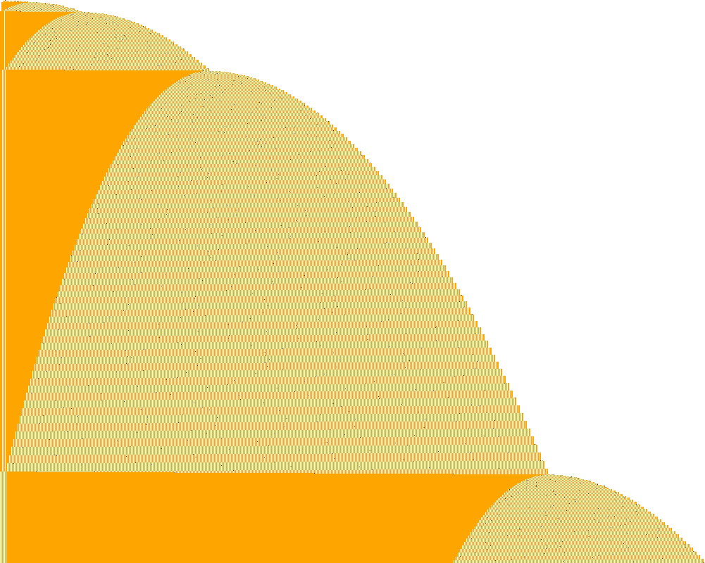

<a id="72"></a>
##  [72](#t72). `1RB1LE_1LC1RC_1LA1RD_1LD0RB_0LC0LF_0LB---` (for later analysis)

- **Same table as nos. [73](#73), [97](#97), other start state (13 Nov 2026).** No. 72 is no. 73 (mirrored) started in state B; no. 97 (mirrored) started in state C. The runs never meet (see no. 73). Overview: *Related machines among the candidates* at the top.

- BB6 sheet: row 1076, Bell-like
- diagram: 491,380 steps, tape width 1001 cells
- **Exact level map (10 Nov 2026).** Tools: `scan/m72/` together with `scan/m105/` (`gmap2.c`, `glev2.py`). The tape grows to the left.
  - The level start is `(110)^n W` in state E, head at the end of the tape, with a short tail W = `1^a (0 1^k)*`. For n = 2q + r the next level starts with n′ = 3q + e (a 3/2 Bell).
  - The first levels agree with direct simulation (n = 14, 28, 51, 81, 126, …). 50,000 levels up to n ≈ 10⁸⁸⁰⁶: no HALT, residues equally distributed. The tail entries are small: ≥ 12 in 9.9 % of the levels, ≥ 24 in 0.7 %, at most 54.
- **Same level map as no. 73.** Every table entry (r, W) → (e, W′) that both machines use is identical: all 3,436 entries of no. 73 occur for no. 72 with the same result. The two machines run the same Bell system from different starts (no. 72: n = 14, W = `111 0 1^6`; no. 73: n = 48).
- **All residue sequences (`clos72.py`).** The exact closure of the tails over every sequence of residues up to depth 400, for all tails up to 3,000 cells, contains no HALT (1,853 tails; 256 branches over the cap, long `(011)` chains). The test of long chains for no. 73 (8,110 runs without HALT) applies here too, since the level map is the same.
- **Assessment (10 Nov 2026).** As for no. 73: no residue sequence leading to a HALT is known, so no. 72 is probably a real non-halter. A non-halting proof for the common Bell system would decide both machines at once. **HALT very unlikely; candidate for a proof, together with no. 73.**

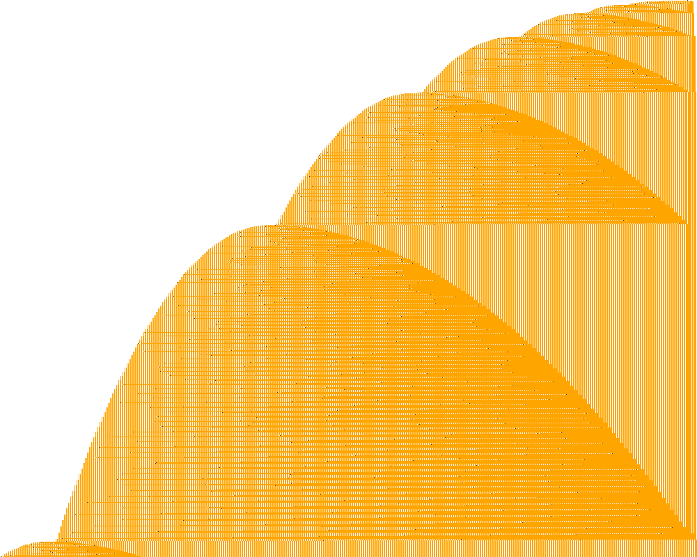

<a id="73"></a>
##  [73](#t73). `1RB1LF_1LC1RD_1RA1LA_0RA0RE_0RC---_1RF0LC` (for later analysis)

- **Same table as nos. [72](#72), [97](#97), other start state (13 Nov 2026).** No. 73 is no. 72 (mirrored) started in state C; no. 97 started in state B. The runs never meet (see no. 73). Overview: *Related machines among the candidates* at the top.

- BB6 sheet: row 1079, Bell-like
- diagram: 492,524 steps, tape width 1001 cells
- **Exact level map (9 Nov 2026).** Tools: `scan/m105/` (`gmap2.c`, `glev2.py`, `run73b.py`) and `scan/m73/tab73.pkl`. The scripts use the mirrored machine; the tape grows to the right.
  - The level start is `(110)^n W` in state D, head at the end of the tape, with n ≥ 2 and a short tail W = `1^a (0 1^k)*`.
  - For n = 2q + r the next level starts with n′ = 3q + e, where e and W′ depend only on (r, W). This is the 3/2 Bell of the Holdout Guide.
  - The levels agree with direct simulation (n = 48, 79, 129, 198, 304, 468, 709, 1,068, 1,609, 2,418, 3,634, 5,462, 8,200, 12,307, 18,465). 50,000 levels up to n ≈ 10⁸⁸⁰⁶: no HALT, 170 table entries, residues equally distributed.
  - The tail entries are small and fall off quickly: entry ≥ 12 in 9 % of the levels, ≥ 24 in 0.5 %, ≥ 39 in 0.002 %. All reachable tail entries are at least 2.
- **Halting tests.**
  - 600 levels from random tails `111 (0 1^k)*` with k < 120: no HALT.
  - 600 levels from random tails whose runs of 1s are all at least 2: no HALT. One level produced a `00`, which disappeared again after 4 levels.
  - `scan2.py`: n < 41 with tails `1^b 0 1^k` (b = 3, 5, 8; k < 200): no HALT, always back in the family.
  - HALT was found only from tails with isolated single 1s (`0101…`) or with `00`, which the real run never produces.
- **Assessment.** As the Holdout Guide says, every known HALT needs a case that the real transitions avoid. No halting configuration with tail runs of at least 2 is known. **HALT very unlikely; candidate for a non-halting proof** (closed family with runs of 1s ≥ 2, still to be made exact).
- **Markov chain over the tails (9 Nov 2026, `scan/m105/markov.py`).** Each residue is taken with probability 1/2. Over 300 levels and all tails up to 3,000 cells: no HALT. But about 1.1·10⁻⁵ of the probability per level goes to long chains `(011)^j`, and in the early real run such chains reached the size of n (`(011)^194` at n ≈ 200). So, as in no. 25, a HALT is not excluded once a chain catches up with n. That was not tested, so this case is open.
- **Long chains and all residue sequences (10 Nov 2026, `scan/m73/chain73.py`, `clos73.py`).**
  - *Long chains:* levels from small n (4 … 59) with tails of the 25 shortest kinds followed by a chain `(011)^j`, with j from 0.3·n up to 60·n, were simulated directly for up to 80 levels. In all 8,110 runs the chain was used up without a HALT.
  - *All residue sequences:* the closure of the tails over **every** sequence of residues (not only probable ones) was computed exactly up to depth 400, for all tails up to 3,000 cells. It contains no HALT. The tails grow only slowly (1,848 tails); 254 branches went over the cap, all of them long chains of the kind tested above.
  - *Shape of the tails:* `3.5.2^j.3`, `8.2^j.3`, `3.K`, `K` and nested variants such as `3.5.2^j.3.5.2^j.3`. The tail behaves like a stack of chains.
- **Same level map as nos. 72 and 97 (10 Nov 2026).** No. 72 (`1RB1LE_1LC1RC_1LA1RD_1LD0RB_0LC0LF_0LB---`) and no. 97 (`1RB1LB_1RC1LD_1LA1RE_1RD0LA_0RB0RF_0RA---`) run the same Bell system from other starts; all table entries agree. See [no. 72](#72) and [no. 97](#97).
- **Towards a closed family (11 Nov 2026, `scan/m73/`: `gram73.py`, `symtab.py`, `reach73.py`, `shapes73.py`, `shapescheck.py`).** Level-start notation; W is the list of runs of ones.
  - *Grammar of the reachable tails:* all 1,848 reachable tails (all residue sequences, depth 400) are of the form X* Y, with
    - blocks X = `3.5.2^j` (P) or `8.2^j` (Q), j ≥ 1;
    - end Y = `[3t]` or `[3, 3t]`.

    With two or more blocks, Y is only `3` or `3.6`, and the later chains are short (≤ 13) while the first one is long (up to 1,491).
  - *Exact rules with parameters* (for large n, both residues; `symtab.py`):
    - `[3t]`: r = 0 → e = 6+t, W′ = `[3]`; r = 1 → e = 6, W′ = `[3, 3t+3]`.
    - `[3, 3t]`: r = 0 → e = 7, W′ = `[3t+3]`; r = 1 → e = 6, W′ = `3.5.2^(t−1).3`.
    - P block with r = 0: becomes a Q block (`3.5` → `8`), and everything behind it stays unchanged.
    - P block with r = 1: the chain grows by 3/2 (2i → 3i, 2i+1 → 3i+4 when only `3` follows), and the next block is processed with residue 1 resp. 0. *(Corrected 12 Nov 2026; the earlier "by 1 for even j, by 3 for odd j" fits only j = 1 and 2.)*
    - Q block: swallowed into n. Its parity flips the residue (even j flips), e grows by about 3j/2, and processing continues with the next block.

    So a level is a left-to-right pass over the blocks with a carried residue.
  - *The simple grammar is not closed for arbitrary parameters:* for example a long second chain gives `3.0.K.2^j` (a `00`), or a P block with chain length 0. Letting the family grow automatically (every form filled in with random parameters, all successor forms added until nothing new appears) gave 345 forms with up to 4 blocks. A fresh check with 4,140 more levels found 16 further forms. The family is infinite (nesting) and needs a regular description with more separators: `3.5`, `8`, `K₂` (a value ≡ 2 mod 3), `3.K₂`, `3.0.K₂`, `9.5`, `3.6.5`, `11`, …
  - *No HALT in these runs (but see 12 Nov 2026 below: some tails of the grammar do halt):* no HALT in any of these runs (about 12,000 levels from arbitrary members of the grown family, plus 150 levels over all residues from tails with long second chains).
- **Assessment (10 Nov 2026).** Unlike no. 25 and no. 105, no residue sequence leading to a HALT was found: none within 400 levels, and no HALT from long chains. No. 73 is probably a real non-halter. A proof would need exact rules for the tail shapes, including the nested chains: possible in principle, but considerably more work than one level table. **HALT very unlikely; candidate for a non-halting proof.** State of the proof (11 Nov 2026): the reachable tails have a simple grammar, but a family that is closed for all parameter values is larger and only partly described (see above); the proof is not finished.
- **Exact event rules, step towards a proof (10 Nov 2026, `scan/m73/xmap.c`, `xm.py`, `rules73.py`).** Mirrored machine. The finest useful event is X(m, S): state C, head left of all nonzero cells, tape `0 0 1^m S`, S = `0 1^a₁ 0 1^a₂ …`, written as the run list [a₁, a₂, …].
  - *Real run:* in the first 2·10¹⁰ steps (61,387 events) every event has this form, and all runs are at least 2.
  - *Main loop:* for m ≡ 2 (mod 3), X(m, [2, k] + R) → X(m + k + 7, R). Tested for all m ≤ 119 with m ≡ 2, k ≤ 19 and four different R (2,888 cases): exact. A chain 2^j = `(011)^j` is eaten two units at a time, +9 each.
  - *Level end:* for m ≡ 0 (mod 3), X(m, [k] + R) → X(4, [2]^(m/3) + [k+3] + R). Tested for all m ≤ 117 with m ≡ 0, k ≤ 19 and three R (2,166 cases): exact. The 1^m becomes the new chain (011)^(m/3) of the next level.
  - *Other cases:* m ≡ 1 or 2 with a first run k ≥ 3. They are periodic in k mod 3 (3-blocks of ones become `011` units). They either end the level, or add 4 to 7 to m and rewrite the next runs: a run 1^k further back can become a chain `2^((k−c)/3)` plus a short rest, so one event may reach deep into the tail.
- **Why the proof is not finished.**
  - *The simple family is not closed:* "all runs ≥ 2, no `00`" is not closed under one event. From random S with all runs ≥ 2, 18 of 3,000 events produce a `00` deep in the tail (`invc.py`). It disappears again after 2 to 20 events (`follow.py`), and the real run never produces it.
  - *What a proof would need:* an invariant set of tails between this family and the exact reachable set. The reachable set over all residue sequences (1,848 tails up to depth 400) has nested chains (`3.5.2^j.3.5.2^j.3`). It looks regular, but describing it exactly and proving it closed (by symbolic execution of the event rules for all chain lengths, e.g. with busycoq's `es`) is a larger project.
  - The standard CTL deciders (CPS, RWL_mod, NG) failed in 43 parameter sets; they were not run further.

- **Nested counters, halting tails, and what is left to prove (12 Nov 2026, `scan/m73/`: `tail_family.py`, `halting_tails.py`, `reachable_exact.py`, `level.c`, `dstep.c`; outputs in the `.txt` files of the same names).** Mirrored machine, level-start notation, W is the list of runs of ones, P_j = `3.5.2^j`. All of this is computed, not proved.
  - *The tail is a stack of 3/2 counters.* A block `3.5.2^j` is a frozen copy of the whole machine: `3` is a wall, `5` the run that the head extends, and the chain `2^j` plays the role of n. More generally `3.K.2^j` with K ≡ 2 (mod 3) behaves like `3.5.2^(j + (K−5)/3)`.
    - With residue 1 the chain 2i becomes 3i + (e_R − 6) and the rest R gets residue 1; the chain 2i+1 becomes 3i + (e_R − 3) and R gets residue 0. Here e_R is the value e of the level map for R alone.
    - The counter to the left of the block (n, or the chain of the block before) loses one `110` per oscillation of the inner counter, about half of the inner chain. For the main counter this is e = 6 − ⌈j/2⌉.
    - Checked for j = 0 … 59 and for two blocks; an exact model built from these rules agrees with direct simulation in 14,970 level computations.
  - *Why the grammar X\*Y is not closed.* A block needs about half of its chain from its left neighbour. If the neighbour is too short, the special forms appear. With a first chain of 4 and a second chain of 12, 14, 16, 18, 20 the result is a chain of length 0, `3.6.5…`, `3.0.14…`, both blocks swallowed into n, and `3.101…`. They return to blocks `3.K.2^j` / `K.2^j` after one or two levels.
  - *Shape of the tails.* T = tails whose runs are all ≡ 0 or 2 (mod 3), with a last run ≡ 0 (mod 3); runs of length 0 (`00`) are allowed inside. T contains X\*Y and the special forms. In 84,884 level computations with n large compared with the tail (all 12,442 small tails, 30,000 random ones, both residues) the result was always in T, without HALT. T describes the shape only; it is not free of HALT (next point).
  - *Tails of the grammar that halt.*
    - `(110)^n` followed by `3.5.2^2.3.5.2^12.3.5.2^41.3` halts for every odd n tested (5 … 39, 61, 151; `gmap2.c`), and for no even n.
    - Among all tails P_a P_b P_c `3` with a < 7, b < 25, c < 90 (n = 41) exactly 8 of 15,750 halt, and all of them have b = 3a + 6 and c = 9a + 23 or 9a + 24.
    - One level higher, with n as the outer counter: among all `(110)^n` P_a P_b `3` with n < 25, a < 25, b < 100 exactly 4 of 62,500 halt (n = 2, a = 4, b = 17 … 20).
    - One counter running out is harmless in everything tested: all 37,820 configurations `(110)^n` P_a X_b Y with n = 5 … 9, a ≤ 30, b ≤ 60 ran 4 levels without HALT. Every HALT found inside the grammar fits the case where two neighbouring counters run out in the same level.
    - So the earlier statements "no tail leads to a HALT" and "a HALT needs `00` or isolated single 1s" hold for reachable and for random tails, but not for all tails of the grammar.
  - *The reachable tails without a size limit* (`reachable_exact.py`; chains are stored as numbers). All residue sequences up to depth 400:

    | start tail | tails | blocks `3.5` | a counter inside the tail runs out | largest share taken from a lending chain |
    |---|---|---|---|---|
    | no. 73, `3.9` | 92,816 | at most 3 | never | 7.05 % (depth 13), below 1.9 % after depth 50 |
    | no. 72, `3.3` | 92,374 | at most 3 | once, depth 4 | the same |
    | no. 97, `3.6` | 51,692 | at most 3 | never | 1.85 % |

    - The 1,848 tails given above are too few: the cap of 3,000 cells drops the branches with a long first chain (with residue 1 at every level the first chain grows by 3/2 per level).
    - The one exception is real: from `3.3` the residues 1,1,1,1 lead to `3.5.3.5.2.3`, and the next residue 1 gives `3.6.5.2^4.3`, which is not in X\*Y. The real run of no. 72 does not take this path.
    - A HALT needs an inner chain about three times as long as its left neighbour; the reachable tails have inner chains of a few percent. The reason: a second block grows only in levels where the first chain is even. As soon as the first chain is odd, the second block becomes an `8` block and is swallowed. With residue 1 at every level the first chain reaches 300,000 after 28 levels while the second never exceeds 13.
  - *What is left to prove.*
    - The regular part (shape of the tails, blocks as nested counters) should be provable, by induction on the nesting depth.
    - No inequality between neighbouring chain lengths is preserved by the level map on its own: while the first chain a stays even, both blocks grow by 3/2 and a loses half of the second chain b, so a/b drops by about 1/3 per level. After about 3a/b such levels in a row the first chain would be used up.
    - So the proof hangs on one statement: *a chain that grows by a ↦ 3a/2 − (small amount) does not stay even for about a/b levels in a row.* For a ↦ 3a/2 alone this is trivial (at most log₂ a levels). With the small amount, "even for L levels" fixes a modulo 2^L, and for L > log₂ a this leaves exactly one value of a; one has to show that the real a is never this value. This is a weak statement of the Collatz kind, and no method for it is known to us.
- **Assessment (12 Nov 2026).** HALT practically excluded: the reachable tails stay far from the thin halting set. A complete non-halting proof is unlikely with the present methods, because of the one parity statement above. The machine is reduced to that statement, with an exact model of the level map and an explicit family of halting tails. The same holds for nos. 72 and 97.


<a id="74"></a>
## [74](#t74). `1RB0RD_1RC0LF_1LA0LB_---1RE_1LB1RA_0LC0RA` (for later analysis)

- **Same table as no. [77](#77), other start state (13 Nov 2026).** No. 74 is no. 77 started in state C. No common configuration found (2·10⁸ steps, in both directions). Overview: *Related machines among the candidates* at the top.

- BB6 sheet: row 1081, Bell-like
- diagram: 715,875 steps, tape width 1001 cells

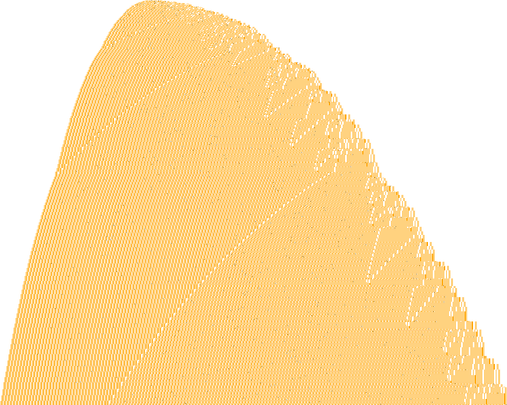

<a id="75"></a>
## [75](#t75). `1RB1RD_1RC1LD_0LA1RA_1LE0RC_---1LF_0LA0LB` (for later analysis)

- **Same table as no. [106](#106), other start state (13 Nov 2026).** No. 75 is no. 106 started in state C. No common configuration found (2·10⁸ steps, in both directions). Overview: *Related machines among the candidates* at the top.

- BB6 sheet: row 1082, Bell-like
- diagram: 557,574 steps, tape width 1001 cells


<a id="76"></a>
## [76](#t76). `1RB1LF_1LC0RD_---1LD_1RB1RE_1LA0LB_0LA0LE` (for later analysis)

- **Same table as no. [99](#99), other start state (13 Nov 2026).** No. 76 is no. 99 (mirrored) started in state B. No common configuration found (2·10⁸ steps, in both directions). Overview: *Related machines among the candidates* at the top.

- BB6 sheet: row 1086, Bell-like
- diagram: 775,501 steps, tape width 1001 cells


<a id="77"></a>
## [77](#t77). `1RB0LF_1LC0LA_1RA0RD_---1RE_1LA1RC_0LB0RC` (for later analysis)

- **Same table as no. [74](#74), other start state (13 Nov 2026).** No. 77 is no. 74 started in state B. No common configuration found (2·10⁸ steps, in both directions). Overview: *Related machines among the candidates* at the top.

- BB6 sheet: row 1087, Bell-like
- diagram: 675,039 steps, tape width 1001 cells


<a id="78"></a>
## [78](#t78). `1RB1LF_1RC1LD_1LB1LE_1LE0LD_0LA0RE_1RD---` (for later analysis)

- **Same table as nos. [79](#79), [92](#92), other start state (13 Nov 2026).** No. 78 is no. 79 started in state E; no. 92 (mirrored) started in state C. No common configuration found (2·10⁸ steps, in both directions). Overview: *Related machines among the candidates* at the top.

- BB6 sheet: row 1088, Bell-like
- diagram: 623,823 steps, tape width 1001 cells


<a id="79"></a>
## [79](#t79). `1RB1LC_1LA1LD_1LD0LC_0LE0RD_1RA1LF_1RC---` (for later analysis)

- **Same table as nos. [78](#78), [92](#92), other start state (13 Nov 2026).** No. 79 is no. 78 started in state B; no. 92 (mirrored) started in state D. No common configuration found (2·10⁸ steps, in both directions). Overview: *Related machines among the candidates* at the top.

- BB6 sheet: row 1089, Bell-like
- diagram: 571,776 steps, tape width 1001 cells


<a id="80"></a>
## [80](#t80). `1RB1RA_1LC0RB_1LE0LD_0LB1LD_0RA0LF_---0RE` (for later analysis)

- **Same table as nos. [91](#91), [108](#108), other start state (13 Nov 2026).** No. 80 is no. 91 (mirrored) started in state D; no. 108 (mirrored) started in state C. No common configuration found (2·10⁸ steps, in both directions). Overview: *Related machines among the candidates* at the top.

- BB6 sheet: row 1090, Bell-like
- diagram: 313,854 steps, tape width 1001 cells


<a id="81"></a>
## [81](#t81). `1RB0LD_0RC1RA_1RD1RE_1LA0LE_0RA0RF_1RC---` (for later analysis)

- **Same table as nos. [44](#44), [89](#89), [96](#96), other start state (13 Nov 2026).** No. 81 is no. 44 (mirrored) started in state B; no. 89 started in state D; no. 96 started in state C. No common configuration found (2·10⁸ steps, in both directions). Overview: *Related machines among the candidates* at the top.

- BB6 sheet: row 1091, Bell-like
- diagram: 162,354 steps, tape width 1001 cells


<a id="82"></a>
## [82](#t82). `1RB0RE_0LC1LE_0RD1LD_1RA1LF_1LC0RA_0LB---` (for later analysis)

- BB6 sheet: row 1092, Bell-like
- diagram: 744,077 steps, tape width 1001 cells


<a id="83"></a>
## [83](#t83). `1RB1RA_1LC0RB_1LD0LB_1RA0LE_---1LF_1LB0LA` (for later analysis)

- BB6 sheet: row 1093, Bell-like
- diagram: 562,740 steps, tape width 1001 cells


<a id="84"></a>
## 🟩 [84](#t84). `1RB0LC_1LC0RE_1RF1LD_1LA0LB_1RD1RA_1LB---` (for later analysis)

- BB6 sheet: row 1094, Bell-like
- diagram: 1,555,978 steps, tape width 1001 cells


<a id="85"></a>
##  [85](#t85). `1RB0RF_0LC1RE_---1LD_1LE0LB_0RF0LD_1RD1RA` (for later analysis)

- BB6 sheet: row 1095, Bell-like
- diagram: 467,874 steps, tape width 1001 cells
- **Structure (9 Nov 2026).** Tools: `scan/m85/`, generic tools `scan/mgen/`. The tape grows to the right.
  - At the right end, the inner levels work on several long segments of `01`, `1101`, `0111` and `1110`, often of related lengths (a, a, 2a, 4a).
  - At the left end, outer events alternate between E and D. In E the tape starts with `(10)^X`. In the following D it starts with `(01)^Y`, where Y ≈ 3X/2 or the run is split into two halves of about X/2.
  - Between two outer events lie about 80 right-end events, and the steps grow by a factor of 10⁶ to 10⁸.

  This is the "3/2 Bell with several long segments" of the Holdout Guide.
- **HALT condition.** HALT needs C on a 0, and C comes only from B on a 0 (`0LC`). So a leftward B has to meet `00`.
- **Run.** Accelerated simulator (40-cell blocks): 92 outer events up to 10³⁰⁰ steps, no HALT (`ph85raw.txt`). The right-end events up to 10³⁰ are in `ph85m.txt` (706 events).
- **Halting tests.**
  - `scan/mgen/hitgen.py`: started from real outer events (checked: the unchanged restart reproduces the real run), with every long segment changed by a random 0 … 39 units. 156 runs × 6 outer events, about 900 outer events (roughly 70,000 right-end events): no HALT.
  - `scan/mgen/famgen.py`: direct simulation of the small inner events with all repeat counts changed by −3 … +10: 150 runs × 3·10⁸ steps, no HALT (`fam85.txt`).
- **Assessment (estimate).** No halting mechanism was found. The chance per outer event is below about 3·10⁻³ (95 % bound). No restart and no repeating structure (TC) was seen. **HALT unlikely.**


<a id="86"></a>
## [86](#t86). `1RB0RE_1RC0RF_1LD1RA_1LB1LD_1RA1LB_---0LD` (for later analysis)

- BB6 sheet: row 1099, Bell-like
- diagram: 366,736 steps, tape width 1001 cells


<a id="87"></a>
## [87](#t87). `1RB1LC_1RC0RF_1RD0LB_1RE0LD_1LF---_0RA1LA` (for later analysis)

- BB6 sheet: row 1100, Bell-like
- diagram: 439,921 steps, tape width 1001 cells


<a id="88"></a>
##  [88](#t88). `1RB0LE_1RC0RF_0RD0RB_1RE0RC_1LA0LA_1RA---` (for later analysis)

- BB6 sheet: row 1102, Bell-like
- diagram: 124,792 steps, tape width 1001 cells
- **Structure (9 Nov 2026).** Tools: `scan/m88/`, generic tools `scan/mgen/`. The tape grows to the right (the scripts use the mirrored machine). At a phase start, read from the head, the tape has:
  - a short piece;
  - one long zero gap Z;
  - a list of zero gaps separated by `111` markers;
  - a fixed piece at the far end.

  In each phase:
  - the head fills Z with `01` and then rebuilds it;
  - Z doubles (ratio 2.000 ± 0.001, so the steps grow ×4 and log10(steps) by 0.602 per phase);
  - every long gap of the list grows by a factor of about 3/2.

  All gaps are odd. Changing one gap by an odd number removes it, so the parity is part of the structure. Short gaps appear, merge and vanish; up to 11 long gaps were present at the same time. This is the "several counters, 3/2 or doubling" of the Holdout Guide.
- **HALT condition.** HALT needs F on a 1, and F comes only from B on a 1 (`0RF`). So B has to step onto a run of at least two 1s in its direction of motion: a `111` marker or the `11` at the far end.
- **Run.** Accelerated simulator (40-cell blocks, `ph88.py`): 493 phases up to 10³⁰⁰ steps in 5 minutes, 1,655 phases up to 10¹⁰⁰⁰ steps in about half an hour (`ph88_1e1000.txt`), no HALT (`ph88.txt`).
- **Halting tests.**
  - `hit88.py`: started from real phase starts (the unchanged restart reproduces the real phases exactly), with every long gap changed by a random even number 0 … 38. 60 runs × 25 phases and 259 runs × 40 phases, together 11,860 phases: no HALT.
  - `fam88.py`: direct simulation of the first 9 real phase starts with all gaps changed by even random amounts, 120 runs × 3·10⁸ steps: no HALT. Without the parity rule (`fam88b.py`, 40 runs × 3·10⁷ steps): no HALT.
  - `rnd88.py`: completely random tapes of 1-runs and 0-runs: 2 of 600 halt within 10⁷ steps.
- **Assessment (estimate).** No halting mechanism was found. With no HALT in 11,860 phases, the chance per phase is below about 2.5·10⁻⁴ (95 % bound), and probably much smaller. If there were a constant chance per phase, the total would grow without limit, but the tests give no sign of such a chance. No restart and no repeating structure (TC) was seen. **HALT unlikely.**


<a id="89"></a>
## [89](#t89). `1RB---_1RC1RE_1LD0LE_1RF0LC_0RD0RA_0RB1RD` (for later analysis)

- **Same table as nos. [44](#44), [81](#81), [96](#96), other start state (13 Nov 2026).** No. 89 is no. 44 (mirrored) started in state F; no. 81 started in state F; no. 96 started in state F. No common configuration found (2·10⁸ steps, in both directions). Overview: *Related machines among the candidates* at the top.

- BB6 sheet: row 1104, Bell-like
- diagram: 146,380 steps, tape width 1001 cells


<a id="90"></a>
## [90](#t90). `1RB1LB_1LC1LA_1RD0LB_1RA1RE_1RF0RD_---1RD` (for later analysis)

- BB6 sheet: row 1108, Bell-like
- diagram: 318,582 steps, tape width 1001 cells


<a id="91"></a>
## [91](#t91). `1RB0LA_1RC0RE_0LD0RF_1LA1LD_0RA1RE_---0LC` (for later analysis)

- **Same table as nos. [80](#80), [108](#108), other start state (13 Nov 2026).** No. 91 is no. 80 (mirrored) started in state B; no. 108 started in state D. No common configuration found (2·10⁸ steps, in both directions). Overview: *Related machines among the candidates* at the top.

- BB6 sheet: row 1110, Bell-like
- diagram: 389,932 steps, tape width 1001 cells


<a id="92"></a>
## [92](#t92). `1RB0RA_0RC0LB_1LD1RF_1LE1RA_1RD1RB_1LA---` (for later analysis)

- **Same table as nos. [78](#78), [79](#79), other start state (13 Nov 2026).** No. 92 is no. 78 (mirrored) started in state D; no. 79 (mirrored) started in state C. No common configuration found (2·10⁸ steps, in both directions). Overview: *Related machines among the candidates* at the top.

- BB6 sheet: row 1113, Bell-like
- diagram: 615,561 steps, tape width 1001 cells


<a id="93"></a>
##  [93](#t93). `1RB0LC_1RC1RE_1LA0LD_0RB0RA_1RB1RF_1RD---` (for later analysis)

- **Same table as nos. [51](#51), [61](#61), [71](#71), other start state (13 Nov 2026).** No. 93 is no. 51 (mirrored) started in state B; no. 61 started in state E; no. 71 started in state C. No common configuration found (2·10⁸ steps, in both directions). Overview: *Related machines among the candidates* at the top.

- BB6 sheet: row 1114, Bell-like
- diagram: 188,839 steps, tape width 1001 cells

- **Macro analysis (13 Nov 2026, `m44/first51.py`, `m44/orbit_start.py`).** This is the table of no. 51 started in state B. From the blank tape it reaches the macro configuration C(6, empty) after 18 steps of no. 51 (the model C(m, r) with the memory word r, see [no. 51](#51)). From there the exact macro rules of no. 51 apply unchanged. The run was followed for 400 macro steps (m up to 161 digits, about 10^320 TM steps): no HALT. r is reset to empty again and again, and every reset is a new "lottery ticket" with the same 108-step halting path as for no. 51. Closest approach: 103 macro steps from HALT (macro step 250, r = [1, 1]). So the estimate of no. 51 applies: about 3^−80 per reset (wiki), halting time around 10^10^38; probviously halting, out of reach for simulation.


<a id="94"></a>
## [94](#t94). `1RB0RA_1LC0LE_1RA1LD_0LB1LF_1LD0RC_1LB---` (for later analysis)

- **Same table as no. [103](#103), other start state (13 Nov 2026).** No. 94 is no. 103 (mirrored) started in state C. No common configuration found (2·10⁸ steps, in both directions). Overview: *Related machines among the candidates* at the top.

- BB6 sheet: row 1116, Bell-like
- diagram: 437,402 steps, tape width 1001 cells


<a id="95"></a>
## 🟩 [95](#t95). `1RB0LE_1RC---_1RD1RE_1LA0RF_0RC0LA_0LC0RB` (for later analysis)
- **Status:** **decided (never halts), 3 Nov 2026** ([Discord](https://discord.com/channels/960643023006490684/1239205785913790465/1567184717650862173))
- **From the Rocq proof:** `1RB0LE_1RC---_1RD1RE_1LA0RF_0RC0LA_0LC0RB`. No custom checker: only `ES_v3` and `Individual62`. The machine has no chaotic tail. At its left records the tape is a few periodic blocks with counts plus a short fixed end word, so it runs as a register machine on eight tape forms. Every rule is linear in the counts, for example N1(a, b, d) -> N1(a+3, b+12, d-2); the only case splits are small d, parity of the counts, and z = 1..5 at the end of a conversion. An inductive invariant of linear inequalities keeps every rule applicable, and no rule halts. The main theorem is `progress_nonhalt` on that invariant, with 34 one-line rules (`es'`, or a local `esr` for more than three counts). Before Rocq: the register machine equals the plain machine's tapes cell by cell on all 4,534 records from step 50,497 to 5.1e9.

- BB6 sheet: row 1117, Bell-like
- diagram: 599,812 steps, tape width 1001 cells


### No. 95: Bell types (29 Oct 2026)

**Tape at a Bell start** (head at the blank left end, state A; written left to right):

    (1000)^a   [middle counters]   001 0^7   U^k   1 0^5 1 0^3 101          U = 1 0^5 1 0^7  (14 cells)

- **Left block** (1000)^a. It grows by 3 for every two units of U that are used up.
- **Reservoir** U^k. Each pass of the head over the tape uses up one unit.
- **Middle counters.** These are long alternating stretches (10)^x between the left block and the reservoir. Each one is one counter.
  - With one counter: x grows by 12 per two units.
  - With two counters x, y: x grows by 7 and y by 5 per two units (the two swap places within each cycle).
- **End of a Bell.** When U is used up, the rightmost counter, of length c, is rebuilt into the new reservoir with about c/2 units. The other counters stay in the middle.
- **Start of type A.** A Bell without counters first converts the old left block: it becomes (0010)^z, which is used up step by step while new counters arise at the same time. In the end there are one, two or three counters, depending on the phase at which z reaches 0.

So the machine is a list of counters (similar to no. 31):
- the reservoir is used up;
- the counters grow linearly;
- at the end of each Bell the rightmost counter becomes the next reservoir.

**Types.** The type is the number of middle counters at the Bell start: **A** = none, **B** = one, **C** = two. No Bell with three counters occurred.

**Order of the first 102 Bells** (Bell 1 at step 1,613, Bell 102 at about 1.06·10⁷⁹ steps):

    AABABABACB ABACBACBBA ABBAABBAAB CBBCBBBBAB ABBBBCBABB BCBAABBBBB BBABABBAAB BAACBBAABA BBBABBBCBB BAABBAACBA BA

- **Frequencies:** A 35, B 57, C 10.
- **Transitions:** BB 28, BA 24, AB 19, AA 10, CB 10, AC 5, BC 5.
- **Fixed rule:** C is **always** followed by B. A and B can be followed by A, B or C.
- **First 16 Bells:** they alternate almost strictly (A B A B A B A C B A B A C B A C). After that, runs like BB, AA and BBBB… appear.
- **No period** can be seen. The next type is **not** determined by the parity (or the residue mod 4) of a, k or the counters. Apparently it depends on finer phase relations, e.g. where in its cycle the conversion of the left block ends.
- **Growth:** the number of steps grows by a factor of about 6 per Bell.
- **No HALT** within the 102 Bells. HALT needs B1 (`---`); a condition for it has not been derived.

<p align="center"></p>

**Fast simulation** (`m95/`). Usage: `python3 fastbe.py TM MAXEVENTS > out.txt; python3 classify.py out.txt`. The simulation has three levels:
- **Chain steps** (`chain.py`). A run w^c of identical words is crossed in one step if the head leaves one copy on the far side in the same state. A variant with a "backsymbol" also handles zigzag passes, where the head bounces back over cells it has just written.
- **Canonical form** (`fast.py`). Whenever the head stands at a blank end of the tape, the tape is brought into a canonical run-length form.
- **Extrapolation.** If the same run structure recurs with the same count differences over two periods, as many periods as safe are skipped in one go. The step count is extrapolated quadratically.

Checks:
- `val.py`: the chain simulator agrees configuration by configuration with direct simulation.
- The Bell starts agree with direct simulation (`ex4.c`, up to 2.2·10¹⁰ steps, 11 Bells), up to a constant offset of the event point.
- Two runs with different thresholds for the extrapolation give the same step numbers and types for all 102 Bells.
- The result `m95/bells_102.txt` took 100 seconds.

<a id="96"></a>
## [96](#t96). `1RB1RE_1LC0LE_1RD0LB_0RA1RC_0RC0RF_1RA---` (for later analysis)

- **Same table as nos. [44](#44), [81](#81), [89](#89), other start state (13 Nov 2026).** No. 96 is no. 44 (mirrored) started in state D; no. 81 started in state C; no. 89 started in state B. No common configuration found (2·10⁸ steps, in both directions). Overview: *Related machines among the candidates* at the top.

- BB6 sheet: row 1118, Bell-like
- diagram: 149,689 steps, tape width 1001 cells


<a id="97"></a>
##  [97](#t97). `1RB1LB_1RC1LD_1LA1RE_1RD0LA_0RB0RF_0RA---` (for later analysis)

- **Same table as nos. [72](#72), [73](#73), other start state (13 Nov 2026).** No. 97 is no. 72 (mirrored) started in state B; no. 73 started in state C. The runs never meet (see no. 73). Overview: *Related machines among the candidates* at the top.

- BB6 sheet: row 1121, Bell-like
- diagram: 515,725 steps, tape width 1001 cells
- **Exact level map (10 Nov 2026).** Tools: `scan/m97/` together with `scan/m105/` (`gmap2.c`, `glev2.py`). The tape grows to the right (the scripts use the mirrored machine).
  - The level start is `(110)^n W` in state E, head at the end of the tape. For n = 2q + r the next level starts with n′ = 3q + e (a 3/2 Bell).
  - The first levels agree with direct simulation (n = 19, 52, 85, 132, …). 50,000 levels up to n ≈ 10⁸⁸⁰⁶: no HALT, residues equally distributed. The tail entries are small: ≥ 12 in 9.3 % of the levels, ≥ 24 in 0.6 %, at most 45.
- **Same level map as nos. 72 and 73.** All 174 table entries that no. 97 uses are identical to those of no. 73 (and no. 72). The three machines run the same Bell system from different starts.
- **All residue sequences (`clos97.py`).** The exact closure over every sequence of residues up to depth 400, for all tails up to 3,000 cells, contains no HALT (1,850 tails, 256 branches over the cap).
- **Assessment (10 Nov 2026).** As for nos. 72 and 73: no residue sequence leading to a HALT is known, so no. 97 is probably a real non-halter. A proof for the common Bell system would decide all three. **HALT very unlikely; proof candidate together with nos. 72 and 73.**


<a id="98"></a>
## [98](#t98). `1RB1LA_1LC0RE_1LF1LD_1RE0LC_1LB1RA_---0LA` (for later analysis)

- BB6 sheet: row 1123, Bell-like
- diagram: 1,197,278 steps, tape width 1001 cells


<a id="99"></a>
## [99](#t99). `1RB0RC_1LC1RF_1RE0LD_1LC1LA_---1RD_0RB0RA` (for later analysis)

- **Same table as no. [76](#76), other start state (13 Nov 2026).** No. 99 is no. 76 (mirrored) started in state E. No common configuration found (2·10⁸ steps, in both directions). Overview: *Related machines among the candidates* at the top.

- BB6 sheet: row 1124, Bell-like
- diagram: 593,858 steps, tape width 920 cells


<a id="100"></a>
## [100](#t100). `1RB1RD_1LC0RD_1RF1RB_1LE0RA_0LB0LE_---0RC` (for later analysis)

- BB6 sheet: row 1126, Bell-like
- diagram: 417,003 steps, tape width 1001 cells


<a id="101"></a>
## 🟩 [101](#t101). `1RB1RC_1LC0LF_1RF0LD_0RE1LB_1RC---_1LD0RA` (for later analysis)

- BB6 sheet: row 1128, Bell-like
- diagram: 1,355,799 steps, tape width 1001 cells


<a id="102"></a>
## 🟩 [102](#t102). `1RB1RA_0LC0RA_1RC1LD_0LB1LE_1LF0RC_---0LD` (for later analysis)
- **Status:** **decided (never halts), 3 Nov 2026** ([Discord](https://discord.com/channels/960643023006490684/1239205785913790465/1567184717650862173))
- **From the Rocq proof:** `1RB1RA_0LC0RA_1RC1LD_0LB1LE_1LF0RC_---0LD`. No custom checker: only `ES_v3` and `Individual62`. At its left records in state D the tape is one of three forms, each a few periodic blocks with counts plus a short fixed word:
  * A(a, c) = `100 (101)^a 110 (011)^c`
  * B(j, b, c) = `10010111 (010)^j (110)^b 1110 (011)^c`
  * C(j, x, c) = `10010111 (010)^j 0 (011)^x 10 (011)^c`

  Every rule is linear in the counts. The loops are A(a, c) -> A(a-5, c+8), B(j, b, c) -> B(j+3, b-27, c+27) and C(j, x, c) -> C(j-24, x-27, c+54). The only case splits are the exits a = 1..5, b = 0..26 and j = 0..23, one rule each, and none of them halts. The main theorem is `progress_nonhalt` on an inductive invariant of linear inequalities, with 59 one-line `es'` rules. Before Rocq: the register machine equals the plain machine's tapes cell by cell on all 14,430 D records from step 672,894 to 7.55e9, with the invariant true at each. `Eqv_v3.v` (TM502) makes `1RB1RA_0LC0RA_1RC1LD_0LB1LE_1LF0LB_---0LD` equivalent to this one.

- BB6 sheet: row 1129, Bell-like
- diagram: 1,113,602 steps, tape width 1001 cells


<a id="103"></a>
## [103](#t103). `1RB0RE_1LC1RD_1LA0LC_0RA1RF_1RD0LB_1RA---` (for later analysis)

- **Same table as no. [94](#94), other start state (13 Nov 2026).** No. 103 is no. 94 (mirrored) started in state B. No common configuration found (2·10⁸ steps, in both directions). Overview: *Related machines among the candidates* at the top.

- BB6 sheet: row 1130, Bell-like
- diagram: 415,453 steps, tape width 1001 cells


<a id="104"></a>
## [104](#t104). `1RB1RE_1LC1LB_1LE0LD_1LE1LC_0RF1RA_---1RA` (for later analysis)

- BB6 sheet: row 1133, Bell-like
- diagram: 241,570 steps, tape width 1001 cells


<a id="105"></a>
##  [105](#t105). `1RB1LF_1LC0RD_---1LA_0LA0RE_1LA1RA_1LB0LD` (for later analysis)

- BB6 sheet: row 1134, Bell-like
- diagram: 70,802 steps, tape width 319 cells
- **Exact level map (9 Nov 2026).** Tools: `scan/m105/` (see its README). The tape grows to the left.
  - The level start is `0 0 111 0 1^n W` in state A, head at the left end, with a tail W = `(0 1^k)*`. Inside a level the `1^n` is turned into `(1101)` units and back, so n grows by 4/3.
  - For n = 3q + r the next level starts with n′ = 4q + e, where e (+7, +11, …) and W′ depend only on (r, W). The table comes from direct simulation at two values of q, which must agree.
  - The first 11 levels agree with direct simulation. 100,000 levels up to n ≈ 10¹²⁴⁹⁵: no HALT, only 32 table entries, the largest tail entry is 7, and the residues of n are equally distributed.
  - The tail is a small counter. A run of levels with r = 2 builds a chain `2.3.3.3…`, which a level with r = 0 or 1 consumes.
- **Halting tests.**
  - `rhalt.py`: 2,100 levels from random (n, W) with n ≤ 2,000 and up to 6 tail entries of up to 3,000 ones. No HALT, and every level ends again in the form `0 0 111 0 1^n′ (0 1^k)*`.
  - `hmap.py`: n ≤ 45 with tails `0 1^k` and `0 1^k 011`, k ≤ 200: no HALT.
  - Unlike no. 25, no halting window was found anywhere in this family.
  - busycoq's verified CTL deciders (CTL62, 84 parameter sets of CPS_LRU, RWL_mod with modulus 3, 6, 9, 12, NG; `try.sh`): all fail.
- **Halting path found (9 Nov 2026, correction of the assessment above).** The closure of the tails under **all** residues (`clos2.py`) reaches a halting entry. From tail W = `0 1 1 0 1 0 1 0 1 0 1 1` (entries 2.1.1.1.2) a level with r = 0 halts, checked by direct simulation (n = 156: HALT after 15,411 steps).
  - `path105.py`: the shortest residue sequence from the real start tail `011` to it has 35 levels: r = 22222222222222022220222222022020200.
  - `constr105.py`: with the exact level map, n₀ = 9,766,370,237,762,426 follows exactly this sequence, so P(n₀, `011`) halts in level 35.
  - `ver105.py`: checked independently with the accelerated simulator, P(n₀, `011`) halts after 37,935,856,547,639,058,576,139,391,116,028,229,062,882 ≈ 3.8·10⁴⁰ steps.
- **Halting chance (Markov chain over the tails, `markov.py`).** With each residue taken with probability 1/3, the chance of a HALT is **1.1·10⁻¹⁴ per level**, constant from level 50 on. It does not depend on n, because the tail is reset again and again.
- **Assessment.** No. 105 is a Collatz-like lottery with a **constant** chance per level: "probviously halting", expected after about 9·10¹³ levels (50 % by 6·10¹³). A non-halting proof is impossible: it would contradict the construction above for suitable residues. **Potential cryptid (probviously halting), like no. 62.**
- **Discord (Peacemaker II, 22 Feb 2026).** The machine was already called an "energy vampire" similar to TM2, with an expected number of Bell iterations to the HALT "in the tens of trillions", ">100 trillion" in the worst case, and a size factor of about 4/3 per iteration. This agrees with the Markov estimate above (about 9·10¹³ levels).

  

- **Comparison with TM2 (vampire family, orbit O2).** Both machines are of the same type and could be simulated the same way: level table, divide and conquer, and pruning, since the next L residues depend only on the last L digits of n.

  | | TM2 (O2, `1RB0LA_0RC0RB_1LD1LA_1LC1RE_1RF0RD_1LC---`) | no. 105 (`1RB1LF_1LC0RD_---1LA_0LA0RE_1LA1RA_1LB0LD`) |
  |---|---|---|
  | level map | n → 3n/2 (residue mod 2) | n → 4n/3 (residue mod 3) |
  | halting chance per level (Markov) | 8.9·10⁻¹³ | 1.1·10⁻¹⁴ (about 80× smaller) |
  | expected HALT | after ≈ 1.1·10¹² Bells | after ≈ 9·10¹³ levels |
  | step count at the expected HALT | ≈ 10^(3.9·10¹¹) (the HALT found at Bell 7.3·10¹¹: ≈ 10^(2.6·10¹¹)) | ≈ 10^(2.25·10¹³) (at 50 %, 6.3·10¹³ levels: ≈ 10^(1.6·10¹³)) |
  | levels H for ≈ 59 % | 10¹² | ≈ 8·10¹³ |
  | largest number with pruning | ≈ 0.37·H bits ≈ 4·10¹¹ bits ≈ 46 GB | ≈ 0.33·H bits ≈ 2.7·10¹³ bits ≈ 3.3 TB |
  | run time | ≈ 13–14 days (`belldco`, 8 threads) to 10¹² | roughly 5,000× more: about 200 years on such a notebook, a few years on a large cluster |
  | result | HALT at Bell 7.3·10¹¹ | – |

  - *Pruning:* the needed precision falls by 1 bit per level for TM2 (binary digits) and by 1.585 bits for no. 105 (base-3 digits). At the same time n grows by 0.585 resp. 0.415 bits per level. This gives the largest sizes above; for TM2 they match the observed k lengths of about 2.9·10¹¹ bits.
  - *Step count:* one level of no. 105 takes about 0.56·n² steps (measured: 0.5598 at n = 3,000, 0.5577 at n = 6,000), and n grows by log10(4/3) = 0.1249 decimal digits per level. Up to level L the run takes about (16/7)·0.56·n_L² ≈ 1.3·n_L² steps, i.e. about 10^(0.25·L) steps. For TM2 a Bell takes about (3/2)·n² steps and n grows by log10(3/2) = 0.176 digits per Bell.
  - *Run time:* `belldco` needs about 1.1·10⁻⁷ s per bit of k per 2·10¹⁰ Bells, so the total time grows like H². This gives the 13 days for TM2; for no. 105 the figure is an extrapolation, a simulator would still have to be written.
  - So a HALT of no. 105 can in principle be found the same way as for TM2, but the effort is orders of magnitude beyond the TM2 run, which was already at the limit. A Rocq proof of a HALT as in `Bellv2.v` would be correspondingly larger.


<a id="106"></a>
## [106](#t106). `1RB1LD_0LC1RC_1RA1RD_1LE0RB_---1LF_0LC0LA` (for later analysis)

- **Same table as no. [75](#75), other start state (13 Nov 2026).** No. 106 is no. 75 started in state B. No common configuration found (2·10⁸ steps, in both directions). Overview: *Related machines among the candidates* at the top.

- BB6 sheet: row 1135, Bell-like
- diagram: 548,093 steps, tape width 1001 cells


<a id="107"></a>
## [107](#t107). `1RB1LD_0RC1RC_1RD0RE_0LA0LF_0RF---_1RA1LA` (for later analysis)

- BB6 sheet: row 1136, Bell-like
- diagram: 941,116 steps, tape width 1001 cells


<a id="108"></a>
## [108](#t108). `1RB0RE_0LC0RF_1LD1LC_1RA0LD_0RD1RE_---0LB` (for later analysis)

- **Same table as nos. [80](#80), [91](#91), other start state (13 Nov 2026).** No. 108 is no. 80 (mirrored) started in state C; no. 91 started in state B. No common configuration found (2·10⁸ steps, in both directions). Overview: *Related machines among the candidates* at the top.

- BB6 sheet: row 1137, Bell-like
- diagram: 311,138 steps, tape width 1001 cells


## Candidates 109–112: potential cryptids from "Machines at the Edge" (for later analysis)

The BB(6) machines of the wiki page [User:RobinCodes/Machines at the Edge](https://wiki.bbchallenge.org/wiki/User:RobinCodes/Machines_at_the_Edge) (1 Nov 2026), 18 in all, are compared here with our list and with the holdout list of 608 machines.
- **Already candidates:** 11 of them are marked **potential cryptid** in the table: nos. 3 (TM2, which halts, see orbit O2), 40 (Lucy's Moonlight), 51, 60, 61, 62, 63, 64, 65, 66, 69.
  - The page says that no. 51 is "equivalent to" no. 61 "(?)". Here both have the same table up to renaming and mirroring, but no common configuration was found (see "Related machines").
- **Not holdouts:** three machines of Racheline's tetrational list are not in the holdout list of 608, and were not in the earlier list of 623 either (also not up to renaming or mirroring), so they are not taken over:
  - `1RB0RC_0RC0RA_1RD1LA_1LE0LB_0LB1LF_0LD---`
  - `1RB0LF_0RC1RB_1LD0RB_1LE---_1RF1LA_0LC0LE`
  - `1RB1RF_1LC0RA_---0LD_0LE0LB_1RF1RB_1RE1LF`
- **Equivalences of the new machines:** nos. 109–112 share no table with any of the 112 candidates (up to renaming and mirroring), and none differs from another candidate in only one or two transitions (`groups.py` on `candidates_112.txt`).
- **New:** the remaining four are still holdouts and become **nos. 109–112**. In the BB6 sheet they are not classified as Bell-like, so they were not among nos. 57–108.

<a id="109"></a>
## [109](#t109). `1RB1LE_0LC1RE_---1LD_0RD1LA_0RF1RF_1RA0LB` (potential cryptid, for later analysis)

- source: [Machines at the Edge](https://wiki.bbchallenge.org/wiki/User:RobinCodes/Machines_at_the_Edge) (RobinCodes), Racheline's list of possibly tetrational machines
- BB6 sheet: row 605, Shift-overflow structural counter, notes: Possibly tetrational machine
- diagram: 685,839 steps, tape width 1001 cells


<a id="110"></a>
## [110](#t110). `1RB1RD_1LC1RA_---1LD_1LE0RA_1LF0LE_0RB0LB` (potential cryptid, for later analysis)

- source: [Machines at the Edge](https://wiki.bbchallenge.org/wiki/User:RobinCodes/Machines_at_the_Edge) (RobinCodes), Racheline's list of possibly tetrational machines
- BB6 sheet: row 563, Shift-overflow bouncer counter, notes: Possibly tetrational machine
- diagram: 431,586 steps, tape width 1001 cells


<a id="111"></a>
## [111](#t111). `1RB0LE_0RC0RA_1LD0LC_1LA0LB_1RA1LF_---0LC` (potential cryptid, for later analysis)

- source: [Machines at the Edge](https://wiki.bbchallenge.org/wiki/User:RobinCodes/Machines_at_the_Edge) (RobinCodes), Racheline's list of possibly tetrational machines
- BB6 sheet: row 564, Shift-overflow bouncer counter, notes: Possibly tetrational machine
- diagram: 362,577 steps, tape width 1001 cells


<a id="112"></a>
## [112](#t112). `1RB1LD_1RC0LE_1LA1RE_0LF1LA_1RB0RB_---0LB` (potential cryptid, for later analysis)

- source: [Machines at the Edge](https://wiki.bbchallenge.org/wiki/User:RobinCodes/Machines_at_the_Edge) (RobinCodes), probviously halting cryptids
- BB6 sheet: row 560, CRYPTID, Shift-overflow bouncer counter, notes: Probviously halting cryptid
- diagram: 388,426 steps, tape width 1001 cells


